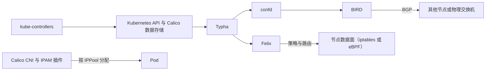
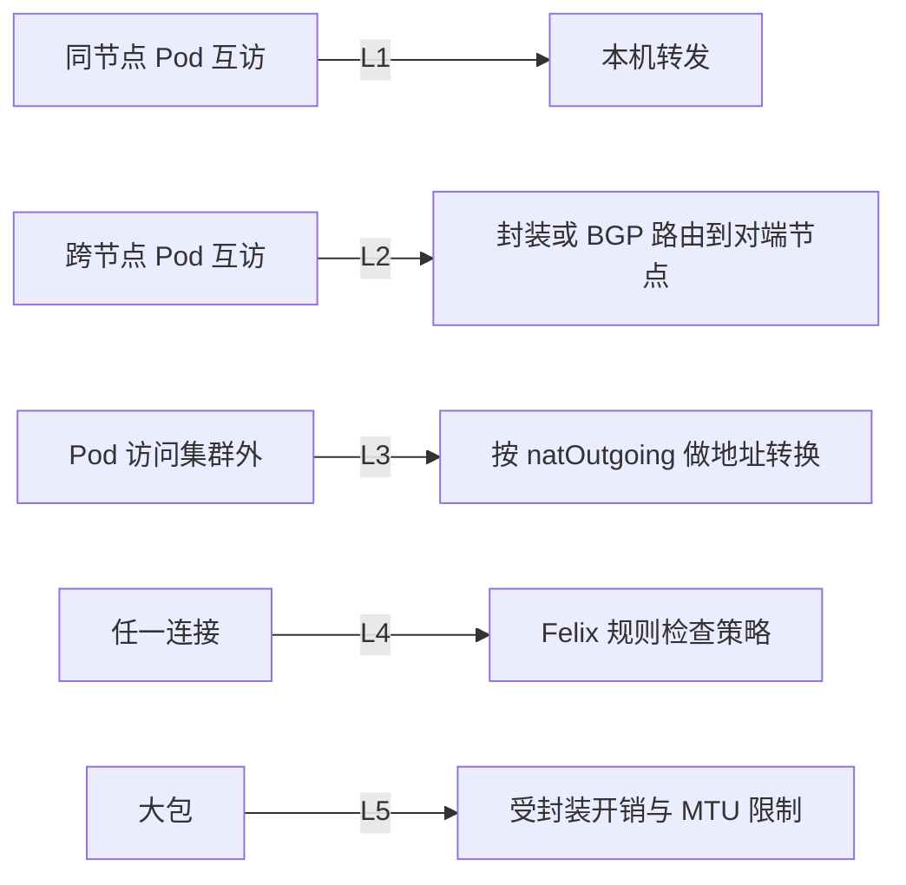

# calico排查参考

## 是什么
- **一句话定位**：一个同时负责 Pod 网络和网络策略的 CNI 实现：每个节点上的 Felix 把策略和路由落到数据面，IPAM 按 IPPool 给 Pod 分地址，跨节点用封装或 BGP 路由连通。
- **解决什么问题**：跨节点不通、Pod 拿不到 IP、BGP 邻居没建立、策略不生效或误拦时，判断问题在地址池、封装与路由、Felix 落实，还是数据存储与 Typha。
- **谁在用、从哪进来**：以 calico-node 的 DaemonSet 形式运行在每个节点；运行时创建 Pod 时调用 Calico CNI 与 IPAM 插件。
- **边界（不负责什么）**：CNI 如何被运行时调用见 CNI排查参考；策略的通用语义见 NetworkPolicy排查参考；Calico 自有的策略资源（全局策略、分层策略、动作顺序）本条没有展开。
- **形态与版本**：数据面可选 Linux 标准（iptables）、eBPF 或 Windows；封装与路由模式因 IPPool 配置而异，所以排查前要先确认当前模式。
- **术语**：
  - Felix —— 节点上的代理，管接口、路由和策略规则
  - BIRD 与 confd —— 前者是 BGP 守护进程，后者根据数据存储生成它的配置
  - Typha —— 数据存储的扇出代理，减轻 API 服务器压力
  - IPPool 与块 —— 地址池与按节点分配的子段，块默认 IPv4 为 /26

## 组件与架构

| 组件 | 角色 | 职责 | 部署位置 / 形态 | 如何找到 |
|---|---|---|---|---|
| calico-node | 节点代理 | 运行 Felix，可带 BIRD 与 confd；只带 Felix 即策略仅模式 | 每个节点的 DaemonSet | 操作符安装时在 calico-system 命名空间〔待复核〕 |
| Felix | 数据面控制 | 管接口、路由与策略规则 | calico-node 内 | calico-node 日志 |
| BIRD 与 confd | 路由分发 | 通过 BGP 在节点间分发路由 | calico-node 内 | calicoctl node status |
| Typha | 扇出代理 | 代替大量 Felix 与 confd 维持数据存储连接 | 独立工作负载，可选 | Typha 的 Pod |
| kube-controllers | 控制器 | 监视 API，执行策略、命名空间、服务账号、端点、节点相关动作 | 一个 Deployment | 对应 Pod 与日志 |
| CNI 与 IPAM 插件 | 接入 | 创建 Pod 网络并按 IPPool 分地址 | 节点配置目录与二进制目录 | 见 CNI排查参考 |

## 正常链路（请求怎么走 / 正常行为）

### 资源匹配关系
| 编号 | 资源 A.字段 | → | 资源 B.字段 | 匹配规则 | 对不上时的表现 |
|---|---|---|---|---|---|
| R1 | IPPool 的 CIDR | → | Pod 的地址来源 | IPPool 是 Calico 期望从中分配端点 IP 的地址集合；其 CIDR 应与集群 Pod 网段一致〔待复核〕；CIDR 重叠的池会带 Disabled 状态，IPAM 不会从中分配 | 池被禁用或网段对不上：Pod 拿不到地址，或地址落在预期之外 |
| R2 | IPPool 的块大小 | → | 按节点分配的地址段 | 块默认 IPv4 为 /26（64 个地址）、IPv6 为 /122；池的子网长度至少要容纳一个块 | 池过小或块太大：节点间地址分配不均，早早耗尽 |
| R3 | 池的封装设置 | → | 跨节点转发方式 | ipipMode 等字段决定何时使用 IPIP；二手资料中还有 VXLAN 及仅跨子网时封装的选项；不封装时靠 BGP 分发路由 | 封装与底层网络不匹配：跨节点不通；MTU 不对：大包丢 |
| R4 | calico-node 的组成 | → | 是否有路由分发 | 带 BIRD 与 confd 时在主机间分发路由；只带 Felix 的策略仅模式不分发路由 | 策略仅模式下却期望跨节点路由：路由不会被 Calico 分发 |
| R5 | Calico 策略 | → | 节点数据面规则 | Felix 把策略翻译成 iptables 规则或 eBPF 程序〔待复核〕 | 规则没落实：策略不生效，或旧规则残留 |
| R6 | Typha | → | Felix 与 confd 的数据来源 | Typha 维持唯一的数据存储连接，缓存并去重事件后分发 | 大规模集群没有 Typha：API 服务器压力大；Typha 异常：Felix 拿不到更新 |
| R7 | CNI 与 IPAM 插件 | → | Pod 的接口与地址 | IPAM 插件依据 IPPool 控制分配；支持用注解为 Pod 强制指定 IP；kube-controllers 监视 API 执行集群状态相关动作 | 指定的 IP 不在池内或已被占用：分配失败 |

### 控制面下发路径
| 环节 | 做什么 | 依据 |
|---|---|---|
| P1 | 部署 calico-node、kube-controllers，可选部署 Typha，并安装 CNI 配置与二进制 | R4 R6 |
| P2 | IPPool、策略等资源存于数据存储（Kubernetes API 或 Calico 数据存储） | R1 R2 |
| P3 | Felix 通过 Typha 或直接订阅数据存储，把策略与路由落到节点数据面〔待复核〕 | R5 R6 |
| P4 | confd 依据数据存储生成 BIRD 配置，BIRD 加载后通过 BGP 分发路由 | R4 |
| P5 | 创建 Pod 时 CNI 调用 IPAM，从 IPPool 的块里分配地址〔待复核〕 | R2 R7 |

### 流量走向（或生命周期）

| 环节 | 起点 → 终点 | 做什么 | 依据 | 同步/异步与默认行为 |
|---|---|---|---|---|
| L1 | Pod → 同节点 Pod | 本机转发 | R7 | 同步 |
| L2 | Pod → 其他节点 Pod | 按池的设置封装（IPIP 或 VXLAN）转发，或经 BGP 学到的路由直达 | R3 R4 | 同步；BGP 需 TCP 179，VXLAN 需 UDP 4789 |
| L3 | Pod → 集群外 | IPPool 启用 natOutgoing 时做地址转换〔待复核〕 | R1 | 同步 |
| L4 | 连接 → 策略检查 | Felix 在数据面落实的规则决定放行或拒绝 | R5 | 同步 |
| L5 | 大包 | 封装占用头部（VXLAN 约 50 字节，IPIP 约 20 字节），MTU 需相应减小 | R3 | 同步 |

### 正常表现（健康基线）
- 每个节点上的 calico-node 就绪，Felix 在运行；使用 BGP 时邻居已建立。
- IPPool 为可用状态，没有被禁用；节点有预期的地址块。
- 跨节点 Pod 互通，策略按预期放行或拒绝。

## 逐环节排查（沿链路对照）
- **P1 部署与就绪**
  - 正常：calico-node 与 kube-controllers 都就绪。
  - 异常：calico-node 不就绪，节点网络不可用。
  - 区分点：整节点网络都有问题时先看该节点的 calico-node（R4）。
  - 证据落点：calico-node 与 kube-controllers 的 Pod 状态与日志。
- **P2 IPPool 与数据存储**
  - 正常：IPPool 可用，不重叠。
  - 异常：IPPool 被标为 Disabled；CIDR 与别的池重叠。
  - 区分点：Pod 拿不到地址时先查池的状态（R1）。
  - 证据落点：IPPool 的状态条件与 CIDR。
- **P3 Felix 落实**
  - 正常：策略与路由被落到数据面。
  - 异常：Felix 没拿到更新；规则迟迟不刷新。
  - 区分点：规则缺失而策略对象正确，查 Felix 日志与 Typha 连接（R5、R6）。
  - 证据落点：Felix 日志；节点上的规则。
- **P4 BGP 路由**
  - 正常：BGP 邻居建立，路由被学到。
  - 异常：邻居未建立；策略仅模式下没有路由分发。
  - 区分点：先确认是否运行了 BIRD（R4），再看 BGP 端口是否被防火墙挡住。
  - 证据落点：BGP 邻居状态；节点路由表。
- **P5 分配地址**
  - 正常：新 Pod 从节点的块里拿到地址。
  - 异常：池耗尽；指定的 IP 不可用。
  - 区分点：地址分配失败的报错见 CNI排查参考；池容量与块大小见 R2。
  - 证据落点：IPPool 的使用情况；Pod 事件。
- **L1 同节点**
  - 正常：同节点互通。
  - 异常：同节点不通。
  - 区分点：同节点不涉及封装与 BGP，多半是 CNI 接入或本机策略。
  - 证据落点：Pod 的网卡与本机规则。
- **L2 跨节点**
  - 正常：跨节点互通。
  - 异常：跨节点不通。
  - 区分点：先确认当前是封装还是 BGP 路由模式（R3），再看对应端口与路由。
  - 证据落点：IPPool 的封装设置；节点路由；防火墙规则。
- **L3 出集群**
  - 正常：能访问集群外。
  - 异常：集群外不通或源地址不符。
  - 区分点：看池是否启用了出网地址转换。
  - 证据落点：IPPool 的 natOutgoing 设置。
- **L4 策略**
  - 正常：策略按预期放行或拒绝。
  - 异常：策略不生效或误拦。
  - 区分点：先确认规则是否已被 Felix 落到数据面（R5）；语义问题按 NetworkPolicy排查参考核对。
  - 证据落点：节点上的规则；策略对象。
- **L5 MTU**
  - 正常：大包正常。
  - 异常：小包通、大包丢。
  - 区分点：对比封装模式与配置的 MTU 是否匹配开销〔待复核〕。
  - 证据落点：封装模式；各节点接口 MTU。

## 异常归因速查
| 现象 / 错误码 | 环节 | 归因类别（回指 R#） | 证据位 | 详细条目 |
|---|---|---|---|---|
| Pod 拿不到 IP | P2 P5 | IPPool 被禁用、耗尽或网段不符（R1、R2） | IPPool 状态与使用情况 | oss/k8s-cni.md |
| IPPool 被标 Disabled | P2 | CIDR 与其他池重叠（R1） | IPPool 的状态条件 | |
| 跨节点 Pod 不通 | L2 | 封装与底层网络不匹配，或 BGP 没建立（R3、R4） | 封装设置；BGP 状态；端口 | oss/k8s-network.md |
| BGP 邻居未建立 | P4 | 没运行 BIRD，或 TCP 179 被挡（R4） | calico-node 组成；防火墙 | |
| 只想要策略却没有路由 | P4 | 策略仅模式不分发路由（R4） | calico-node 是否带 BIRD 与 confd | |
| 策略写了不生效 | L4 P3 | Felix 没落实（R5） | 节点规则；Felix 日志 | oss/k8s-networkpolicy.md |
| 小包通、大包丢 | L5 | MTU 与封装开销不匹配（R3） | 封装模式与 MTU | |
| 大集群里 Felix 更新慢 | P3 | 没用 Typha 或 Typha 异常（R6） | Typha 状态 | |
| 节点网络整体不可用 | P1 | 该节点 calico-node 不就绪（R4） | calico-node Pod 状态 | oss/k8s-node.md |
| 多网卡节点跨节点不通 | L2 | 节点地址自动探测选错（R3） | IP_AUTODETECTION_METHOD | |

## 状态、事件与日志语义
| 来源 | 取值 | 含义 | 常见出现环节 |
|---|---|---|---|
| IPPool 状态条件 | Disabled | CIDR 与其他池重叠，IPAM 不从中分配 | P2 P5 |
| 需放行的端口 | TCP 179 为 BGP，UDP 4789 为 VXLAN，TCP 5473 为 Typha，UDP 51820 为 WireGuard | 防火墙需放行对应端口，取值来自二手资料〔待复核〕 | P3 P4 L2 |
| 命令 | calicoctl node status | 查看 BGP 邻居状态〔待复核〕 | P4 |

## 配置语义
| 配置项 | 默认 / 取值含义 | 改动后的行为后果 |
|---|---|---|
| IPPool.cidr | 池的地址范围，应与集群 Pod 网段一致〔待复核〕 | 与其他池重叠会被禁用 |
| IPPool 块大小 | 默认 IPv4 /26，IPv6 /122 | 决定每节点一次分到多少地址 |
| 封装设置（ipipMode 等） | 决定何时封装；也可不封装走 BGP | 要与底层网络能力匹配 |
| natOutgoing | 是否对出网流量做地址转换〔待复核〕 | 关闭后集群外看到的是 Pod 地址 |
| 策略仅模式 | 只运行 Felix | 不分发路由，适合托管云 |
| IP_AUTODETECTION_METHOD | 节点地址自动探测方式〔待复核〕 | 多网卡节点用来避免选错地址 |
| Felix 的 iptables 刷新间隔 | 二手资料显示默认 90 秒〔待复核〕 | 影响被外部改动的规则多久被修回 |

## 边界与置信度说明
- **来源**：Calico 官方组件架构页与 IPPool 参考页（3.32 最新版）；Felix 的具体行为、端口、MTU 取值、命名空间与安装细节来自二手资料，不是官方原文。
- **〔待复核〕项**：Felix 翻译策略与落实的细节；各端口与封装模式的对应；MTU 常见取值；natOutgoing 与 IP 自动探测的默认行为；组件所在命名空间。
- **版本差异**：安装方式分操作符与清单，字段与资源版本随版本变化；原生 v3 CRD 下 CIDR 重叠校验为异步。
- **未覆盖**：Calico 自有的策略资源（全局策略、分层策略、Pass 与 Log 动作的顺序语义）；eBPF 数据面的内部机制；WireGuard 加密；BGP 对等与路由反射器配置；Windows；服务网格集成（Dikastes）。
- **related**：见 frontmatter。
