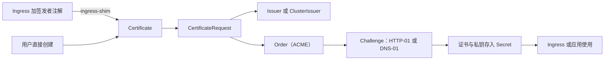
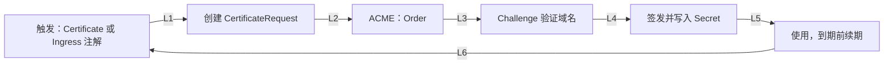

# cert-manager排查参考

## 是什么
- **一句话定位**：在 Kubernetes 里自动申请、保存和续期证书的组件：声明一个 Certificate，cert-manager 经签发者（Issuer 或 ClusterIssuer）完成签发，把证书和私钥存进 Secret，并在到期前自动续期。
- **解决什么问题**：证书一直 Not Ready、Ingress 没生成证书、ACME 挑战失败、没按时续期时，沿着 Certificate → CertificateRequest → Order → Challenge 这条链找到卡住的那一环。
- **谁在用、从哪进来**：给 Ingress 或应用提供 TLS 证书；可通过显式 Certificate 资源触发，也可通过 Ingress 上的注解由 ingress-shim 自动创建。
- **边界（不负责什么）**：集群自身组件（控制面、kubelet）的证书见 集群证书排查参考，不归 cert-manager 管；Ingress 如何使用证书见 Ingress排查参考；证书到期的监控指标本条未展开。
- **形态与版本**：官方文档来自较早版本，较新版本的字段与行为有变化，使用时以所用版本的官方文档为准。
- **术语**：
  - Issuer 与 ClusterIssuer —— 前者属于某个命名空间，后者不属于任何命名空间
  - ACME —— 自动验证域名所有权的协议，Let's Encrypt 使用它
  - HTTP-01 与 DNS-01 —— 两种验证域名的方式
  - ingress-shim —— 监视 Ingress 并按注解自动创建 Certificate 的子组件

## 组件与架构

| 组件 | 角色 | 职责 | 部署位置 / 形态 | 如何找到 |
|---|---|---|---|---|
| cert-manager 控制器 | 控制面 | 处理证书资源，驱动签发与续期 | 集群内的工作负载 | 其 Pod 与日志 |
| ingress-shim | 子组件 | 监视 Ingress，按注解创建 Certificate | cert-manager 内 | Ingress 的注解与生成的 Certificate |
| Issuer 与 ClusterIssuer | 签发者 | 定义向谁、用什么方式签发 | 命名空间内或集群级 | 对应对象及其 Ready 状况 |
| Certificate 与相关资源 | 流程对象 | Certificate、CertificateRequest、Order、Challenge | 命名空间内 | 各对象的状况与事件 |
| 存放证书的 Secret | 产物 | 保存证书与私钥 | 命名空间内 | Certificate 的 secretName |

## 正常链路（请求怎么走 / 正常行为）

### 资源匹配关系
| 编号 | 资源 A.字段 | → | 资源 B.字段 | 匹配规则 | 对不上时的表现 |
|---|---|---|---|---|---|
| R1 | Ingress 的注解 | → | 自动创建的 Certificate | ingress-shim 监视 Ingress；至少要设置 cert-manager.io/issuer 或 cert-manager.io/cluster-issuer；kubernetes.io/tls-acme 为 true 还需给 ingress-shim 配置默认签发者 | 加了注解没有 Certificate：多半缺签发者注解 |
| R2 | Certificate 的 issuerRef | → | Issuer 或 ClusterIssuer | 名称、种类与组要对上；ClusterIssuer 不属于命名空间，与 Ingress 所在命名空间无关；签发者自身要处于就绪状态 | 签发者不存在或未就绪：CertificateRequest 报签发者未就绪，签发停住 |
| R3 | Certificate | → | CertificateRequest、Order、Challenge | 链路是 Certificate 到 CertificateRequest 到 Order 到 Challenge，ACME 签发才有 Order 与 Challenge | 卡在哪一级，哪一级的状况与事件里就有原因 |
| R4 | 挑战类型 | → | 域名验证方式 | HTTP-01 要求集群可被公网访问，cert-manager 会临时创建 acmesolver 的 Pod、Service 与 Ingress；DNS-01 要求有权限创建 TXT 记录；通配符证书必须用 DNS-01〔待复核〕 | 通配符用了 HTTP-01：失败；DNS-01 缺权限：TXT 记录创建不了 |
| R5 | Certificate 的 secretName | → | 存放证书的 Secret | 签发成功后证书与私钥存入该 Secret | Secret 不存在：证书还没签发成功，Ingress 引用它也无法工作 |
| R6 | duration 与 renewBefore | → | 签发与续期时机 | 可在 Certificate 的 spec 里设，也可经 Ingress 注解 cert-manager.io/duration 与 renew-before 传入；常见默认 90 天，续期在实际生命周期的三分之二处触发〔待复核〕 | 没按时续期：先看续期窗口与签发者是否仍可用 |
| R7 | Certificate 的状况 | → | 是否可用 | Ready 为 True 表示就绪；签发者也有 Ready 状况〔待复核〕 | Ready 不为 True：看 describe 的状况与事件 |

### 控制面下发路径
| 环节 | 做什么 | 依据 |
|---|---|---|
| P1 | 部署 cert-manager 及其 CRD（含 certificates、certificaterequests、issuers、clusterissuers 与 acme 组的 orders、challenges），可用 cmctl check api 验证〔待复核〕 | R3 |
| P2 | 创建 Issuer 或 ClusterIssuer，并等它就绪 | R2 |
| P3 | 创建 Certificate，或给 Ingress 加签发者注解由 ingress-shim 创建 | R1 R2 |
| P4 | cert-manager 依次创建 CertificateRequest、Order、Challenge 并驱动完成 | R3 R4 |
| P5 | 到期前按续期窗口自动重复签发流程，更新 Secret | R6 |

### 流量走向（或生命周期）

| 环节 | 起点 → 终点 | 做什么 | 依据 | 同步/异步与默认行为 |
|---|---|---|---|---|
| L1 | 触发 → Certificate | 显式创建，或 ingress-shim 按注解创建 | R1 R2 | 异步 |
| L2 | Certificate → CertificateRequest | 由 Certificate 派生出请求，指向签发者 | R2 R3 | 异步 |
| L3 | CertificateRequest → Order | ACME 签发会创建 Order，记录与 CA 的交互 | R3 | 仅 ACME |
| L4 | Order → Challenge | 为每个域名创建挑战并验证，HTTP-01 用临时 Pod 与 Ingress，DNS-01 写 TXT 记录 | R4 | 可能耗时数分钟，受 DNS 传播影响 |
| L5 | 验证通过 → Secret | CA 签发证书，cert-manager 写入 Secret | R5 | 完成后 Ready 变为 True |
| L6 | 使用与续期 | Ingress 或应用使用 Secret；到期前按续期窗口再次签发并更新 Secret | R6 | 续期流程与首次签发相同 |

### 正常表现（健康基线）
- Issuer 或 ClusterIssuer 就绪，Certificate 的 Ready 为 True，Secret 存在。
- 没有长期停留的 Order 与 Challenge；到期前能自动续期。
- Ingress 引用的 Secret 里是有效的证书。

## 逐环节排查（沿链路对照）
- **P1 部署**
  - 正常：CRD 与控制器都在。
  - 异常：CRD 缺失；控制器没起来。
  - 区分点：整个体系都没动静，先确认安装与 API 可用。
  - 证据落点：CRD 列表；cert-manager 的 Pod。
- **P2 签发者**
  - 正常：签发者就绪。
  - 异常：签发者未就绪，ACME 账户或配置有误。
  - 区分点：CertificateRequest 报签发者未就绪，就去 describe 签发者（R2）。
  - 证据落点：Issuer 或 ClusterIssuer 的状况。
- **P3 触发**
  - 正常：Certificate 被创建。
  - 异常：Ingress 加了注解却没有 Certificate。
  - 区分点：检查是否至少设置了 issuer 或 cluster-issuer 注解（R1）。
  - 证据落点：Ingress 的注解；生成的 Certificate。
- **P4 驱动流程**
  - 正常：各级对象依次创建。
  - 异常：某一级一直不推进。
  - 区分点：按链路从 Certificate 往下 describe，卡在哪一级看哪一级（R3）。
  - 证据落点：各级对象的状况与事件。
- **P5 续期**
  - 正常：到期前自动续期。
  - 异常：没续期，证书过期。
  - 区分点：续期流程与首次签发相同，失败原因也相同，先看当前是否还能签发。
  - 证据落点：Certificate 的状况与续期时间；cert-manager 日志。
- **L1 触发**
  - 正常：触发后创建 Certificate。
  - 异常：见 P3。
  - 区分点：同 P3。
  - 证据落点：同 P3。
- **L2 请求**
  - 正常：CertificateRequest 被批准并交给签发者。
  - 异常：签发者未就绪或引用写错。
  - 区分点：核对 issuerRef 的名称、种类、组。
  - 证据落点：CertificateRequest 的描述。
- **L3 Order**
  - 正常：Order 创建并进行。
  - 异常：Order 失败。
  - 区分点：Order 失败的原因在其状态里，常与挑战有关〔待复核〕。
  - 证据落点：Order 的状态。
- **L4 挑战**
  - 正常：挑战通过。
  - 异常：HTTP-01 访问不到验证路径；DNS-01 TXT 没创建或没传播。
  - 区分点：常见原因有 DNS 未传播、Ingress 配置错误、防火墙挡住 HTTP-01 路径；DNS-01 需要 DNS 的 API 权限（R4）。
  - 证据落点：Challenge 的描述与错误信息；DNS 记录；Ingress 与临时 solver。
- **L5 写入 Secret**
  - 正常：Secret 里有证书与私钥，Ready 为 True。
  - 异常：Secret 不存在。
  - 区分点：Secret 没有说明签发没完成，回到上游环节找。
  - 证据落点：Certificate 的状况；Secret 是否存在。
- **L6 使用与续期**
  - 正常：Ingress 用到新证书。
  - 异常：证书已更新但 Ingress 仍在用旧证书。
  - 区分点：看使用方是否重新加载了 Secret，细节见具体 Ingress 控制器条目。
  - 证据落点：Ingress 的 TLS 引用；实际提供的证书。

## 异常归因速查
| 现象 / 错误码 | 环节 | 归因类别（回指 R#） | 证据位 | 详细条目 |
|---|---|---|---|---|
| Certificate 一直不就绪 | P4 L1 至 L5 | 链路中某一级卡住（R3） | 各级对象的状况与事件 | |
| Ingress 加了注解没有 Certificate | P3 | 缺 issuer 或 cluster-issuer 注解（R1） | Ingress 注解 | oss/k8s-ingress.md |
| 签发者未就绪 | P2 L2 | Issuer 或 ClusterIssuer 配置或账户有问题（R2） | 签发者的状况 | |
| HTTP-01 挑战失败 | L4 | 验证路径访问不到：未公网可达、Ingress 配错、防火墙（R4） | Challenge 描述；入口与防火墙 | oss/ingress-nginx.md |
| DNS-01 挑战失败 | L4 | 缺 DNS 权限或记录未传播（R4） | Challenge 描述；DNS 记录 | |
| 通配符证书签发失败 | L4 | 通配符必须用 DNS-01（R4）〔待复核〕 | 挑战类型 | |
| Secret 不存在 | L5 | 签发未完成（R5） | Certificate 状况 | |
| 没有按时续期 | P5 | 续期窗口内签发失败（R6） | Certificate 的续期时间与状况 | oss/k8s-certs.md |
| 证书更新了但仍在用旧证书 | L6 | 使用方没重新加载 Secret | 实际提供的证书 | oss/ingress-nginx.md |
| 经 Ingress 注解申请没反应 | P3 | ingress-shim 未处理，或签发者注解缺失（R1） | cert-manager 日志；注解 | |

## 状态、事件与日志语义
| 来源 | 取值 | 含义 | 常见出现环节 |
|---|---|---|---|
| Certificate 状况 | Ready 为 True | 证书已签发且可用〔待复核〕 | L5 |
| Issuer 状况 | Ready | 签发者就绪〔待复核〕 | P2 |
| Challenge 描述 | 错误信息 | 挑战失败的原因，如 DNS 未传播、路径访问失败 | L4 |
| 注解 | cert-manager.io/cluster-issuer | 指定使用的 ClusterIssuer | P3 |
| 注解 | cert-manager.io/issuer | 指定使用的 Issuer | P3 |
| 注解 | kubernetes.io/tls-acme | 需要 ingress-shim 配置默认签发者 | P3 |
| 注解 | acme.cert-manager.io/http01-ingress-class | 解决挑战使用的 Ingress 类 | L4 |
| 注解 | cert-manager.io/duration、cert-manager.io/renew-before | 对应 Certificate 的 duration 与 renewBefore | P3 |

## 配置语义
| 配置项 | 默认 / 取值含义 | 改动后的行为后果 |
|---|---|---|
| duration | 常见默认 90 天（2160 小时）〔待复核〕 | 决定请求的证书有效期，CA 可能有自己的上限 |
| renewBefore | 默认在生命周期的三分之二处触发，90 天证书约提前 30 天〔待复核〕 | 调大提前续期窗口 |
| issuerRef | 名称、种类、组 | 指向的签发者必须存在且就绪 |
| secretName | 存放证书与私钥的 Secret | 使用方引用它 |
| 挑战求解器 | HTTP-01 或 DNS-01 | 决定验证方式与所需权限、网络条件 |
| privateKey | 算法与大小可设，如 ECDSA 与 256 | 影响签发请求的密钥类型〔待复核〕 |

## 边界与置信度说明
- **来源**：cert-manager 官方文档的故障排查 FAQ（v1.2）与 Ingress 用法页（v1.4），给出资源链路与 ingress-shim 的注解语义；ACME 两种验证方式、默认有效期与续期时机、Ready 状况的含义来自二手资料。没有做过运行时取证。
- **〔待复核〕项**：HTTP-01 与 DNS-01 的适用条件；通配符必须 DNS-01；默认有效期与续期时机；Ready 状况的精确含义；CRD 清单与 cmctl 的用法；Order 失败的具体表现。
- **版本差异**：官方来源版本较早，新版本在字段、默认值与行为上有变化，包括对 Gateway API 的支持与新的状况语义，以所用版本的官方文档为准。
- **未覆盖**：自签名、CA、Vault 等其他签发者类型；Gateway API 与 cert-manager 的集成；证书的 Secret 注解与轮换私钥策略；速率限制与 ACME 账户；证书到期的监控指标；cert-manager 的 webhook 问题。
- **related**：见 frontmatter。
