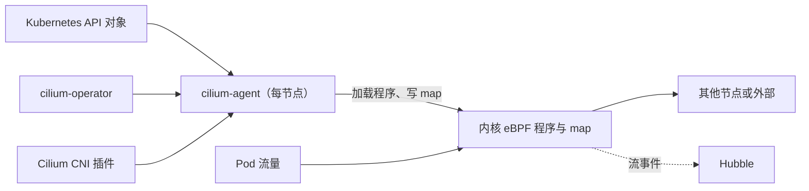
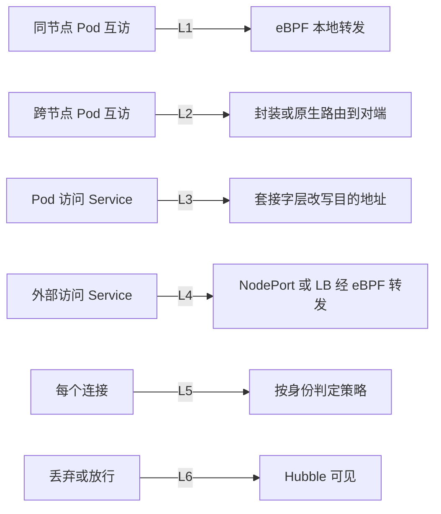

# cilium排查参考

## 是什么
- **一句话定位**：以 eBPF 为数据面的 CNI：在内核里直接做 Pod 转发、Service 负载均衡和策略判定，策略依据"身份"而不是 IP，可以完全替换 kube-proxy。
- **解决什么问题**：用了 Cilium 的集群，按 iptables 与 kube-proxy 的思路去排查会找错地方。这一条先让你判断当前是哪种形态，再决定看哪里：跨节点、Service、策略、还是内核能力。
- **谁在用、从哪进来**：每个节点上的 cilium-agent 加载 eBPF 程序并处理流量；运行时创建 Pod 时调用 Cilium CNI。
- **边界（不负责什么）**：CNI 如何被运行时调用见 CNI排查参考；通用策略语义见 NetworkPolicy排查参考；Cilium 自有策略资源的完整语法与 L7 策略细节本条没有展开。
- **形态与版本**：**排查前先确认三件事**：是否替换了 kube-proxy（替换后 kube-proxy排查参考不适用）；路由模式是覆盖网络还是原生路由；IPAM 用的是哪种模式。这三项决定链路。
- **术语**：
  - 身份（identity）—— 按标签分组的安全身份，随数据包携带，策略依据它判断
  - 原生路由与覆盖网络 —— 前者用主机路由表，后者封装后传输
  - kube-proxy 替换 —— 由 eBPF 负责 Service 负载均衡
  - Hubble —— 观测网络流的组件

## 组件与架构

| 组件 | 角色 | 职责 | 部署位置 / 形态 | 如何找到 |
|---|---|---|---|---|
| cilium-agent | 节点代理 | 加载 eBPF 程序，维护身份、策略与 Service 后端，管理本节点端点 | 每个节点的 DaemonSet | 对应 Pod 与日志 |
| cilium-operator | 集群级 | 处理集群范围的任务，如 cluster-pool 模式下分配节点 Pod 网段〔待复核〕 | Deployment，可多副本 | 对应 Pod |
| eBPF 程序与 map | 数据面 | 在 TC、XDP、套接字等挂接点处理流量，状态存在 map 里 | 内核 | 经 agent 查看 |
| Cilium CNI 插件 | 接入 | 创建 Pod 网络并向 agent 登记端点 | 节点配置目录与二进制目录 | 见 CNI排查参考 |
| Hubble | 观测 | 提供每条网络流的可见性 | agent 内置，可带中继与界面 | Hubble 的命令行或界面 |

## 正常链路（请求怎么走 / 正常行为）

### 资源匹配关系
| 编号 | 资源 A.字段 | → | 资源 B.字段 | 匹配规则 | 对不上时的表现 |
|---|---|---|---|---|---|
| R1 | Pod 的标签 | → | 安全身份 | 共享相同安全策略的容器组被分配同一身份，身份随数据包携带，接收节点验证它，策略依据身份而非 IP | 标签变化会使身份变化：之前放行的流量可能被拒 |
| R2 | 网络策略（Kubernetes 的或 Cilium 自有的） | → | 流量的放行或拒绝 | 三层四层策略按标签、协议、端口限制，并可到七层；依据身份判断；对 Kubernetes NetworkPolicy 的执行〔待复核〕 | 策略不生效或误拦：先看身份是否匹配了预期的标签 |
| R3 | 路由模式 | → | 跨节点转发方式 | 覆盖网络用封装（如 VXLAN 或 Geneve）；原生路由用主机路由表，要求底层网络能路由容器 IP，可与云路由器或路由守护进程集成；路由学习可用二层邻居发现或 BGP | 模式与底层网络不匹配：跨节点不通 |
| R4 | IPAM 模式 | → | Pod 地址来源 | 有 cluster-pool（由 Operator 分配节点网段）、ENI、Azure 委托等多种；cluster-pool 配置里有网段列表与每节点掩码长度〔待复核〕 | 网段与集群或底层网络冲突、池耗尽：Pod 拿不到地址 |
| R5 | kubeProxyReplacement 设置 | → | Service 转发由谁做 | 完整替换时由 eBPF 负责 ClusterIP、NodePort、LoadBalancer，东西向在套接字层改写 connect，南北向可用 XDP、DSR、Maglev | 替换后仍去查 kube-proxy 规则：找不到，规则不在那里 |
| R6 | agent 的计算结果 | → | eBPF map 与程序 | agent 把身份、策略、Service 后端写入 map，挂在 TC、XDP、套接字等挂接点上 | agent 没写入或程序没加载：流量行为与对象定义不一致 |
| R7 | 网络流 | → | Hubble 的可见性 | Hubble 提供对每条网络流的可见性，包括被丢弃的流 | 流量被丢却没有线索：用 Hubble 看丢弃原因 |

### 控制面下发路径
| 环节 | 做什么 | 依据 |
|---|---|---|
| P1 | 部署 cilium-agent（每节点）、cilium-operator，并安装 CNI 配置；要求内核满足版本、且不应同时装有其他 CNI〔待复核〕 | R5 R6 |
| P2 | agent 在节点加载 eBPF 程序并初始化 map | R6 |
| P3 | operator 在 cluster-pool 模式下给各节点分配 Pod 网段〔待复核〕 | R4 |
| P4 | agent 监听 Pod、Service、策略等对象，计算身份、策略与 Service 后端并写入 map | R1 R2 R5 R6 |
| P5 | 创建 Pod 时 CNI 调用 agent，创建端点并分配地址 | R4 |

### 流量走向（或生命周期）

| 环节 | 起点 → 终点 | 做什么 | 依据 | 同步/异步与默认行为 |
|---|---|---|---|---|
| L1 | Pod → 同节点 Pod | 经 eBPF 程序本地转发 | R6 | 同步 |
| L2 | Pod → 其他节点 Pod | 覆盖模式封装后传输，或原生路由经主机路由表转发 | R3 | 同步；原生路由要求底层网络能路由容器 IP |
| L3 | Pod → Service | 东西向在套接字层改写 connect 的目的地址，避免逐包转换；不经 kube-proxy | R5 | 同步，仅在替换 kube-proxy 时 |
| L4 | 外部 → Service | NodePort 或负载均衡的流量由 eBPF 处理，可用 XDP、DSR、Maglev | R5 | 同步 |
| L5 | 连接 → 策略判定 | 依据身份与三层到七层规则放行或拒绝 | R1 R2 | 同步 |
| L6 | 流 → Hubble | 放行与丢弃的流都可被观测 | R7 | 异步 |

### 正常表现（健康基线）
- 每个节点的 cilium-agent 就绪，eBPF 程序已加载。
- 当前形态与预期一致：是否替换 kube-proxy、路由模式、IPAM 模式。
- 策略依据的身份与 Pod 标签一致；Hubble 里没有意外的丢弃。

## 逐环节排查（沿链路对照）
- **P1 部署与前置条件**
  - 正常：agent 与 operator 就绪。
  - 异常：内核版本不满足；残留了其他 CNI。
  - 区分点：agent 起不来先看内核能力与是否有 CNI 冲突〔待复核〕。
  - 证据落点：agent 日志；节点内核版本；节点上的 CNI 配置。
- **P2 加载程序**
  - 正常：eBPF 程序已加载。
  - 异常：程序加载失败，该节点网络异常。
  - 区分点：只有个别节点异常，先看该节点的 agent。
  - 证据落点：该节点 agent 日志。
- **P3 分配网段**
  - 正常：节点拿到 Pod 网段。
  - 异常：节点没拿到网段，Pod 拿不到 IP。
  - 区分点：看 IPAM 模式与 operator 状态（R4）。
  - 证据落点：节点上的网段分配；operator 日志。
- **P4 计算与写入**
  - 正常：身份、策略、Service 后端被写入 map。
  - 异常：对象正确但行为不符，map 内容缺失或陈旧。
  - 区分点：对象与行为不一致时先怀疑 agent 没同步（R6）。
  - 证据落点：agent 日志；agent 报告的策略与 Service 状态。
- **P5 接入**
  - 正常：Pod 创建后端点就绪。
  - 异常：端点创建失败。
  - 区分点：运行时调用层面的失败见 CNI排查参考。
  - 证据落点：Pod 事件；agent 日志。
- **L1 同节点**
  - 正常：同节点互通。
  - 异常：同节点不通。
  - 区分点：多半是端点或本机策略问题。
  - 证据落点：该节点 agent 的端点状态。
- **L2 跨节点**
  - 正常：跨节点互通。
  - 异常：跨节点不通。
  - 区分点：先确认路由模式（R3）；覆盖模式看封装端口与节点间连通，原生路由看底层网络能否路由容器 IP。
  - 证据落点：路由模式设置；节点间连通；路由表。
- **L3 Pod 访问 Service**
  - 正常：Service 地址被正确改写到后端。
  - 异常：Service 不通。
  - 区分点：先确认是否替换了 kube-proxy（R5）：替换了就在 Cilium 里看 Service 后端，没替换仍按 kube-proxy排查参考。
  - 证据落点：kubeProxyReplacement 设置；agent 报告的 Service 与后端。
- **L4 外部访问 Service**
  - 正常：NodePort 或负载均衡入口可达。
  - 异常：外部不通或源 IP 异常。
  - 区分点：与 Service 的流量策略配合判断，见 Service排查参考。
  - 证据落点：Service 类型与流量策略；agent 状态。
- **L5 策略判定**
  - 正常：策略按身份生效。
  - 异常：策略不生效、误拦。
  - 区分点：先核对 Pod 标签对应的身份，再核对策略的选择器（R1、R2）；通用语义见 NetworkPolicy排查参考。
  - 证据落点：端点的身份；策略对象；Hubble 的丢弃记录。
- **L6 观测**
  - 正常：能看到流与丢弃。
  - 异常：流量被丢却无线索。
  - 区分点：Hubble 是定位丢弃原因的首选入口（R7）。
  - 证据落点：Hubble 的流记录。

## 异常归因速查
| 现象 / 错误码 | 环节 | 归因类别（回指 R#） | 证据位 | 详细条目 |
|---|---|---|---|---|
| 按 kube-proxy 排查找不到规则 | L3 | 已由 Cilium 替换 kube-proxy（R5） | kubeProxyReplacement 设置 | oss/kube-proxy.md |
| 替换后 Service 不通 | L3 L4 | eBPF 侧的 Service 后端或配置问题（R5、R6） | agent 报告的 Service 状态 | oss/k8s-service.md |
| 跨节点 Pod 不通 | L2 | 路由模式与底层网络不匹配（R3） | 路由模式；底层可达性 | oss/k8s-network.md |
| cilium-agent 起不来 | P1 P2 | 内核能力不满足或有其他 CNI〔待复核〕（R6） | agent 日志；内核版本 | |
| Pod 拿不到 IP | P3 P5 | IPAM 配置或池耗尽（R4） | IPAM 模式与网段 | oss/k8s-cni.md |
| 策略不生效或误拦 | L5 | 身份与标签不一致，或选择器不匹配（R1、R2） | 端点身份；策略对象 | oss/k8s-networkpolicy.md |
| 改标签后原本通的流量被拒 | L5 | 标签变化导致身份变化（R1） | 变更前后的端点身份 | |
| 流量被丢却没有线索 | L6 | 需要观测丢弃原因（R7） | Hubble 的流记录 | |
| 对象正确但行为不符 | P4 | agent 没同步到 map（R6） | agent 日志 | |
| 从 kube-proxy 切换后行为变化 | L3 | 转发机制从规则链变为 eBPF（R5） | 切换前后的 Service 转发方式 | |

## 状态、事件与日志语义
| 来源 | 取值 | 含义 | 常见出现环节 |
|---|---|---|---|
| 配置 | kubeProxyReplacement | 为 true 表示完整替换 kube-proxy；较旧版本的取值写法不同〔待复核〕 | L3 |
| 配置 | IPAM 模式 | cluster-pool、ENI、Azure 委托等 | P3 |
| 概念 | 身份 | 策略判断依据，随数据包携带 | L5 |
| 观测 | Hubble 的流记录 | 每条放行或丢弃的流及原因 | L6 |

## 配置语义
| 配置项 | 默认 / 取值含义 | 改动后的行为后果 |
|---|---|---|
| kubeProxyReplacement | true 即完整替换 kube-proxy〔待复核〕 | 改动后 Service 转发机制整体改变，需同时处理节点上遗留的 kube-proxy 规则 |
| 路由模式 | 覆盖网络（封装）或原生路由 | 决定跨节点转发方式与对底层网络的要求 |
| IPAM 模式 | cluster-pool、ENI、Azure 委托 | 决定地址来源 |
| cluster-pool 的网段与掩码 | 网段列表与每节点掩码长度，示例每节点 /24〔待复核〕 | 决定每节点可用地址数量 |
| operator 副本数 | 可设多副本 | 提高集群级任务的可用性 |
| 带宽管理器 | 可选 | 对 Pod 出向限速 |

## 边界与置信度说明
- **来源**：Cilium 官方 README 与项目说明（v1.19 至 v1.20）；组件构成、IPAM 取值与部署要求来自二手资料。没有做过运行时取证。
- **〔待复核〕项**：对 Kubernetes NetworkPolicy 的执行细节；operator 的具体职责；kubeProxyReplacement 在各版本的取值写法；内核版本要求；cluster-pool 配置项名称。
- **版本差异**：eBPF 能力依赖内核，不同版本的取值写法与默认值不同；以所用版本的官方文档为准。
- **未覆盖**：CiliumNetworkPolicy 的完整语法与 L7 策略；Cluster Mesh；入口与出口网关；Gateway API 与服务网格功能；透明加密；BGP 控制面；Hubble 的部署与使用细节；故障时用 agent 命令行取证的具体方法。
- **related**：见 frontmatter。
