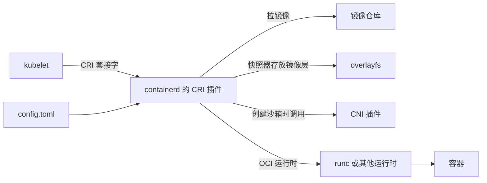

# containerd排查参考

## 是什么
- **一句话定位**：kubelet 通过 CRI 把"创建沙箱、拉镜像、创建与启动容器"交给 containerd，containerd 再用 runc 等 OCI 运行时把容器真正跑起来。节点上"Pod 起不来、节点 NotReady、cgroup 报错"的一部分根因在这一层。
- **解决什么问题**：Pod 事件里的沙箱创建失败、镜像拉取失败、节点运行时不可用时，判断问题在 kubelet 与运行时的对接、cgroup 驱动、配置文件、pause 镜像，还是 CNI。
- **谁在用、从哪进来**：每个节点上的 kubelet 通过 CRI 套接字调用它；运维也用 crictl 直接与它交互排查。
- **边界（不负责什么）**：CNI 如何被调用见 CNI排查参考；容器被 OOM 杀掉或被驱逐见 资源与QoS排查参考；Pod 的生命周期状态见 Pod排查参考；节点状况见 节点排查参考。
- **形态与版本**：Kubernetes 1.35 要求运行时符合 CRI，且只支持 CRI v1。containerd 1.x 与 2.x 的配置插件名不同，配置文件版本也不同，抄旧配置到新版本可能不生效。
- **术语**：
  - CRI —— kubelet 与容器运行时之间的接口
  - 沙箱 —— Pod 的共享环境，由 pause 容器撑起
  - cgroup 驱动 —— 谁来管理 cgroup：cgroupfs 或 systemd
  - 快照器 —— 镜像层的存储实现，默认 overlayfs
  - crictl —— 与 CRI 运行时交互的命令行工具

## 组件与架构

| 组件 | 角色 | 职责 | 部署位置 / 形态 | 如何找到 |
|---|---|---|---|---|
| containerd | 运行时 | 提供 CRI，管理镜像、沙箱、容器 | 节点上的系统服务 | 其进程与日志 |
| CRI 插件 | containerd 内 | 实现 CRI，对接 kubelet | containerd 的内置插件 | config.toml 中的 cri 相关段 |
| 配置文件 | 配置 | 决定 cgroup 驱动、快照器、运行时、pause 镜像等 | /etc/containerd/config.toml | 该文件 |
| runc 等 OCI 运行时 | 执行体 | 真正创建容器进程 | 节点上的二进制 | config 里 runtimes 段 |
| crictl | 诊断工具 | 直接通过 CRI 查看与操作 | 节点上的命令 | /etc/crictl.yaml |

## 正常链路（请求怎么走 / 正常行为）

### 资源匹配关系
| 编号 | 资源 A.字段 | → | 资源 B.字段 | 匹配规则 | 对不上时的表现 |
|---|---|---|---|---|---|
| R1 | kubelet 的 CRI 端点 | → | containerd 的 CRI 套接字 | Linux 上 containerd 默认套接字为 /run/containerd/containerd.sock；crictl 通过 /etc/crictl.yaml 指向同一处 | 端点不一致：kubelet 找不到运行时，节点无法就绪 |
| R2 | kubelet 的 cgroupDriver | → | 运行时的 cgroup 驱动 | 两者必须一致；systemd 为 init 时用 systemd 驱动；cgroup v2 推荐 systemd；较新版本在启用特性门控且运行时支持时，kubelet 会从运行时自动探测 | 不一致：资源压力下不稳定；已有 Pod 的沙箱重建出错 |
| R3 | config.toml 的版本与插件名 | → | 配置是否生效 | 默认按版本 1 解析，version 等于 2 启用长插件名 io.containerd.grpc.v1.cri；较新版本的路径名不同，如 io.containerd.cri.v1.runtime | 把旧版配置原样用到新版本：选项写在不认识的路径下，不生效 |
| R4 | disabled_plugins | → | CRI 是否启用 | 软件包安装的 containerd 可能默认禁用 CRI 插件，需确保 cri 不在禁用列表里 | CRI 被禁用：kubelet 无法连接，节点不可用 |
| R5 | containerd 的 sandbox_image | → | kubelet 的 pod-infra-container-image | 最佳实践是两者匹配；kubelet 若未声明匹配的镜像，可能尝试回收 pause 镜像 | pause 镜像被回收或拉不到：新建沙箱失败 |
| R6 | runtimes 与 default_runtime_name | → | Pod 使用的 OCI 运行时 | 默认 runc；可用 runtime_type 增加 crun、gVisor、Kata 等并指定默认 | 运行时名或二进制路径写错：容器创建失败 |
| R7 | snapshotter 设置 | → | 镜像层存储 | 默认 overlayfs；数据在 /var/lib/containerd 与 /run/containerd 下 | 存储目录满或快照器不支持：镜像拉取与容器创建失败〔待复核〕 |
| R8 | CNI 加载状态 | → | 沙箱网络 | crictl info 输出里有 lastCNILoadStatus，为 OK 表示 CNI 配置已加载 | 非 OK：沙箱网络建立失败，见 CNI排查参考 |

### 控制面下发路径
| 环节 | 做什么 | 依据 |
|---|---|---|
| P1 | 安装 containerd 并准备 config.toml；包安装的默认配置可能含不兼容参数，可用 containerd config default 重新生成 | R3 R4 |
| P2 | 按需调整 cgroup 驱动、pause 镜像等，并重启 containerd 使配置生效 | R2 R4 R5 |
| P3 | 配置 kubelet 的 CRI 端点与 cgroup 驱动，使之与运行时一致 | R1 R2 |
| P4 | kubelet 通过 CRI 依次调用运行沙箱、拉取镜像、创建与启动容器 | R5 R6 |

### 流量走向（或生命周期）

| 环节 | 起点 → 终点 | 做什么 | 依据 | 同步/异步与默认行为 |
|---|---|---|---|---|
| L1 | 镜像仓库 → 节点 | 经 CRI 的镜像接口拉取镜像，存入快照器 | R7 | 失败会重试并退避，见 Pod排查参考 |
| L2 | 运行沙箱 | 拉起 pause 容器并建立网络，调用 CNI | R5 R8 | 同步；pause 镜像与 CNI 是两个常见失败点 |
| L3 | 创建与启动容器 | 由 OCI 运行时创建进程，并按 cgroup 驱动设置资源限制 | R2 R6 | 同步 |
| L4 | 运行中 → 停止 | 容器退出或被停止后清理 | R6 | 同步 |
| L5 | 诊断 | 用 crictl 查看沙箱、容器、镜像与运行时信息 | R1 R8 | 手动 |

### 正常表现（健康基线）
- containerd 在运行，CRI 套接字存在，kubelet 能连上；crictl info 的 lastCNILoadStatus 为 OK。
- kubelet 与运行时使用同一种 cgroup 驱动。
- pause 镜像在节点上，不会被回收。

## 逐环节排查（沿链路对照）
- **P1 安装与配置**
  - 正常：config.toml 有效，CRI 未被禁用。
  - 异常：包安装的默认配置含不兼容参数；cri 在 disabled_plugins 里。
  - 区分点：安装或装 CNI 后容器反复崩溃，先怀疑配置不兼容，可重新生成默认配置（R3、R4）。
  - 证据落点：config.toml 的内容与 disabled_plugins；containerd 日志。
- **P2 生效**
  - 正常：改配置后重启，新值生效。
  - 异常：改了没重启；写在了不认识的插件路径下。
  - 区分点：升级 containerd 后配置失效，先对照所用版本的路径名与配置版本。
  - 证据落点：crictl info 里展示的实际配置。
- **P3 kubelet 对接**
  - 正常：端点与驱动都对。
  - 异常：端点指错；驱动不一致。
  - 区分点：节点一直不就绪且 kubelet 报连不上运行时，先查端点与套接字是否存在（R1）。
  - 证据落点：kubelet 的 CRI 端点配置；套接字文件。
- **P4 CRI 调用**
  - 正常：各调用成功。
  - 异常：某一步失败，事件里出现沙箱创建失败。
  - 区分点：看失败发生在拉镜像、建沙箱还是创建容器。
  - 证据落点：Pod 事件；kubelet 与 containerd 日志。
- **L1 拉镜像**
  - 正常：镜像拉取并存入快照器。
  - 异常：拉取失败；存储空间不足。
  - 区分点：镜像本身的拉取失败与退避见 Pod排查参考的 L2。
  - 证据落点：crictl 拉取结果；节点存储空间。
- **L2 建沙箱**
  - 正常：pause 容器起来、网络建立。
  - 异常：pause 镜像拉不到或被回收；CNI 失败。
  - 区分点：区分 pause 镜像问题（R5）与 CNI 问题（R8，见 CNI排查参考）。
  - 证据落点：沙箱相关事件；crictl info 的 CNI 状态；节点上是否有 pause 镜像。
- **L3 建容器**
  - 正常：容器创建成功。
  - 异常：运行时名或二进制路径错；cgroup 驱动不一致导致创建失败。
  - 区分点：驱动不一致在资源压力下才暴露更明显（R2）。
  - 证据落点：containerd 日志；runtimes 配置。
- **L4 运行与停止**
  - 正常：状态正常上报，停止后清理。
  - 异常：残留的沙箱或容器。
  - 区分点：残留资源可用 crictl 列出后核对。
  - 证据落点：crictl 的沙箱与容器列表。
- **L5 诊断**
  - 正常：crictl 能连上运行时。
  - 异常：crictl 报连接失败。
  - 区分点：先看 /etc/crictl.yaml 的端点与套接字是否存在。
  - 证据落点：crictl 配置；containerd 进程状态。

## 异常归因速查
| 现象 / 错误码 | 环节 | 归因类别（回指 R#） | 证据位 | 详细条目 |
|---|---|---|---|---|
| 节点 NotReady，kubelet 连不上运行时 | P3 | CRI 端点不一致或 containerd 没运行（R1） | kubelet 端点；套接字 | oss/k8s-node.md |
| CRI 插件没生效 | P1 | cri 在 disabled_plugins 里（R4） | config.toml | |
| 安装后容器反复崩溃 | P1 | 软件包自带配置含不兼容参数（R3） | config.toml | |
| 升级 containerd 后选项不生效 | P2 | 配置版本与插件路径名变化（R3） | config 版本；所用版本文档 | |
| 切换 cgroup 驱动后旧 Pod 重建出错 | P3 L3 | 已有 Pod 的沙箱按原驱动创建（R2） | 驱动变更时间；Pod 事件 | oss/k8s-pod.md |
| 资源压力下节点不稳定 | L3 | kubelet 与运行时驱动不一致（R2） | 两侧驱动设置 | oss/k8s-resources.md |
| 创建沙箱失败，pause 镜像拉不到 | L2 | sandbox_image 不可达或被回收（R5） | sandbox_image；节点镜像列表 | oss/k8s-pod.md |
| 创建沙箱失败，网络相关 | L2 | CNI 没加载（R8） | crictl info 的 lastCNILoadStatus | oss/k8s-cni.md |
| 容器创建失败，运行时找不到 | L3 | runtimes 或二进制路径配错（R6） | runtimes 配置；二进制路径 | |
| 镜像拉取与容器创建都失败 | L1 | 存储空间或快照器问题（R7）〔待复核〕 | 节点磁盘；快照器配置 | |
| crictl 连不上运行时 | L5 | crictl 的端点配置不对（R1） | /etc/crictl.yaml | |

## 状态、事件与日志语义
| 来源 | 取值 | 含义 | 常见出现环节 |
|---|---|---|---|
| crictl info | lastCNILoadStatus | OK 表示 CNI 配置已加载 | L2 |
| crictl info | containerdEndpoint、rootDir、stateDir | 运行时套接字与数据目录 | L5 |
| 配置项 | SystemdCgroup | runc 选项里使用 systemd 驱动 | P2 |
| 配置项 | sandbox_image | pause 镜像 | L2 |
| 配置项 | disabled_plugins | 被禁用的插件列表，cri 不应在其中 | P1 |
| 配置版本 | version 等于 2 | 启用长插件名与新字段 | P2 |

## 配置语义
| 配置项 | 默认 / 取值含义 | 改动后的行为后果 |
|---|---|---|
| cgroup 驱动 | containerd 与 Kubernetes 默认为 cgroupfs；systemd 主机推荐 systemd | 必须与 kubelet 一致；切换会影响已有 Pod 沙箱的重建 |
| SystemdCgroup | 在 runc 选项里设为 true 使用 systemd 驱动 | 路径随 containerd 版本而变 |
| sandbox_image | pause 镜像 | 要与 kubelet 的 pod-infra-container-image 匹配 |
| snapshotter | 默认 overlayfs | 影响镜像层存储方式 |
| runtimes 与 default_runtime_name | 默认 runc，可加 crun、gVisor、Kata | 决定 Pod 使用的 OCI 运行时 |
| 配置文件 version | 默认按 1 解析 | 要用新字段与长插件名需设为 2 |

## 边界与置信度说明
- **来源**：Kubernetes 官方容器运行时页（多个版本）与 containerd 官方 CRI 配置、crictl 文档，没有做过运行时取证。
- **〔待复核〕项**：存储空间不足或快照器问题在各版本的具体表现。
- **版本差异**：containerd 1.x 与 2.x 的插件路径名不同，配置版本也在演进；Kubernetes v1.34 起可由 kubelet 自动探测 cgroup 驱动，是否启用取决于特性门控与运行时支持。
- **未覆盖**：镜像仓库的认证与镜像加速配置；运行时的日志与指标；CRI-O 等其他运行时；Windows 节点；镜像垃圾回收的阈值；容器日志的轮转；运行时升级与回滚。
- **related**：见 frontmatter。
