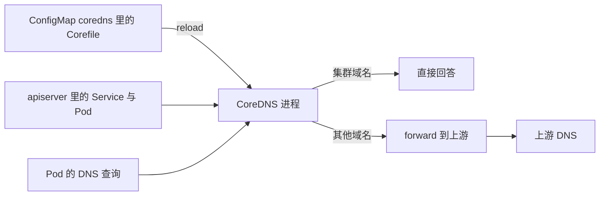

# CoreDNS排查参考

## 是什么
- **一句话定位**：Kubernetes 默认的集群 DNS 软件。它按 Corefile 里的插件链处理每个查询：集群域名用 kubernetes 插件根据 Service 与 Pod 信息回答，其余转发到上游。
- **解决什么问题**：回答"集群 DNS 服务里到底哪一步出了问题"：配置没生效、转发环路、上游不通、就绪探针失败，都落在 Corefile 与插件行为上。
- **谁在用、从哪进来**：所有 Pod 的 DNS 查询经 resolv.conf 里的集群 DNS 服务地址到达它。
- **边界（不负责什么）**：Pod 里 resolv.conf 如何生成、名字如何补全见集群DNS排查参考；查询到达 CoreDNS 之前经过的 Service 转发见 Service排查参考与 kube-proxy排查参考。
- **形态与版本**：以 Deployment 部署在 kube-system，配置存放在 ConfigMap。插件选项的完整细节以 CoreDNS 官方插件文档为准，本条只写 Kubernetes 官方文档给出的默认配置及其语义。
- **术语**：
  - Corefile —— CoreDNS 的配置文件
  - server block —— 以域名和端口开头的一段配置，如 `.:53`
  - 插件链 —— 一个 server block 里的各插件，按顺序处理查询
  - 存根域 —— 把某个域单独转发到指定上游的做法

## 组件与架构

| 组件 | 角色 | 职责 | 部署位置 / 形态 | 如何找到 |
|---|---|---|---|---|
| CoreDNS 进程 | 解析服务 | 按插件链处理查询 | kube-system 中的 Deployment | 对应 Pod 及日志 |
| Corefile ConfigMap | 配置 | 存放插件链与上游 | kube-system 的 coredns ConfigMap | ConfigMap 的 Corefile 键 |
| kubernetes 插件 | 内置插件 | 依据 Service 与 Pod 信息回答集群域查询 | CoreDNS 内 | Corefile 中 kubernetes 一行 |
| forward 插件 | 内置插件 | 转发集群域之外的查询 | CoreDNS 内 | Corefile 中 forward 一行 |

## 正常链路（请求怎么走 / 正常行为）

### 资源匹配关系
| 编号 | 资源 A.字段 | → | 资源 B.字段 | 匹配规则 | 对不上时的表现 |
|---|---|---|---|---|---|
| R1 | 查询的域名 | → | Corefile 的 server block | 默认只有 `.:53` 一个块处理所有查询；另加 `某域:53` 块可让该域走独立的插件链与上游；多个块都匹配时取最具体的〔待复核〕 | 自定义域没生效：块写法或域名不匹配，查询落到了默认块 |
| R2 | ConfigMap 的 Corefile | → | 运行中的 CoreDNS 配置 | reload 插件检测到变更后自动重载，编辑后需等待约两分钟 | 改了没生效：还没到重载时间，或配置有语法错误导致重载失败〔待复核〕 |
| R3 | kubernetes 插件的域设置 | → | 集群域名记录 | 域为 cluster.local 与反向域；根据 Service 与 Pod 的 IP 回答查询；ttl 为 30；反向域未命中时 fallthrough 给后面的插件 | 域与集群实际域名不一致：集群内名字解析不到 |
| R4 | forward 插件的目标 | → | 上游解析器 | 默认转发到 /etc/resolv.conf 所指的解析器，也可写成指定地址；负责集群域之外的查询 | 上游不可达或写错：集群外域名失败，集群内正常 |
| R5 | cache 设置 | → | 响应缓存时长 | 默认 cache 30，即缓存 30 秒 | 缓存期内记录变更不可见，表现为"改了但解析仍是旧值" |
| R6 | loop 插件 | → | 转发环路检测 | 检测到简单转发环路时终止 CoreDNS 进程 | 上游最终指回自身：CoreDNS 启动后被终止，Pod 反复重启 |
| R7 | health 与 ready 插件 | → | 探针端点 | health 在本机 8080 的 /health，带 lameduck 5s；ready 在 8181，所有可报告就绪的插件就绪才返回 200 | 某个插件未就绪：就绪探针失败，Pod 不接流量 |

### 控制面下发路径
| 环节 | 做什么 | 依据 |
|---|---|---|
| P1 | 管理员修改 kube-system 里 coredns ConfigMap 的 Corefile | R1 R2 |
| P2 | reload 插件发现变更并重载配置，约两分钟内生效 | R2 |
| P3 | kubernetes 插件持续根据 Service 与 Pod 的变化更新可回答的记录 | R3 |

### 流量走向（或生命周期）

| 环节 | 起点 → 终点 | 做什么 | 依据 | 同步/异步与默认行为 |
|---|---|---|---|---|
| L1 | 客户端 → CoreDNS | 查询到达 53 端口 | R1 | 同步 |
| L2 | 查询 → server block | 按域名选择 server block，默认块处理所有未被特殊配置的域 | R1 | 同步 |
| L3 | server block → kubernetes 插件 | 集群域与反向域由 kubernetes 插件回答，反向域未命中则 fallthrough | R3 | 同步 |
| L4 | 插件链 → 上游 | 集群域之外的查询由 forward 转到上游，结果经 cache 缓存 | R4 R5 | 同步；缓存默认 30 秒 |

### 正常表现（健康基线）
- CoreDNS Pod 都就绪，ready 端点返回 200。
- 修改 Corefile 后，约两分钟内行为随之更新。
- 集群内名字与集群外名字都能解析，没有 loop 导致的重启。

## 逐环节排查（沿链路对照）
- **P1 修改配置**
  - 正常：ConfigMap 的 Corefile 语法正确，改动符合预期。
  - 异常：缩进或块结构写错；把存根域块写进了错误位置。
  - 区分点：改完后行为完全没变化，先确认改的是 kube-system 里正在用的那份 ConfigMap（R2）。
  - 证据落点：coredns ConfigMap 的 Corefile 内容。
- **P2 重载**
  - 正常：等待约两分钟后新配置生效。
  - 异常：超过等待时间仍是旧行为；重载失败后仍沿用旧配置〔待复核〕。
  - 区分点：未到两分钟不判故障；超时再看 CoreDNS 日志是否有重载或解析配置的报错。
  - 证据落点：CoreDNS 日志。
- **P3 记录更新**
  - 正常：新建 Service 后其记录很快可解析。
  - 异常：Service 已存在但解析不到。
  - 区分点：先排除名字与命名空间错误，再看 kubernetes 插件的域设置是否与集群域一致（R3）。
  - 证据落点：Corefile 的 kubernetes 行；Service 是否存在。
- **L1 查询到达**
  - 正常：CoreDNS 收到来自 Pod 的查询。
  - 异常：根本收不到查询。
  - 区分点：收不到查询时，问题在 CoreDNS 之前，见集群DNS排查参考的 L2。
  - 证据落点：CoreDNS 日志与指标。
- **L2 选 server block**
  - 正常：自定义域命中独立块，其余命中默认块。
  - 异常：自定义域走了默认上游。
  - 区分点：块里的域名写法与查询名不匹配（R1）。
  - 证据落点：Corefile 中各块的域名。
- **L3 集群域回答**
  - 正常：集群域名返回正确记录。
  - 异常：集群内名字解析不到，而外部域名正常。
  - 区分点：集群外正常、集群内失败，看 kubernetes 插件与 API 访问；反过来，看 forward。
  - 证据落点：kubernetes 插件的域设置与 CoreDNS 日志。
- **L4 转发与缓存**
  - 正常：集群外域名返回，重复查询命中缓存。
  - 异常：上游不通导致超时；CoreDNS 因转发环路被终止；缓存导致改动不可见。
  - 区分点：Pod 反复重启并伴随 loop 相关日志，指向 R6，检查 forward 的上游是否最终回到 CoreDNS 自己。
  - 证据落点：CoreDNS 日志；forward 的目标地址。

## 异常归因速查
| 现象 / 错误码 | 环节 | 归因类别（回指 R#） | 证据位 | 详细条目 |
|---|---|---|---|---|
| CoreDNS Pod 反复重启 | L4 | forward 上游指回自身，loop 检测终止进程（R6） | CoreDNS 日志；forward 目标 | |
| 修改 Corefile 后没变化 | P1 P2 | 还在重载等待期，或改错了 ConfigMap（R2） | ConfigMap 内容；等待时长 | |
| 集群外域名解析失败、集群内正常 | L4 | forward 上游不通或写错（R4） | forward 的目标地址 | |
| 集群内名字解析不到、集群外正常 | L3 P3 | kubernetes 插件域与集群域不一致，或名字有误（R3） | Corefile 的 kubernetes 行 | |
| 某个域需要走指定上游但没生效 | L2 | server block 域名不匹配，查询落到默认块（R1） | Corefile 各块的域名 | |
| 就绪探针失败 | L1 | ready 端点未返回 200（R7） | 8181 端口的 ready 响应 | |
| 记录改了但解析仍是旧值 | L4 | 命中 cache（R5） | cache 的时长设置 | |

## 状态、事件与日志语义
| 来源 | 取值 | 含义 | 常见出现环节 |
|---|---|---|---|
| 端点 | 8080 的 /health | CoreDNS 自身健康；lameduck 让进程在退出前保持一段时间 | L1 |
| 端点 | 8181 的 ready | 所有可报告就绪的插件都就绪时返回 200 OK | L1 |
| 端点 | 9153 的指标 | prometheus 插件暴露的指标 | L1 |
| 插件行为 | loop 检出环路 | CoreDNS 进程被终止 | L4 |

## 配置语义
| 配置项 | 默认 / 取值含义 | 改动后的行为后果 |
|---|---|---|
| kubernetes 的 pods | 默认 insecure；另有 verified、disabled 等取值〔待复核〕 | 决定是否以及如何为 Pod IP 形式的名字生成记录 |
| kubernetes 的 ttl | 默认 30 | 记录被客户端缓存的时长 |
| forward | 默认 /etc/resolv.conf | 改成指定地址即固定上游；可在独立 server block 里为某个域单独指定上游 |
| cache | 默认 30 | 调大减少上游压力，但记录变更更晚可见 |
| reload | 默认启用 | 变更自动重载，约需两分钟 |
| loop | 默认启用 | 检测到环路会终止进程，用来避免死循环 |

## 边界与置信度说明
- **来源**：Kubernetes 官方「Customizing DNS Service」文档，只覆盖默认 Corefile 及各插件的一句话语义，没有做过运行时取证。
- **〔待复核〕项**：多个 server block 匹配时取最具体者；重载失败时沿用旧配置的行为；kubernetes 插件 pods 的各取值与其他选项。这些来自社区资料或通用认知，需要对照 CoreDNS 官方插件文档确认。
- **版本差异**：默认 Corefile 随 Kubernetes 与 CoreDNS 版本有所变化，以所用集群的实际 ConfigMap 为准。
- **未覆盖**：rewrite、template、file 等扩展插件；多集群服务发现相关配置；节点本地 DNS 缓存的配合；日志与指标的完整清单。
- **related**：见 frontmatter。
