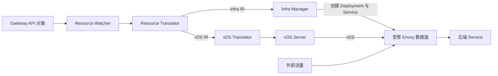

# envoygateway排查参考

## 是什么
- **一句话定位**：Envoy Gateway 是 Gateway API 的一个实现。它监听 Gateway、HTTPRoute 等对象，把它们翻译成 Envoy 配置并经 xDS 推给 Envoy，同时负责创建和维护运行 Envoy 的 Deployment、Service 等基础设施。
- **解决什么问题**：Gateway API 对象和真正处理流量的 Envoy 之间隔着一层翻译与下发。路由写了不生效，要判断是没被 Envoy Gateway 认领、基础设施没起来、翻译结果不对，还是没推到 Envoy。
- **谁在用、从哪进来**：集群里选用了 Envoy Gateway 作为 GatewayClass 控制器的 Gateway 与 Route。
- **边界（不负责什么）**：Gateway API 对象本身的语义与状况见 GatewayAPI排查参考；Envoy 数据面如何处理请求、响应标志含义见 envoy排查参考；后端 Service 与端点见 Service排查参考。
- **形态与版本**：控制面是一个 Kubernetes 控制器，数据面是它按 Gateway 创建的受管 Envoy。设计文档最初写于早期版本，Provider、支持的 Route 类型等随版本扩展，使用时以所用版本的官方说明为准。
- **术语**：
  - 受管数据面 —— 由 Envoy Gateway 创建和维护的 Envoy 代理及其 Deployment、Service
  - IR —— 内部中间表示，分为基础设施用的 Infra IR 与配置用的 xDS IR
  - EnvoyProxy —— 用来改写数据面基础设施默认参数的自定义资源
  - 静态配置 —— 启动时加载的配置文件，与动态的 Gateway API 对象相对

## 组件与架构

| 组件 | 角色 | 职责 | 部署位置 / 形态 | 如何找到 |
|---|---|---|---|---|
| Resource Watcher | 控制面 | 通过 Provider 监听 Gateway API 等资源 | Envoy Gateway 进程内 | Envoy Gateway 的日志 |
| Resource Translator | 控制面 | 把外部资源翻译成 Infra IR 与 xDS IR | 进程内 | 同上 |
| Infra Manager | 控制面 | 依据 Infra IR 创建、更新、删除数据面基础设施 | 进程内 | 受管 Deployment 与 Service |
| xDS Translator 与 xDS Server | 控制面 | 把 xDS IR 转成 xDS 资源，经 gRPC 下发（Delta xDS） | 进程内 | Envoy 与它之间的连接 |
| EnvoyProxy 自定义资源 | 配置 | 改写数据面基础设施的默认参数 | 由 GatewayClass 的 parametersRef 引用 | 该资源的内容 |
| 受管 Envoy 数据面 | 数据面 | 实际处理流量 | 由 Infra Manager 创建的 Pod | 见 envoy排查参考 |

## 正常链路（请求怎么走 / 正常行为）

### 资源匹配关系
| 编号 | 资源 A.字段 | → | 资源 B.字段 | 匹配规则 | 对不上时的表现 |
|---|---|---|---|---|---|
| R1 | GatewayClass.spec.controllerName | → | Envoy Gateway 静态配置的控制器名 | 两者相同，Envoy Gateway 才管理引用该 GatewayClass 的 Gateway；多个 GatewayClass 用同一控制器名时按 Gateway API 的指南解决冲突 | 控制器名不一致：Gateway 没人认领，什么基础设施都不会创建 |
| R2 | GatewayClass.spec.parametersRef | → | EnvoyProxy 自定义资源 | 引用的 EnvoyProxy 改写数据面基础设施的默认参数，如把暴露方式从 LoadBalancer 改为 ClusterIP 或 NodePort；不写则用默认参数 | 引用写错或资源不存在：数据面参数回到默认，Service 类型不符预期 |
| R3 | Gateway | → | 受管 Envoy 基础设施 | 每个 Gateway 触发 Envoy Gateway 创建受管的 Envoy 代理基础设施，如 Deployment 与 Service | Gateway 在、数据面 Pod 或 Service 不在：Infra Manager 这一环出问题 |
| R4 | Gateway 的监听器 | → | Envoy 的监听器 | 一个 Gateway 监听器对应一个 Envoy 监听器；按端口分组，兼容的一组合并成一个 Envoy 监听器 | 同端口的监听器不兼容：冲突按 Gateway API 的指南解决，其中一部分监听器可能不生效〔待复核〕 |
| R5 | HTTPRoute | → | Envoy 的路由 | 一个 HTTPRoute 对应一个 Envoy 路由，匹配、过滤并转到后端 | Route 写对了但请求不命中：翻译或下发出问题，见 envoy排查参考 |
| R6 | 路由的后端引用 | → | Service 与其端点 | 后端虽可写任意合法的组与种类，但只支持 Service 引用，服务发现用 Kubernetes | 引用的不是 Service：不被支持，路由后端不可用 |
| R7 | 静态配置文件 | → | Envoy Gateway 的运行方式 | 启动时加载，设置控制器名、Provider 等；没提供文件时用默认参数；目前只能通过配置文件 | 改了配置文件没生效：静态配置在启动时才加载，通常需要重启〔待复核〕 |

### 控制面下发路径
| 环节 | 做什么 | 依据 |
|---|---|---|
| P1 | Resource Watcher 通过 Provider 监听 GatewayClass、Gateway、Route 等资源的变化 | R1 R5 |
| P2 | Resource Translator 把资源翻译成两份中间表示：Infra IR 与 xDS IR | R1 R2 R4 R5 |
| P3 | Infra Manager 依据 Infra IR 创建或更新受管数据面的 Deployment 与 Service | R2 R3 |
| P4 | xDS Translator 把 xDS IR 转成 xDS 资源，xDS Server 经 gRPC 以 Delta xDS 下发给 Envoy | R4 R5 R6 |

### 流量走向（或生命周期）

| 环节 | 起点 → 终点 | 做什么 | 依据 | 同步/异步与默认行为 |
|---|---|---|---|---|
| L1 | Gateway → 基础设施 | Infra Manager 为 Gateway 创建 Envoy 的 Deployment 与 Service | R3 | 异步，由控制器完成 |
| L2 | Envoy → xDS Server | 受管 Envoy 向 Envoy Gateway 的 xDS Server 取得监听器、路由、集群与端点 | R4 R5 | 持续的 gRPC 流，变更增量推送 |
| L3 | 外部 → Envoy | 流量经数据面 Service 的暴露方式（默认 LoadBalancer，可经 EnvoyProxy 改为 ClusterIP 或 NodePort）进入 Envoy | R2 | 同步 |
| L4 | Envoy → 后端 | 按监听器与路由匹配转到后端 Service 的端点，之后的细节见 envoy排查参考 | R4 R5 R6 | 同步 |

### 正常表现（健康基线）
- GatewayClass 的控制器名与 Envoy Gateway 的配置一致，Gateway 已被认领。
- 每个 Gateway 有对应的受管 Envoy Pod 与 Service，Pod 就绪。
- 路由变更后很快在 Envoy 配置中体现。

## 逐环节排查（沿链路对照）
- **P1 监听资源**
  - 正常：Envoy Gateway 看得到 Gateway API 资源的变化。
  - 异常：GatewayClass 的控制器名不匹配，Gateway 不被认领。
  - 区分点：新建 Gateway 后什么基础设施都没出现，先查 controllerName（R1）。
  - 证据落点：GatewayClass 的 controllerName；Envoy Gateway 的静态配置。
- **P2 翻译**
  - 正常：资源被翻译成 IR。
  - 异常：资源写法不被支持或字段有误，翻译失败。
  - 区分点：后端引用不是 Service 属于不被支持的写法（R6），应在 Route 的状况里体现，见 GatewayAPI排查参考。
  - 证据落点：Envoy Gateway 日志；Route 与 Gateway 的状况。
- **P3 创建基础设施**
  - 正常：受管的 Deployment 与 Service 出现。
  - 异常：基础设施没出现，或参数与预期不符。
  - 区分点：基础设施缺失看 Infra Manager 与 EnvoyProxy 的引用；Service 类型不对看 parametersRef（R2）。
  - 证据落点：受管 Deployment 与 Service；EnvoyProxy 的内容。
- **P4 下发 xDS**
  - 正常：Envoy 收到并应用配置。
  - 异常：基础设施在，Envoy 没拿到配置或配置不对。
  - 区分点：用 Envoy 自己的配置转储和访问日志判断，见 envoy排查参考。
  - 证据落点：Envoy 的配置转储；Envoy 与 xDS Server 的连接状态。
- **L1 基础设施就绪**
  - 正常：Pod 就绪、Service 有地址。
  - 异常：Pod 起不来；LoadBalancer 地址一直没分配。
  - 区分点：Pod 问题回到 Pod排查参考；地址问题要看所在环境对 LoadBalancer 的支持，必要时经 EnvoyProxy 改暴露方式。
  - 证据落点：受管 Pod 状态；Service 的外部地址。
- **L2 获取配置**
  - 正常：Envoy 持续从 xDS Server 获取配置。
  - 异常：Envoy 起来了但没有监听器与路由。
  - 区分点：整套配置都缺，指向与 xDS Server 的连接，而不是某条 Route。
  - 证据落点：Envoy 的 bootstrap 与连接日志。
- **L3 流量入口**
  - 正常：外部流量到达 Envoy。
  - 异常：外部访问不到数据面。
  - 区分点：看数据面 Service 的类型与暴露方式是否符合预期（R2）。
  - 证据落点：数据面 Service 的类型与地址。
- **L4 转发到后端**
  - 正常：请求命中路由并到达后端。
  - 异常：404、503 等。
  - 区分点：响应标志与响应码的含义按 envoy排查参考判断；Route 是否被接受按 GatewayAPI排查参考判断。
  - 证据落点：Envoy 访问日志；Route 的状况；后端 Service 的端点。

## 异常归因速查
| 现象 / 错误码 | 环节 | 归因类别（回指 R#） | 证据位 | 详细条目 |
|---|---|---|---|---|
| 创建 Gateway 后什么都没出现 | P1 | GatewayClass 的控制器名与 Envoy Gateway 配置不一致（R1） | controllerName 的取值 | oss/k8s-gateway-api.md |
| 数据面 Service 类型不对 | P3 | parametersRef 指向的 EnvoyProxy 缺失或写错（R2） | GatewayClass 的 parametersRef；EnvoyProxy 内容 | |
| Gateway 在、数据面 Pod 不在 | P3 L1 | Infra Manager 创建基础设施失败（R3） | 受管 Deployment 与 Envoy Gateway 日志 | |
| 同端口多个监听器行为异常 | P2 | 监听器兼容性判断与合并（R4） | 监听器的端口与协议 | |
| Route 对象正常但请求不命中 | P4 L4 | 配置没下发或翻译结果不符（R5） | Envoy 配置转储 | oss/envoy-proxy.md |
| 后端引用被拒绝 | P2 | 只支持 Service 引用（R6） | 后端引用的组与种类 | oss/k8s-gateway-api.md |
| 数据面起来了但没有监听器与路由 | L2 | Envoy 没连上 xDS Server（R5） | Envoy 与 xDS Server 的连接 | oss/envoy-proxy.md |
| 改了静态配置文件没生效 | P1 | 静态配置只在启动时加载（R7） | 配置文件与进程启动时间〔待复核〕 | |
| 外部访问不到数据面 | L3 | 数据面 Service 暴露方式不符预期（R2） | Service 类型与外部地址 | oss/k8s-service.md |

## 状态、事件与日志语义
| 来源 | 取值 | 含义 | 常见出现环节 |
|---|---|---|---|
| 配置项 | controllerName | GatewayClass 与 Envoy Gateway 匹配的依据 | P1 |
| 配置项 | parametersRef | 指向 EnvoyProxy，改写数据面基础设施参数 | P3 |
| 内部表示 | Infra IR 与 xDS IR | 分别供基础设施管理与 xDS 翻译使用 | P2 |
| 状况 | Gateway 与 Route 的 Accepted、Programmed、ResolvedRefs 等 | 由 Envoy Gateway 按 Gateway API 的约定回写，语义见 GatewayAPI排查参考〔待复核〕 | P2 P4 |

## 配置语义
| 配置项 | 默认 / 取值含义 | 改动后的行为后果 |
|---|---|---|
| 静态配置文件 | 设置控制器名、Provider 等；不提供则用默认参数 | 启动时加载，改动通常需要重启〔待复核〕 |
| GatewayClass.controllerName | 与静态配置的控制器名比对 | 不一致则 Gateway 不被管理 |
| GatewayClass.parametersRef | 指向 EnvoyProxy | 改变数据面基础设施默认参数，如暴露方式 |
| EnvoyProxy 的暴露方式 | 默认 LoadBalancer，可改为 ClusterIP 或 NodePort | 改变外部流量进入数据面的方式 |
| 辅助控制面 | 如全局限流的限流服务 | 需要额外部署与配置，不属于默认安装 |

## 边界与置信度说明
- **来源**：Envoy Gateway 官方系统设计文档，其中部分内容最初写于早期版本（页面可见 v0.2 的版本页），没有做过运行时取证。
- **〔待复核〕项**：同端口监听器冲突时的具体处理；静态配置变更是否必须重启；状况回写的具体语义；受管 Deployment 与 Service 的默认命名与所在命名空间。
- **版本差异**：设计文档里的 Provider、支持的 Route 类型（早期只提到 HTTPRoute 与 TLSRoute）随版本扩展，较新版本还有更多策略类资源，以所用版本的官方文档为准。
- **未覆盖**：ClientTrafficPolicy、BackendTrafficPolicy、SecurityPolicy 等策略资源；限流、认证、扩展过滤器的具体行为；多网关与多命名空间部署；升级与回滚；指标与日志的完整清单。
- **related**：见 frontmatter。
