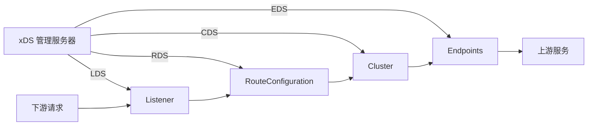

# envoy排查参考

## 是什么
- **一句话定位**：Envoy 数据面如何处理一个请求：下游连接到达监听器，经过滤器链与路由，选出上游集群，再从集群里挑一个端点转发；配置可静态写好，也可由 xDS 管理服务器动态下发。
- **解决什么问题**：看到 503、404、504 和一串响应标志时，能判断请求死在哪一环：没有路由、找不到集群、没有健康端点、连不上、被熔断、还是超时。
- **谁在用、从哪进来**：Envoy Gateway、Istio 等都以 Envoy 作数据面，请求经它们转发；本条只写 Envoy 数据面自己的逻辑。
- **边界（不负责什么）**：Gateway API 或 Istio 的对象如何被翻译成 Envoy 配置并下发，见各自的软件条目；Service 与端点的来源见 Service排查参考。
- **形态与版本**：以进程或 Pod 内的代理运行。官方概览示例使用 v2 API，现行为 v3 API，资源模型一致，字段与过滤器名随版本变化。
- **术语**：
  - Listener —— 监听地址与端口，带过滤器链
  - RouteConfiguration —— 虚拟主机与路由规则
  - Cluster —— 一组上游，带负载均衡与健康策略
  - 响应标志 —— 访问日志里说明请求为何被这样处理的缩写

## 组件与架构

| 组件 | 角色 | 职责 | 部署位置 / 形态 | 如何找到 |
|---|---|---|---|---|
| Listener | 入口 | 监听地址与端口，用过滤器链处理连接 | Envoy 进程内 | 管理接口的监听器列表〔待复核〕 |
| 路由配置 | 路由 | 按主机名与路径选择目标集群 | Envoy 进程内 | 配置转储中的路由部分 |
| Cluster | 上游抽象 | 负载均衡、健康检查、连接池、熔断 | Envoy 进程内 | 管理接口的集群信息 |
| 端点 | 后端实例 | 具体的 IP 与端口，常由 EDS 提供 | Envoy 进程内 | 集群下的端点状态 |
| xDS 管理服务器 | 控制面 | 动态下发上述各类资源 | 独立的服务 | bootstrap 里指向它的 cluster |
| 管理接口 | 观测 | 提供配置转储、集群、统计等〔待复核〕 | 本机管理端口 | bootstrap 的 admin 地址 |

## 正常链路（请求怎么走 / 正常行为）

### 资源匹配关系
| 编号 | 资源 A.字段 | → | 资源 B.字段 | 匹配规则 | 对不上时的表现 |
|---|---|---|---|---|---|
| R1 | 下游连接的地址与端口 | → | Listener 及其 filter chain | 连接到达监听器后，按 filter chain 的匹配条件选一条 | 没有匹配的 filter chain：连接被拒，标志 NR |
| R2 | 请求的主机名与路径 | → | 路由配置的 virtual_host 与 route | 先按 domains 选虚拟主机，再按 routes 的 match 选路由 | 没有配置路由：404，标志 NR |
| R3 | 路由里的 cluster 名 | → | Cluster 的名字 | route 指向的 cluster 必须存在 | 找不到集群：标志 NC |
| R4 | Cluster 名 | → | EDS 的 ClusterLoadAssignment.cluster_name | EDS 类型的集群，端点来自同名的 ClusterLoadAssignment | 名字对不上：集群没有端点，请求落在无健康主机上 |
| R5 | Cluster 的健康与限制 | → | 可用端点与是否放行 | 健康检查与异常检测决定端点是否可用，熔断限制并发与排队 | 无健康主机：UH 加 503；超过限制：UO 加 503；本地健康检查失败：LH 加 503 |
| R6 | 路由或集群的资源名 | → | 管理服务器下发的资源名 | 监听器里 rds 的 route_config_name 必须等于管理服务器下发的 RouteConfiguration 名；集群通过 eds_config 指向 EDS | 名字不一致：路由配置收不到，请求没有路由 |

### 控制面下发路径
| 环节 | 做什么 | 依据 |
|---|---|---|
| P1 | bootstrap 静态给出管理服务器所在的 cluster，并在 dynamic_resources 里指向 LDS 与 CDS | R6 |
| P2 | LDS 下发 Listener，其 HTTP 连接管理器通过 rds 引用路由配置名 | R1 R6 |
| P3 | RDS 下发同名的 RouteConfiguration | R2 R6 |
| P4 | CDS 下发 Cluster，EDS 类型的集群再指向 EDS | R3 R6 |
| P5 | EDS 下发 ClusterLoadAssignment，给出各集群的端点 | R4 |

### 流量走向（或生命周期）

| 环节 | 起点 → 终点 | 做什么 | 依据 | 同步/异步与默认行为 |
|---|---|---|---|---|
| L1 | 下游 → Listener | 连接到达，选 filter chain，进入 HTTP 连接管理器 | R1 | 同步 |
| L2 | 请求 → 路由 | 按主机名与路径匹配路由 | R2 | 同步 |
| L3 | 路由 → Cluster | 按路由指定的 cluster 名找到集群 | R3 | 同步 |
| L4 | Cluster → 端点 | 按负载均衡选端点，受健康检查、熔断、超时与重试约束 | R4 R5 | 同步；重试用尽时标志 URX |
| L5 | 端点 → 响应 | 返回响应并写访问日志，响应标志说明处理方式 | R5 | 同步 |

### 正常表现（健康基线）
- 访问日志里响应标志为 -，即没有任何标志。
- 路由与集群都已由管理服务器下发且名字一致，端点数符合预期。
- 没有持续出现的 NR 或 NC，这两个几乎总是配置问题〔待复核〕。

## 逐环节排查（沿链路对照）
- **P1 管理服务器连接**
  - 正常：Envoy 能连上管理服务器并收到资源。
  - 异常：管理服务器所在 cluster 配错，什么资源都收不到。
  - 区分点：所有动态资源都缺失，先看这一步。
  - 证据落点：bootstrap 里的 xds cluster；Envoy 与管理服务器之间的连接日志。
- **P2 监听器下发**
  - 正常：监听器已下发并在监听。
  - 异常：监听器缺失或没有匹配的 filter chain。
  - 区分点：连接直接被拒，且伴随 NR，看 filter chain 的匹配条件。
  - 证据落点：监听器列表；配置转储里的监听器部分。
- **P3 路由配置下发**
  - 正常：路由配置已下发，名字与监听器引用一致。
  - 异常：路由配置名与引用不一致，或还没下发。
  - 区分点：所有请求都 404，先对照 route_config_name 与实际下发的名字（R6）。
  - 证据落点：配置转储里的路由配置名。
- **P4 集群下发**
  - 正常：路由引用的集群都已存在。
  - 异常：集群被移除或从未下发。
  - 区分点：标志 NC 明确指向这一环。
  - 证据落点：集群列表。
- **P5 端点下发**
  - 正常：每个集群都有预期数量的端点。
  - 异常：端点为空或名字对不上。
  - 区分点：集群在、端点为空，对照 ClusterLoadAssignment 的 cluster_name（R4）。
  - 证据落点：集群下的端点列表。
- **L1 监听器**
  - 正常：连接被接受。
  - 异常：没有匹配的 filter chain 导致连接被拒。
  - 区分点：与 404 的区别是这里在 HTTP 层之前。
  - 证据落点：监听器配置与访问日志。
- **L2 路由匹配**
  - 正常：请求命中预期路由。
  - 异常：404 并伴随 NR；主机名或路径不匹配。
  - 区分点：NR 加 404 说明没有路由，不涉及上游；先看 domains 与 match。
  - 证据落点：路由配置里的 domains 与 match；请求的主机头与路径。
- **L3 集群查找**
  - 正常：路由指向的集群存在。
  - 异常：NC，集群不存在。
  - 区分点：NC 几乎总是配置错误，不是网络问题〔待复核〕。
  - 证据落点：路由里的 cluster 名；集群列表。
- **L4 选端点与转发**
  - 正常：端点可用，请求成功。
  - 异常：UH 无健康端点；UF 连不上；UO 熔断；UT 超时；URX 重试用尽；LH 本地健康检查失败。
  - 区分点：先看标志，再看响应码，二者结合；标志为 - 且返回错误，说明是上游应用自己返回的。
  - 证据落点：访问日志的响应标志；集群的端点健康与熔断状态。
- **L5 响应与日志**
  - 正常：响应与日志一致。
  - 异常：下游提前断开（DC）；多个标志同时出现。
  - 区分点：多个标志要连起来读，如 URX 与 UF 同时出现表示连不上且重试用尽〔待复核〕。
  - 证据落点：访问日志。

## 异常归因速查
| 现象 / 错误码 | 环节 | 归因类别（回指 R#） | 证据位 | 详细条目 |
|---|---|---|---|---|
| 404 与 NR | L2 P3 | 没有配置匹配的路由（R2、R6） | 路由配置；请求主机与路径 | oss/k8s-gateway-api.md |
| NC | L3 P4 | 路由引用的集群不存在（R3） | 路由里的 cluster 名；集群列表 | |
| 503 与 UH | L4 P5 | 集群没有健康端点（R4、R5） | 集群端点与健康状态 | oss/k8s-service.md |
| 503 与 UF | L4 | 连不上上游端点（R5） | 上游端口与可达性 | |
| 503 与 UO | L4 | 熔断触发（R5） | 集群的熔断设置与并发 | |
| 504 与 UT | L4 | 上游请求超时（R5） | 超时设置与上游耗时 | |
| URX | L4 | 重试次数用尽（R5） | 重试策略与上游状态 | |
| LH | L4 | 本地服务未通过健康检查（R5） | 健康检查配置 | |
| 所有路由都 404 | P3 | 路由配置名与监听器引用不一致（R6） | route_config_name 与下发名 | |
| 没有任何动态资源 | P1 | 管理服务器连接配置错误（R6） | bootstrap 的管理服务器配置 | |
| 有错误响应但标志为 - | L4 L5 | 上游应用自己返回的错误（R5） | 上游应用日志 | |

## 状态、事件与日志语义
| 来源 | 取值 | 含义 | 常见出现环节 |
|---|---|---|---|
| 响应标志 | UH | 上游集群没有健康主机，伴随 503 | L4 |
| 响应标志 | UF | 上游连接失败，伴随 503 | L4 |
| 响应标志 | UO | 上游溢出，即熔断，伴随 503 | L4 |
| 响应标志 | NR | 没有为该请求配置路由，伴随 404；较新版本还含下游连接没有匹配的 filter chain | L1 L2 |
| 响应标志 | NC | 找不到上游集群 | L3 |
| 响应标志 | URX | 达到重试上限或最大连接尝试次数 | L4 |
| 响应标志 | UT | 上游请求超时，伴随 504 | L4 |
| 响应标志 | DC | 下游连接终止 | L5 |
| 响应标志 | LH | 本地服务健康检查失败，伴随 503 | L4 |
| 响应标志 | LR、UR | 本地重置、上游远端重置，均伴随 503 | L4 |
| 响应标志 | UC、RL | 上游连接终止、限流〔待复核〕 | L4 |
| 响应标志 | - | 没有标志，处理正常 | L5 |

## 配置语义
| 配置项 | 默认 / 取值含义 | 改动后的行为后果 |
|---|---|---|
| 路由 match | 如按前缀匹配 | 决定请求命中哪条路由 |
| cluster 类型 | 如静态或 EDS | EDS 时端点由管理服务器下发 |
| connect_timeout | 集群连接上游的超时 | 过短会造成 UF，过长拖慢失败 |
| 负载均衡策略 | 如轮询 | 决定端点选择方式 |
| 熔断设置 | 限制连接、排队、请求数 | 超过限制时 UO |
| 重试策略 | 次数与条件 | 次数用尽时 URX |
| admin 地址 | bootstrap 中指定 | 决定管理接口监听位置，注意仅应本机可达 |

## 边界与置信度说明
- **来源**：Envoy 官方文档的访问日志与配置概览，覆盖多个版本；没有做过运行时取证。
- **〔待复核〕项**：管理接口各路径的具体输出；UC、RL 等扩展标志；NR 与 NC 是否几乎总意味着配置错误；多标志组合的含义。
- **版本差异**：官方说明里 NR 伴随 404，部分二手资料写成 503，以官方为准；较新版本的 NR 还包括没有匹配的 filter chain；v2 API 已被 v3 取代，字段名与过滤器名不同。
- **未覆盖**：过滤器的详细行为（限流、认证、重写等）；TLS 与证书的下发（SDS）；健康检查与异常检测的参数；HTTP/2、gRPC 与 TCP 代理的差别；观测指标清单。
- **related**：见 frontmatter。
