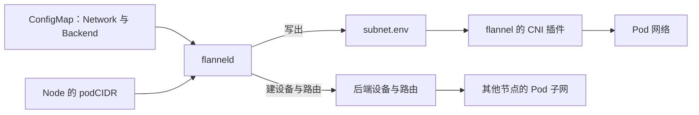
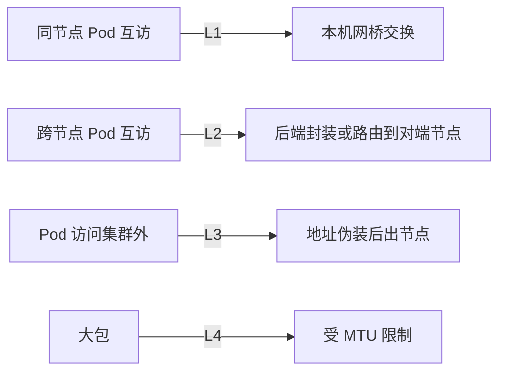

# flannel排查参考

## 是什么
- **一句话定位**：一个只管"Pod 跨节点互通"的轻量 CNI 实现：给每个节点分一段 Pod 子网，再用封装或路由把各节点的子网连起来。
- **解决什么问题**：跨节点 Pod 不通、节点拿不到子网、大包丢失（MTU）、防火墙挡住封装端口时，判断问题在配置、后端选择、节点子网还是底层网络。
- **谁在用、从哪进来**：以 DaemonSet 部署的 flanneld 在每个节点运行，并在节点上安装 CNI 插件，运行时创建 Pod 时调用它拿到子网与网卡配置。
- **边界（不负责什么）**：CNI 如何被运行时调用、配置目录与二进制目录，见 CNI排查参考；NetworkPolicy 的语义见 NetworkPolicy排查参考；flannel 本身不负责策略执行（见下文）。
- **形态与版本**：后端一旦设置运行期间不应更换；k3s 内置的 flannel 参数与独立部署不同。
- **术语**：
  - 后端 —— 跨节点转发方式：vxlan、host-gw、wireguard、udp
  - subnet.env —— flanneld 写出的文件，记录本节点子网与 MTU
  - DirectRouting —— vxlan 在同子网节点间改用直连路由

## 组件与架构

| 组件 | 角色 | 职责 | 部署位置 / 形态 | 如何找到 |
|---|---|---|---|---|
| flanneld | 节点代理 | 取得本节点子网，建立后端设备与路由，写 subnet.env，监听其他节点变化 | 每个节点一个 DaemonSet Pod | 对应命名空间里的 flannel 工作负载〔待复核〕 |
| kube-flannel-cfg | 配置 | 存放 net-conf.json，含 Network 与 Backend | ConfigMap | 对应命名空间里的该 ConfigMap |
| CNI 插件与配置 | 接入 | 让运行时创建 Pod 时按 subnet.env 分配地址 | 节点配置目录与二进制目录 | 见 CNI排查参考 |
| 后端设备 | 数据面 | vxlan 后端为 flannel.1，wireguard 为 flannel-wg | 节点内核 | 节点上的网络接口 |

## 正常链路（请求怎么走 / 正常行为）

### 资源匹配关系
| 编号 | 资源 A.字段 | → | 资源 B.字段 | 匹配规则 | 对不上时的表现 |
|---|---|---|---|---|---|
| R1 | Node.spec.podCIDR | → | 本节点的 Pod 子网 | kube-subnet-mgr 模式下，每个节点的子网读自 Node 的 podCIDR，flannel 并把 VTEP MAC、节点 IP 等写回 Node 注解〔待复核〕 | 节点没有 podCIDR：该节点拿不到子网，Pod 起不来 |
| R2 | net-conf.json 的 Network 与 Backend | → | 集群 Pod 总网段与后端类型 | kube-subnet-mgr 时读 /etc/kube-flannel/net-conf.json（来自 ConfigMap），否则读 etcd；后端一旦设置运行期间不应更换 | 改了后端不生效或行为紊乱：后端应在部署时确定 |
| R3 | 后端类型 | → | 跨节点转发方式 | vxlan 封装后经 UDP 转发；host-gw 为到对端节点的直连路由，要求节点二层直连，通常不能用于云环境；wireguard 加密封装；udp 仅调试用；vxlan 的 DirectRouting 在同子网节点间改用直连路由 | 后端与网络环境不匹配：跨节点不通，如在不满足二层直连的网络里用 host-gw |
| R4 | subnet.env | → | CNI 插件给 Pod 的子网与 MTU | flanneld 写出 FLANNEL_NETWORK、FLANNEL_SUBNET、FLANNEL_MTU、FLANNEL_IPMASQ；MTU 由 flannel 自动计算 | 文件缺失或值异常：Pod 拿不到正确子网或 MTU 不对 |
| R5 | --ip-masq 设置 | → | 出集群流量的地址伪装 | 上游清单启用后，目的地在 flannel 网络之外的流量做地址伪装，生效值反映在 FLANNEL_IPMASQ〔待复核〕 | Pod 访问集群外时源地址被改写为节点地址：是预期行为 |
| R6 | 节点上的网卡 | → | 封装所用的节点地址 | 默认自动选择网卡，多网卡节点可用 --iface 指定 | 选错网卡：跨节点封装包走错路径，表现为跨节点不通 |
| R7 | NetworkPolicy | → | flannel 的数据面 | 基础的 flannel 本身不执行 NetworkPolicy，需搭配其他组件或改用别的 CNI〔待复核〕 | 策略写了毫无变化：不是写错，是网络插件不执行 |

### 控制面下发路径
| 环节 | 做什么 | 依据 |
|---|---|---|
| P1 | flanneld 启动，读取 net-conf.json 的网络与后端配置 | R2 |
| P2 | flanneld 从 Node 的 podCIDR 取得本节点子网，写 subnet.env，按后端建立设备与路由 | R1 R3 R4 |
| P3 | 安装 CNI 配置与二进制到节点（通常由 DaemonSet 的初始化容器完成）〔待复核〕 | R4 |
| P4 | flanneld 监听其他节点的变化，更新到它们子网的路由、转发表或对端信息 | R3 |

### 流量走向（或生命周期）

| 环节 | 起点 → 终点 | 做什么 | 依据 | 同步/异步与默认行为 |
|---|---|---|---|---|
| L1 | Pod → 同节点 Pod | 经本机网桥交换，不经过后端设备〔待复核〕 | R4 | 同步 |
| L2 | Pod → 其他节点 Pod | 按后端处理：vxlan 封装进 UDP（Linux 默认端口 8472）发往对端节点并解封装；host-gw 直接路由到对端节点；wireguard 加密封装 | R3 R6 | 同步；需要节点间底层可达且防火墙放行 |
| L3 | Pod → 集群外 | 启用 --ip-masq 时做地址伪装后离开节点 | R5 | 同步 |
| L4 | 任意 → 任意 | 封装会占用头部，flannel 自动算出较小的 MTU，vxlan 在 1500 的物理 MTU 上常为 1450 | R4 | 同步 |

### 正常表现（健康基线）
- 每个节点的 flanneld 在运行，节点有 podCIDR，/run/flannel/subnet.env 存在。
- 跨节点 Pod 互通，后端设备（如 flannel.1）存在。
- 各节点的 Pod MTU 与后端相符，没有大包丢失。

## 逐环节排查（沿链路对照）
- **P1 读取配置**
  - 正常：flanneld 读到 net-conf.json。
  - 异常：配置缺失或格式错误，flanneld 启动失败。
  - 区分点：flannel Pod 反复重启时，先看日志是否在读配置阶段失败。
  - 证据落点：flannel Pod 日志；kube-flannel-cfg 的内容。
- **P2 取子网与建后端**
  - 正常：节点拿到子网，后端设备建立。
  - 异常：节点没有 podCIDR，拿不到子网；后端设备没创建。
  - 区分点：个别节点出问题，先看该节点的 podCIDR（R1）。
  - 证据落点：Node 的 spec.podCIDR；flanneld 日志。
- **P3 安装 CNI**
  - 正常：配置与二进制已就位。
  - 异常：新节点没有 CNI 配置或二进制。
  - 区分点：这是 CNI 层的问题，见 CNI排查参考。
  - 证据落点：节点上的配置目录与二进制目录。
- **P4 同步其他节点**
  - 正常：到各节点子网的路由或转发表项齐全。
  - 异常：新加入节点后，旧节点没有到它的路由。
  - 区分点：只有涉及某个新节点的流量不通，查其他节点上到它的路由或转发表项。
  - 证据落点：节点上到各 Pod 子网的路由与后端转发表。
- **L1 同节点**
  - 正常：同节点 Pod 互通。
  - 异常：同节点也不通。
  - 区分点：同节点不通、跨节点才涉及后端，所以问题多在本机网桥或 CNI，而不是后端。
  - 证据落点：本机网桥与 Pod 的网卡配置。
- **L2 跨节点**
  - 正常：跨节点 Pod 互通。
  - 异常：跨节点不通。
  - 区分点：vxlan 看节点间 UDP 端口是否被防火墙挡住（Linux 默认 8472）；host-gw 看节点是否二层直连；多网卡看 --iface（R3、R6）。
  - 证据落点：节点间对应端口的连通性；路由与后端转发表；防火墙规则。
- **L3 访问集群外**
  - 正常：集群外目标可达。
  - 异常：集群外不可达，或源地址与预期不符。
  - 区分点：源地址被改写成节点地址是 --ip-masq 的预期行为（R5）。
  - 证据落点：flanneld 启动参数；FLANNEL_IPMASQ 的取值。
- **L4 大包与 MTU**
  - 正常：大包正常。
  - 异常：小包通、大包丢；不同节点 MTU 不一致。
  - 区分点：先对比各节点 subnet.env 里的 FLANNEL_MTU 与物理网络 MTU。
  - 证据落点：各节点 subnet.env；物理网卡 MTU。

## 异常归因速查
| 现象 / 错误码 | 环节 | 归因类别（回指 R#） | 证据位 | 详细条目 |
|---|---|---|---|---|
| 跨节点 Pod 不通，同节点通 | L2 | 后端转发或底层网络问题（R3、R6） | 节点间 UDP 端口；路由与转发表 | oss/k8s-network.md |
| vxlan 下跨节点不通 | L2 | 防火墙挡了封装端口（Linux 默认 8472）（R3） | 防火墙规则 | |
| host-gw 下跨节点不通 | L2 | 节点不满足二层直连（R3） | 节点所在网络 | |
| 节点拿不到子网 | P2 | Node 没有 podCIDR（R1） | Node 的 spec.podCIDR | oss/k8s-node.md |
| 新节点 Pod 起不来 | P3 | 该节点缺 CNI 配置或二进制（R4） | 节点目录内容 | oss/k8s-cni.md |
| 小包通、大包丢 | L4 | MTU 不匹配（R4） | 各节点 FLANNEL_MTU 与物理 MTU | |
| 改了后端类型没生效 | P1 | 后端不应在运行期更换（R2） | net-conf.json 与实际设备 | |
| 访问集群外源地址变成节点地址 | L3 | 地址伪装的预期行为（R5） | FLANNEL_IPMASQ | |
| NetworkPolicy 写了不生效 | — | flannel 本身不执行策略（R7）〔待复核〕 | 网络插件的能力说明 | oss/k8s-networkpolicy.md |
| 多网卡节点跨节点不通 | L2 | 封装走了错误的网卡（R6） | --iface 设置 | |

## 状态、事件与日志语义
| 来源 | 取值 | 含义 | 常见出现环节 |
|---|---|---|---|
| subnet.env | FLANNEL_NETWORK | 整个集群的 flannel 网段 | P2 |
| subnet.env | FLANNEL_SUBNET | 本节点的 Pod 子网 | P2 |
| subnet.env | FLANNEL_MTU | flannel 算出的 MTU | L4 |
| subnet.env | FLANNEL_IPMASQ | 是否对出网流量做地址伪装 | L3 |
| 网络接口 | flannel.1 | vxlan 后端创建的接口〔待复核〕 | L2 |
| 网络接口 | flannel-wg、flannel-wg-v6 | wireguard 后端创建的接口 | L2 |

## 配置语义
| 配置项 | 默认 / 取值含义 | 改动后的行为后果 |
|---|---|---|
| Backend.Type | 默认 vxlan；可选 host-gw、wireguard、udp | 决定跨节点转发方式；运行期间不应更换 |
| vxlan 的 DirectRouting | 默认 false | 开启后同子网节点用直连路由，只在跨子网时封装 |
| --kube-subnet-mgr | 从 Kubernetes API 取子网并读 net-conf.json | 关闭则需要 etcd |
| --ip-masq | 上游清单启用 | 对出 flannel 网络的流量做地址伪装 |
| --iface | 指定通信网卡 | 多网卡节点用于避免选错网卡 |
| VXLAN 端口 | Linux 默认 8472〔待复核〕 | 防火墙需放行来自其他节点的该端口 |
| EnableNFTables | 实验性，默认 false〔待复核〕 | 不建议仅因主机用 nftables 就开启 |

## 边界与置信度说明
- **来源**：flannel 上游文档的 backends 与 configuration 页（通过仓库镜像分支取得，不是主仓库页面）与 k3s 官方文档；kube-subnet-mgr 的部署细节、MTU 取值、"不执行 NetworkPolicy"一条来自二手资料。
- **〔待复核〕项**：flannel 是否执行 NetworkPolicy（多个二手来源一致，但没取到上游原文）；VXLAN 默认端口；DaemonSet 的命名空间与名字；本机网桥的细节；CNI 配置与二进制的安装方式。
- **版本差异**：上游文档提到 MTU 由 flannel 自动计算且不可改；双栈只支持 vxlan、wireguard、Linux 的 host-gw；较新文档提到可选的独立网络策略组件。k3s 内置的 flannel 后端名与参数不同，如 wireguard-native。
- **未覆盖**：IPv6 与双栈细节；WireGuard 的密钥与对端管理；nftables 模式；Windows 节点；与 kube-proxy 的规则关系；升级与迁移到其他 CNI。
- **related**：见 frontmatter。
