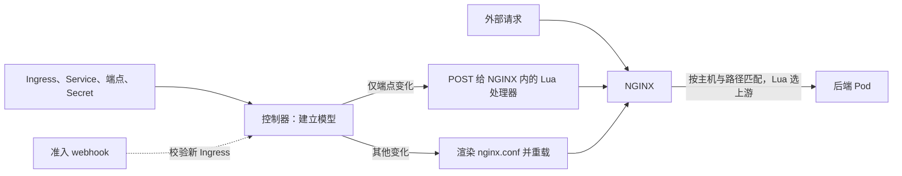
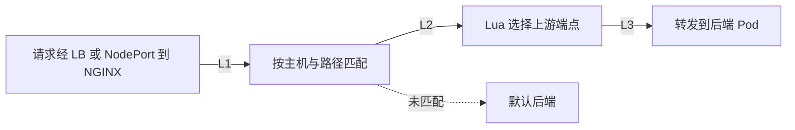

# ingress-nginx排查参考

## 是什么
- **一句话定位**：把 Ingress 规则组装成 nginx.conf 的 Ingress 控制器：监听 Ingress、Service、端点、Secret，建立内部模型，变化时重新生成配置并重载 NGINX，端点变化则通过 Lua 动态更新、不重载。
- **状态说明**：**这个控制器项目已经退役**，不再有发布、缺陷修复和安全更新；已有部署仍可运行，Ingress API 本身不受影响，官方建议迁移（如迁到 Gateway API 的实现，见 envoygateway排查参考）。本条只用于存量部署的排障。
- **解决什么问题**：Ingress 写了不生效、所有 Ingress 突然都不更新、返回 default backend 404 时，判断问题在认领、配置生成与重载，还是上游选择。
- **谁在用、从哪进来**：外部流量经负载均衡或 NodePort 进入这个控制器的 NGINX，再按 Ingress 规则转发。
- **边界（不负责什么）**：Ingress 的资源模型与匹配规则见 Ingress排查参考；后端 Service 与端点见 Service排查参考。F5 的 NGINX Ingress Controller 是另一个项目，注解与配置方式不同，不适用本条〔待复核〕。
- **形态与版本**：以 Deployment 或 DaemonSet 部署，由 NGINX 加 Lua 扩展构成；项目已退役，具体行为以所用版本的官方文档为准。
- **术语**：
  - 模型 —— 控制器内部对全部 Ingress 与后端的汇总表示
  - 重载 —— 重新加载 NGINX 配置，代价较大，控制器尽量避免
  - Lua 处理器 —— NGINX 内部动态更新端点与证书的组件
  - 准入 webhook —— 在 Ingress 被接受前校验其生成的配置是否有效

## 组件与架构

| 组件 | 角色 | 职责 | 部署位置 / 形态 | 如何找到 |
|---|---|---|---|---|
| 控制器 | 控制面 | 监听对象，建立模型，决定重载或动态更新 | 控制器 Pod 内 | 控制器日志 |
| NGINX 与 Lua | 数据面 | 处理流量，动态更新端点与证书，选择上游 | 同一 Pod | 生成的 nginx.conf |
| 准入 webhook | 校验 | 可选；校验新 Ingress 生成的配置是否有效 | 控制器提供的服务 | 对应 webhook 配置 |
| 默认后端 | 兜底 | 处理没有匹配的请求 | 控制器的配置或独立后端〔待复核〕 | 控制器的默认后端设置 |

## 正常链路（请求怎么走 / 正常行为）

### 资源匹配关系
| 编号 | 资源 A.字段 | → | 资源 B.字段 | 匹配规则 | 对不上时的表现 |
|---|---|---|---|---|---|
| R1 | Ingress.ingressClassName | → | 本控制器 | 通过类名（常为 nginx）选择该控制器，旧的 ingress.class 注解已弃用但仍可用〔待复核〕 | 没选中：请求落到默认后端，返回 default backend 404 |
| R2 | Ingress、Service、端点、Secret | → | 控制器的内部模型与 nginx.conf | 模型含按主机名建立的服务器与上游；多个 Ingress 为同一主机定义不同路径时会合并 | 合并后规则不符预期：不同 Ingress 的路径冲突或覆盖 |
| R3 | Ingress 上的注解 | → | 配置的作用范围 | 注解作用于所在 Ingress 的全部路径，不同 Ingress 的注解互不共享；前缀为 nginx.ingress.kubernetes.io〔待复核〕 | 以为注解会跨 Ingress 生效：只在写它的 Ingress 内有效 |
| R4 | 变更的类型 | → | 是否重载 NGINX | 新旧模型相同则什么都不做；仅端点不同则动态更新、不重载；其余变化重新生成配置并重载 | 频繁重载：多为路径、注解、Service 或 Secret 变化，而不是端点变化 |
| R5 | 端点变化 | → | Lua 的后端对象 | 控制器取回所有 Service 的端点生成后端对象，发给 Lua 处理器；每个请求由 Lua 选上游并套用负载均衡算法 | 动态更新没生效：流量仍打旧端点 |
| R6 | 全部 Ingress 的配置 | → | 生成的 nginx.conf 是否有效 | 控制器按同步循环对全部匹配对象应用配置；任一 Ingress 配置有误会使整体配置无效，导致不重载 | 一个坏配置：所有 Ingress 的后续变更都不再被采纳 |
| R7 | 未匹配规则的请求 | → | 默认后端 | 返回 default backend - 404〔待复核〕 | 本应被处理的请求得到 404：先查 R1 的认领 |

### 控制面下发路径
| 环节 | 做什么 | 依据 |
|---|---|---|
| P1 | 控制器监听 Ingress、Service、端点、Secret 与 ConfigMap 的变化 | R2 |
| P2 | 建立模型：按主机名建服务器列表、建上游列表，合并同主机的多个 Ingress | R2 R3 |
| P3 | 比较新旧模型：相同则略过；仅端点不同则发给 Lua；否则渲染 nginx.conf 并重载 | R4 R5 |
| P4 | 可选的准入 webhook 在 Ingress 被接受前，生成配置并调用 NGINX 检查语法 | R6 |

### 流量走向（或生命周期）

| 环节 | 起点 → 终点 | 做什么 | 依据 | 同步/异步与默认行为 |
|---|---|---|---|---|
| L1 | 外部 → NGINX | 流量经控制器自己的 Service（负载均衡或 NodePort）到达 NGINX | R1 | 同步 |
| L2 | 请求 → server 与 location | 按主机名与路径匹配 nginx.conf 中的规则 | R2 R3 | 同步 |
| L3 | location → 上游 | balancer_by_lua 阶段的 Lua 代码选出端点，套用负载均衡算法 | R5 | 同步 |
| L4 | NGINX → Pod | 转发到选定端点 | R5 | 同步 |
| L5 | 无匹配 → 默认后端 | 没有规则匹配时由默认后端响应 | R7 | 同步 |

### 正常表现（健康基线）
- 控制器 Pod 就绪，对应的 Ingress 被认领，nginx.conf 有效。
- 端点变化时不触发重载；路径、注解等变化才重载。
- 没有因某个坏配置导致全局更新停滞。

## 逐环节排查（沿链路对照）
- **P1 监听**
  - 正常：控制器能看到各对象的变化。
  - 异常：控制器与 apiserver 连通问题。
  - 区分点：所有变更都不被采纳，先区分是监听问题还是 R6 的坏配置阻塞。
  - 证据落点：控制器日志。
- **P2 建立模型**
  - 正常：模型包含预期的主机与上游。
  - 异常：多个 Ingress 为同一主机定义了冲突的路径。
  - 区分点：合并后规则不符预期，对比各 Ingress 的路径（R2）。
  - 证据落点：生成的 nginx.conf 中该主机的 server 与 location。
- **P3 比较与重载**
  - 正常：只在需要时重载。
  - 异常：生成的配置无效，重载失败，此后所有变更被搁置。
  - 区分点：某次变更后所有 Ingress 都不再更新，先查最近改动的 Ingress 的注解，尤其是 configuration-snippet 一类（R6）。
  - 证据落点：控制器日志里的配置检查错误；最近变更的 Ingress。
- **P4 准入 webhook**
  - 正常：不合规的 Ingress 在创建时被拒绝。
  - 异常：创建 Ingress 被 webhook 拒绝，或 webhook 本身不可用导致创建失败。
  - 区分点：被拒绝的信息指向具体的配置错误；webhook 不可用则要看它的服务与证书（由准入的 Job 维护）〔待复核〕。
  - 证据落点：创建时返回的错误；webhook 配置与证书。
- **L1 进入 NGINX**
  - 正常：外部请求到达 NGINX。
  - 异常：外部进不来。
  - 区分点：先看控制器自己的 Service 暴露方式；认领问题表现为返回 default backend 404（R1）。
  - 证据落点：控制器的 Service；Ingress 的类名。
- **L2 匹配规则**
  - 正常：命中预期的 server 与 location。
  - 异常：主机或路径不命中。
  - 区分点：规则语义见 Ingress排查参考；这里重点核对生成配置里是否包含它。
  - 证据落点：生成的 nginx.conf；Ingress 的规则。
- **L3 选上游**
  - 正常：Lua 选到可用端点。
  - 异常：502、503、504 一类上游错误；端点更新没同步到 Lua。
  - 区分点：端点早已变化却仍打旧端点，指向动态更新这一环（R5）；端点本身是否正确回到 Service排查参考。
  - 证据落点：EndpointSlice；NGINX 的访问与错误日志。
- **L4 转发到 Pod**
  - 正常：请求到达 Pod。
  - 异常：超时、连接失败。
  - 区分点：与注解里的超时设置、后端应用状态配合判断〔待复核〕。
  - 证据落点：注解中的超时配置；后端 Pod 状态。
- **L5 默认后端**
  - 正常：只有真正无匹配的请求到这里。
  - 异常：本应被处理的请求得到 default backend 404。
  - 区分点：认领问题，查类名或残留旧注解（R1）。
  - 证据落点：Ingress 的 ingressClassName 与注解。

## 异常归因速查
| 现象 / 错误码 | 环节 | 归因类别（回指 R#） | 证据位 | 详细条目 |
|---|---|---|---|---|
| default backend 404 | L1 L5 | Ingress 没选中该控制器（R1、R7） | ingressClassName 与旧注解 | oss/k8s-ingress.md |
| 所有 Ingress 突然都不更新 | P3 | 某个 Ingress 的配置有误使整体配置无效（R6） | 最近变更的 Ingress；控制器日志 | |
| 创建 Ingress 被拒绝 | P4 | 准入 webhook 校验未通过，或 webhook 不可用（R6） | 创建时的错误；webhook 状态 | |
| 改了注解却没效果 | P2 | 注解只作用于所在 Ingress（R3） | 注解写在哪个 Ingress | |
| 502、503、504 | L3 L4 | 上游端点不可用或超时（R5） | 端点与 NGINX 日志 | oss/k8s-service.md |
| 端点变了流量仍打旧 Pod | L3 | 动态更新没生效（R5） | 端点与 Lua 后端对象 | |
| 频繁重载、抖动 | P3 | 路径、注解、Service 或 Secret 频繁变化（R4） | 重载频率与触发变更 | |
| 同一主机的规则互相覆盖 | P2 | 多个 Ingress 合并后冲突（R2） | 各 Ingress 的路径 | |
| 大请求被拒（413） | L2 | 请求体大小限制相关注解〔待复核〕 | proxy-body-size 一类设置 | |
| 想迁移但不知从何入手 | 全局 | 项目已退役，应迁移到其他方案 | 现有 Ingress 清单 | oss/envoy-gateway.md |

## 状态、事件与日志语义
| 来源 | 取值 | 含义 | 常见出现环节 |
|---|---|---|---|
| 响应内容 | default backend - 404 | 默认后端的响应，说明请求没有匹配任何规则〔待复核〕 | L5 |
| 注解前缀 | nginx.ingress.kubernetes.io | 控制器识别的注解命名空间〔待复核〕 | P2 |
| 行为 | 重载 | 配置变化后重新加载 NGINX | P3 |
| 行为 | 动态更新 | 端点与证书变化经 Lua 处理，不重载 | L3 |

## 配置语义
| 配置项 | 默认 / 取值含义 | 改动后的行为后果 |
|---|---|---|
| ingressClassName | 常为 nginx；旧的 ingress.class 注解已弃用 | 决定由哪个控制器处理 |
| 注解 | 作用于所在 Ingress 的全部路径 | 影响范围超出上游配置的注解变化会触发重载 |
| load-balance 一类注解 | 只影响上游配置 | 变化不需要重载 |
| configuration-snippet 一类 | 可注入自定义配置 | 语法错误会使整体配置无效，所有 Ingress 变更被搁置 |
| 准入 webhook | 可选 | 开启后能在创建时拦截无效配置，但自身不可用也会影响创建 |
| 默认后端 | 没有匹配时的兜底 | 决定未匹配请求的响应 |

## 边界与置信度说明
- **来源**：ingress-nginx 官方「How it works」与「Code Overview」文档，以及 Kubernetes 官方博客关于项目退役的说明；注解清单、默认后端的细节与管理方式来自二手资料。没有做过运行时取证。
- **〔待复核〕项**：F5 的 NGINX Ingress Controller 与它的区别；类名取值与旧注解的兼容性；默认后端的部署形态；注解前缀与具体注解名；webhook 证书维护方式。
- **版本差异**：项目已退役，各版本行为以所用版本的官方文档为准；工作原理页里"需要重载的情形"清单较长，这里只列了确认过的几项。
- **未覆盖**：全局 ConfigMap 的各项设置；限流、认证、重写等注解的详细行为；金丝雀发布；TLS 与证书的动态处理；日志格式；迁移到 Gateway API 的具体步骤。
- **related**：见 frontmatter。
