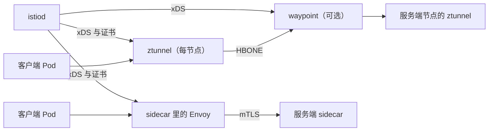
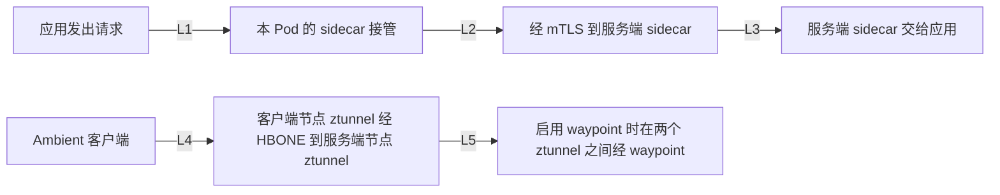

# istio排查参考

## 是什么
- **一句话定位**：以 Envoy 为数据面的服务网格：istiod 把路由、策略和证书下发给数据面，流量经代理时被透明地接管，从而获得路由控制、mTLS 和可观测。数据面有两种形态：每个 Pod 一个 sidecar，或每节点一个 ztunnel 加按需部署的 waypoint。
- **解决什么问题**：服务经过网格后出现 503、连接被拒、规则不生效时，先判断流量走的是哪种数据面，再判断是没纳入网格、配置没下发、规则不匹配，还是 mTLS 不通。
- **谁在用、从哪进来**：被纳入网格的命名空间里的工作负载；外部流量常经网格的入口网关进入。
- **边界（不负责什么）**：Envoy 数据面如何处理请求、响应标志含义，见 envoy排查参考，sidecar、入口网关与 waypoint 的数据面都复用它；后端 Service 与端点见 Service排查参考；Kubernetes 原生的 Gateway API 见 GatewayAPI排查参考。
- **形态与版本**：**排查前先确认当前是 Sidecar 还是 Ambient**，两者链路不同，同一个集群里不同命名空间可能用不同模式。Ambient 的一些限制随版本变化（见文末）。
- **术语**：
  - istiod —— 控制面，负责向数据面下发配置与证书
  - sidecar —— 与应用同一 Pod 里的 Envoy 代理
  - ztunnel —— Ambient 的每节点四层代理，负责 mTLS 与安全隧道
  - waypoint —— Ambient 里按命名空间或服务部署的七层 Envoy 代理
  - HBONE —— ztunnel 之间使用的基于 HTTP CONNECT 的隧道协议

## 组件与架构

| 组件 | 角色 | 职责 | 部署位置 / 形态 | 如何找到 |
|---|---|---|---|---|
| istiod | 控制面 | 配置数据面，下发路由、策略、证书 | 通常在 istio-system 命名空间 | 对应 Deployment 与日志 |
| sidecar | 数据面（Sidecar 模式） | 与应用同 Pod，透明接管该 Pod 的流量 | Pod 里的 istio-proxy 容器 | Pod 的容器列表 |
| ztunnel | 数据面（Ambient） | 每节点一个，承担四层与 mTLS | 每节点的 DaemonSet | ztunnel 的 Pod |
| waypoint | 数据面（Ambient，可选） | 七层处理与策略执行 | 由 istiod 依据 Gateway 部署 | gatewayClassName 为 istio-waypoint 的 Gateway |
| 入口网关 | 数据面 | 集群外流量入口 | 独立的 Envoy 工作负载 | 对应 Gateway 与其 Service |

## 正常链路（请求怎么走 / 正常行为）

### 资源匹配关系
| 编号 | 资源 A.字段 | → | 资源 B.字段 | 匹配规则 | 对不上时的表现 |
|---|---|---|---|---|---|
| R1 | 命名空间标签 | → | 数据面模式 | Sidecar：istio-injection 为 enabled，或 istio.io/rev 指定修订；两者并存时 istio-injection 优先；Ambient：istio.io/dataplane-mode 为 ambient | 标签缺失或写错：Pod 没有被纳入网格，流量不经代理 |
| R2 | Pod 创建事件 | → | sidecar 注入 | 注入发生在 Pod 创建时，由准入 webhook 加上 istio-proxy 容器；Pod 上的 sidecar.istio.io/inject 为 false 可覆盖命名空间设置 | 先有 Pod 后打标签：已有 Pod 没有 sidecar，需重启 |
| R3 | istiod 的配置 | → | 数据面代理的配置 | 经 xDS 下发：sidecar、waypoint、网关用完整配置，ztunnel 用简化的资源，并经 xDS 获取本节点各 Pod 服务账号的 mTLS 证书 | 没收到推送：代理配置陈旧，行为与对象定义不符 |
| R4 | Ambient 的命名空间或服务标签 | → | 是否经过 waypoint | 只有四层需求时仅 ztunnel 处理；七层功能需要 waypoint；用 istio.io/use-waypoint 标签指向它，默认在同一命名空间查找，策略由目的端的 waypoint 执行 | 要用七层路由或策略却没有 waypoint：规则不生效 |
| R5 | VirtualService、DestinationRule、Gateway | → | Envoy 的路由与集群配置 | VirtualService 的 hosts 与匹配决定路由，目的地可带子集与权重；DestinationRule 定义子集与连接池、异常检测等；二者对应 envoy排查参考里的路由与集群〔待复核〕 | hosts 对不上或子集不存在：请求没有路由或目的地为空，表现为 404 或 503 |
| R6 | PeerAuthentication 的 mTLS 模式 | → | 双向 TLS 行为 | 模式有 STRICT 等；Ambient 的旧文档称不是所有组件都支持，建议只用 STRICT | 一端要求 mTLS、另一端没进网格：连接被拒或重置 |
| R7 | 工作负载的服务账号 | → | mTLS 身份与证书 | ztunnel 经 xDS 为本节点各 Pod 的服务账号取证书；sidecar 的证书通常约 24 小时轮换一次〔待复核〕 | 证书获取失败：握手失败，连接被拒 |

### 控制面下发路径
| 环节 | 做什么 | 依据 |
|---|---|---|
| P1 | 安装控制面（按所选 profile，可带修订版本），决定支持 Sidecar 还是 Ambient | R1 |
| P2 | 给命名空间打标签纳管；Sidecar 模式下需重启已有 Pod 才会注入 | R1 R2 |
| P3 | istiod 监听 Istio 与 Kubernetes 资源，翻译成 xDS 推给 sidecar、ztunnel、waypoint 与网关 | R3 R5 R7 |
| P4 | Ambient 下，istiod 监视 gatewayClassName 为 istio-waypoint 的 Gateway，自动部署 waypoint 的 Deployment 与 Service | R4 |

### 流量走向（或生命周期）

| 环节 | 起点 → 终点 | 做什么 | 依据 | 同步/异步与默认行为 |
|---|---|---|---|---|
| L1 | 应用 → 本 Pod sidecar | Sidecar 模式下，流量被透明地交给本 Pod 的 Envoy | R1 R2 | 同步 |
| L2 | 客户端 sidecar → 服务端 sidecar | 请求先经客户端 sidecar 再经服务端 sidecar，按配置做 mTLS 与路由 | R3 R5 R6 | 同步 |
| L3 | 服务端 sidecar → 应用 | 服务端 sidecar 把请求交给应用 | R3 | 同步 |
| L4 | 客户端节点 ztunnel → 服务端节点 ztunnel | Ambient 下经 HBONE 隧道传输，负责认证与四层转发 | R3 R7 | 同步 |
| L5 | ztunnel → waypoint → ztunnel | 配置了 waypoint 时，七层处理与策略在目的端 waypoint 执行 | R4 | 同步；未配置则只有四层 |

### 正常表现（健康基线）
- istiod 就绪；各代理与 istiod 的同步状态为已同步。
- 命名空间标签与预期的数据面模式一致，Sidecar 模式下的 Pod 都带有 istio-proxy 容器。
- 路由规则命中预期的目的地与子集，mTLS 双方一致。

## 逐环节排查（沿链路对照）
- **P1 控制面**
  - 正常：istiod 就绪。
  - 异常：istiod 不可用或资源吃紧，配置推送变慢。
  - 区分点：所有代理都变陈旧，先看 istiod；大规模时配置没有做范围限定会放大压力。
  - 证据落点：istiod 的状态与日志。
- **P2 纳管**
  - 正常：标签正确，Pod 已注入。
  - 异常：标签写错；两个标签并存；先有 Pod 后加标签。
  - 区分点：Pod 里没有 istio-proxy 容器，先看命名空间标签，再看 Pod 创建的先后（R1、R2）。
  - 证据落点：命名空间标签；Pod 的容器列表。
- **P3 配置下发**
  - 正常：代理的配置与 istiod 同步。
  - 异常：代理状态为 STALE，配置陈旧〔待复核〕。
  - 区分点：STALE 通常指代理与控制面连通有问题；对象正确但行为不符，先怀疑没推送。
  - 证据落点：istioctl 的同步状态；代理收到的配置。
- **P4 waypoint 部署**
  - 正常：waypoint 的 Deployment 与 Service 已自动创建。
  - 异常：Gateway 存在但 waypoint 没起来。
  - 区分点：看 gatewayClassName 是否为 istio-waypoint，以及命名空间是否已标记为 ambient。
  - 证据落点：waypoint 的 Gateway 与其 Deployment。
- **L1 流量接管**
  - 正常：流量经本 Pod 的 sidecar。
  - 异常：Pod 没有 sidecar，流量绕过网格。
  - 区分点：参见 P2。
  - 证据落点：Pod 的容器与流量路径。
- **L2 sidecar 到 sidecar**
  - 正常：路由与 mTLS 生效。
  - 异常：503、连接被拒、404。
  - 区分点：先看响应标志，再按 envoy排查参考判断是路由、集群还是端点；mTLS 方面看两端模式是否一致（R6）。
  - 证据落点：代理访问日志的响应标志；两端的 PeerAuthentication。
- **L3 交给应用**
  - 正常：请求到达应用端口。
  - 异常：上游应用自己返回错误。
  - 区分点：响应标志为 - 而有错误，说明是应用返回的。
  - 证据落点：应用日志；访问日志。
- **L4 ztunnel 之间**
  - 正常：HBONE 隧道建立，身份认证通过。
  - 异常：证书获取失败，连接被拒。
  - 区分点：四层与身份问题看 ztunnel，不涉及 waypoint 与七层规则（R7）。
  - 证据落点：ztunnel 日志；服务账号与证书状态。
- **L5 waypoint**
  - 正常：七层规则与策略生效。
  - 异常：七层规则不生效；流量没有经过 waypoint。
  - 区分点：看标签是否指向了 waypoint，以及命名空间或服务是否已纳入（R4）。
  - 证据落点：istio.io/use-waypoint 标签；waypoint 的状态。

## 异常归因速查
| 现象 / 错误码 | 环节 | 归因类别（回指 R#） | 证据位 | 详细条目 |
|---|---|---|---|---|
| Pod 里没有 istio-proxy | P2 L1 | 命名空间没标签，或先有 Pod 后加标签（R1、R2） | 命名空间标签；Pod 创建时间 | oss/k8s-pod.md |
| 两个注入标签并存行为不符 | P2 | istio-injection 优先于 istio.io/rev（R1） | 命名空间标签 | |
| 对象正确但行为不符，代理 STALE | P3 | 代理没收到推送，多为与控制面连通问题（R3） | 同步状态 | |
| 503 与 UH、404 与 NR 等 | L2 | 数据面的路由、集群、端点问题，按 Envoy 响应标志判断 | 访问日志的响应标志 | oss/envoy-proxy.md |
| 路由规则不生效 | L2 | VirtualService 的 hosts 对不上或子集不存在（R5） | VirtualService 与 DestinationRule | oss/k8s-service.md |
| 连接被拒或重置 | L2 L4 | 两端 mTLS 模式不一致，或证书问题（R6、R7） | PeerAuthentication；证书状态 | |
| Ambient 下七层规则不生效 | L5 P4 | 没有 waypoint，或标签没指向它（R4） | waypoint 与标签 | |
| waypoint 没被部署 | P4 | Gateway 的类名错误或命名空间未纳入 ambient（R4） | Gateway 与命名空间标签 | oss/k8s-gateway-api.md |
| 改了 ProxyConfig 没生效 | P3 | 不会动态应用，需重启工作负载〔待复核〕 | 工作负载重启时间 | |
| 更换修订版本后仍是旧 sidecar | P2 | 需要重启工作负载才会用新 sidecar（R2） | Pod 里的 sidecar 版本 | |
| 控制面资源占用高、推送慢 | P1 | 配置量大且没做范围限定 | istiod 资源使用 | |

## 状态、事件与日志语义
| 来源 | 取值 | 含义 | 常见出现环节 |
|---|---|---|---|
| 同步状态 | SYNCED | 代理配置与 istiod 一致〔待复核〕 | P3 |
| 同步状态 | STALE | 近期没有收到配置推送，常见原因是与控制面连通问题〔待复核〕 | P3 |
| 命名空间标签 | istio-injection=enabled | 启用 sidecar 自动注入 | P2 |
| 命名空间标签 | istio.io/rev | 指定控制面修订版本 | P2 |
| 命名空间标签 | istio.io/dataplane-mode=ambient | 纳入 Ambient | P2 |
| 标签 | istio.io/use-waypoint | 指向 waypoint | L5 |
| 容器 | istio-proxy | 被注入的 sidecar，暴露 15090 等端口〔待复核〕 | L1 |

## 配置语义
| 配置项 | 默认 / 取值含义 | 改动后的行为后果 |
|---|---|---|
| 注入策略 | 命名空间标签与 Pod 级的 sidecar.istio.io/inject 共同决定，Pod 级可覆盖 | 改标签不影响已有 Pod，需重启 |
| 修订版本与标签 | istio.io/rev 指向特定控制面修订；可用标签别名 | 升级时更新别名比逐个改命名空间标签省事，之后需重启工作负载 |
| holdApplicationUntilProxyStarts | 可让应用等待 sidecar 就绪 | 避免启动初期流量绕过代理 |
| PeerAuthentication 的 mtls | 模式有 STRICT 等 | STRICT 要求双方都用 mTLS，没进网格的一端会被拒 |
| waypoint 与标签 | 用 Gateway 定义，再用 istio.io/use-waypoint 指向 | 决定七层功能由谁处理 |
| 配置范围限定 | 大规模时强烈建议 | 减小 istiod 与代理的配置体量 |

## 边界与置信度说明
- **来源**：Istio 官方文档的 Ambient 概览、ztunnel 与 waypoint、控制面关系、性能页面；Sidecar 的注入机制、istioctl 用法、VirtualService 与 DestinationRule 的字段、mTLS 取值来自二手资料，不是官方原文。
- **〔待复核〕项**：VirtualService 与 DestinationRule 到 Envoy 配置的映射；证书轮换周期；STALE 与 SYNCED 的精确含义；istio-proxy 暴露的端口；ProxyConfig 变更的生效方式。
- **版本差异**：旧版 ambient 文档称已有 sidecar 网格不能直接转为 ambient、PeerAuthentication 不被所有组件支持；较新文档称不同数据面模式可无缝互操作。具体能否混用、是否支持某功能，以所用版本为准。
- **未覆盖**：入口网关与出口网关的详细配置；AuthorizationPolicy 与请求认证；ServiceEntry、Sidecar 资源；遥测与追踪；多集群；iptables 或 CNI 如何实现透明接管；Ambient 的各类策略细节。
- **related**：见 frontmatter。
