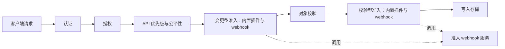
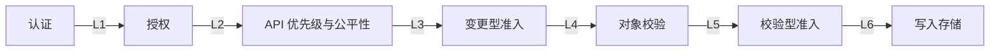

# apiserver排查参考

## 是什么
- **一句话定位**：所有对集群的读写都要经过 kube-apiserver 的同一条流水线：认证（你是谁）、授权（你能不能做）、准入（变更型 webhook，再校验型 webhook）、校验，最后才写入存储。API 优先级与公平性在过载时决定哪些请求排队、哪些被拒绝。
- **解决什么问题**：创建资源被拒、报 401、403、429、webhook 超时时，判断请求死在流水线的哪一关，以及是谁拒绝的。
- **谁在用、从哪进来**：kubectl、控制器、kubelet、各类 operator 与应用，所有人都经它访问集群。
- **边界（不负责什么）**：数据写入存储之后的行为见 etcd排查参考；证书本身的有效期与轮换见 集群证书排查参考；RBAC 规则的具体写法与策略类准入组件（如策略引擎）本条未展开。
- **形态与版本**：运行在控制面，常见为多副本。准入 webhook 的默认超时与失败策略随 API 版本不同，见下文。
- **术语**：
  - 准入控制 —— 请求通过认证与授权后、持久化前的拦截与改写步骤
  - 变更型与校验型 webhook —— 前者可修改对象，后者只能放行或拒绝
  - failurePolicy —— webhook 不可达或出错时是放行（Ignore）还是拒绝（Fail）
  - FlowSchema 与优先级 —— API 优先级与公平性用来给请求分类并分配并发的资源

## 组件与架构

| 组件 | 角色 | 职责 | 部署位置 / 形态 | 如何找到 |
|---|---|---|---|---|
| kube-apiserver | 控制面 | 处理全部 API 请求，执行整条流水线 | 控制面节点，常为多副本 | 控制面的 apiserver Pod 与其启动参数 |
| 认证与授权模块 | 流水线前段 | 确定身份并判断是否允许 | apiserver 内 | 启动参数中的认证与授权配置 |
| 准入 webhook 配置 | 扩展 | 告诉 apiserver 对哪些请求调用哪个外部服务 | MutatingWebhookConfiguration 与 ValidatingWebhookConfiguration | 这两类对象 |
| 准入 webhook 服务 | 外部依赖 | 实际执行改写或校验 | 集群内的工作负载或外部服务 | 配置里 clientConfig 指向的服务 |
| APF 对象 | 流控 | FlowSchema 分类请求，PriorityLevelConfiguration 分配并发 | apiserver 配置对象 | 这两类对象 |

## 正常链路（请求怎么走 / 正常行为）

### 资源匹配关系
| 编号 | 资源 A.字段 | → | 资源 B.字段 | 匹配规则 | 对不上时的表现 |
|---|---|---|---|---|---|
| R1 | 请求携带的凭据 | → | 身份 | 按顺序评估各认证器，采用第一个成功的；全部失败返回 401；认证方式有客户端证书、令牌、OIDC、webhook 令牌认证〔待复核〕 | 凭据无效或过期：401，请求根本没进入授权 |
| R2 | 已认证的身份 | → | 授权结果 | 授权模式按顺序检查（如 Node 先于 RBAC），所有模块都没有意见时拒绝；拒绝返回 403〔待复核〕 | 身份对但权限不足：403，错误信息里会写明谁在哪个资源上被拒绝 |
| R3 | 请求的对象与操作 | → | 需要调用的 webhook | webhook 配置里的规则按 API 组、资源、动词、版本匹配；变更型 webhook 先于所有校验型 webhook 被调用 | 规则没匹配到：webhook 不被调用，期望的改写或校验没发生 |
| R4 | webhook 调用 | → | 通过或拒绝 | failurePolicy 默认 Fail；timeoutSeconds 为 1 到 30 秒，默认 10 秒；超时后按失败策略忽略该次调用或使 API 调用失败 | webhook 不可达或超时且策略为 Fail：创建或修改请求直接失败 |
| R5 | 变更型 webhook 改了对象 | → | 是否重新调用 | 内置的变更型准入插件会被重新执行，webhook 用 reinvocationPolicy 控制自己是否被重新调用 | 多个变更型 webhook 互相改写：结果不稳定，应避免作用于同一资源〔待复核〕 |
| R6 | 请求的用户、动词、资源、命名空间 | → | FlowSchema 与优先级 | 请求被分类到某个 FlowSchema，再到对应优先级；每个响应带两个响应头标明匹配结果；优先级用 Queue 或 Reject 处理排不上的请求，Reject 返回 429；system:masters 组的请求被豁免于流控〔待复核〕 | 过载时被拒绝：429，要看是哪个 FlowSchema 与优先级 |
| R7 | webhook 配置对象本身 | → | 是否被变更型 webhook 拦截 | 变更型准入 webhook 从不会用于针对 webhook 配置对象本身的准入请求 | 这保证了即使某个 webhook 配置有问题，仍有办法修改或删除这个配置 |
| R8 | 对象的各个字段 | → | schema 校验 | 校验失败会指出具体不合法的字段〔待复核〕 | 字段类型或取值不合法：被拒绝，错误里写明字段 |

### 控制面下发路径
| 环节 | 做什么 | 依据 |
|---|---|---|
| P1 | 管理员在 apiserver 启动参数里配置认证方式与授权模式及其顺序〔待复核〕 | R1 R2 |
| P2 | 管理员注册 MutatingWebhookConfiguration 与 ValidatingWebhookConfiguration，写明规则、失败策略、超时 | R3 R4 R5 |
| P3 | webhook 服务就绪并能被 apiserver 访问，clientConfig 与证书配置正确〔待复核〕 | R4 |
| P4 | 管理员按需配置 FlowSchema 与 PriorityLevelConfiguration | R6 |

### 流量走向（或生命周期）

| 环节 | 起点 → 终点 | 做什么 | 依据 | 同步/异步与默认行为 |
|---|---|---|---|---|
| L1 | 请求 → 身份 | 评估认证器，采用第一个成功的 | R1 | 同步；失败 401 |
| L2 | 身份 → 授权 | 判断是否允许该操作 | R2 | 同步；失败 403 |
| L3 | 请求 → 流控 | 分类到 FlowSchema 与优先级，必要时排队或拒绝 | R6 | 过载时才有感知；拒绝为 429；它位于授权之后〔待复核〕 |
| L4 | 请求 → 变更型准入 | 按顺序调用匹配的变更型 webhook，可改写对象 | R3 R4 R5 | 同步；超时默认 10 秒 |
| L5 | 对象 → 校验与校验型准入 | 对象 schema 校验，再调用匹配的校验型 webhook，任一拒绝则整体失败 | R3 R4 R8 | 同步；校验在变更之后〔待复核〕 |
| L6 | 通过 → 存储 | 通过后写入存储，之后见 etcd排查参考 | R7 | 同步 |

### 正常表现（健康基线）
- 认证与授权都通过，没有无故的 401、403。
- webhook 服务可达，调用在超时之内返回，没有大量失败策略触发。
- 没有持续的 429；各 FlowSchema 的排队与拒绝处于低位。

## 逐环节排查（沿链路对照）
- **P1 认证与授权配置**
  - 正常：认证方式与授权模式符合预期。
  - 异常：授权模式顺序或集合不对，请求被意外拒绝。
  - 区分点：身份没问题而一直 403，先看授权模式与 RBAC 规则。
  - 证据落点：apiserver 的启动参数；对应的角色绑定。
- **P2 webhook 注册**
  - 正常：规则、失败策略、超时都符合意图。
  - 异常：规则太宽，把不该拦的请求也拦了；失败策略为 Fail 但 webhook 不稳。
  - 区分点：整类资源的创建都失败，先看这类 webhook 配置的规则与失败策略（R3、R4）。
  - 证据落点：两类 webhook 配置的 rules、failurePolicy、timeoutSeconds、namespaceSelector。
- **P3 webhook 服务**
  - 正常：服务就绪，证书可信。
  - 异常：服务没起来、被调度走、证书不匹配。
  - 区分点：webhook Pod 自己的创建也被这个 webhook 拦住，会形成死锁；设置合理的优先级与调度约束〔待复核〕。
  - 证据落点：webhook 服务的端点与 Pod 状态；clientConfig 的 caBundle。
- **P4 流控配置**
  - 正常：关键请求有足够并发。
  - 异常：关键请求被归到限额很小的优先级。
  - 区分点：用响应头确定匹配到的 FlowSchema 与优先级，再看该优先级的 limitResponse（R6）。
  - 证据落点：响应头里的两个 UID；/debug/api_priority_and_fairness/ 的输出。
- **L1 认证**
  - 正常：凭据有效，身份被识别。
  - 异常：401。
  - 区分点：401 说明没过认证，与权限无关；先查凭据是否过期、证书是否可信。
  - 证据落点：客户端使用的凭据；apiserver 日志。
- **L2 授权**
  - 正常：操作被允许。
  - 异常：403。
  - 区分点：403 的信息写明了用户、动词、资源，直接对照角色绑定。
  - 证据落点：错误信息；角色与角色绑定。
- **L3 流控**
  - 正常：请求立即处理。
  - 异常：429，或明显排队变慢。
  - 区分点：先区分是 apiserver 端 APF 拒绝，还是客户端自己的限速（客户端日志里有 client-side throttling）。
  - 证据落点：响应头；apiserver 日志里的拒绝记录；客户端日志。
- **L4 变更型准入**
  - 正常：webhook 在超时内返回。
  - 异常：超时、不可达，且失败策略为 Fail 时请求失败；多个 webhook 互相改写。
  - 区分点：错误信息里会写明是哪个 webhook 调用失败，典型文本含 context deadline exceeded〔待复核〕。
  - 证据落点：错误信息里的 webhook 名；webhook 服务状态与日志。
- **L5 校验与校验型准入**
  - 正常：对象合法，校验型 webhook 放行。
  - 异常：字段不合法；校验型 webhook 拒绝。
  - 区分点：被拒绝时错误信息是 webhook 返回的内容或具体字段，直接读它。
  - 证据落点：错误信息；webhook 的日志。
- **L6 写入存储**
  - 正常：写入成功。
  - 异常：写入慢或失败。
  - 区分点：流水线前面都过了才到这一步，问题转到 etcd排查参考。
  - 证据落点：apiserver 对存储的请求延迟。

## 异常归因速查
| 现象 / 错误码 | 环节 | 归因类别（回指 R#） | 证据位 | 详细条目 |
|---|---|---|---|---|
| 401 Unauthorized | L1 | 凭据无效、过期或不被信任（R1） | 客户端凭据；apiserver 日志 | |
| 403 Forbidden | L2 | 身份有效但没有权限（R2） | 错误信息；角色绑定 | |
| 429 Too Many Requests | L3 | 被 API 优先级与公平性拒绝（R6） | 响应头；apiserver 日志 | |
| 429 但 apiserver 没有拒绝记录 | L3 | 客户端自己的限速（R6） | 客户端的 client-side throttling 日志 | |
| 创建某类资源一律失败 | P2 L4 | webhook 不可达或超时且失败策略为 Fail（R4） | webhook 配置与服务状态 | oss/k8s-workload.md |
| 报 context deadline exceeded 且指向某个 webhook | L4 | webhook 响应超过超时（R4） | timeoutSeconds；webhook 耗时 | |
| webhook 的 Pod 自己创建不出来 | P3 | webhook 拦截了自己所在的资源，形成死锁（R3） | webhook 规则与命名空间选择 | oss/k8s-pod.md |
| 有问题的 webhook 配置删不掉或改不了 | P2 | 变更型 webhook 不拦截针对 webhook 配置对象的请求，可直接修改（R7） | webhook 配置对象 | |
| 校验报某个字段不合法 | L5 | 对象不满足 schema（R8） | 错误里指出的字段 | |
| 多个变更型 webhook 结果不稳定 | L4 | 互相改写，顺序依赖（R5） | 各 webhook 的作用范围 | |
| 升级后准入突然失败 | P2 | 旧版本 v1beta1 webhook 默认超时与失败策略与 v1 不同（R4） | webhook 配置的 API 版本 | |

## 状态、事件与日志语义
| 来源 | 取值 | 含义 | 常见出现环节 |
|---|---|---|---|
| 响应码 | 401 | 认证失败 | L1 |
| 响应码 | 403 | 授权拒绝 | L2 |
| 响应码 | 429 | 被限流 | L3 |
| 响应头 | X-Kubernetes-PF-FlowSchema-UID | 请求匹配的 FlowSchema | L3 |
| 响应头 | X-Kubernetes-PF-PriorityLevel-UID | 对应的优先级 | L3 |
| 诊断入口 | /debug/api_priority_and_fairness/ | 流控的诊断信息，需 RBAC 授权访问 | L3 |
| 配置 | failurePolicy | Ignore 或 Fail，默认 Fail | L4 |
| 配置 | timeoutSeconds | 1 到 30 秒，默认 10 秒 | L4 |
| 优先级处置 | Queue、Reject | 排不上时排队或拒绝（返回 429） | L3 |

## 配置语义
| 配置项 | 默认 / 取值含义 | 改动后的行为后果 |
|---|---|---|
| failurePolicy | 默认 Fail | Ignore 让不可达的 webhook 不阻塞请求，但校验类 webhook 会因此失效 |
| timeoutSeconds | 默认 10 秒，范围 1 到 30 | 调大放宽等待但拖慢请求，调小更快失败 |
| reinvocationPolicy | 控制变更型 webhook 是否被重新调用 | 多个 webhook 互相依赖时需要考虑 |
| namespaceSelector | 限定 webhook 作用的命名空间 | 把 webhook 自己所在命名空间排除，可避免自拦死锁 |
| 授权模式 | 如 Node 加 RBAC，顺序有意义 | 顺序决定谁先判断 |
| FlowSchema 与 PriorityLevelConfiguration | 默认已有若干预置对象 | 自定义可保护关键请求，配错会让它们被限流 |

## 边界与置信度说明
- **来源**：官方 API 字段说明与官方 flow-control 调试页给出 webhook 的失败策略、超时、调用顺序与 APF 响应头；认证与授权的流水线顺序、状态码含义、APF 的拒绝行为来自二手资料，官方 Controlling Access 页本次没取到。
- **〔待复核〕项**：认证方式列表与授权模式细节；APF 位于授权之后的位置；schema 校验位于变更型准入之后；context deadline exceeded 的错误文本；client-side throttling 与 APF 拒绝的区分；webhook 死锁的具体条件。
- **版本差异**：admissionregistration 的 v1beta1 webhook 默认超时 30 秒，v1 为 10 秒，且 v1 默认失败策略为 Fail，旧版本曾是 Ignore；APF 自 v1.20 起默认启用。
- **未覆盖**：RBAC 的规则写法与排查；ValidatingAdmissionPolicy 与 MutatingAdmissionPolicy；审计日志；服务账号令牌的签发与绑定；聚合 API 与 CRD 的请求处理；apiserver 自身的高可用与负载均衡；请求延迟的指标分析。
- **related**：见 frontmatter。
