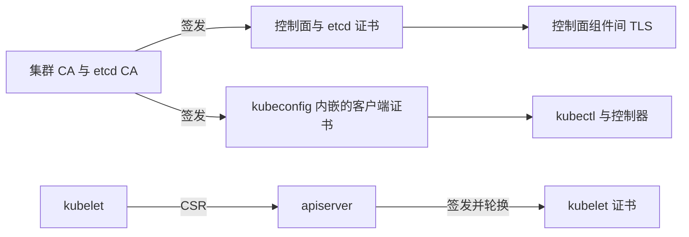
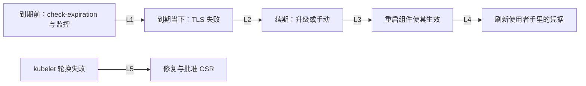

# 集群证书排查参考

## 是什么
- **一句话定位**：kubeadm 部署的集群里，各组件之间靠 TLS 证书互相认证：控制面证书、etcd 证书、kubeconfig 里内嵌的客户端证书、kubelet 的证书。它们有固定的有效期，到期后组件之间的连接会失败。
- **解决什么问题**：看到证书过期、x509 错误、节点因证书失联时，判断是哪一类证书、该用哪种方式续期、续期后还要做什么才会生效。
- **谁在用、从哪进来**：所有组件间的 TLS 通信，以及 kubectl 等使用 admin 凭据的客户端。
- **边界（不负责什么）**：etcd 与 apiserver 本身的运行问题见 etcd排查参考与 apiserver排查参考；应用证书由 cert-manager 之类的组件管理，见 cert-manager排查参考；托管云的控制面证书由云厂商管理，不适用。
- **形态与版本**：证书的路径、命令与字段以 kubeadm 部署为准；外部 CA 签发的证书 kubeadm 管不了。
- **术语**：
  - 叶子证书与 CA 证书 —— 前者给组件用，默认 1 年；后者用来签发前者，默认 10 年
  - 续期 —— 用 CA 重新签发即将到期的证书
  - CSR —— 证书签发请求，kubelet 服务端证书的轮换要经它
  - 外部 CA 模式 —— CA 密钥不在 kubeadm 管理的磁盘上

## 组件与架构

| 组件 | 角色 | 职责 | 部署位置 / 形态 | 如何找到 |
|---|---|---|---|---|
| 集群 CA 与 etcd CA | 信任根 | 签发其他证书，默认 10 年 | /etc/kubernetes/pki | 该目录里的 CA 证书与密钥 |
| 控制面与 etcd 证书 | 叶子证书 | 组件间的服务端与客户端认证，默认 1 年 | 同上 | check-expiration 的输出 |
| kubeconfig 里的客户端证书 | 叶子证书 | admin.conf、controller-manager.conf、scheduler.conf 内嵌 | /etc/kubernetes 下 | check-expiration 的输出 |
| kubelet 证书 | 节点证书 | 客户端证书自动轮换；服务端证书可经 CSR 轮换 | /var/lib/kubelet/pki | 该目录与 kubelet 配置 |
| CertificateSigningRequest | 流程对象 | 承载证书签发请求，需批准 | apiserver | CSR 列表与状态 |

## 正常链路（请求怎么走 / 正常行为）

### 资源匹配关系
| 编号 | 资源 A.字段 | → | 资源 B.字段 | 匹配规则 | 对不上时的表现 |
|---|---|---|---|---|---|
| R1 | 证书类别 | → | 有效期 | kubeadm 生成的非 CA 证书默认 1 年（8760 小时），CA 证书默认 10 年（87600 小时），可用 certificateValidityPeriod 与 caCertificateValidityPeriod 调整 | 一年后叶子证书到期，组件之间 TLS 失败 |
| R2 | 证书所在位置 | → | check-expiration 的覆盖范围 | 覆盖 /etc/kubernetes/pki 下的证书，以及 admin.conf、controller-manager.conf、scheduler.conf 内嵌的客户端证书；不含 kubelet.conf | 以为列表里没有 kubelet 就没问题：kubelet 证书走自己的轮换，要另外看 |
| R3 | kubelet 的客户端证书 | → | 自动轮换 | kubeadm 把 kubelet 配成自动续期，使用 /var/lib/kubelet/pki 下可轮换的证书，与 kubeadm certs renew 无关；rotateCertificates 为 true 时轮换〔待复核〕 | 轮换失败：kubelet 无法向 apiserver 认证，节点失联 |
| R4 | kubelet 的服务端证书 | → | CSR 与批准 | serverTLSBootstrap 为 true 时走 CSR 流程，需要有人或有机制批准〔待复核〕 | CSR 一直 Pending：服务端证书拿不到或不轮换 |
| R5 | kubeadm upgrade | → | 自动续期 | 控制面升级时会续期所有证书，适合每次升级间隔不超过一年；可用 --certificate-renewal=false 关闭 | 一年以上没升级：证书到期而没被自动续上 |
| R6 | kubeadm certs renew | → | 手动续期的范围与生效 | 可续某一个或全部；用 /etc/kubernetes/pki 下的 CA 签发；多控制面副本需在每个控制面节点上执行；续期后组件要重启才会用新证书 | 只续了一个节点或没重启组件：证书仍旧或组件不一致 |
| R7 | 签发 CA 的来源 | → | kubeadm 能否管理 | kubeadm 无法管理外部 CA 签发的证书，会提示哪些是外部管理的；CA 密钥不在磁盘上时进入外部 CA 模式 | 外部 CA 下用 kubeadm 续期：不适用，需用外部工具 |
| R8 | admin 凭据的副本 | → | 使用者手里的凭据 | admin.conf 常被复制到用户的 kube 配置，续期后需要更新副本；较新版本另有 super-admin.conf，只应放在控制面且仅 root 可读〔待复核〕 | 服务端续期了、本地副本没更新：kubectl 仍报证书问题 |

### 控制面下发路径
| 环节 | 做什么 | 依据 |
|---|---|---|
| P1 | kubeadm 初始化时生成 CA 与各叶子证书，默认非 CA 1 年、CA 10 年 | R1 |
| P2 | 控制面升级时 kubeadm 自动续期所有证书 | R5 |
| P3 | 需要时手动 kubeadm certs renew，在每个控制面节点执行，并重启静态 Pod 使其生效 | R6 R7 |
| P4 | kubelet 自动轮换客户端证书；服务端证书若启用 CSR 流程则需批准〔待复核〕 | R3 R4 |

### 流量走向（或生命周期）

| 环节 | 起点 → 终点 | 做什么 | 依据 | 同步/异步与默认行为 |
|---|---|---|---|---|
| L1 | 到期前 | 用 check-expiration 查看剩余时间，并接入监控告警 | R1 R2 | 需主动检查 |
| L2 | 到期当下 | 组件之间的 TLS 失败，kubectl 或 kubelet 认证失败，表现为 x509 过期类错误 | R1 R3 | 突发 |
| L3 | 续期 | 升级时自动续期，或手动 renew | R5 R6 | 多控制面节点要逐个执行 |
| L4 | 生效 | 重启使用旧证书的组件，使其加载新证书 | R6 | 静态 Pod 可移出再移回清单目录触发重建 |
| L5 | 使用者凭据 | 更新用户手里的 admin 凭据副本 | R8 | 手动 |
| L6 | kubelet 轮换失败 | 修复 kubelet 客户端证书，必要时批准 CSR | R3 R4 | 手动 |

### 正常表现（健康基线）
- 叶子证书的剩余有效期在安全范围内，且有告警。
- kubelet 的客户端证书持续轮换，没有 Pending 的 CSR 堆积。
- 每次控制面升级都顺带续了期，且升级间隔不超过一年。

## 逐环节排查（沿链路对照）
- **P1 生成与有效期**
  - 正常：有效期符合规划。
  - 异常：有效期不符预期。
  - 区分点：默认叶子 1 年、CA 10 年，可通过配置调整（R1）。
  - 证据落点：kubeadm 配置里的有效期字段；check-expiration 输出。
- **P2 升级时自动续期**
  - 正常：每次升级顺带续期。
  - 异常：超过一年没升级，或升级时关闭了续期。
  - 区分点：看是否用了 --certificate-renewal=false，以及两次升级的间隔（R5）。
  - 证据落点：升级记录；证书剩余时间。
- **P3 手动续期**
  - 正常：每个控制面节点都续了，组件已重启。
  - 异常：只续了一个节点；续了没重启；外部 CA 下用 kubeadm。
  - 区分点：多副本控制面必须每个节点都执行（R6）；外部 CA 的证书 kubeadm 管不了（R7）。
  - 证据落点：各节点证书的到期时间；组件启动时间。
- **P4 kubelet 轮换**
  - 正常：客户端证书自动轮换。
  - 异常：轮换失败；服务端证书的 CSR 一直 Pending。
  - 区分点：kubelet 证书不在 check-expiration 里，要单独看（R2、R3）。
  - 证据落点：kubelet 的证书目录；CSR 列表与状态。
- **L1 到期前检查**
  - 正常：能提前发现。
  - 异常：没有检查和告警，等到过期才发现。
  - 区分点：check-expiration 不含 kubelet 的证书，监控要覆盖。
  - 证据落点：check-expiration 输出；监控指标。
- **L2 到期当下**
  - 正常：不会发生。
  - 异常：x509 过期类错误；kubectl 失败；节点失联。
  - 区分点：看是哪一类证书过期：控制面与 etcd、kubeconfig 内嵌、还是 kubelet，对应的修复不同（R1、R3）〔待复核〕。
  - 证据落点：错误信息里的证书与组件；各证书到期时间。
- **L3 续期**
  - 正常：续期成功。
  - 异常：续期命令在外部 CA 集群里无效。
  - 区分点：先确认是否外部 CA 模式（R7）。
  - 证据落点：check-expiration 里的外部管理标记。
- **L4 生效**
  - 正常：组件用上新证书。
  - 异常：续期后仍然报旧证书错误。
  - 区分点：组件需要重启才加载新证书（R6）。
  - 证据落点：组件的启动时间与证书序列。
- **L5 使用者凭据**
  - 正常：本地副本已更新。
  - 异常：服务端已续期，本地 kubectl 仍失败。
  - 区分点：用户本地的 admin 凭据是副本，需要更新（R8）。
  - 证据落点：本地 kube 配置里的证书与服务端的差异。
- **L6 kubelet 修复**
  - 正常：轮换自动完成。
  - 异常：轮换失败的节点需手动修复，并批准新的 CSR〔待复核〕。
  - 区分点：先看 kubelet 能否连上 apiserver 提交 CSR，再看 CSR 是否被批准。
  - 证据落点：kubelet 日志；CSR 列表。

## 异常归因速查
| 现象 / 错误码 | 环节 | 归因类别（回指 R#） | 证据位 | 详细条目 |
|---|---|---|---|---|
| x509 证书已过期或尚未生效 | L2 | 叶子证书到期，或系统时间不对（R1）〔待复核〕 | 证书到期时间；节点时间 | oss/k8s-apiserver.md |
| kubectl 报证书问题，服务端已续期 | L5 | 本地 admin 凭据副本未更新（R8） | 本地与服务端凭据差异 | |
| 续期后组件仍用旧证书 | L4 | 组件没重启（R6） | 组件启动时间 | |
| 多控制面只有一个节点正常 | P3 | 只在一个节点续了期（R6） | 各节点证书到期时间 | |
| 节点 NotReady 且 kubelet 认证失败 | P4 L6 | kubelet 客户端证书轮换失败（R3） | kubelet 证书目录；日志 | oss/k8s-node.md |
| CSR 一直 Pending | P4 | 没有批准，或没有自动批准机制（R4） | CSR 列表 | |
| 用 kubeadm 续期无效 | P3 L3 | 证书由外部 CA 签发（R7） | check-expiration 的外部管理标记 | |
| 超过一年没升级后证书全部过期 | P2 | 自动续期只在升级时发生（R5） | 升级间隔 | |
| check-expiration 里看不到 kubelet | L1 | 它不在该命令覆盖范围，走自己的轮换（R2） | kubelet 证书目录 | |
| etcd 连接失败，证书相关 | L2 | etcd 的证书到期 | etcd 证书到期时间 | oss/k8s-etcd.md |

## 状态、事件与日志语义
| 来源 | 取值 | 含义 | 常见出现环节 |
|---|---|---|---|
| 错误 | x509 证书过期类 | 证书已过期或尚未生效 | L2 |
| check-expiration | 外部管理标记 | 该证书由外部 CA 签发，kubeadm 不管理 | L3 |
| CSR 状态 | Pending | 等待批准 | P4 |
| 配置 | rotateCertificates | kubelet 客户端证书自动轮换〔待复核〕 | P4 |
| 配置 | serverTLSBootstrap | kubelet 服务端证书走 CSR 流程〔待复核〕 | P4 |
| 命令 | check-expiration、renew | 查看与续期 | L1 L3 |

## 配置语义
| 配置项 | 默认 / 取值含义 | 改动后的行为后果 |
|---|---|---|
| certificateValidityPeriod | 默认 8760 小时即 1 年 | 调大延后到期，但要权衡安全 |
| caCertificateValidityPeriod | 默认 87600 小时即 10 年 | CA 到期会让整套信任失效 |
| encryptionAlgorithm | 默认 RSA-2048，可选 RSA-3072、RSA-4096、ECDSA-P256 | 影响新签证书的算法 |
| --certificate-renewal | 升级时默认续期，设为 false 关闭 | 关闭后需要自己手动续期 |
| rotateCertificates | kubelet 客户端证书自动轮换〔待复核〕 | 关闭则会到期失效 |
| serverTLSBootstrap | kubelet 服务端证书走 CSR〔待复核〕 | 开启后需要批准 CSR |

## 边界与置信度说明
- **来源**：Kubernetes 官方 kubeadm 证书管理页的多个版本，给出有效期、续期方式、check-expiration 的范围、外部 CA 限制；kubelet 的 rotateCertificates 与 serverTLSBootstrap、CSR 批准、super-admin.conf、各类错误表现来自二手资料。没有做过运行时取证。
- **〔待复核〕项**：kubelet 证书轮换的两个配置项的精确语义；CSR 的自动批准做法；x509 错误的几种具体成因；super-admin.conf 的适用版本。
- **版本差异**：certificateValidityPeriod 等字段属于 kubeadm 的 v1beta4 配置；1.17 之前初始化的节点有 kubelet.conf 需手动修改的已知问题。
- **未覆盖**：非 kubeadm 部署的证书管理；前置代理证书与服务账号密钥；证书吊销；手动用证书 API 续期的细节；CA 自身到期与更换；证书到期的具体监控指标。
- **related**：见 frontmatter。
