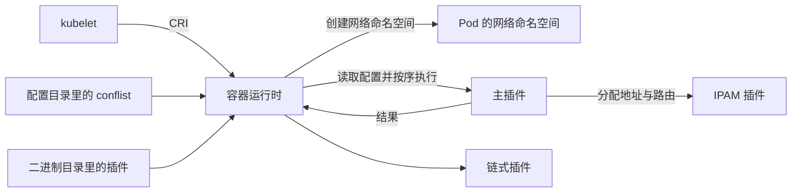

# CNI排查参考

## 是什么
- **一句话定位**：Pod 的网络是怎么被"接上"的：容器运行时在创建 Pod 沙箱时，按节点上的 CNI 配置，调用对应的插件可执行文件，给 Pod 创建网卡、分配 IP、设置路由。
- **解决什么问题**：Pod 一直创建中、节点一直 NotReady、报"找不到插件"或"没有可用 IP"时，定位卡在配置、二进制、插件执行还是地址池这一步。
- **谁在用、从哪进来**：kubelet 经 CRI 让运行时创建 Pod 沙箱，运行时随后调用 CNI；每个新 Pod 和每次删除 Pod 都会走一遍。
- **边界（不负责什么）**：具体网络插件（Cilium、Calico、flannel）内部怎么转发、怎么执行策略，见各自条目；Pod 创建后 Pod 之间如何互通见 k8s网络排查参考；NetworkPolicy 见 NetworkPolicy排查参考。
- **形态与版本**：CNI 规范当前为 v1.1.0，自 v1.0.0 起只支持网络配置列表。运行时配置项的名字随版本变化，使用时以所用运行时版本的官方说明为准。
- **术语**：
  - 运行时 —— 负责调用 CNI 插件的程序，此处指 containerd、CRI-O 等
  - 插件 —— 应用某个网络配置的可执行文件
  - IPAM 插件 —— 专门负责分配 IP 地址与路由的插件，由主插件调用
  - 链式插件 —— 在已创建的接口上追加调整的插件，如端口映射

## 组件与架构

| 组件 | 角色 | 职责 | 部署位置 / 形态 | 如何找到 |
|---|---|---|---|---|
| 容器运行时 | 调用方 | 创建网络命名空间，读取配置，按序调用插件，缓存结果 | 每个节点 | 运行时的配置与日志 |
| CNI 配置 | 配置 | 声明网络名、插件列表及各自参数 | 节点上的配置目录，默认 /etc/cni/net.d〔待复核〕 | 配置目录里的 .conflist |
| CNI 插件二进制 | 执行体 | 真正创建接口、分配地址、设路由 | 节点上的二进制目录，默认 /opt/cni/bin〔待复核〕 | 二进制目录里的可执行文件 |
| IPAM 插件 | 地址管理 | 分配与回收地址，设置路由 | 由主插件调用 | 配置里 ipam 段 |
| 网络插件的节点代理 | 安装与维护 | 通常以 DaemonSet 把配置与二进制写到每个节点 | 每个节点 | 网络插件对应的工作负载 |

## 正常链路（请求怎么走 / 正常行为）

### 资源匹配关系
| 编号 | 资源 A.字段 | → | 资源 B.字段 | 匹配规则 | 对不上时的表现 |
|---|---|---|---|---|---|
| R1 | 节点上的配置目录 | → | 运行时选用的网络配置 | 运行时从配置目录读取网络配置；目录里没有配置时，网络插件被视为未初始化；同时存在多个配置时的选取规则见运行时说明〔待复核〕 | 无配置：节点保持 NotReady，新 Pod 创建失败 |
| R2 | 配置里的插件 type | → | 二进制目录里的同名可执行文件 | type 就是要调用的可执行文件名，在预先约定的目录中查找 | 找不到：报 failed to find plugin，Pod 沙箱创建失败 |
| R3 | 容器 ID、网络命名空间、接口名 | → | 一次 ADD 与 DEL 的身份 | 插件以（网络名、容器 ID、接口名）为主键保存状态；ADD 之后最终必须有 DEL；同一组不得在没有 DEL 的情况下重复 ADD | 异常中断导致 ADD 无对应 DEL：残留地址、接口等资源 |
| R4 | 配置列表里的插件顺序 | → | 执行顺序 | 按列表顺序执行，上一步结果以 prevResult 传给后面；容器结束时按相反顺序断开 | 顺序或依赖不当：后面的链式插件拿不到预期的接口或结果 |
| R5 | 主插件的 ipam 配置 | → | 地址池与路由 | 主插件调用 IPAM 插件分配地址并设置路由，IPAM 返回精简结果 | 地址池耗尽：报 no IP addresses available，新 Pod 起不来 |
| R6 | kubelet 与容器运行时 | → | Pod 网络建立 | Pod 网络命名空间由实现 CRI 的软件建立，Pod 网络由 Pod 网络实现管理，Linux 上多数运行时通过 CNI 与它交互 | 运行时与插件配置不一致：网络建立失败 |
| R7 | 插件返回的结果（接口、地址、路由、DNS） | → | Pod 的网络状态 | 成功返回码为 0 并输出结果；失败为非零并输出错误结构 | 非零退出：运行时判定沙箱网络建立失败，Pod 不会启动 |

### 控制面下发路径
| 环节 | 做什么 | 依据 |
|---|---|---|
| P1 | 网络插件的节点代理把配置与二进制写到每个节点的目录里 | R1 R2 |
| P2 | 运行时加载配置；没有配置则报未初始化，节点保持 NotReady | R1 |
| P3 | 每创建一个 Pod 沙箱，运行时调用一次 CNI 的 ADD | R3 R4 R5 |
| P4 | 每删除一个 Pod，运行时按相反顺序调用 DEL（必要时还有 CHECK 与 GC） | R3 R4 |

### 流量走向（或生命周期）

| 环节 | 起点 → 终点 | 做什么 | 依据 | 同步/异步与默认行为 |
|---|---|---|---|---|
| L1 | 运行时 → 网络命名空间 | 先为沙箱创建网络命名空间，插件在运行时自己的网络域内执行 | R3 R6 | 同步 |
| L2 | 运行时 → loopback | Kubernetes 还要求设置 loopback，containerd 调用外部 loopback 插件，较新 CRI-O 内部处理〔待复核〕 | R2 | 同步 |
| L3 | 主插件 ADD | 在 Pod 命名空间里创建或调整接口，调用 IPAM 分配地址并设置路由 | R2 R4 R5 | 同步；任一步失败整体失败 |
| L4 | 链式插件 | 在已有接口上追加调整，如端口映射 | R4 | 同步 |
| L5 | 结果返回 | 插件输出结果，运行时据此得到 Pod 的网络状态 | R7 | 同步 |
| L6 | 删除 Pod | 按相反顺序调用 DEL，释放地址与接口 | R3 R4 | 同步；缓存的结果在成功 DEL 后清除 |

### 正常表现（健康基线）
- 每个节点的配置目录里有有效的网络配置，二进制目录里有配置引用的全部插件。
- 新 Pod 很快拿到 IP，没有 FailedCreatePodSandBox 事件。
- 删除 Pod 后地址被释放，没有残留。

## 逐环节排查（沿链路对照）
- **P1 安装到节点**
  - 正常：每个节点都有配置和二进制。
  - 异常：网络插件的节点代理没在某个节点上运行，该节点缺配置或二进制。
  - 区分点：只有新加入的节点出问题，先看网络插件的 DaemonSet 有没有在这个节点调度成功。
  - 证据落点：网络插件对应工作负载在该节点上的状态；节点上的目录内容。
- **P2 加载配置**
  - 正常：运行时读到有效配置。
  - 异常：配置目录为空或配置不是有效 JSON，节点保持 NotReady，事件含 NetworkPluginNotReady 一类〔待复核〕。
  - 区分点：节点 NotReady 且伴随网络未初始化，先看配置目录而不是 kubelet。
  - 证据落点：运行时对 CNI 配置的加载状态；节点状况，见 节点排查参考。
- **P3 创建 Pod 时 ADD**
  - 正常：ADD 成功，Pod 得到地址。
  - 异常：Pod 停在创建中，事件为创建沙箱失败。
  - 区分点：先判断范围：只有一个 Pod 失败、同节点所有新 Pod 失败、还是多节点都失败，三者排查方向不同。
  - 证据落点：Pod 事件；运行时与 kubelet 日志。
- **P4 删除时 DEL**
  - 正常：地址与接口被释放。
  - 异常：残留地址导致地址池逐渐耗尽。
  - 区分点：地址池逐渐变少而 Pod 数没增加，查 DEL 是否被遗漏。
  - 证据落点：IPAM 的已分配记录与实际 Pod 数对比。
- **L1 沙箱与命名空间**
  - 正常：命名空间创建成功。
  - 异常：命名空间路径获取失败。
  - 区分点：这一步由运行时负责，插件还没被调用。
  - 证据落点：运行时日志。
- **L2 loopback**
  - 正常：loopback 设置成功。
  - 异常：找不到 loopback 插件。
  - 区分点：报 failed to find plugin "loopback"，是二进制目录与运行时配置的目录不一致〔待复核〕。
  - 证据落点：运行时实际使用的二进制目录。
- **L3 主插件 ADD**
  - 正常：接口建立，地址分配。
  - 异常：找不到主插件；IPAM 地址池耗尽；插件自身出错退出非零。
  - 区分点：找不到插件看 R2 的目录与文件名；没有可用 IP 看 R5 的地址池。
  - 证据落点：错误信息里插件名与目录；IPAM 的地址池使用情况。
- **L4 链式插件**
  - 正常：端口映射等追加动作成功。
  - 异常：链式插件失败导致整体失败。
  - 区分点：看错误信息指向的是哪一个插件。
  - 证据落点：配置列表里的插件顺序与各自参数。
- **L5 结果**
  - 正常：Pod 得到 IP。
  - 异常：插件返回非零，沙箱建立失败。
  - 区分点：运行时据返回码判定成败，细节在错误结构里。
  - 证据落点：运行时记录的插件错误输出。
- **L6 删除与清理**
  - 正常：按相反顺序清理。
  - 异常：删除失败后残留。
  - 区分点：与 P4 配合判断是否有 ADD 没有对应 DEL。
  - 证据落点：残留的接口与地址记录。

## 异常归因速查
| 现象 / 错误码 | 环节 | 归因类别（回指 R#） | 证据位 | 详细条目 |
|---|---|---|---|---|
| Pod 一直 ContainerCreating | P3 L3 | 沙箱网络建立失败（R7） | Pod 事件；运行时日志 | oss/k8s-pod.md |
| FailedCreatePodSandBox | P3 | CNI 的 ADD 失败，看事件里的具体原因（R7） | 事件里 reason 之后的信息 | oss/k8s-pod.md |
| failed to find plugin | L2 L3 | 配置里引用的插件在二进制目录中不存在（R2） | 配置的 type；二进制目录 | |
| cni plugin not initialized | P2 | 配置目录没有网络配置（R1） | 配置目录内容 | oss/k8s-node.md |
| 节点一直 NotReady 且网络未就绪 | P1 P2 | 网络插件没在该节点安装成功（R1） | 插件工作负载在该节点的状态 | oss/k8s-node.md |
| no IP addresses available | L3 | 地址池耗尽（R5） | IPAM 地址池使用情况 | |
| 只有新加入节点的 Pod 起不来 | P1 | 该节点缺配置或二进制（R1、R2） | 该节点目录内容 | |
| 地址池逐渐耗尽而 Pod 数不增 | P4 L6 | DEL 遗漏造成残留（R3） | IPAM 记录与实际 Pod 数 | |
| 运行时升级后插件找不到 | L2 L3 | 运行时配置项名称或目录默认值变化（R2、R6） | 运行时实际生效的 CNI 目录 | |

## 状态、事件与日志语义
| 来源 | 取值 | 含义 | 常见出现环节 |
|---|---|---|---|
| CNI_COMMAND | ADD、DEL、CHECK、GC、VERSION | 调用插件的五种操作 | P3 P4 |
| 插件返回码 | 0 / 非零 | 成功并输出结果 / 失败并输出错误结构 | L5 |
| 事件 | FailedCreatePodSandBox | 创建沙箱失败，原因在 reason 之后〔待复核〕 | P3 |
| 运行时信息 | failed to find plugin | 配置引用的插件不在二进制目录中〔待复核〕 | L2 L3 |
| 运行时信息 | cni plugin not initialized | 配置目录里没有网络配置〔待复核〕 | P2 |
| IPAM 信息 | no IP addresses available | 地址范围耗尽〔待复核〕 | L3 |

## 配置语义
| 配置项 | 默认 / 取值含义 | 改动后的行为后果 |
|---|---|---|
| 配置目录 | containerd 与 CRI-O 默认常为 /etc/cni/net.d〔待复核〕 | 运行时从这里读网络配置 |
| 二进制目录 | containerd 默认常为 /opt/cni/bin；containerd 2.1 起支持复数的 bin_dirs〔待复核〕 | 与网络插件写入的目录不一致就会找不到插件 |
| 配置里的 disableCheck | 为真时运行时不得调用 CHECK | 用于规避某些插件组合返回的假错误 |
| 配置列表的插件顺序 | 按列表顺序执行，删除时反序 | 决定链式插件能否拿到预期的接口 |

## 边界与置信度说明
- **来源**：CNI 规范与 Kubernetes 官方网络文档提供协议与职责划分；运行时的默认目录、具体报错字符串来自二手资料，不是官方文档原文。
- **〔待复核〕项**：各运行时的默认目录与配置项名；报错字符串的原文；多配置并存时的选取规则；loopback 在各运行时中的处理。
- **版本差异**：规范 v1.0.0 起只支持配置列表；containerd 2.1 起 bin_dir 被 bin_dirs 取代，复制旧版本的配置表名到新版本可能不生效。
- **未覆盖**：具体网络插件的数据面；多网卡（多个 CNI 网络）场景；CNI 与 hostNetwork Pod 的关系；运行时侧 CNI 超时与并发设置；规范里的 GC 与状态保存细节。
- **related**：见 frontmatter。
