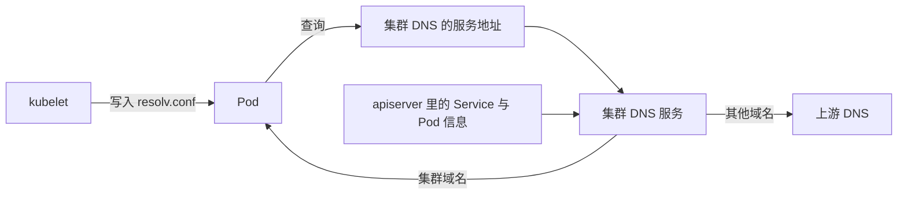
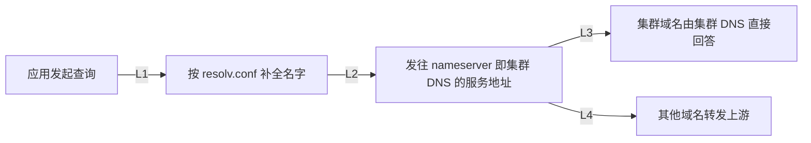

# 集群DNS排查参考

## 是什么
- **一句话定位**：集群内用名字访问 Service 和 Pod 的解析机制：kubelet 给每个 Pod 写好解析配置，集群 DNS 服务根据 API 里的 Service 与 Pod 信息生成记录并回答查询。
- **解决什么问题**：让工作负载用稳定的名字而不是 IP 找到 Service；同时决定集群外的域名怎么解析。
- **谁在用、从哪进来**：Pod 里的应用发起域名查询，由 Pod 内的 resolv.conf 决定查询怎么展开、发给谁。
- **边界（不负责什么）**：集群 DNS 软件本身（Corefile、插件、缓存）见 CoreDNS排查参考；Service 虚拟 IP 到后端的转发见 Service排查参考与 kube-proxy排查参考；节点自身的解析配置不在本条范围。
- **形态与版本**：规范只保证文档列出的名字布局，其余即使能解析也是实现细节，随时可能变化。
- **术语**：
  - search 列表 —— 短名按其逐个补全后缀再查询
  - ndots —— 名字里点的个数低于它时，先按 search 列表补全
  - dnsPolicy —— Pod 的 DNS 策略
  - headless Service —— 没有集群 IP，解析结果是后端 Pod 地址集合

## 组件与架构

| 组件 | 角色 | 职责 | 部署位置 / 形态 | 如何找到 |
|---|---|---|---|---|
| kubelet | 节点代理 | 按 Pod 的 dnsPolicy 与 dnsConfig 生成每个 Pod 的 resolv.conf | 每个节点 | Pod 内的 resolv.conf |
| 集群 DNS 服务（常见为 CoreDNS） | 解析服务 | 依据 Service 与 Pod 信息回答集群域名查询，转发其他查询 | 集群内的 Pod，经一个 Service 暴露 | resolv.conf 里 nameserver 对应的 Service |
| Service / Pod 对象 | 数据来源 | 提供生成记录所需的信息 | apiserver | 对应对象的 spec 与 status |

## 正常链路（请求怎么走 / 正常行为）

### 资源匹配关系
| 编号 | 资源 A.字段 | → | 资源 B.字段 | 匹配规则 | 对不上时的表现 |
|---|---|---|---|---|---|
| R1 | Pod.spec.dnsPolicy 与 dnsConfig | → | Pod 内的 resolv.conf | ClusterFirst 时 nameserver 指向集群 DNS，search 含 Pod 命名空间与集群域，选项含 ndots:5；hostNetwork 的 Pod 需用 ClusterFirstWithHostNet 才享有同样行为；None 时全部由 dnsConfig 提供；dnsConfig 可与任一策略叠加；Default 继承节点配置〔待复核〕 | 策略与预期不符：解析不到集群域名，或解析到不该用的服务器 |
| R2 | 查询名 | → | search 列表补全后的候选名 | search 列表的各后缀依次用来补全查询；点少于 ndots 时先补全再原样查〔待复核〕 | 短名被逐个补全，多一轮失败查询后才命中或最终失败 |
| R3 | Service 名 | → | DNS 记录 | 普通 Service 解析到集群 IP（按 IP 族给 A 或 AAAA）；headless Service 解析到全部后端 Pod 地址；命名端口另有 SRV 记录 | 期望单个 IP 却得到一组 Pod 地址：多为 headless |
| R4 | Pod 的 hostname 与 subdomain | → | Pod 的 A 或 AAAA 记录 | 需要存在与 subdomain 同名的 headless Service；Pod 需就绪，除非 Service 设了 publishNotReadyAddresses | 无同名 headless Service 或 Pod 未就绪：查不到 Pod 记录 |
| R5 | 非集群域名的查询 | → | 上游 DNS | ClusterFirst 下不匹配集群域后缀的查询被集群 DNS 转发到上游 | 上游不可达或配置错：集群外域名解析失败，集群内名字正常 |
| R6 | 查询里的命名空间 | → | 解析范围 | 不带命名空间的短名只在 Pod 所在命名空间查；跨命名空间要带上命名空间，如 data.prod | 短名跨命名空间：查不到，带上命名空间即可 |

### 控制面下发路径
| 环节 | 做什么 | 依据 |
|---|---|---|
| P1 | kubelet 创建 Pod 时按 dnsPolicy 与 dnsConfig 生成 resolv.conf | R1 |
| P2 | 集群 DNS 服务根据 API 中的 Service 与 Pod 信息生成并更新记录 | R3 R4 |

### 流量走向（或生命周期）

| 环节 | 起点 → 终点 | 做什么 | 依据 | 同步/异步与默认行为 |
|---|---|---|---|---|
| L1 | 应用 → 本地解析器 | 读取 resolv.conf，按 search 与 ndots 把名字展开成候选 | R1 R2 R6 | 同步；候选逐个尝试 |
| L2 | 本地解析器 → 集群 DNS | 向 nameserver 发查询；该地址是集群 DNS 的 Service 地址，所以这一步本身要经过 Service 转发 | R1 | 同步；依赖 Service 与 kube-proxy 正常 |
| L3 | 集群 DNS → 应用 | 对集群域名，按记录规则回答 | R3 R4 | 同步 |
| L4 | 集群 DNS → 上游 | 对非集群域名转发到上游并返回 | R5 | 同步 |

### 正常表现（健康基线）
- Pod 内 resolv.conf 的 nameserver、search、选项与其 dnsPolicy 一致。
- 同命名空间用短名、跨命名空间用 name.namespace 都能解析；Service 全名能解析到预期 IP。
- 集群外域名经上游正常解析。

## 逐环节排查（沿链路对照）
- **P1 resolv.conf 生成**
  - 正常：内容与 dnsPolicy、dnsConfig 一致。
  - 异常：hostNetwork 的 Pod 没用 ClusterFirstWithHostNet，拿不到集群 DNS；dnsPolicy 设为 None 却没给 dnsConfig。
  - 区分点：集群域名不通而 Pod 用了宿主网络，先查策略（R1）。
  - 证据落点：Pod 的 spec.dnsPolicy；Pod 内 resolv.conf。
- **P2 记录生成**
  - 正常：Service 与符合条件的 Pod 都有对应记录。
  - 异常：Pod 记录缺失，因为没有同名 headless Service、Pod 未就绪、或没设 hostname 与 subdomain。
  - 区分点：Service 记录正常而 Pod 记录缺失，看 R4 的三个条件。
  - 证据落点：Pod 的 hostname、subdomain 与就绪状态；对应 headless Service。
- **L1 名字展开**
  - 正常：短名按 search 列表补全后命中。
  - 异常：短名跨命名空间解析不到；带点的名字被先补全，多出失败查询。
  - 区分点：同一个名字写短名失败、写全名成功，说明是展开问题（R2、R6）。
  - 证据落点：resolv.conf 的 search 与 ndots。
- **L2 到达集群 DNS**
  - 正常：查询能到集群 DNS 的 Service 地址并被转发到某个 DNS Pod。
  - 异常：所有解析都超时；只有部分节点超时。
  - 区分点：全部名字都失败而 DNS Pod 正常，问题多在 Service 转发这一环，见 Service排查参考与 kube-proxy排查参考。
  - 证据落点：nameserver 对应 Service 的端点；失败节点的规则。
- **L3 集群域名应答**
  - 正常：普通 Service 返回集群 IP，headless 返回 Pod 地址集合。
  - 异常：普通 Service 返回空或 NXDOMAIN；返回多个地址而预期是一个。
  - 区分点：Service 名拼错或命名空间不对优先排除；返回多个地址看是否是 headless（R3）。
  - 证据落点：Service 的 clusterIP 与端点；应答内容。
- **L4 转发上游**
  - 正常：集群外域名正常返回。
  - 异常：集群外域名失败而集群内正常。
  - 区分点：集群内外表现不同，问题在上游转发配置，而不在记录生成。
  - 证据落点：集群 DNS 的上游转发配置，见 CoreDNS排查参考。

## 异常归因速查
| 现象 / 错误码 | 环节 | 归因类别（回指 R#） | 证据位 | 详细条目 |
|---|---|---|---|---|
| 短名跨命名空间查不到 | L1 | 短名只在本命名空间查（R6） | 查询名；Pod 所在命名空间 | |
| 集群域名全部解析超时 | L2 | 到集群 DNS 的服务地址不通（R1） | nameserver 对应 Service 与端点 | |
| hostNetwork Pod 解析不到集群域名 | P1 | 未使用 ClusterFirstWithHostNet（R1） | Pod 的 dnsPolicy | |
| 解析出一串 Pod IP | L3 | headless Service 的预期行为（R3） | Service 的 clusterIP 为 None | |
| 查不到 Pod 的域名记录 | P2 | 缺同名 headless Service 或 Pod 未就绪（R4） | hostname、subdomain、就绪状态 | |
| 集群外域名解析失败、集群内正常 | L4 | 上游转发不通或配置错误（R5） | 集群 DNS 的上游配置 | |
| 自定义 dnsConfig 不生效 | P1 | dnsPolicy 与 dnsConfig 的组合不符预期（R1） | Pod 内 resolv.conf | |
| NXDOMAIN | L1 L3 | 名字拼错、命名空间不对、或记录不存在（R2、R3、R6） | 查询名与 Service 是否存在 | |

## 状态、事件与日志语义
| 来源 | 取值 | 含义 | 常见出现环节 |
|---|---|---|---|
| resolv.conf | search 含命名空间、svc、集群域三项 | 默认的名字补全规则 | L1 |
| resolv.conf | options ndots:5 | 默认的补全触发阈值 | L1 |
| DNS 应答 | NXDOMAIN | 名字不存在；先排除拼写与命名空间 | L1 L3 |
| 记录类型 | SRV | 为 Service 的命名端口生成 | L3 |

## 配置语义
| 配置项 | 默认 / 取值含义 | 改动后的行为后果 |
|---|---|---|
| dnsPolicy | ClusterFirst：集群域走集群 DNS，其余转发上游；ClusterFirstWithHostNet：给 hostNetwork 的 Pod 同样的行为；None：忽略环境、全部用 dnsConfig；Default：继承节点〔待复核〕 | 选错策略会让 Pod 解析不到集群域名或用错上游 |
| dnsConfig | 可选，能与任一策略叠加，可加 nameservers、searches、options | 与 None 搭配时是 DNS 的唯一来源 |
| ndots | 默认 5 | 调小可减少补全造成的多余查询，但短名可能不再被补全 |
| publishNotReadyAddresses | 默认 false | 设为 true 时未就绪的 Pod 也会有记录 |
| setHostnameAsFQDN | Pod 字段，自 v1.22 稳定 | 开启后 Pod 的 hostname 取其全限定域名 |

## 边界与置信度说明
- **来源**：Kubernetes 官方「DNS for Services and Pods」文档的多个版本，没有做过运行时取证。
- **〔待复核〕项**：Default 策略继承节点的细节；ndots 的精确补全规则（来自 resolv.conf 手册，本次未取）。
- **版本差异**：旧版 kube-dns 曾使用 `IP地址.命名空间.pod.集群域` 形式的 Pod 记录；文档明确只有列出的布局受保证，其他写法即使可用也属实现细节。
- **未覆盖**：搜索域数量与长度上限；IPv6 与双栈的细节；节点本地 DNS 缓存；ExternalName 类型的解析；集群 DNS 自身的配置（见 CoreDNS排查参考）。
- **related**：见 frontmatter。
