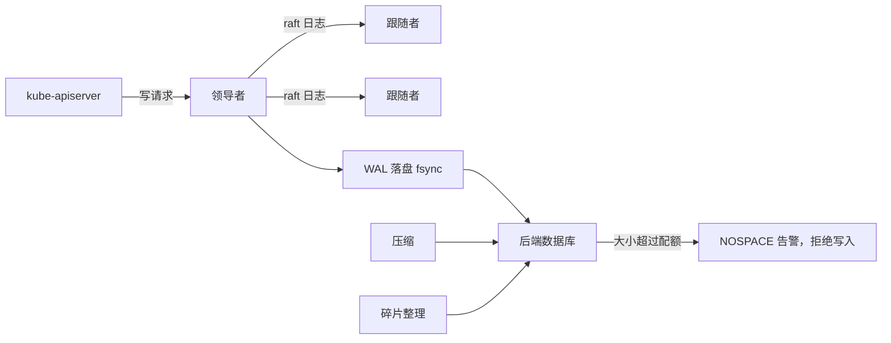

# etcd排查参考

## 是什么
- **一句话定位**：Kubernetes 的唯一权威存储。所有对象的写入都要经 raft 达成多数一致、落盘后才算成功；它对磁盘延迟和数据库大小都很敏感，两者出问题时表现为整个集群"变慢"或"不能写"。
- **解决什么问题**：看到 API 请求整体变慢、写操作全部失败、控制面反复选主时，判断是法定人数、磁盘延迟、选举超时，还是数据库超过配额。
- **谁在用、从哪进来**：只有 kube-apiserver 直接访问 etcd；其他组件都经 apiserver 间接依赖它。
- **边界（不负责什么）**：请求进入 apiserver 之后经过的认证、准入等步骤见 apiserver排查参考；etcd 证书的有效期与轮换见 集群证书排查参考；备份恢复与升级流程本条未展开。
- **形态与版本**：常见为 3 或 5 个成员，与控制面同机或独立；各项默认值取决于版本与部署方式。
- **术语**：
  - 法定人数 —— 多数成员，达成一致所需的最少成员数
  - 压缩 —— 清掉旧的修订历史，释放逻辑空间
  - 碎片整理 —— 把压缩释放的空间真正还给磁盘
  - NOSPACE 告警 —— 数据库达到配额后 etcd 设置的告警，期间拒绝写入

## 组件与架构

| 组件 | 角色 | 职责 | 部署位置 / 形态 | 如何找到 |
|---|---|---|---|---|
| etcd 成员 | 存储 | 保存集群全部状态，参与 raft | 控制面节点或独立节点，常为 3 或 5 个 | etcd 的 Pod 或进程与其启动参数 |
| 领导者 | raft 角色 | 接收写请求并复制日志 | 某个成员 | 端点状态里的 leader 标记 |
| WAL 与后端数据库 | 持久化 | 日志先落盘再写入数据库 | 成员本地磁盘 | 磁盘延迟与数据库大小指标 |
| 告警 | 保护机制 | 空间不足时拒绝写入 | etcd 内 | 告警列表 |
| kube-apiserver | 客户端 | 唯一的客户端，也可触发周期压缩〔待复核〕 | 控制面 | 与 etcd 的连接配置 |

## 正常链路（请求怎么走 / 正常行为）

### 资源匹配关系
| 编号 | 资源 A.字段 | → | 资源 B.字段 | 匹配规则 | 对不上时的表现 |
|---|---|---|---|---|---|
| R1 | 成员数 n | → | 法定人数与容错 | 法定人数为 n 除以 2 再加 1；奇数集群增加一个节点总会使所需节点数增加，偶数规模不增加容错 | 失去多数成员：集群不能提交写入 |
| R2 | 心跳间隔与选举超时 | → | 领导者稳定性 | 默认心跳 100 毫秒、选举超时 1000 毫秒，推荐选举超时不小于心跳的 5 倍〔待复核〕 | 磁盘或网络延迟接近超时：频繁选主，写入中断 |
| R3 | 数据库大小 | → | 空间配额 | 默认 2GB，可调至 8GB；接近配额时触发告警 | 超过配额：写请求被拒绝，读不受影响 |
| R4 | 修订历史 | → | 压缩与碎片整理 | 历史不断增长；压缩清理旧修订，碎片整理把空间还给磁盘；etcd 默认不自动压缩，需设置参数或手动〔待复核〕 | 只压缩不整理：数据库文件大小不降，配额仍可能被触发 |
| R5 | 磁盘的 fsync 延迟 | → | 写入提交速度 | 提案要落盘才能提交；磁盘慢到超过选举超时时，领导者虽能发心跳但实际不可用 | 磁盘慢：写请求超时、领导者变更，API 整体变慢 |
| R6 | apiserver 的 etcd 连接配置 | → | 读写与证书 | apiserver 以客户端证书连接 etcd；kubeadm 部署下证书在 etcd 的 pki 目录〔待复核〕 | 证书或端点配置错：apiserver 连不上 etcd，整个控制面不可用 |
| R7 | 告警状态 | → | 写入是否被拒绝 | 告警设置期间写请求被拒绝；释放空间后必须显式解除告警才恢复写入 | 释放了空间但仍不能写：告警还没解除 |

### 控制面下发路径
| 环节 | 做什么 | 依据 |
|---|---|---|
| P1 | 部署成员并配置配额、选举与心跳参数、自动压缩参数 | R2 R3 R4 |
| P2 | 周期压缩：由 etcd 的自动压缩参数，或 apiserver 的压缩间隔参数完成，二者应一致〔待复核〕 | R4 |
| P3 | 运维定期对各端点做碎片整理 | R4 |
| P4 | 监控数据库大小、磁盘延迟、领导者变更并告警 | R2 R3 R5 |

### 流量走向（或生命周期）

| 环节 | 起点 → 终点 | 做什么 | 依据 | 同步/异步与默认行为 |
|---|---|---|---|---|
| L1 | apiserver → 领导者 | 写请求发给领导者，由它发起复制 | R1 R6 | 同步 |
| L2 | 领导者 → 多数成员 | 日志复制并在多数成员落盘后提交 | R1 R5 | 同步；对磁盘延迟敏感 |
| L3 | 提交 → 数据库 | 应用到后端数据库，数据库随修订增长 | R3 | 持续增长 |
| L4 | 修订历史 → 压缩 | 周期清理旧修订 | R4 | 默认不自动，需配置 |
| L5 | 压缩后 → 碎片整理 | 把空间还给磁盘 | R4 | 运维手动或定期；执行期间有延迟尖峰〔待复核〕 |
| L6 | 数据库 → 配额 | 超过配额设置 NOSPACE 告警，拒绝写入 | R3 R7 | 需压缩、整理并解除告警 |

### 正常表现（健康基线）
- 多数成员健康，领导者稳定，没有无故的领导者变更。
- WAL 落盘延迟与后端提交延迟保持低位；API 写延迟正常。
- 数据库大小远低于配额，且有定期压缩与整理。

## 逐环节排查（沿链路对照）
- **P1 配置**
  - 正常：配额、超时、压缩参数合理。
  - 异常：没配自动压缩；选举超时与心跳比例不当。
  - 区分点：数据库一直增长，先看是否配置了压缩（R4）。
  - 证据落点：etcd 的启动参数。
- **P2 周期压缩**
  - 正常：历史被定期清理。
  - 异常：etcd 与 apiserver 的压缩参数互相冲突或都没开。
  - 区分点：数据库增长而压缩从未发生，查谁负责压缩〔待复核〕。
  - 证据落点：两处的压缩参数；etcd 日志里的压缩记录。
- **P3 碎片整理**
  - 正常：压缩后做了整理，文件大小下降。
  - 异常：压缩后大小不降。
  - 区分点：压缩只释放逻辑空间，必须整理才还给磁盘（R4）。
  - 证据落点：端点状态里的数据库大小。
- **P4 监控**
  - 正常：有数据库大小与延迟的告警。
  - 异常：告警缺失，等到写入失败才发现。
  - 区分点：参见监控指标条目里 etcd 部分。
  - 证据落点：etcd 的指标。
- **L1 写入口**
  - 正常：写请求被领导者接收。
  - 异常：找不到领导者；apiserver 连不上 etcd。
  - 区分点：整个控制面不可用，先看 etcd 连接与证书（R6）。
  - 证据落点：apiserver 与 etcd 的日志；端点状态。
- **L2 复制与落盘**
  - 正常：多数成员落盘后提交。
  - 异常：写超时、领导者频繁变更、日志里出现提交耗时过长的告警〔待复核〕。
  - 区分点：磁盘慢到超过选举超时，会让领导者虽能发心跳却不能提交（R5）；先看磁盘延迟指标。
  - 证据落点：WAL 落盘与后端提交的延迟指标；领导者变更计数。
- **L3 数据增长**
  - 正常：增长平缓。
  - 异常：增长很快，逼近配额。
  - 区分点：看是什么在产生大量写入与历史（如频繁更新的对象、事件）。
  - 证据落点：数据库大小与配额之比。
- **L4 压缩**
  - 正常：压缩后历史减少。
  - 异常：压缩带来延迟尖峰。
  - 区分点：尖峰与压缩时间点对齐，属可预期现象。
  - 证据落点：etcd 日志中的压缩记录与延迟曲线。
- **L5 碎片整理**
  - 正常：整理后文件缩小。
  - 异常：整理期间节点短暂不可响应，甚至触发重新选主〔待复核〕。
  - 区分点：对成员逐个整理，避免同时对多个成员做。
  - 证据落点：整理前后的数据库大小；选主事件。
- **L6 配额与告警**
  - 正常：数据库在配额之内。
  - 异常：写请求报 database space exceeded。
  - 区分点：恢复要按三步：压缩、对每个端点整理、解除告警；释放了空间还不能写，看告警是否还在（R7）。
  - 证据落点：告警列表；数据库大小。

## 异常归因速查
| 现象 / 错误码 | 环节 | 归因类别（回指 R#） | 证据位 | 详细条目 |
|---|---|---|---|---|
| mvcc: database space exceeded | L6 | 数据库超过配额，NOSPACE 告警生效（R3、R7） | 告警列表；数据库大小 | oss/k8s-apiserver.md |
| 释放空间后仍不能写 | L6 | 告警没有解除（R7） | 告警列表 | |
| 压缩后数据库文件大小不降 | L5 P3 | 没做碎片整理（R4） | 整理前后大小 | |
| API 整体变慢、写超时 | L2 | 磁盘 fsync 慢（R5） | WAL 落盘延迟指标 | oss/k8s-apiserver.md |
| 领导者频繁切换 | L2 | 磁盘或网络延迟接近选举超时（R2、R5） | 领导者变更计数 | |
| 整个控制面不可用 | L1 | apiserver 连不上 etcd，或失去多数成员（R1、R6） | 端点状态；apiserver 日志 | oss/k8s-node.md |
| 数据库一直增长 | P1 P2 | 没有配置自动压缩（R4） | etcd 与 apiserver 的压缩参数 | |
| 压缩或整理时延迟抖动 | L4 L5 | 维护操作造成的可预期尖峰（R4） | 抖动与维护时间点 | |
| 偶数个成员以为更可靠 | P1 | 偶数规模不增加容错，且所需多数更大（R1） | 成员数 | |
| 配额调到很大仍出问题 | P1 | 超过推荐上限，应先找增长根源（R3） | 数据库大小趋势 | |

## 状态、事件与日志语义
| 来源 | 取值 | 含义 | 常见出现环节 |
|---|---|---|---|
| 错误 | mvcc: database space exceeded | 配额告警期间的写请求被拒绝 | L6 |
| 告警 | NOSPACE | 数据库达到配额 | L6 |
| 错误 | etcdserver: request timed out | 请求在 etcd 内超时〔待复核〕 | L2 |
| 日志 | apply request took too long | 提交耗时过长，常与磁盘慢相关〔待复核〕 | L2 |
| 指标 | etcd_mvcc_db_total_size_in_bytes 与 etcd_server_quota_backend_bytes | 数据库大小与配额，二者之比用来预警 | L3 L6 |
| 指标 | etcd_disk_wal_fsync_duration_seconds | WAL 落盘延迟 | L2 |
| 指标 | etcd_disk_backend_commit_duration_seconds | 后端提交延迟 | L2 |
| 指标 | etcd_server_leader_changes_seen_total | 领导者变更次数 | L2 |
| 指标 | etcd_request_duration_seconds | apiserver 视角的 etcd 延迟 | L2 |

## 配置语义
| 配置项 | 默认 / 取值含义 | 改动后的行为后果 |
|---|---|---|
| quota-backend-bytes | 默认 2GB，可调至 8GB | 调大延后触发告警，但推荐上限就是 8GB，不能代替压缩 |
| heartbeat-interval | 默认 100 毫秒〔待复核〕 | 调大可容忍更高的网络延迟 |
| election-timeout | 默认 1000 毫秒，推荐不小于心跳的 5 倍〔待复核〕 | 调大减少误选主，但故障切换更慢 |
| auto-compaction-retention 与模式 | 默认不自动压缩，可按周期或按修订〔待复核〕 | 不配则历史无限增长 |
| 成员数 | 奇数，常为 3 或 5 | 偶数不增加容错 |

## 边界与置信度说明
- **来源**：etcd 官方 FAQ（v3.2、v3.4）给出法定人数、默认配额、慢磁盘对领导者的影响、空间告警与三步恢复；默认超时、压缩参数、指标名称、证书路径与部分错误文本来自二手资料，官方运维与调优文档本次没取到。
- **〔待复核〕项**：心跳与选举超时的默认值；apiserver 的压缩间隔参数与 etcd 自动压缩的关系；碎片整理造成重新选主的条件；部分错误文本与日志措辞；证书路径。
- **版本差异**：各版本对默认值、自动压缩与告警的细节有差异，以所用 etcd 版本的官方文档为准。
- **未覆盖**：备份与恢复；成员的增删与替换；etcd 升级；磁盘选型与性能基准；多集群与跨地域部署；认证与权限；etcd 自身的证书轮换。
- **related**：见 frontmatter。
