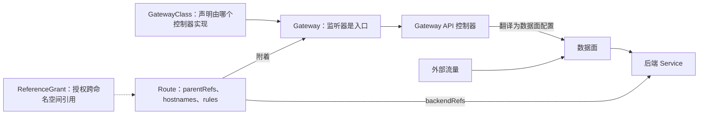

# GatewayAPI排查参考

## 是什么
- **一句话定位**：用一组分角色的 API 对象描述"流量从哪个入口进来、按什么规则转到哪个 Service"：GatewayClass 声明谁来实现，Gateway 打开入口，Route 声明转发规则，ReferenceGrant 授权跨命名空间引用。
- **解决什么问题**：把"路由不通"拆成可对照状态条件的几步：控制器接受了没有、入口就绪了没有、Route 附着上没有、后端引用解析成功没有。
- **谁在用、从哪进来**：基础设施提供者建 GatewayClass，集群运维建 Gateway，应用开发者建 Route；外部流量到达 Gateway 的某个监听器。
- **边界（不负责什么）**：具体实现（如 Envoy Gateway）怎样把这些对象翻译成数据面配置，见各自的软件条目；转发到 Service 之后的链路见 Service排查参考；它与 Ingress 是两套独立的 API，见 Ingress排查参考。
- **形态与版本**：API 组为 gateway.networking.k8s.io，稳定版本 v1；不同资源处在 Standard 或 Experimental 通道，随版本变化，以所装 CRD 为准。
- **术语**：
  - 监听器（listener）—— Gateway 上的一个入口，含端口、协议、可选主机名
  - parentRefs —— Route 指明要附着的 Gateway
  - allowedRoutes —— 监听器声明允许哪些 Route 附着
  - 状况（conditions）—— 各对象 status 里的 Accepted、Programmed、ResolvedRefs 等

## 组件与架构

| 组件 | 角色 | 职责 | 部署位置 / 形态 | 如何找到 |
|---|---|---|---|---|
| GatewayClass | 声明（集群级） | 指明由哪个控制器实现 Gateway | apiserver | GatewayClass 的控制器名与 Accepted 状况 |
| Gateway | 声明 | 用监听器打开入口，并声明允许附着的 Route | apiserver | Gateway 的 listeners 与 status |
| Route（HTTPRoute 等） | 声明 | 声明匹配条件与后端 | apiserver | Route 的 parentRefs、rules 与 status |
| ReferenceGrant | 授权 | 在目标命名空间授权跨命名空间引用 | 目标命名空间 | ReferenceGrant 的 from 与 to |
| Gateway API 控制器 | 实现 | 接受对象、配置底层基础设施、回写状况 | 集群内的工作负载 | 控制器 Pod 与日志 |

## 正常链路（请求怎么走 / 正常行为）

### 资源匹配关系
| 编号 | 资源 A.字段 | → | 资源 B.字段 | 匹配规则 | 对不上时的表现 |
|---|---|---|---|---|---|
| R1 | Gateway 指定的 GatewayClass | → | GatewayClass 声明的控制器 | 每个 Gateway 恰好关联一个 GatewayClass，GatewayClass 说明负责管理它的控制器，由该控制器认领；GatewayClass 是集群级资源，另有 Accepted 状况表示控制器是否接受该类〔待复核〕 | 类名写错或控制器未运行：Gateway 不被接受 |
| R2 | Gateway 的 listeners | → | 实际打开的入口 | 每个监听器有端口、协议与可选主机名；Gateway 可以已 Accepted 但尚未 Programmed | Programmed 为假：入口还没配置好，流量不通 |
| R3 | Route.parentRefs | → | Gateway（及其监听器） | Route 通过 parentRefs 附着；监听器的 allowedRoutes 决定是否允许；Gateway 在别的命名空间时 parentRefs 要写 namespace | 没有任何监听器允许它：Route 不被接受，原因为 NotAllowedByListeners |
| R4 | Route.hostnames | → | 监听器的主机名 | 主机名需要与所附监听器相容〔待复核〕 | 主机名对不上：请求不会命中这条 Route |
| R5 | Route.rules 的匹配条件 | → | 请求的路径、头、方法等 | rules 里的 matches 决定命中哪条规则，每条规则带自己的 backendRefs | 匹配条件写错：请求落不到预期后端 |
| R6 | rules 的 backendRefs | → | 后端 Service（名称与端口） | 引用要能解析到真实的后端；跨命名空间引用需要 ReferenceGrant 授权 | 后端不存在：ResolvedRefs 为假，原因含 BackendNotFound；缺授权：引用被拒绝 |
| R7 | 各对象的 status.conditions | → | 对象当前是否可用 | GatewayClass 看 Accepted；Gateway 看 Accepted 与 Programmed；Route 在每个父对象下看 Accepted 与 ResolvedRefs | 条件为假时，原因与信息指明卡在哪一环 |

### 控制面下发路径
| 环节 | 做什么 | 依据 |
|---|---|---|
| P1 | 基础设施提供者创建 GatewayClass，声明由哪个控制器实现 | R1 |
| P2 | 集群运维创建 Gateway，控制器接受它并配置底层基础设施，回写 Accepted 与 Programmed | R1 R2 R7 |
| P3 | 应用开发者创建 Route 并用 parentRefs 附着，控制器核对 allowedRoutes 与后端引用，回写 Route 状况 | R3 R6 R7 |
| P4 | 控制器把 Gateway 与 Route 翻译成数据面配置（具体方式因实现而异） | R2 R5 |

### 流量走向（或生命周期）

| 环节 | 起点 → 终点 | 做什么 | 依据 | 同步/异步与默认行为 |
|---|---|---|---|---|
| L1 | 外部 → 监听器 | 请求到达 Gateway 的某个监听器，端口、协议、主机名要对上 | R2 | 同步；入口未 Programmed 时不通 |
| L2 | 监听器 → Route 规则 | 只有已附着且被接受的 Route 参与匹配，按 hostnames 与 matches 选规则 | R3 R4 R5 | 同步 |
| L3 | 规则 → 后端 | 按 backendRefs 选后端，引用必须已解析 | R6 | 同步 |
| L4 | 后端 Service → 端点 | 转发到 Service 的端点，之后的链路见 Service排查参考 | R6 | 同步 |

### 正常表现（健康基线）
- GatewayClass 为 Accepted，Gateway 同时为 Accepted 与 Programmed。
- 每条 Route 在其父 Gateway 下 Accepted 与 ResolvedRefs 都为真。
- 后端 Service 有可用端点，跨命名空间引用都有对应的 ReferenceGrant。

## 逐环节排查（沿链路对照）
- **P1 GatewayClass**
  - 正常：GatewayClass 存在且 Accepted。
  - 异常：GatewayClass 没被接受，或对应控制器没在运行。
  - 区分点：整个体系都不动，先看 GatewayClass 与控制器（R1）。
  - 证据落点：GatewayClass 的 Accepted 状况；控制器 Pod 与日志。
- **P2 Gateway**
  - 正常：Gateway 为 Accepted，随后 Programmed。
  - 异常：Accepted 为真而 Programmed 为假；Gateway 根本没被接受。
  - 区分点：Accepted 说明控制器认可了对象，Programmed 才说明底层入口已配置好，二者不能混为一谈（R2、R7）。
  - 证据落点：Gateway 的 conditions 里的原因与信息。
- **P3 Route 附着**
  - 正常：Route 在父 Gateway 下 Accepted 为真。
  - 异常：Route 没被接受，原因是没有监听器允许它；parentRefs 写错或漏了 namespace。
  - 区分点：看 Route 的 status 里每个父对象的状况，原因如 NotAllowedByListeners 直接指向监听器的 allowedRoutes（R3）。
  - 证据落点：Route 的 status.parents 下的状况；监听器的 allowedRoutes。
- **P4 数据面落实**
  - 正常：控制器把配置下发到数据面。
  - 异常：状况都为真但流量仍不通。
  - 区分点：状况只代表控制器对 API 对象的判断，数据面是否真的生效要看具体实现，见对应软件条目。
  - 证据落点：数据面实际配置；控制器日志。
- **L1 监听器入口**
  - 正常：请求到达预期监听器。
  - 异常：端口、协议或主机名与监听器不符。
  - 区分点：先确认入口地址与端口，再看 Gateway 的 Programmed（R2）。
  - 证据落点：Gateway 的 listeners 与 addresses。
- **L2 Route 匹配**
  - 正常：请求命中预期 Route 与规则。
  - 异常：Route 虽存在但没参与匹配，因为没被接受；主机名或匹配条件对不上。
  - 区分点：Route 状况不是 Accepted 时不会生效；已接受但不命中则看 hostnames 与 matches（R4、R5）。
  - 证据落点：Route 的状况；hostnames 与 matches。
- **L3 后端选择**
  - 正常：backendRefs 已解析。
  - 异常：ResolvedRefs 为假，后端不存在或缺授权。
  - 区分点：后端在别的命名空间时，先看目标命名空间有没有 ReferenceGrant（R6）。
  - 证据落点：Route 状况里的 ResolvedRefs；ReferenceGrant。
- **L4 到达端点**
  - 正常：流量到达 Service 的端点。
  - 异常：路由与引用都对，后端仍失败。
  - 区分点：转到 Service排查参考 排查端点与 targetPort。
  - 证据落点：后端 Service 与 EndpointSlice。

## 异常归因速查
| 现象 / 错误码 | 环节 | 归因类别（回指 R#） | 证据位 | 详细条目 |
|---|---|---|---|---|
| Gateway 没被接受 | P1 P2 | 类名错误或控制器未运行（R1） | GatewayClass 与 Gateway 的状况 | |
| Accepted 为真但 Programmed 为假 | P2 | 底层入口尚未配置好（R2、R7） | Gateway 状况的原因与信息 | |
| Route 没被接受，NotAllowedByListeners | P3 | 没有监听器的 allowedRoutes 允许它（R3） | Route 的 status.parents；监听器的 allowedRoutes | |
| Route 已接受但请求不命中 | L2 | hostnames 或 matches 对不上（R4、R5） | Route 的 hostnames 与 matches | |
| ResolvedRefs 为假，BackendNotFound | L3 | 后端 Service 不存在或名称端口写错（R6） | Route 状况；Service 是否存在 | |
| 跨命名空间引用被拒绝 | L3 | 目标命名空间缺 ReferenceGrant（R6） | ReferenceGrant 的 from 与 to | |
| 所有状况都为真仍不通 | P4 L4 | 数据面未生效或后端本身有问题（R2、R6） | 数据面配置；后端端点 | |
| 引用的 Group 或 Kind 无效 | P3 | 对象引用被实现拒绝并写入状况（R7） | 所属对象的状况 | |

## 状态、事件与日志语义
| 来源 | 取值 | 含义 | 常见出现环节 |
|---|---|---|---|
| GatewayClass 状况 | Accepted | 控制器接受了这个类 | P1 |
| Gateway 状况 | Accepted | 控制器接受了这个 Gateway | P2 |
| Gateway 状况 | Programmed | 控制器已配置好底层基础设施 | P2 L1 |
| Route 状况 | Accepted | 该 Route 已被对应父 Gateway 接受 | P3 L2 |
| Route 状况 | ResolvedRefs | 所有引用（如后端）已解析 | L3 |
| 状况的原因 | NotAllowedByListeners | 没有监听器的 allowedRoutes 允许该 Route | P3 |
| 状况的原因 | BackendNotFound | 引用的后端不存在 | L3 |

## 配置语义
| 配置项 | 默认 / 取值含义 | 改动后的行为后果 |
|---|---|---|
| 监听器 allowedRoutes | 声明允许附着的 Route 种类与命名空间范围 | 放宽才会让更多 Route 附着成功；收紧会让已附着的 Route 被拒绝 |
| Route.parentRefs | 指向要附着的 Gateway，可再指到某个监听器；跨命名空间要写 namespace | 写错则 Route 不会被任何 Gateway 接受 |
| Route.hostnames | 限定该 Route 处理的主机名 | 与监听器主机名不相容则不会命中〔待复核〕 |
| backendRefs | 后端 Service 的名称与端口 | 名称或端口错会导致 ResolvedRefs 为假 |
| ReferenceGrant | 在目标命名空间授权来自某命名空间某类对象的引用 | 缺失则跨命名空间引用被拒绝 |
| 通道 | Standard 与 Experimental | 同一资源在不同版本可能处在不同通道，用之前确认所装 CRD |

## 边界与置信度说明
- **来源**：官方 API 参考与官方库注释给出资源类型、allowedRoutes、状况类型与部分原因；Kubernetes 官方概念页给出 Gateway 与 GatewayClass 的关联以及 Route 的字段形态。Gateway 的 Accepted 与 Programmed 语义、角色分工、parentRefs 跨命名空间的写法、ReferenceGrant 的作用，仍来自二手资料，不是官方文档原文，需要对照官方文档复核。
- **〔待复核〕项**：Route 主机名与监听器主机名相容的具体规则；GatewayClass 的 Accepted 语义。
- **版本差异**：各资源所处通道随 Gateway API 版本变化；条目写作时较新资料把 TCPRoute、UDPRoute、TLSRoute、ListenerSet 归入 Experimental，以实际安装的 CRD 为准。
- **未覆盖**：各类 Route 的详细字段（过滤器、重写、流量切分等）；BackendTLSPolicy 与策略挂接；监听器的 TLS 配置；实现特有的扩展与状况；与服务网格的结合。
- **related**：见 frontmatter。
