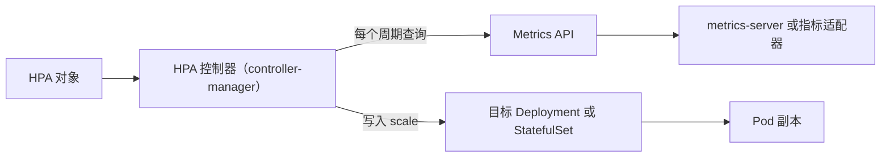
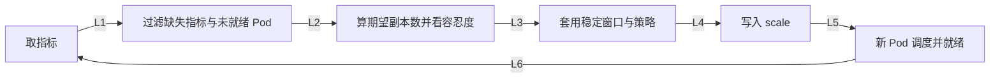

# HPA排查参考

## 是什么
- **一句话定位**：HPA 按一个公式根据指标调整工作负载的副本数：期望副本数等于当前副本数乘以"当前指标值除以目标值"，向上取整；比值在容忍度之内就不动。
- **解决什么问题**：不扩容、指标显示 unknown、扩了又缩、缩得太慢、副本在上下限之间抖动时，判断是拿不到指标、指标没法算、被容忍度或稳定窗口压住了，还是扩出来的 Pod 起不来。
- **谁在用、从哪进来**：需要按负载自动调整副本数的 Deployment、StatefulSet 等；DaemonSet 不适用。
- **边界（不负责什么）**：指标本身如何产生与采集见 监控采集链路排查参考与 工作负载与资源指标排查参考；扩出来的 Pod 起不来见 调度排查参考与 Pod排查参考；工作负载控制器的更新逻辑见 工作负载控制器排查参考。
- **形态与版本**：控制器运行在 kube-controller-manager 内；autoscaling/v2 为当前稳定版本。
- **术语**：
  - 容忍度 —— 比值与 1.0 足够接近时不做扩缩，默认 0.1
  - 稳定窗口 —— 回看一段时间选最保守的建议，用来抑制抖动
  - 初始就绪延迟与 CPU 初始化窗口 —— 刚启动的 Pod 的 CPU 数据不参与计算的时间
  - 聚合 API —— metrics.k8s.io、custom.metrics.k8s.io、external.metrics.k8s.io

## 组件与架构

| 组件 | 角色 | 职责 | 部署位置 / 形态 | 如何找到 |
|---|---|---|---|---|
| HPA 对象 | 声明 | 写明目标、指标、上下限、行为 | 命名空间内 | HPA 的 spec 与 status |
| HPA 控制器 | 控制面 | 周期性取指标、算期望副本、写入目标的 scale | kube-controller-manager 内 | HPA 的状况与事件 |
| Metrics API | 指标入口 | 提供资源、自定义、外部三类指标 | 聚合 API | 对应 APIService |
| metrics-server | 资源指标源 | 提供 metrics.k8s.io，需单独部署 | 集群内的工作负载 | 见 监控采集链路排查参考 |
| 指标适配器 | 自定义与外部指标源 | 把外部监控数据暴露为聚合 API | 集群内的工作负载 | 其 APIService 与日志 |

## 正常链路（请求怎么走 / 正常行为）

### 资源匹配关系
| 编号 | 资源 A.字段 | → | 资源 B.字段 | 匹配规则 | 对不上时的表现 |
|---|---|---|---|---|---|
| R1 | HPA 的 scaleTargetRef | → | 可扩缩的工作负载 | 目标须支持 scale，如 Deployment、StatefulSet；DaemonSet 这类无法扩缩的对象不适用 | 指向不可扩缩的对象：HPA 不起作用 |
| R2 | HPA 的指标类型 | → | 聚合 API | 资源指标走 metrics.k8s.io，通常由 Metrics Server 提供；自定义与外部指标走 custom.metrics.k8s.io 与 external.metrics.k8s.io，需要相应的适配器 | 对应 API 不可用：HPA 取不到指标，状态为未知 |
| R3 | 容器的资源请求 | → | 利用率类指标 | 利用率是相对请求算的；若 Pod 里有容器没设置对应请求，该 Pod 的 CPU 利用率无法定义，对这个指标不采取任何动作 | 没设 requests：HPA 看起来在运行却永远不扩缩 |
| R4 | 当前指标值与期望值 | → | 期望副本数 | 期望副本数等于当前副本数乘以二者之比再向上取整；平均值指标取所有 Pod 的平均；比值在 1.0 的容忍度（默认 0.1）内跳过 | 利用率略高于目标却不扩：落在容忍度内，属于预期 |
| R5 | Pod 的就绪与启动阶段 | → | 参与计算的 Pod | 计算前会考虑缺失指标与就绪 Pod 数；刚启动的 Pod 受初始就绪延迟（默认 30 秒）与 CPU 初始化窗口（默认 5 分钟）影响 | 新 Pod 启动期的高 CPU 被忽略，所以扩容反应会比直觉慢 |
| R6 | minReplicas 与 maxReplicas | → | 副本上下限 | 期望副本数被限制在这个区间内〔待复核〕 | 已到上限还需要更多：不会再扩，状况里会体现被限制〔待复核〕 |
| R7 | behavior 的稳定窗口与策略 | → | 扩缩速度与抖动抑制 | scaleDown 默认稳定窗口 300 秒，scaleUp 默认 0；policies 可按百分比或 Pod 数限制每个周期的变化量；selectPolicy 取 Max、Min 或 Disabled〔待复核〕 | 缩容比预期慢：稳定窗口在压住；想禁止缩容用 Disabled |
| R8 | HPA 与其他控制者 | → | 谁决定副本数 | HPA 与 VPA 同作用于同一指标会互相影响；工作负载里手写的副本数也会与 HPA 争夺〔待复核〕 | 副本数被来回改写：多个控制者在同时管理 |
| R9 | 同步周期与指标采集周期 | → | 反应延迟 | HPA 每 15 秒评估，metrics-server 约每 15 秒采集，二者叠加造成延迟〔待复核〕 | 负载突增时不是立刻扩容，有几十秒的滞后 |

### 控制面下发路径
| 环节 | 做什么 | 依据 |
|---|---|---|
| P1 | 用户创建 autoscaling/v2 的 HPA，指向目标与指标 | R1 R2 |
| P2 | 控制器每个同步周期向聚合 API 查询各指标 | R2 R3 |
| P3 | 计算期望副本数，先过滤缺失指标与未就绪的 Pod，再看容忍度 | R4 R5 |
| P4 | 套用 behavior 的稳定窗口与策略，并限制在上下限之内〔待复核〕 | R6 R7 |
| P5 | 把结果写入目标的 scale，由目标的控制器去增减 Pod | R8 |

### 流量走向（或生命周期）

| 环节 | 起点 → 终点 | 做什么 | 依据 | 同步/异步与默认行为 |
|---|---|---|---|---|
| L1 | 控制器 → Metrics API | 每个周期查询指标，默认 15 秒 | R2 R9 | 周期性 |
| L2 | 指标 → Pod 过滤 | 处理缺失指标、未就绪与刚启动的 Pod | R3 R5 | 影响参与计算的集合 |
| L3 | 过滤后 → 期望副本 | 按公式算期望副本，比值在容忍度内跳过 | R4 | 容忍度默认 0.1 |
| L4 | 期望副本 → 行为约束 | 套用稳定窗口与策略，限制在上下限之内 | R6 R7 | 缩容默认窗口 300 秒〔待复核〕 |
| L5 | 结果 → 目标 | 写入 scale 子资源 | R8 | 同步 |
| L6 | 新副本 → 就绪 | 新 Pod 被调度、启动、就绪后才算有效容量 | R5 | 受调度与启动速度影响 |

### 正常表现（健康基线）
- HPA 的状况显示能取到指标且可以扩缩；指标值有具体数字而不是 unknown。
- 负载上升后副本数在合理延迟内增加，负载回落后在稳定窗口之后逐步减少。
- 所有目标容器都设置了资源请求。

## 逐环节排查（沿链路对照）
- **P1 声明**
  - 正常：目标可扩缩，指标类型与来源对应。
  - 异常：目标是 DaemonSet；指标类型写错。
  - 区分点：HPA 对象本身创建成功但完全不动，先看目标是否可扩缩（R1）。
  - 证据落点：HPA 的 spec 与目标种类。
- **P2 取指标**
  - 正常：能从聚合 API 取到。
  - 异常：取不到，状态为未知。
  - 区分点：资源指标看 metrics.k8s.io 与 Metrics Server，自定义与外部指标看适配器及其 APIService（R2）。
  - 证据落点：HPA 状况与事件；对应 APIService。
- **P3 过滤与计算**
  - 正常：参与计算的 Pod 合理。
  - 异常：缺请求导致利用率无法定义；大量 Pod 未就绪。
  - 区分点：HPA 状况正常却不扩，先查容器是否设置了 requests（R3）。
  - 证据落点：目标容器的 requests；Pod 就绪状态。
- **P4 行为约束**
  - 正常：按窗口与策略平滑变化。
  - 异常：缩容很慢；扩容被限速。
  - 区分点：这是稳定窗口与策略的设计效果，不是故障；需要时调整 behavior（R7）。
  - 证据落点：HPA 的 behavior；上下限。
- **P5 写入与协作**
  - 正常：目标按 scale 增减 Pod。
  - 异常：副本数被其他控制者改写。
  - 区分点：看是否有 VPA 或手动副本设置同时在管（R8）。
  - 证据落点：目标的副本数来源；VPA 对象。
- **L1 取指标**
  - 正常：每个周期都取到。
  - 异常：偶发取不到。
  - 区分点：指标有 15 秒量级的采集与评估延迟（R9）。
  - 证据落点：指标新鲜度。
- **L2 过滤**
  - 正常：就绪 Pod 的指标参与计算。
  - 异常：新 Pod 的 CPU 被忽略，反应慢。
  - 区分点：初始就绪延迟 30 秒、CPU 初始化窗口 5 分钟是设计行为（R5）。
  - 证据落点：控制器参数；Pod 启动时间。
- **L3 计算**
  - 正常：比值超出容忍度时才变化。
  - 异常：利用率偏离目标却不动。
  - 区分点：先算比值：落在 0.9 到 1.1 之间属于容忍度内（R4）。
  - 证据落点：当前指标值与目标值。
- **L4 行为约束**
  - 正常：按策略变化。
  - 异常：抖动，或缩容很慢。
  - 区分点：抖动多是窗口太短，缩容慢是窗口在压住（R7）。
  - 证据落点：behavior 配置；副本数曲线。
- **L5 写入**
  - 正常：目标副本数被更新。
  - 异常：HPA 要求了新副本数而目标没变。
  - 区分点：转到目标控制器，见 工作负载控制器排查参考。
  - 证据落点：目标的 scale 与事件。
- **L6 新副本就绪**
  - 正常：新 Pod 起来并就绪。
  - 异常：新 Pod 一直 Pending。
  - 区分点：扩了副本数但没有真正增加容量，转到 调度排查参考。
  - 证据落点：新 Pod 的状态与调度事件。

## 异常归因速查
| 现象 / 错误码 | 环节 | 归因类别（回指 R#） | 证据位 | 详细条目 |
|---|---|---|---|---|
| 状态正常但永远不扩缩 | P3 | 容器没设置 requests，利用率无法定义（R3） | 目标容器的 requests | oss/k8s-resources.md |
| 指标显示 unknown | P2 | 聚合 API 不可用或没有对应提供者（R2） | APIService；metrics-server | oss/monitoring-pipeline.md |
| 取不到自定义或外部指标 | P2 | 缺少适配器，或适配器不可用（R2） | 适配器的 APIService 与日志 | |
| 利用率略高于目标却不扩 | L3 | 落在容忍度内（R4） | 当前值与目标值之比 | |
| 新 Pod 启动时的高 CPU 没触发扩容 | L2 | 初始就绪延迟与初始化窗口（R5） | Pod 启动时间 | |
| 缩容很慢 | L4 | 稳定窗口压住（R7）〔待复核〕 | behavior 的 scaleDown | |
| 扩了又很快缩回 | L4 | 窗口或策略不合适，指标抖动（R7） | 副本数与指标曲线 | |
| 想禁止缩容 | P4 | 可将 scaleDown 的 selectPolicy 设为 Disabled（R7）〔待复核〕 | behavior | |
| 副本数被来回改写 | P5 | 多个控制者同时管理（R8）〔待复核〕 | 其他控制者对象 | oss/k8s-workload.md |
| 扩出来的 Pod 一直 Pending | L6 | 没有足够容量或约束不满足 | 新 Pod 的调度事件 | oss/k8s-scheduling.md |
| 负载突增时扩容有滞后 | L1 | 采集与评估周期叠加（R9）〔待复核〕 | 指标新鲜度 | |
| DaemonSet 上建了 HPA 无效 | P1 | DaemonSet 不适用（R1） | 目标种类 | |

## 状态、事件与日志语义
| 来源 | 取值 | 含义 | 常见出现环节 |
|---|---|---|---|
| HPA 状况 | AbleToScale | 控制器是否能够扩缩〔待复核〕 | P5 |
| HPA 状况 | ScalingActive | 是否能取到指标并在计算〔待复核〕 | P2 |
| HPA 状况 | ScalingLimited | 期望副本数是否被上下限或策略限制〔待复核〕 | P4 |
| 指标状态 | unknown | 取不到或无法计算指标 | P2 P3 |
| 事件 | FailedGetResourceMetric 一类 | 取资源指标失败〔待复核〕 | P2 |
| 聚合 API | metrics.k8s.io、custom.metrics.k8s.io、external.metrics.k8s.io | 三类指标入口 | P2 |

## 配置语义
| 配置项 | 默认 / 取值含义 | 改动后的行为后果 |
|---|---|---|
| --horizontal-pod-autoscaler-sync-period | 默认 15 秒 | 调小反应更快，对 API 与指标源压力更大 |
| 容忍度 | 默认 0.1，全局配置 | 调小更敏感，更容易抖动 |
| --horizontal-pod-autoscaler-initial-readiness-delay | 默认 30 秒 | 影响刚就绪 Pod 的指标采纳 |
| --horizontal-pod-autoscaler-cpu-initialization-period | 默认 5 分钟 | 启动期 CPU 在这段时间内被忽略 |
| behavior 的 stabilizationWindowSeconds | scaleDown 默认 300 秒，scaleUp 默认 0〔待复核〕 | 窗口越长越保守 |
| behavior 的 policies 与 selectPolicy | Percent 或 Pods，Max、Min 或 Disabled〔待复核〕 | 限制每个周期的变化量，Disabled 禁止该方向 |
| minReplicas 与 maxReplicas | 副本上下限〔待复核〕 | 到达上限后不再扩容 |

## 边界与置信度说明
- **来源**：Kubernetes 官方 HPA 文档给出控制循环、公式、容忍度、聚合 API、请求缺失的影响、就绪与初始化窗口；behavior 的默认窗口、策略类型、状况的含义、VPA 冲突来自二手资料。没有做过运行时取证。
- **〔待复核〕项**：behavior 的默认值与 selectPolicy 取值；HPA 状况与事件名的精确含义；上下限被命中时的表现；HPA 与 VPA、手写副本的冲突；指标采集与评估的叠加延迟。
- **版本差异**：autoscaling/v2 为当前稳定版本；behavior 等字段在不同版本的行为与默认值以所用版本文档为准。
- **未覆盖**：自定义与外部指标的适配器配置；容器级别的资源指标；VPA 的行为；Cluster Autoscaler 与 HPA 的配合；按事件驱动的扩缩容（如 KEDA）；指标的聚合方式与 Pod 选择细节。
- **related**：见 frontmatter。
