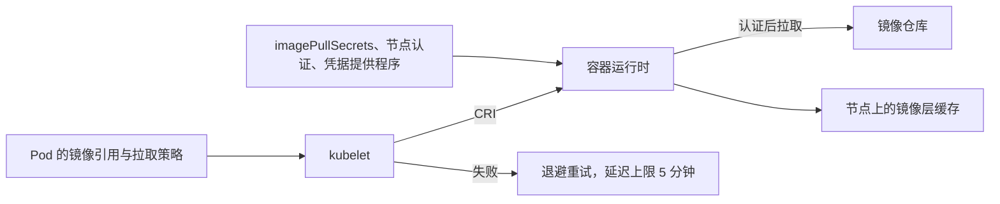
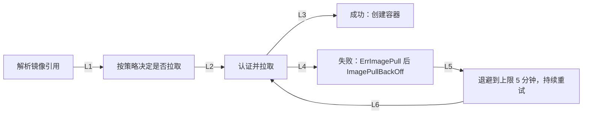

# 镜像与仓库排查参考

## 是什么
- **一句话定位**：容器镜像怎样被解析、拉取、缓存，以及拉取失败时 kubelet 的退避行为：镜像名如何补全，拉取策略的默认值怎么定，私有仓库如何认证，失败后多久重试。
- **解决什么问题**：Pod 卡在 ImagePullBackOff、更新后拿到旧镜像、私有仓库拉不动、改了标签策略不变、拉得很慢时，判断是镜像名、策略、认证、并发排队，还是退避在等待。
- **谁在用、从哪进来**：每个创建容器的 Pod 都要经过；由 kubelet 通过容器运行时完成拉取。
- **边界（不负责什么）**：运行时本身的配置（镜像仓库镜像加速、pause 镜像）见 containerd排查参考；Pod 状态里 Waiting 的整体含义见 Pod排查参考；仓库自身的可用性与权限不在范围。
- **形态与版本**：并行拉取是较新特性；默认仓库可由运行时配置改变。
- **术语**：
  - 拉取策略 —— IfNotPresent、Always、Never
  - 摘要 —— 镜像内容的哈希，指定后只用它拉取
  - 退避 —— 拉取失败后重试之间逐步拉长的延迟
  - imagePullSecrets —— Pod 里用来认证私有仓库的凭据引用

## 组件与架构

| 组件 | 角色 | 职责 | 部署位置 / 形态 | 如何找到 |
|---|---|---|---|---|
| kubelet | 节点代理 | 按策略决定是否拉取，调用运行时，失败后退避 | 每个节点 | Pod 的 Waiting 状态与事件 |
| 容器运行时 | 拉取执行 | 实际拉取、缓存镜像层 | 每个节点 | 见 containerd排查参考 |
| 镜像仓库 | 来源 | 提供镜像 | 公共或私有 | 镜像引用里的主机名 |
| 认证配置 | 凭据 | imagePullSecrets、节点级配置、凭据提供程序 | Pod、节点或 kubelet | 对应配置 |
| AlwaysPullImages 准入 | 强制策略 | 让所有拉取都强制检查 | apiserver | 准入配置 |

## 正常链路（请求怎么走 / 正常行为）

### 资源匹配关系
| 编号 | 资源 A.字段 | → | 资源 B.字段 | 匹配规则 | 对不上时的表现 |
|---|---|---|---|---|---|
| R1 | 镜像引用（仓库、名字、标签、摘要） | → | 实际拉取的镜像 | 没写仓库主机名认为是 Docker 公共仓库，没写标签认为是 latest，同时写标签与摘要时只用摘要 | 本想用私有仓库却没写主机名：去公共仓库找，拉取失败或拿到不同的镜像 |
| R2 | 省略的 imagePullPolicy | → | 默认策略 | 标签是 latest 或没有标签则 Always，非 latest 的标签则 IfNotPresent，指定了摘要则 IfNotPresent；值在对象首次创建时设定，之后不随镜像变化而更新 | 改了标签策略不变：需要手动改策略；用固定标签覆盖镜像内容，节点上有缓存就不会拉新的 |
| R3 | imagePullPolicy 的取值 | → | 拉取行为 | IfNotPresent 本地没有才拉；Always 每次启动都请求运行时拉取，若所有层已存在则用缓存；Never 不拉，本地没有就启动失败 | Never 下本地没有镜像：容器启动失败 |
| R4 | 私有仓库的认证方式 | → | 能否拉取 | 可配置节点级认证、kubelet 凭据提供程序、预拉取镜像、Pod 的 imagePullSecrets、厂商扩展 | 私有仓库没有任何认证：拉取失败，进入 ImagePullBackOff |
| R5 | 拉取失败 | → | ImagePullBackOff 与退避 | 原因包括镜像名无效或私有仓库没有 imagePullSecret；Kubernetes 持续重试，延迟逐步加大，上限 300 秒 | 修好原因后不是立刻拉取，最长要等到下一次重试（5 分钟内） |
| R6 | 强制拉取的方式 | → | 每次都拉 | 设为 Always；省略策略并用 latest 标签；省略策略与标签；或启用 AlwaysPullImages 准入控制器 | 想每次都拉新镜像却没设：命中节点缓存，拿到旧镜像 |
| R7 | kubelet 的拉取并发 | → | 拉取排队 | 默认串行，一次只发一个拉取请求；serializeImagePulls 为 false 时可并行，maxParallelImagePulls 限制并发；同一 Pod 的多个镜像从不并行 | 一个大镜像占着队列：同节点其他 Pod 的拉取排队等待 |
| R8 | 运行时的镜像层缓存 | → | 拉取效率 | 运行时会发现节点上已有的层，不再重复下载，所以 Always 在仓库可靠时也高效 | 仓库不可靠时 Always 会放大失败影响 |
| R9 | 运行时的默认镜像仓库配置 | → | 短名解析 | 可在运行时配置里改默认仓库，改变"没写主机名"的解析 | 同样的短名在不同节点解析到不同仓库：运行时配置不一致 |

### 控制面下发路径
| 环节 | 做什么 | 依据 |
|---|---|---|
| P1 | 在 Pod 模板里写镜像引用与拉取策略；策略在首次创建时定下 | R1 R2 |
| P2 | 配置私有仓库的认证：imagePullSecrets、节点级、凭据提供程序 | R4 |
| P3 | kubelet 通过运行时拉取，受并发设置约束 | R3 R7 R8 |
| P4 | 拉取失败则进入退避，延迟逐步加大到 300 秒 | R5 |
| P5 | 需要时预拉取镜像、启用 AlwaysPullImages 或调整并发 | R6 R7 R9 |

### 流量走向（或生命周期）

| 环节 | 起点 → 终点 | 做什么 | 依据 | 同步/异步与默认行为 |
|---|---|---|---|---|
| L1 | 引用 → 镜像 | 补全仓库与标签，摘要优先 | R1 | 同步 |
| L2 | 策略 → 是否拉取 | 按 IfNotPresent、Always、Never 决定 | R2 R3 R6 | 策略在首次创建时定下 |
| L3 | 拉取 → 成功 | 经运行时认证并拉取，复用已有层 | R4 R7 R8 | 默认串行 |
| L4 | 拉取 → 失败 | 失败后容器处于 Waiting，初次失败先报 ErrImagePull〔待复核〕 | R5 | 同步 |
| L5 | 失败 → 退避 | 重试延迟逐步加大，上限 300 秒 | R5 | 持续重试 |
| L6 | 退避 → 重试 | 原因修复后，在下一次重试时成功 | R5 | 不是立即 |

### 正常表现（健康基线）
- 镜像名写全仓库与标签，生产用固定标签或摘要，不用 latest。
- 私有仓库有可靠的认证方式；节点能稳定访问仓库。
- 没有大量 Pod 因串行拉取而排队等待。

## 逐环节排查（沿链路对照）
- **P1 引用与策略**
  - 正常：镜像名写全，策略符合意图。
  - 异常：只写短名；改了标签策略没变。
  - 区分点：策略在对象首次创建时定下，后续改标签不会更新，必须手动改（R2）。
  - 证据落点：Pod 或模板里的镜像与 imagePullPolicy。
- **P2 认证**
  - 正常：有可用的认证方式。
  - 异常：私有仓库没配置认证；imagePullSecrets 写在了错的命名空间或对象上。
  - 区分点：ImagePullBackOff 且是私有仓库，先看认证（R4）。
  - 证据落点：Pod 的 imagePullSecrets；节点与 kubelet 的认证配置。
- **P3 拉取并发**
  - 正常：队列不长。
  - 异常：同节点的拉取排队。
  - 区分点：默认串行，一个大镜像会让后面的等待（R7）。
  - 证据落点：节点上正在进行的拉取；并发设置。
- **P4 退避**
  - 正常：失败后重试。
  - 异常：修好原因后仍等了一会儿才成功。
  - 区分点：退避延迟最高到 5 分钟，修好后要等下一次重试（R5）。
  - 证据落点：Pod 事件里的重试时间。
- **P5 强制与预拉**
  - 正常：按需强制拉取或预拉取。
  - 异常：以为会拉新镜像其实命中缓存。
  - 区分点：见 R6，想每次都拉就明确设置 Always。
  - 证据落点：策略与准入配置。
- **L1 解析**
  - 正常：解析到预期的仓库与镜像。
  - 异常：短名解析到公共仓库。
  - 区分点：看运行时是否配置了默认仓库，且各节点一致（R9）。
  - 证据落点：镜像引用；运行时配置。
- **L2 决定是否拉取**
  - 正常：该拉就拉。
  - 异常：拿到旧镜像；Never 下启动失败。
  - 区分点：命中缓存的旧镜像多是 IfNotPresent 加固定标签被覆盖；Never 要求本地已有（R3）。
  - 证据落点：策略；节点上的镜像。
- **L3 拉取**
  - 正常：认证通过并下载。
  - 异常：认证失败；网络不通；仓库不可达。
  - 区分点：事件里的错误信息区分是认证问题还是网络问题。
  - 证据落点：Pod 事件；运行时日志，见 containerd排查参考。
- **L4 失败**
  - 正常：不会发生。
  - 异常：ErrImagePull，随后 ImagePullBackOff。
  - 区分点：ImagePullBackOff 是退避阶段的状态，真正的原因在前面的失败事件里。
  - 证据落点：容器 Waiting 的 reason 与消息。
- **L5 退避**
  - 正常：不会发生。
  - 异常：长时间停留在退避。
  - 区分点：延迟上限 300 秒，不会无限增长。
  - 证据落点：事件的间隔。
- **L6 重试**
  - 正常：原因修复后成功。
  - 异常：修复后仍失败。
  - 区分点：确认修复的是真正的原因，如凭据所在的命名空间。
  - 证据落点：最新一次拉取的事件。

## 异常归因速查
| 现象 / 错误码 | 环节 | 归因类别（回指 R#） | 证据位 | 详细条目 |
|---|---|---|---|---|
| ImagePullBackOff | L4 L5 | 镜像名无效，或私有仓库没有认证（R4、R5） | 前面的拉取失败事件 | oss/k8s-pod.md |
| ErrImagePull | L4 | 初次拉取失败（R5）〔待复核〕 | 事件里的错误信息 | oss/containerd.md |
| 私有仓库拉不动 | P2 L3 | 没有或错配认证（R4） | imagePullSecrets；节点认证 | |
| 更新后还是旧镜像 | L2 | 策略为 IfNotPresent 且标签没变，命中缓存（R2、R6） | 策略；节点上的镜像 | oss/k8s-workload.md |
| 改了标签策略没变成 Always | P1 | 策略在首次创建时定下，不随之更新（R2） | 对象创建时间与策略 | |
| 想每次都拉新镜像 | P5 | 需明确设为 Always 或启用准入（R6） | 策略与准入配置 | |
| Never 策略下容器起不来 | L2 | 本地没有该镜像（R3） | 节点上的镜像 | |
| 同节点的 Pod 等着拉镜像 | P3 | 默认串行拉取，前面有大镜像（R7） | 并发设置；正在拉取的镜像 | |
| 短名镜像解析到公共仓库 | L1 | 没写主机名，或运行时默认仓库配置不一致（R1、R9） | 镜像引用；运行时配置 | oss/containerd.md |
| 修好后仍等了几分钟才成功 | L5 L6 | 退避延迟最高 300 秒（R5） | 重试间隔 | |
| 生产里用 latest 难以回滚 | P1 | latest 难以追踪版本与回滚（R1） | 镜像标签 | |

## 状态、事件与日志语义
| 来源 | 取值 | 含义 | 常见出现环节 |
|---|---|---|---|
| 容器状态 | Waiting 且 reason 为 ImagePullBackOff | 无法拉取镜像，会持续重试并退避 | L4 L5 |
| 容器状态 | ErrImagePull | 初次拉取失败〔待复核〕 | L4 |
| 退避上限 | 300 秒 | 延迟逐步加大到的编译内上限 | L5 |
| 策略 | IfNotPresent、Always、Never | 本地没有才拉、每次启动都拉、从不拉 | L2 |
| 配置 | serializeImagePulls、maxParallelImagePulls | 是否串行、并发上限 | P3 |

## 配置语义
| 配置项 | 默认 / 取值含义 | 改动后的行为后果 |
|---|---|---|
| imagePullPolicy | 省略时按标签决定：latest 或无标签为 Always，其他为 IfNotPresent，摘要为 IfNotPresent | 首次创建后不随镜像变化更新 |
| 镜像标签 | 无标签即 latest | 生产应指定有意义的标签或摘要 |
| imagePullSecrets | Pod 里引用私有仓库凭据 | 命名空间与对象要对 |
| AlwaysPullImages 准入 | 可选 | 开启后强制每次检查拉取 |
| serializeImagePulls | 默认串行，设为 false 可并行（v1.32 为 beta） | 并行需要运行时的镜像服务能承受 |
| maxParallelImagePulls | 限制并行数 | 超出的拉取要等待 |
| 运行时默认仓库 | 未设则为 Docker 公共仓库 | 改变短名的解析结果 |

## 边界与置信度说明
- **来源**：Kubernetes 官方 Images 概念页的多个版本与中文版，给出名字补全、拉取策略默认规则、三种策略、强制拉取、ImagePullBackOff 与退避上限、私有仓库认证方式、并行拉取设置。没有做过运行时取证。
- **〔待复核〕项**：ErrImagePull 作为初次失败状态的说法，官方页本次没有明确写；Always 策略在较早与较新文档里的描述略有不同（解析摘要与请求运行时拉取）。
- **版本差异**：并行拉取为较新特性；按 RuntimeClass 拉取镜像是 alpha；Always 的实现描述在新旧文档里不同。
- **未覆盖**：镜像加速与镜像仓库镜像（registry mirror）的配置；镜像垃圾回收的阈值；镜像签名与准入校验；预拉取的具体做法；节点级认证文件的格式；拉取超时与重试细节；镜像大小与启动时间的优化。
- **related**：见 frontmatter。
