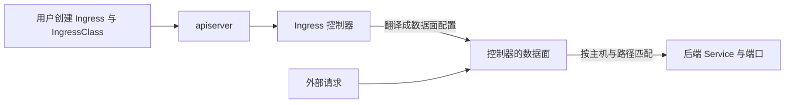
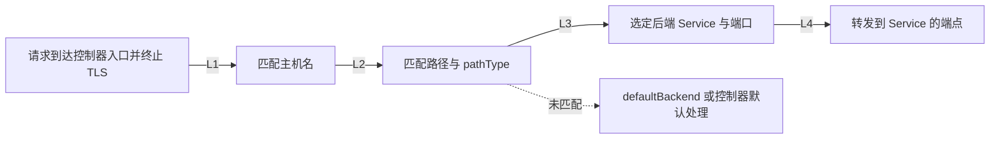

# Ingress排查参考

## 是什么
- **一句话定位**：Ingress 是描述"集群外的 HTTP(S) 请求怎样按主机名与路径转到集群内 Service"的 API 对象。它本身只是声明，真正处理流量的是某个 Ingress 控制器，由 IngressClass 决定谁来负责。
- **解决什么问题**：把"规则写了却不生效"拆成几个可核对的环节：有没有控制器认领、主机与路径是否匹配、转发到的 Service 与端口对不对、TLS 配置是否对得上。
- **谁在用、从哪进来**：外部流量先到达某个 Ingress 控制器的入口，再由它按 Ingress 规则转发。
- **边界（不负责什么）**：具体控制器（如 nginx-ingress）如何把规则变成数据面配置、有哪些私有注解，见各自的软件条目；转发到 Service 之后的链路见 Service排查参考；Gateway API 是另一条链路，见 GatewayAPI排查参考。
- **形态与版本**：Ingress 自 v1.19 起稳定，官方没有移除它的计划；ingressClassName 取代已弃用的 ingress.class 注解。需要区分：kubernetes/ingress-nginx 这个控制器项目已经退役，不再有发布、缺陷修复与安全更新，已有部署仍可运行，Ingress API 本身不受影响。
- **术语**：
  - Ingress 控制器 —— 实际处理流量并落实 Ingress 规则的程序
  - IngressClass —— 声明"哪个控制器负责"的集群资源
  - pathType —— 路径匹配方式：Exact、Prefix、ImplementationSpecific
  - defaultBackend —— 没有规则匹配时接手请求的后端

## 组件与架构

| 组件 | 角色 | 职责 | 部署位置 / 形态 | 如何找到 |
|---|---|---|---|---|
| Ingress 对象 | 声明 | 写明主机、路径、后端与 TLS | apiserver | Ingress 的 spec |
| IngressClass | 声明 | 指明由哪个控制器实现 | 集群级资源 | IngressClass 与其是否为默认 |
| Ingress 控制器 | 实现 | 监听 Ingress 并落实规则，处理实际流量 | 集群内的工作负载 | 控制器自己的 Pod 与日志 |
| 后端 Service | 目的地 | 接住转发过来的流量 | 集群内 | Service 与端点 |

## 正常链路（请求怎么走 / 正常行为）

### 资源匹配关系
| 编号 | 资源 A.字段 | → | 资源 B.字段 | 匹配规则 | 对不上时的表现 |
|---|---|---|---|---|---|
| R1 | Ingress.spec.ingressClassName | → | IngressClass → 控制器 | 控制器经"控制器 → IngressClass → Ingress"判断是否该由自己处理；未写时应有默认 IngressClass；旧的 ingress.class 注解若存在，优先于该字段 | 没有任何控制器认领：规则不生效；多个控制器都认领：行为不可预期〔待复核〕 |
| R2 | 请求的主机名 | → | rules[].host | 先匹配主机；可精确写，也可写通配符，通配符只覆盖单个 DNS 标签 | `*.foo.com` 匹配 baz.foo.com，但不匹配 foo.com 或 baz.bar.foo.com |
| R3 | 请求的路径 | → | paths[].path 与 pathType | Exact 精确且区分大小写；Prefix 按斜杠分段逐段匹配；多条同时匹配取最长，长度相同 Exact 优先；ImplementationSpecific 由控制器决定 | 路径不匹配：落到 defaultBackend 或控制器的默认处理；/aaa/bbb 不匹配 /aaa/bbbxyz |
| R4 | 匹配到的规则 | → | backend 的 Service 名称与端口，或资源后端 | 引用 Service 名称与端口（数字或名称）；也可引用一个资源对象 | Service 或端口写错：转发失败，表现为 5xx 或控制器的错误页，具体由控制器决定〔待复核〕 |
| R5 | 无规则匹配的请求 | → | defaultBackend | 没写 rules 时必须有 defaultBackend；未设置时由控制器决定怎么处理；defaultBackend 通常是控制器的配置项，不写在 Ingress 里 | 未匹配请求得到的响应各控制器不一样，不能默认是 404 |
| R6 | tls.hosts 与 secretName | → | 443 端口上的 TLS 终止 | 只支持 443 端口；多个主机按 SNI 区分，前提是控制器支持；hosts 要与密钥里的名称一致；secretName 可省略以只按 SNI 路由 | 主机名与证书不一致：浏览器证书告警或握手失败 |
| R7 | Ingress 对象 | → | 实际生效的数据面配置 | Ingress 只是声明，必须由控制器落实；规则写对不代表已生效 | 对象在、规则对，但没有控制器在工作：流量不通 |

### 控制面下发路径
| 环节 | 做什么 | 依据 |
|---|---|---|
| P1 | 用户创建 Ingress，必要时创建或指定 IngressClass | R1 R7 |
| P2 | 控制器根据 IngressClass 判断这个 Ingress 是否归自己 | R1 |
| P3 | 归自己的 Ingress 被控制器监听，规则和后端信息被翻译进它的数据面（具体方式因控制器而异）〔待复核〕 | R4 R7 |

### 流量走向（或生命周期）

| 环节 | 起点 → 终点 | 做什么 | 依据 | 同步/异步与默认行为 |
|---|---|---|---|---|
| L1 | 外部 → 控制器入口 | 请求到达控制器；HTTPS 在此按 SNI 选证书并终止 | R6 | 同步；只支持 443 |
| L2 | 请求 → 主机规则 | 按主机名选出规则，通配符只覆盖单层 | R2 | 同步 |
| L3 | 主机规则 → 路径规则 | 按路径与 pathType 选后端，最长匹配优先，同长度 Exact 优先 | R3 | 同步 |
| L4 | 规则 → Service | 转发到 backend 指定的 Service 与端口，之后的链路见 Service排查参考 | R4 | 同步 |
| L5 | 未匹配请求 | 交给 defaultBackend，没设置则由控制器决定 | R5 | 因控制器而异 |

### 正常表现（健康基线）
- 有一个且仅有一个控制器认领该 Ingress，规则已被落实。
- 主机与路径按预期命中，后端 Service 的端点正常。
- TLS 证书的名称与访问的主机一致。

## 逐环节排查（沿链路对照）
- **P1 声明**
  - 正常：Ingress 与 IngressClass 都存在，类名指向正确。
  - 异常：既没写 ingressClassName 又没有默认 IngressClass；同时写了旧注解与新字段。
  - 区分点：旧注解存在时它优先于 ingressClassName（R1），两者不一致会让人误判。
  - 证据落点：Ingress 的 ingressClassName 与注解；IngressClass 及其默认标记。
- **P2 认领**
  - 正常：目标控制器认领，其他控制器不碰它。
  - 异常：没有控制器认领，或多个控制器同时认领。
  - 区分点：规则看起来都对却完全不生效，先确认有没有控制器认领（R1、R7）。
  - 证据落点：控制器日志中对该 Ingress 的处理记录。
- **P3 落实**
  - 正常：控制器把规则落进数据面。
  - 异常：控制器看到了 Ingress，但没能生成有效配置。
  - 区分点：不同控制器的落实方式与私有注解不同，见各自软件条目。
  - 证据落点：控制器的配置与日志。
- **L1 入口与 TLS**
  - 正常：请求到达入口，证书与访问的主机匹配。
  - 异常：证书不对或握手失败；不支持 SNI 的控制器上多主机证书混用。
  - 区分点：证书名称与 tls.hosts、密钥内容是否一致（R6）。
  - 证据落点：tls 配置；密钥中的证书名称。
- **L2 主机匹配**
  - 正常：主机命中预期规则。
  - 异常：通配符主机没匹配上。
  - 区分点：通配符只覆盖单层，foo.com 与多层子域都不会被 `*.foo.com` 匹配（R2）。
  - 证据落点：rules 的 host；实际请求的主机头。
- **L3 路径匹配**
  - 正常：路径按 pathType 命中最长规则。
  - 异常：期望的路径没命中，或命中了别的规则。
  - 区分点：Prefix 按斜杠分段，不是字符串前缀；同长度时 Exact 优先；ImplementationSpecific 的行为要看控制器（R3）。
  - 证据落点：paths 的 path 与 pathType；实际请求路径。
- **L4 转发到后端**
  - 正常：请求到达后端 Service 的端点。
  - 异常：后端 Service 名称或端口写错；Service 没有可用端点。
  - 区分点：Ingress 规则命中了但后端失败，转到 Service排查参考排查端点与 targetPort。
  - 证据落点：backend 的 Service 与端口；对应 EndpointSlice。
- **L5 未匹配请求**
  - 正常：按 defaultBackend 或控制器默认行为处理。
  - 异常：期望得到某种响应，实际不同。
  - 区分点：未设置 defaultBackend 时由控制器决定，不同控制器的表现不同（R5）。
  - 证据落点：控制器文档与配置里的默认后端设置。

## 异常归因速查
| 现象 / 错误码 | 环节 | 归因类别（回指 R#） | 证据位 | 详细条目 |
|---|---|---|---|---|
| 规则都对却完全不生效 | P2 | 没有控制器认领（R1、R7） | ingressClassName；IngressClass；控制器日志 | |
| 同一个 Ingress 被处理出不同结果 | P2 | 多个控制器同时认领或新旧类名写法并存（R1） | 注解与 ingressClassName | |
| 通配符域名不匹配 | L2 | 通配符只覆盖单个 DNS 标签（R2） | host 与实际主机头 | |
| 路径没命中或命中别的规则 | L3 | pathType 语义与最长匹配（R3） | paths 的 path 与 pathType | |
| 404 | L3 L5 | 路径或主机未命中，由 defaultBackend 或控制器默认响应处理（R3、R5） | 规则与控制器默认后端 | |
| 规则命中但返回 5xx | L4 | 后端 Service 名称、端口或端点有问题（R4） | backend 引用；EndpointSlice | |
| 证书告警或握手失败 | L1 | tls.hosts 与证书名称不一致，或控制器不支持 SNI（R6） | tls 配置；证书名称 | |
| 同一个 Ingress 换了控制器行为就变 | L3 L5 | ImplementationSpecific 与默认后端行为随控制器而异（R3、R5） | 所用控制器与其文档 | |

## 状态、事件与日志语义
| 来源 | 取值 | 含义 | 常见出现环节 |
|---|---|---|---|
| pathType | Exact | 路径精确且区分大小写才匹配 | L3 |
| pathType | Prefix | 按斜杠分段逐段前缀匹配，区分大小写 | L3 |
| pathType | ImplementationSpecific | 匹配语义由 IngressClass 对应的控制器决定 | L3 |
| 类名写法 | ingressClassName | 当前写法；取代旧注解 | P1 P2 |
| 类名写法 | kubernetes.io/ingress.class 注解 | 已弃用的旧写法，存在时优先于新字段 | P1 P2 |

## 配置语义
| 配置项 | 默认 / 取值含义 | 改动后的行为后果 |
|---|---|---|
| ingressClassName | 指向 IngressClass；未写时应有默认 IngressClass | 决定由哪个控制器处理 |
| 默认 IngressClass | 可把某个 IngressClass 标为默认 | 没写类名的 Ingress 会归它；官方建议即使控制器不强求也定义默认类 |
| pathType | Exact、Prefix、ImplementationSpecific | 决定路径匹配语义；Exact 与 Prefix 要求路径以斜杠开头 |
| defaultBackend | 没写 rules 时必须指定；通常是控制器的配置项 | 决定未匹配请求去哪 |
| tls | 只支持 443；多主机按 SNI 区分 | 主机名需与证书一致；secretName 可省略以只按 SNI 路由 |

## 边界与置信度说明
- **来源**：Kubernetes 官方 Ingress 概念页与 v1.31 API 参考，没有做过运行时取证。
- **〔待复核〕项**：多个控制器同时认领时的具体表现；后端写错时各控制器的具体响应；控制器翻译配置的细节。这些取决于控制器实现。
- **版本差异**：旧版本主要用 ingress.class 注解指定控制器，新版本用 ingressClassName 与 IngressClass；两者并存时注解优先。
- **控制器状态**：ingress-nginx 退役不改变 Ingress 的资源模型与本条的匹配规则；仍在用它的集群，排查时按本条核对规则，控制器私有行为另查对应的软件条目。F5 的 NGINX Ingress Controller 是另一个项目，名字相近，不受此影响。
- **未覆盖**：Ingress 的 status（负载均衡地址）如何回填；各控制器的私有注解；跨命名空间引用后端的限制；Resource 后端的具体用法；Ingress 与 Gateway API 的迁移关系。
- **related**：见 frontmatter。
