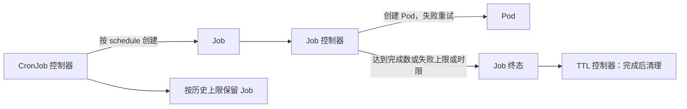

# Job与CronJob排查参考

## 是什么
- **一句话定位**：Job 负责"把一件有限的任务跑到成功"，失败时重试并带退避和时限；CronJob 负责"按计划创建 Job"，并用并发策略与错过判定决定该不该创建。
- **解决什么问题**：Job 一直不完成、重试很多次后失败、被时限终止，或 CronJob 没按时运行、Job 堆积、错过很多次后不再触发时，判断是重试规则、时限、并发策略，还是清理策略在起作用。
- **谁在用、从哪进来**：数据迁移、备份、批处理、定时任务等一次性或周期性的工作负载。
- **边界（不负责什么）**：Job 的 Pod 自己起不来或容器崩溃见 Pod排查参考；调度失败见 调度排查参考；长期运行的工作负载见 工作负载控制器排查参考。
- **形态与版本**：控制器运行在 kube-controller-manager 内；Indexed 模式、失败策略等为较新特性，以所用版本为准。
- **术语**：
  - 退避 —— 失败后重试之间逐步拉长的等待
  - 错过调度 —— CronJob 到了预定时间却没能创建出 Job
  - 并发策略 —— 上一次还没跑完时，是否允许、跳过或替换
  - TTL —— Job 完成后保留多久再被清理

## 组件与架构

| 组件 | 角色 | 职责 | 部署位置 / 形态 | 如何找到 |
|---|---|---|---|---|
| CronJob 控制器 | 控制面 | 按计划创建 Job，处理并发与错过 | kube-controller-manager 内 | CronJob 的状态与事件 |
| Job 控制器 | 控制面 | 创建 Pod，重试失败，判定完成或失败 | 同上 | Job 的状态与状况 |
| TTL 控制器 | 控制面 | 在 Job 完成后按 TTL 清理，目前只支持 Job | 同上 | Job 的 ttlSecondsAfterFinished |
| Job 的 Pod | 执行体 | 实际运行任务 | 集群节点 | 带 Job 标签的 Pod |

## 正常链路（请求怎么走 / 正常行为）

### 资源匹配关系
| 编号 | 资源 A.字段 | → | 资源 B.字段 | 匹配规则 | 对不上时的表现 |
|---|---|---|---|---|---|
| R1 | Job 模板里的 restartPolicy | → | 失败后的处理方式 | Job 只能用 Never 或 OnFailure；OnFailure 时容器在同一个 Pod 内重启，Never 时失败后由 Job 控制器创建新 Pod〔待复核〕 | 误设为 Always：Job 不被接受；选 Never 时失败会留下多个失败的 Pod |
| R2 | backoffLimit | → | 重试次数与等待 | 默认 6；失败的 Pod 由 Job 控制器以指数退避重建，延迟 10 秒、20 秒、40 秒等，封顶六分钟；Pod 被删除或成功且同时没有其他 Pod 失败时重置计数 | 超过上限：Job 失败；重试之间的等待越来越长 |
| R3 | activeDeadlineSeconds | → | Job 的总时限 | 作用于 Job 的总持续时间，不论创建了多少 Pod；到达后所有运行中的 Pod 被终止，Job 状态为 Failed、原因 DeadlineExceeded | 任务本身慢于时限：被强行终止，即使还在正常运行 |
| R4 | completions、parallelism、completionMode | → | 完成判定与并发 | completions 为需要的成功次数，非并行时默认 1；parallelism 为并行 Pod 数，默认 1；Indexed 模式下每个 Pod 有唯一完成序号 | 完成数与并行数不合理：任务重复或永远凑不够 |
| R5 | ttlSecondsAfterFinished | → | 完成后的清理 | TTL 控制器目前只支持 Job；设了才会在完成后被清理 | 没设：已完成的 Job 与其 Pod 一直留着 |
| R6 | CronJob 的 schedule 与时区 | → | 触发时间 | 用类 cron 表达式；timeZone 字段自 v1.27 起可用，未设时按控制器所在的时区解释〔待复核〕 | 时间不对：时区理解不同 |
| R7 | concurrencyPolicy 与 startingDeadlineSeconds | → | 是否创建 Job、是否算错过 | Forbid 且上一次仍在运行时，这次就算作错过；到了预定时间没能创建出 Job 也算错过；startingDeadlineSeconds 未设且并发策略为 Allow 时 Job 总会至少运行一次 | Forbid 下上一次太久：后续被一次次跳过；错过次数过多：CronJob 可能不再触发〔待复核〕 |
| R8 | successfulJobsHistoryLimit 与 failedJobsHistoryLimit | → | 保留的已完成 Job | 默认分别 3 与 1；设为 0 表示完成后不保留 | 失败的 Job 只保留 1 个：排查历史很快被覆盖 |
| R9 | suspend | → | 是否继续触发 | CronJob 设为暂停后停止后续执行而不删除对象〔待复核〕 | 忘了取消暂停：CronJob 看似正常却从不触发 |

### 控制面下发路径
| 环节 | 做什么 | 依据 |
|---|---|---|
| P1 | 用户创建 Job，或创建 CronJob 由其定期创建 Job | R1 R6 |
| P2 | Job 控制器创建 Pod，失败时按 backoffLimit 与指数退避重建 | R2 |
| P3 | 达到完成数、重试上限或总时限时，Job 进入终态 | R2 R3 R4 |
| P4 | CronJob 控制器按 schedule 判断是否到点，按并发策略决定是否创建 Job | R6 R7 R9 |
| P5 | 按历史上限保留已完成 Job，按 TTL 清理 | R5 R8 |

### 流量走向（或生命周期）

| 环节 | 起点 → 终点 | 做什么 | 依据 | 同步/异步与默认行为 |
|---|---|---|---|---|
| L1 | Job → Pod | Job 控制器创建 Pod 并启动 | R1 R4 | 异步 |
| L2 | 运行 → 失败重试 | Pod 失败后按 backoffLimit 以指数退避重建，延迟逐步拉长至封顶六分钟 | R2 | 默认最多重试 6 次 |
| L3 | 运行 → 终态 | 达到完成数则成功；超过重试上限或总时限则失败，原因分别可见于状况 | R2 R3 R4 | 总时限到了会终止所有运行中的 Pod |
| L4 | CronJob → 触发 | 按 schedule 与时区判断是否到点 | R6 R9 | 暂停时不触发 |
| L5 | 到点 → 创建 Job | 按并发策略判断：允许、跳过（算错过）或替换 | R7 | 默认策略与错过判定见速查表 |
| L6 | 完成后 → 清理 | 按历史上限保留，按 TTL 清理 | R5 R8 | 默认保留成功 3 个、失败 1 个 |

### 正常表现（健康基线）
- Job 在预期时间内达到完成数；没有反复重试到上限。
- CronJob 按计划触发，没有被并发策略持续跳过。
- 已完成的 Job 数量在历史上限之内，按需被清理。

## 逐环节排查（沿链路对照）
- **P1 创建**
  - 正常：Job 或 CronJob 被接受。
  - 异常：重启策略写错；schedule 表达式不合法。
  - 区分点：Job 只允许 Never 或 OnFailure。
  - 证据落点：对象的 spec；创建时的错误信息。
- **P2 重试**
  - 正常：失败后按退避重建 Pod。
  - 异常：重试间隔越来越长；产生很多失败的 Pod。
  - 区分点：延迟 10 秒、20 秒、40 秒递增，封顶六分钟，这是设计行为；Never 策略下每次失败留一个 Pod（R1、R2）。
  - 证据落点：Job 下的 Pod 列表与创建时间；失败原因。
- **P3 终态判定**
  - 正常：按预期成功。
  - 异常：失败，原因是超过重试上限或总时限。
  - 区分点：总时限到达会一次性终止所有运行中的 Pod，状态为 Failed、原因 DeadlineExceeded；超过重试上限则是另一个原因（R2、R3）。
  - 证据落点：Job 的状况里的原因与信息。
- **P4 CronJob 触发**
  - 正常：到点创建 Job。
  - 异常：没触发。
  - 区分点：先看是否被暂停（R9）、时区是否理解一致（R6）、是否被并发策略跳过（R7）。
  - 证据落点：CronJob 的 suspend、schedule、timeZone；最近调度时间与事件。
- **P5 清理**
  - 正常：数量受控。
  - 异常：完成的 Job 与 Pod 堆积。
  - 区分点：没设 ttlSecondsAfterFinished 就不会按 TTL 清理；历史上限只限制保留的数量（R5、R8）。
  - 证据落点：TTL 与历史上限设置；Job 列表。
- **L1 启动**
  - 正常：Pod 被创建并运行。
  - 异常：Pod 起不来。
  - 区分点：Pod 层面的问题转到 Pod排查参考与调度排查参考。
  - 证据落点：Pod 的状态与事件。
- **L2 运行与重试**
  - 正常：任务成功或按策略重试。
  - 异常：反复失败。
  - 区分点：看每次失败的原因，而不是看 Job；重试上限默认 6。
  - 证据落点：失败 Pod 的退出码与日志。
- **L3 终态**
  - 正常：成功完成。
  - 异常：DeadlineExceeded 或超过重试上限。
  - 区分点：任务本身比时限慢，时限会强行终止；也可能是任务有死循环，需要区分。
  - 证据落点：Job 状况；任务实际耗时。
- **L4 到点**
  - 正常：按时触发。
  - 异常：不触发或时间不对。
  - 区分点：同 P4。
  - 证据落点：同 P4。
- **L5 并发与错过**
  - 正常：该跑的都跑了。
  - 异常：Forbid 下被一次次跳过；错过很多次后不再触发〔待复核〕。
  - 区分点：上一次 Job 一直不结束，会让 Forbid 下所有后续触发都算错过，要先解决上一次为什么不结束（R7）。
  - 证据落点：上一次 Job 的运行状态；CronJob 的事件。
- **L6 清理**
  - 正常：旧 Job 被清理。
  - 异常：堆积，或排查时想看的失败 Job 已经被覆盖。
  - 区分点：失败历史默认只保留 1 个（R8），需要更多历史就调大。
  - 证据落点：历史上限；Job 列表。

## 异常归因速查
| 现象 / 错误码 | 环节 | 归因类别（回指 R#） | 证据位 | 详细条目 |
|---|---|---|---|---|
| DeadlineExceeded | L3 P3 | 到达 activeDeadlineSeconds，运行中的 Pod 被终止（R3） | Job 状况；任务耗时 | oss/k8s-pod.md |
| 重试很多次后 Job 失败 | P2 L2 | 超过 backoffLimit（R2） | 失败 Pod 的退出码与日志 | oss/k8s-pod.md |
| 重试间隔越来越长 | L2 | 指数退避，封顶六分钟（R2） | Pod 创建时间间隔 | |
| Job 下有很多失败的 Pod | P2 | restartPolicy 为 Never，每次失败新建一个 Pod〔待复核〕（R1） | Pod 列表 | |
| Job 一直不完成 | L1 L3 | 完成数未凑够，或 Pod 一直起不来（R4） | completions 与成功数；Pod 状态 | oss/k8s-scheduling.md |
| CronJob 没有按时运行 | P4 L4 | 被暂停、时区不一致，或被并发策略跳过（R6、R7、R9） | suspend、timeZone、事件 | |
| CronJob 被一次次跳过 | L5 | Forbid 下上一次未结束，算作错过（R7） | 上一次 Job 状态 | |
| 错过很多次后 CronJob 不再触发 | L5 | 错过次数过多〔待复核〕（R7） | CronJob 事件 | |
| 完成的 Job 与 Pod 一直留着 | P5 L6 | 没设 ttlSecondsAfterFinished（R5） | Job 的 TTL 设置 | |
| 失败的 Job 很快看不到了 | L6 | 失败历史默认只保留 1 个（R8） | failedJobsHistoryLimit | |
| 到了该运行的时间 Job 没出现 | L5 | CronJob 到点却没能创建 Job，算错过（R7） | CronJob 事件 | |

## 状态、事件与日志语义
| 来源 | 取值 | 含义 | 常见出现环节 |
|---|---|---|---|
| Job 状况 | Failed 原因 DeadlineExceeded | 到达总时限 | L3 |
| Job 状况 | Failed 原因 BackoffLimitExceeded | 超过重试上限〔待复核〕 | L3 |
| 注解 | batch.kubernetes.io/job-completion-index | Indexed 模式下每个 Pod 的完成序号 | L1 |
| 重试计数 | 重置条件 | Pod 被删除，或成功且同时没有其他 Pod 失败 | L2 |

## 配置语义
| 配置项 | 默认 / 取值含义 | 改动后的行为后果 |
|---|---|---|
| backoffLimit | 默认 6 | 调小更快失败，调大更多重试 |
| activeDeadlineSeconds | 总时限，不论创建多少 Pod | 到达后强制终止，状态 Failed |
| completions 与 parallelism | 非并行默认都是 1 | 决定完成条件与并发 |
| ttlSecondsAfterFinished | 完成后保留的秒数，TTL 控制器目前只支持 Job | 不设则不按 TTL 清理 |
| concurrencyPolicy | Allow、Forbid、Replace，常见默认 Allow〔待复核〕 | Forbid 下上一次未结束则本次算错过 |
| startingDeadlineSeconds | 未设时 Job 总会至少运行一次（并发为 Allow 时） | 设了则超过该时限的错过不再补 |
| successfulJobsHistoryLimit 与 failedJobsHistoryLimit | 默认 3 与 1，设为 0 即不保留 | 决定还能回看多少次历史 |
| suspend | 可暂停后续执行 | 暂停期间不触发 |

## 边界与置信度说明
- **来源**：Kubernetes 官方 Job 与 CronJob 的文本，经 Devtron 与 OpenShift 文档站点转载取得，不是 kubernetes.io 原页；Indexed 模式、时区字段、重启策略差异来自二手博客与 OpenShift 说明。没有做过运行时取证。
- **〔待复核〕项**：Never 与 OnFailure 下失败 Pod 的具体表现（有 OpenShift 文档称二者效果相近，与上述说法不一致，以官方为准）；CronJob 的时区默认解释；并发策略的默认值；错过次数上限与具体提示文本；suspend 的细节；BackoffLimitExceeded 的原因名。
- **版本差异**：CronJob 的 timeZone 自 v1.27 起可用；Job 的 podFailurePolicy、Indexed 等较新特性随版本演进。
- **未覆盖**：podFailurePolicy 与失败分类；Job 的 suspend 与可变调度指令；弹性 Indexed Job；CronJob 的错过调度计算细节；与队列系统（Kueue）的集成；长任务的 Pod 干扰预算。
- **related**：见 frontmatter。
