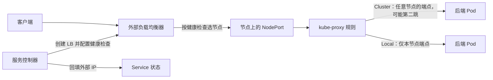
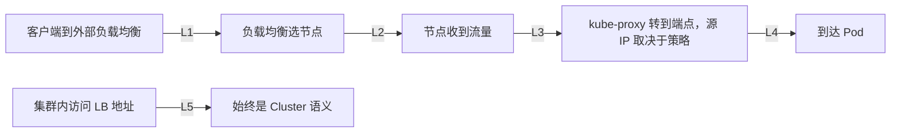

# 外部负载均衡与源IP排查参考

## 是什么
- **一句话定位**：Service 的 LoadBalancer 类型把外部流量经集群外的负载均衡器送进节点，再由 kube-proxy 转到 Pod。这一条回答两件事：外部地址为什么没分配、以及应用看到的客户端 IP 为什么不是真实的。
- **解决什么问题**：EXTERNAL-IP 一直 pending、客户端 IP 被改成节点地址、设了 Local 后部分节点不通或流量不均、删除 Service 后云上负载均衡残留时，判断是云侧、控制器、流量策略，还是健康检查。
- **谁在用、从哪进来**：需要直接对外暴露四层服务的 Service；Ingress 与 Gateway 的入口 Service 通常也是这个类型。
- **边界（不负责什么）**：Service 到后端的转发规则见 Service排查参考与 kube-proxy排查参考；七层入口见 Ingress排查参考；具体云厂商或自建方案（如 MetalLB）的注解、健康检查参数、空闲超时不在官方页范围，本条未覆盖。
- **形态与版本**：负载均衡本身在集群外，数据路径由外部提供。官方页以云环境为前提。
- **术语**：
  - 源地址转换 —— 节点把包的源 IP 换成自己的 IP，使应答能原路返回
  - 第二跳 —— 流量到了某节点后又被转发到另一个节点的端点
  - 健康检查端口 —— Local 策略下每个节点上提供 /healthz 的端口
  - 清理终结器 —— 保证云上负载均衡被清理后 Service 才真正删除

## 组件与架构

| 组件 | 角色 | 职责 | 部署位置 / 形态 | 如何找到 |
|---|---|---|---|---|
| 服务控制器 | 控制面 | 为 LoadBalancer 类型的 Service 创建云负载均衡并配置健康检查，回填外部 IP，加清理终结器 | 控制面 | Service 的状态与事件 |
| 外部负载均衡器 | 数据路径 | 接收外部流量并分发到节点 | 集群之外 | 云控制台或自建设备 |
| kube-proxy | 节点转发 | 把节点上收到的流量转到端点，决定是否做源地址转换 | 每个节点 | 见 kube-proxy排查参考 |
| 健康检查端口 | 节点探测 | Local 策略下让没有端点的节点把自己摘除 | 每个节点 | Service 的 healthCheckNodePort |

## 正常链路（请求怎么走 / 正常行为）

### 资源匹配关系
| 编号 | 资源 A.字段 | → | 资源 B.字段 | 匹配规则 | 对不上时的表现 |
|---|---|---|---|---|---|
| R1 | Service.spec.type | → | 入口形态 | ClusterIP 只在集群内，应用看到的源 IP 是客户端 Pod 的 IP；NodePort 与 LoadBalancer 面向外部，默认会做源地址转换；LoadBalancer 在 ClusterIP 的基础上为外部负载均衡编入各节点的条目 | 以为 NodePort 或 LoadBalancer 下源 IP 不变：默认已被转换 |
| R2 | Service(LoadBalancer) | → | 外部负载均衡器 | 集群必须运行在已支持配置外部负载均衡器的环境；服务控制器创建它，云厂商分配 IP 后控制面把外部 IP 写进 Service | 环境不支持或云侧没分配：EXTERNAL-IP 一直 pending〔待复核〕 |
| R3 | externalTrafficPolicy | → | 源 IP 与转发跳数 | Cluster（默认）隐藏源 IP、可能有第二跳、负载分布好；Local 只转发到本节点端点、保留源 IP、无第二跳，但可能流量不均 | 需要真实客户端 IP 却用默认的 Cluster：应用看到节点或内部地址 |
| R4 | healthCheckNodePort | → | 节点健康检查 | 仅在 LoadBalancer 加 Local 时生效；不指定则由控制器从 NodePort 范围里分配；指定后与 Local 绑定；改类型后该字段被清除；没有端点的节点在 /healthz 上返回 No Service Endpoints Found | 端口冲突或指定了却没用 Local：不生效；没端点的节点被摘除是预期 |
| R5 | 集群内对 External IP 或 LoadBalancer IP 的访问 | → | 流量策略语义 | 从集群内发往它们的流量总是得到 Cluster 语义；发往 NodePort 的客户端选节点时可能需要考虑流量策略 | 在集群内测试 Local 的效果：看不到源 IP 保留 |
| R6 | LoadBalancer 类型 Service 的删除 | → | 云上资源的清理 | 服务控制器给它加 service.kubernetes.io/load-balancer-cleanup 终结器，云上负载均衡资源清理后才移除，防止遗留 | 删除卡住：云侧清理还没完成或失败 |
| R7 | 负载均衡对目标的权重能力 | → | Local 下的流量分布 | 部分云厂商的负载均衡不允许为每个目标配置不同权重 | Local 下各节点端点数不同：流量分布不均衡 |
| R8 | 没有本地端点的节点 | → | 收到的流量 | Local 策略下，发到没有本地端点的节点的数据包被丢弃，所以负载均衡要依赖健康检查避开它们 | 负载均衡没做健康检查或检查没生效：一部分请求被丢 |

### 控制面下发路径
| 环节 | 做什么 | 依据 |
|---|---|---|
| P1 | 用户创建 type 为 LoadBalancer 的 Service，选择 externalTrafficPolicy | R1 R3 |
| P2 | 服务控制器调用云接口创建负载均衡，并给 Service 加清理终结器 | R2 R6 |
| P3 | 云厂商分配 IP，控制面查到后写进 Service 的状态 | R2 |
| P4 | 选择 Local 时分配 healthCheckNodePort，并配置到每个节点的 HTTP 健康检查 | R4 |
| P5 | 删除 Service 时清理云上负载均衡，随后移除终结器 | R6 |

### 流量走向（或生命周期）

| 环节 | 起点 → 终点 | 做什么 | 依据 | 同步/异步与默认行为 |
|---|---|---|---|---|
| L1 | 客户端 → 负载均衡 | 流量先到集群外的负载均衡器 | R2 | 数据路径在集群外 |
| L2 | 负载均衡 → 节点 | 按健康检查在符合条件的节点间分发；Cluster 下所有就绪可调度节点都符合；Local 下只有有端点的节点通过检查 | R3 R4 | Local 下约 10 秒后没端点的节点被摘除 |
| L3 | 节点 → 端点 | Cluster 下可能转到别的节点并做源地址转换；Local 下只转本地端点 | R3 R8 | 默认 Cluster |
| L4 | 端点 → 应用 | Cluster 下应用看到节点或内部地址，Local 下看到真实客户端 IP | R3 | 取决于策略 |
| L5 | 集群内 → LB 地址 | 从集群内发往 External IP 或 LoadBalancer IP 总是 Cluster 语义 | R5 | 不受 Local 影响 |

### 正常表现（健康基线）
- Service 有外部 IP；负载均衡的后端节点都健康。
- 需要真实客户端 IP 的服务用了 Local，且每个被选中的节点上都有端点。
- 删除 Service 后云上负载均衡被及时清理。

## 逐环节排查（沿链路对照）
- **P1 声明**
  - 正常：类型与策略符合意图。
  - 异常：要真实客户端 IP 却没设 Local。
  - 区分点：默认的 Cluster 会隐藏源 IP（R3）。
  - 证据落点：Service 的 type 与 externalTrafficPolicy。
- **P2 创建负载均衡**
  - 正常：服务控制器成功创建。
  - 异常：环境不支持，或云接口调用失败。
  - 区分点：EXTERNAL-IP 一直 pending，先看环境是否支持外部负载均衡，再看 Service 事件（R2）。
  - 证据落点：Service 的事件与状态；控制器日志。
- **P3 回填 IP**
  - 正常：外部 IP 出现在 Service 状态里。
  - 异常：云侧已分配但 Service 没更新。
  - 区分点：云控制台上有 IP 而 Service 没有，多半是控制器与云接口之间的问题。
  - 证据落点：云侧的负载均衡；Service 状态。
- **P4 健康检查**
  - 正常：每个节点有 healthCheckNodePort，负载均衡按它检查。
  - 异常：端口冲突；检查没配到负载均衡上。
  - 区分点：用户指定的端口仅在 LoadBalancer 加 Local 时生效（R4）。
  - 证据落点：Service 的 healthCheckNodePort；节点上该端口的响应。
- **P5 清理**
  - 正常：云上资源被清理，终结器被移除。
  - 异常：Service 删除卡住，或云上负载均衡遗留。
  - 区分点：看终结器还在不在，说明云侧清理有没有完成（R6）。
  - 证据落点：Service 的终结器；云侧资源。
- **L1 入口**
  - 正常：外部流量能到负载均衡。
  - 异常：外部连不上。
  - 区分点：负载均衡本身与其监听、后端是否健康，在集群外。
  - 证据落点：负载均衡的监听与后端状态。
- **L2 选节点**
  - 正常：只选有端点且健康的节点。
  - 异常：流量打到没端点的节点；分布不均。
  - 区分点：Local 下负载均衡依赖健康检查避开没端点的节点，且部分厂商不支持权重（R7、R8）。
  - 证据落点：负载均衡的后端健康；各节点的端点数。
- **L3 转发**
  - 正常：按策略转发。
  - 异常：Local 下部分请求被丢。
  - 区分点：没有本地端点的节点收到包会丢弃，说明健康检查没把它摘掉（R8）。
  - 证据落点：节点上该 Service 的端点；健康检查结果。
- **L4 应用看到的源 IP**
  - 正常：符合策略预期。
  - 异常：看到节点或内部地址。
  - 区分点：Cluster 下源地址被转换，是预期；要真实 IP 改 Local（R3）。
  - 证据落点：应用侧记录的客户端地址；策略。
- **L5 集群内访问**
  - 正常：行为一致。
  - 异常：在集群内测试 Local 看不到效果。
  - 区分点：集群内访问 LB 地址总是 Cluster 语义（R5），要从集群外测。
  - 证据落点：测试的发起位置。

## 异常归因速查
| 现象 / 错误码 | 环节 | 归因类别（回指 R#） | 证据位 | 详细条目 |
|---|---|---|---|---|
| EXTERNAL-IP 一直 pending | P2 P3 | 环境不支持外部负载均衡，或云侧没分配（R2）〔待复核〕 | Service 事件；云侧状态 | oss/k8s-service.md |
| 应用看到的是节点或内部地址 | L4 | 默认 Cluster 做了源地址转换（R3） | externalTrafficPolicy | oss/kube-proxy.md |
| 设了 Local 后部分请求失败 | L3 L2 | 请求到了没本地端点的节点被丢弃（R8） | 各节点端点分布；健康检查 | |
| Local 下流量分布不均 | L2 | 节点端点数不同，负载均衡不支持权重（R7） | 各节点端点数 | |
| 没有端点的节点没被摘除 | P4 L2 | 健康检查没配到负载均衡，或端口不对（R4） | healthCheckNodePort；检查结果 | |
| healthCheckNodePort 指定了没生效 | P4 | 仅 LoadBalancer 加 Local 时生效（R4） | type 与策略 | |
| 删除 Service 后云上负载均衡遗留 | P5 | 终结器未完成清理（R6） | 终结器；云侧资源 | |
| 删除 Service 一直卡住 | P5 | 云侧清理没完成（R6） | 终结器 | |
| 在集群内测 Local 看不到源 IP | L5 | 集群内访问 LB 地址总是 Cluster 语义（R5） | 测试的发起位置 | |
| NodePort 下源 IP 不对 | L4 | NodePort 默认也做源地址转换（R1） | 策略 | oss/k8s-service.md |
| 外部访问不通且 Service 有外部 IP | L1 L2 | 负载均衡的后端或监听问题，在集群外 | 负载均衡状态 | oss/k8s-network.md |

## 状态、事件与日志语义
| 来源 | 取值 | 含义 | 常见出现环节 |
|---|---|---|---|
| Service 状态 | EXTERNAL-IP 为 pending | 外部地址尚未分配 | P2 P3 |
| 终结器 | service.kubernetes.io/load-balancer-cleanup | 云上负载均衡清理完成前保留 Service | P5 |
| 健康检查响应 | No Service Endpoints Found | 该节点没有端点，应被负载均衡摘除 | L2 |
| 健康检查路径 | /healthz | Local 下每个节点在 healthCheckNodePort 上提供 | P4 |
| 策略取值 | Cluster、Local | 源 IP 与跳数的取舍 | P1 |

## 配置语义
| 配置项 | 默认 / 取值含义 | 改动后的行为后果 |
|---|---|---|
| externalTrafficPolicy | 默认 Cluster；Local 保留源 IP、无第二跳 | Local 要求负载均衡能避开没端点的节点，且可能不均衡 |
| healthCheckNodePort | 未指定时从 NodePort 范围分配；仅 LoadBalancer 加 Local 生效 | 改类型后字段被清除 |
| loadBalancerClass | Service 字段，用来选择负载均衡的实现 | 具体取值取决于所用实现 |
| allocateLoadBalancerNodePorts | Service 字段，控制是否为负载均衡分配节点端口 | 取决于负载均衡的实现方式 |

## 边界与置信度说明
- **来源**：Kubernetes 官方 Using Source IP 教程、Create an External Load Balancer 页与 Service 字段说明，给出三种类型的源 IP 行为、两种流量策略的取舍、健康检查端口、集群内访问语义与清理终结器。没有做过运行时取证。
- **〔待复核〕项**：EXTERNAL-IP 一直 pending 的具体成因与各环境表现，官方页只说明了前提而没有列出症状。
- **版本差异**：官方页的措辞随版本略有调整；以所用版本文档为准。
- **未覆盖**：各云厂商的注解与健康检查参数；MetalLB 等自建方案；Proxy Protocol 与源 IP 传递；负载均衡的空闲超时与连接复用（见跨层超时一类条目）；双栈与 loadBalancerSourceRanges 的细节；与 Ingress 或 Gateway 控制器配合时的健康检查。
- **related**：见 frontmatter。
