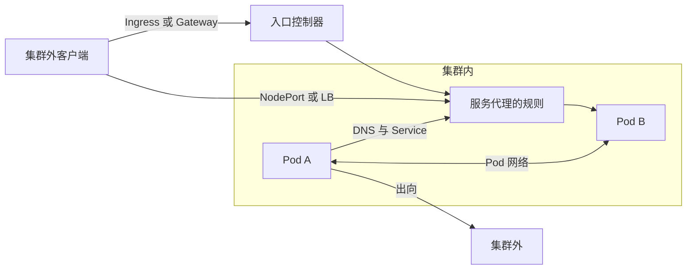
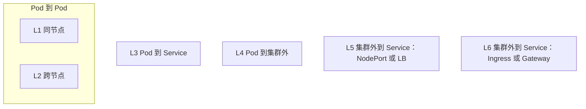

# k8s网络排查参考

## 是什么
- **一句话定位**：Kubernetes 网络的整体模型和四条主链路：Pod 与 Pod、Pod 到 Service、集群内到集群外、集群外到集群内。每条链路经过哪些环节、每个环节归谁实现、出了问题该去看哪个条目。
- **解决什么问题**：网络问题往往一开始不知道在哪一层。本条先把现象定位到具体链路和环节，再指向对应的专项条目，避免在不相关的层上浪费时间。
- **谁在用、从哪进来**：任何"访问不通 / 解析失败 / 外部进不来 / 策略不生效"类问题，都从这里先定位链路。
- **边界（不负责什么）**：各环节的详细机制由专项条目负责：Service排查参考、kube-proxy排查参考、集群DNS排查参考、CoreDNS排查参考、Ingress排查参考、GatewayAPI排查参考、Pod排查参考、节点排查参考。Pod 网络如何建立见 CNI排查参考，NetworkPolicy 的语义见 NetworkPolicy排查参考；具体 CNI 插件的内部转发与策略执行取决于所选软件，见 flannel排查参考、calico排查参考、cilium排查参考。
- **形态与版本**：这个模型只有少数部分由 Kubernetes 自己实现（Service 与 EndpointSlice 的管理、kube-proxy 的默认服务代理），其余由外部组件提供，没有对应组件时相应 API 存在但无效果。
- **术语**：
  - Pod 网络 —— 负责 Pod 之间通信的那一层，由 Pod 网络实现（常见为 CNI 插件）管理
  - 服务代理 —— 监听 Service 与 EndpointSlice 并编程数据面的组件，默认是 kube-proxy
  - NetworkPolicy —— 控制 Pod 之间以及 Pod 与外部三层四层流量的 API

## 组件与架构

| 组件 | 角色 | 职责 | 部署位置 / 形态 | 如何找到 |
|---|---|---|---|---|
| 容器运行时与 kubelet | 节点 | 建立 Pod 的网络命名空间，并调用 Pod 网络实现 | 每个节点 | 节点上的运行时与 kubelet |
| Pod 网络实现（CNI 插件等） | 数据面 | 给 Pod 分配 IP，保证 Pod 之间互通，常同时执行 NetworkPolicy | 每个节点上的组件 | 集群里的网络插件工作负载 |
| 服务代理（默认 kube-proxy） | 数据面 | 把 Service 虚拟 IP 转成后端转发规则 | 每个节点 | 见 kube-proxy排查参考 |
| 集群 DNS（常见 CoreDNS） | 解析 | 给 Pod 提供 Service 名解析并转发外部域名 | 集群内 | 见 集群DNS排查参考 |
| Ingress 或 Gateway 控制器 | 入口 | 把集群外的 HTTP(S) 流量转到 Service | 集群内 | 见 Ingress排查参考 与 GatewayAPI排查参考 |

## 正常链路（请求怎么走 / 正常行为）

### 资源匹配关系
| 编号 | 资源 A.字段 | → | 资源 B.字段 | 匹配规则 | 对不上时的表现 |
|---|---|---|---|---|---|
| R1 | 新建的 Pod | → | Pod IP 与网络命名空间 | 命名空间由运行时侧建立，网络由 Pod 网络实现接入，每个 Pod 得到集群内唯一的 IP | Pod 创建后没有 IP 或一直 ContainerCreating：网络接入这一步失败，见 Pod排查参考 |
| R2 | Pod IP | → | 另一个 Pod IP | 所有 Pod 之间应能直接通信，无需代理或地址转换，同节点与跨节点一样 | 同节点通而跨节点不通，或反之：问题在 Pod 网络实现 |
| R3 | Service 虚拟 IP 与端口 | → | 后端 Pod IP 与端口 | 由服务代理根据 Service 与 EndpointSlice 编程，详见 Service排查参考 与 kube-proxy排查参考 | 直连 Pod IP 通而经 Service 不通：问题在 Service 或服务代理这一层 |
| R4 | NetworkPolicy | → | Pod 之间及 Pod 与外部的流量 | 通常由 Pod 网络实现执行；不支持 NetworkPolicy 的实现上，API 存在但没有效果 | 策略写了却不生效，或预期放行却被拒：先确认所用网络实现是否支持并启用了策略 |
| R5 | Service 名 | → | DNS 解析结果 | 由集群 DNS 回答，Pod 的 resolv.conf 决定补全与指向，详见 集群DNS排查参考 | 解析失败：不要先怀疑连通性，先走 DNS 条目 |
| R6 | 集群外入口（NodePort、负载均衡、Ingress、Gateway） | → | Service 或其端点 | 四层入口直接走服务代理；七层入口由 Ingress 或 Gateway 控制器按规则转发到 Service | 外部进不来：先分清是四层入口还是七层入口，再进各自条目 |
| R7 | 节点上的代理程序（如 kubelet） | → | 本节点所有 Pod | 节点上的代理程序应能与本节点所有 Pod 通信 | 探针或节点到 Pod 的访问失败：影响就绪判断，见 Pod排查参考 |

### 控制面下发路径
| 环节 | 做什么 | 依据 |
|---|---|---|
| P1 | 创建 Pod 时，运行时建立网络命名空间，Pod 网络实现分配 IP 并接入网络 | R1 |
| P2 | Service 与 EndpointSlice 由控制面维护，各节点的服务代理据此编程数据面 | R3 |
| P3 | 集群 DNS 根据 Service 与 Pod 信息生成记录，kubelet 为 Pod 写好解析配置 | R5 |
| P4 | NetworkPolicy 由 Pod 网络实现读取并在数据面执行 | R4 |
| P5 | Ingress 或 Gateway 控制器监听对应 API 对象，把规则落实到入口数据面 | R6 |

### 流量走向（或生命周期）

| 环节 | 起点 → 终点 | 做什么 | 依据 | 同步/异步与默认行为 |
|---|---|---|---|---|
| L1 | Pod → 同节点的 Pod | 经本机的网络接入直接互通，无需地址转换 | R2 | 同步 |
| L2 | Pod → 其他节点的 Pod | 由 Pod 网络实现保证 Pod IP 在集群内可达，方式因实现而异 | R2 | 同步 |
| L3 | Pod → Service | 先经 DNS 解析（如用名字），再命中服务代理规则转到后端 Pod | R3 R5 | 同步 |
| L4 | Pod → 集群外 | 出向流量离开集群，是否做地址转换、受不受 NetworkPolicy 限制取决于网络实现与策略〔待复核〕 | R4 | 因实现而异 |
| L5 | 集群外 → Service | 经 NodePort 或负载均衡进入节点，再走服务代理转到后端 | R3 R6 | 同步 |
| L6 | 集群外 → Service | 经 Ingress 或 Gateway 控制器按七层规则转到 Service，再走 Service 转发 | R3 R6 | 同步 |

### 正常表现（健康基线）
- 任意两个 Pod 之间能直接互通，不需要经过 Service。
- 经 Service 访问与直接访问后端 Pod IP 的结果一致。
- 名字能解析，外部流量经入口能到达后端；NetworkPolicy 按预期放行或拒绝。

## 逐环节排查（沿链路对照）
- **P1 Pod 接入网络**
  - 正常：Pod 创建后很快拿到 IP。
  - 异常：Pod 长时间停在创建中，没有 IP。
  - 区分点：这一步由运行时与 Pod 网络实现负责，先看 Pod 事件，再看网络插件本身，调用机制见 CNI排查参考。
  - 证据落点：Pod 事件与状态，见 Pod排查参考；网络插件的日志。
- **P2 Service 数据面**
  - 正常：每个节点都有 Service 对应的规则。
  - 异常：个别节点规则缺失。
  - 区分点：转到 Service排查参考 与 kube-proxy排查参考。
  - 证据落点：EndpointSlice；节点上的规则。
- **P3 DNS**
  - 正常：Pod 内 resolv.conf 与集群 DNS 都正常。
  - 异常：解析失败或慢。
  - 区分点：先用 IP 访问能通，说明连通性没问题，问题在 DNS；转到 集群DNS排查参考 与 CoreDNS排查参考。
  - 证据落点：Pod 内 resolv.conf；集群 DNS 日志。
- **P4 NetworkPolicy**
  - 正常：策略按预期放行或拒绝。
  - 异常：策略不生效。
  - 区分点：确认所用网络实现支持并启用了 NetworkPolicy，不支持时 API 存在但没有效果（R4），策略语义见 NetworkPolicy排查参考。
  - 证据落点：网络实现的能力说明；策略与 Pod 标签的匹配。
- **P5 入口控制器**
  - 正常：控制器在运行并落实规则。
  - 异常：规则写了但没落实。
  - 区分点：转到 Ingress排查参考 或 GatewayAPI排查参考。
  - 证据落点：控制器日志；对象状态。
- **L1 同节点 Pod 互通**
  - 正常：同节点 Pod 之间直接通。
  - 异常：同节点都不通。
  - 区分点：同节点不通是 Pod 网络本机部分的问题；若同节点通、跨节点不通，进入 L2（R2）。
  - 证据落点：Pod 网络实现在本机的配置与日志。
- **L2 跨节点 Pod 互通**
  - 正常：跨节点 Pod 之间直接通。
  - 异常：跨节点不通，或只有特定节点之间不通。
  - 区分点：节点之间的底层网络、封装方式与 Pod 网络实现的路由都可能是原因；这一环的细节取决于具体网络插件，通用的 Pod 网络建立见 CNI排查参考，具体插件的转发机制见 flannel排查参考、calico排查参考、cilium排查参考。
  - 证据落点：节点间的连通性；网络插件日志。
- **L3 Pod 到 Service**
  - 正常：经 Service 访问与直连后端一致。
  - 异常：直连通、经 Service 不通。
  - 区分点：这是 Service 或服务代理的问题，详见 Service排查参考 与 kube-proxy排查参考；若失败只发生在用名字访问时，回到 P3。
  - 证据落点：Service 的端点；节点规则；解析结果。
- **L4 Pod 到集群外**
  - 正常：能访问集群外的目标。
  - 异常：集群外域名解析失败；集群外 IP 也不通。
  - 区分点：域名失败而 IP 通，问题在 DNS 转发上游；IP 也不通则看出向路径与 NetworkPolicy（R4）。
  - 证据落点：集群 DNS 的上游配置；网络实现与策略。
- **L5 四层入口到 Service**
  - 正常：外部经 NodePort 或负载均衡能到后端。
  - 异常：外部不通，或应用看到的源 IP 被改写。
  - 区分点：源 IP 改写是经 NodePort 或负载均衡的预期行为，详见 kube-proxy排查参考 与 Service排查参考。
  - 证据落点：Service 类型与流量策略；节点规则。
- **L6 七层入口到 Service**
  - 正常：Ingress 或 Gateway 规则命中并转到 Service。
  - 异常：规则不命中，或后端失败。
  - 区分点：规则层问题进 Ingress排查参考 或 GatewayAPI排查参考；规则命中但后端失败，回到 Service排查参考。
  - 证据落点：控制器状态与规则；后端端点。

## 异常归因速查
| 现象 / 错误码 | 环节 | 归因类别（回指 R#） | 证据位 | 详细条目 |
|---|---|---|---|---|
| 解析不到 Service 名 | P3 L3 | DNS 层问题（R5） | resolv.conf；集群 DNS 日志 | oss/k8s-dns.md、oss/coredns.md |
| 用 IP 能通、用名字不通 | P3 | DNS 层问题而非连通性（R5） | 解析结果 | oss/k8s-dns.md |
| 直连 Pod IP 通、经 Service 不通 | L3 P2 | Service 或服务代理层问题（R3） | EndpointSlice；节点规则 | oss/k8s-service.md、oss/kube-proxy.md |
| 个别节点访问 Service 失败 | P2 L3 | 这些节点的服务代理规则缺失或陈旧（R3） | 失败节点规则 | oss/kube-proxy.md |
| 同节点通、跨节点不通 | L2 | 跨节点的 Pod 网络问题（R2） | 节点间连通性；网络插件日志 | oss/flannel.md、oss/calico.md、oss/cilium.md |
| Pod 一直没有 IP | P1 | Pod 网络接入失败（R1） | Pod 事件；网络插件日志 | oss/k8s-pod.md、oss/k8s-cni.md |
| 外部访问不通（HTTP） | L6 P5 | 入口控制器或规则层问题（R6） | 控制器状态与规则 | oss/k8s-ingress.md、oss/k8s-gateway-api.md |
| 外部访问不通（NodePort 或 LB） | L5 | 四层入口或 Service 层问题（R3、R6） | Service 类型、流量策略、节点规则 | oss/k8s-service.md、oss/kube-proxy.md |
| NetworkPolicy 写了不生效 | P4 | 网络实现不支持或未启用策略（R4） | 网络实现的能力说明 | oss/k8s-networkpolicy.md、oss/flannel.md、oss/calico.md、oss/cilium.md |
| 探针失败导致 Pod 不就绪 | P1 L1 | 节点到 Pod 的访问异常（R7） | Pod 状况与探针配置 | oss/k8s-pod.md |
| 节点失联后其上网络异常 | P1 | 节点状态问题，不属于纯网络层（R7） | 节点状态 | oss/k8s-node.md |

## 状态、事件与日志语义
| 来源 | 取值 | 含义 | 常见出现环节 |
|---|---|---|---|
| Pod 状态 | 创建中且无 IP | Pod 网络接入没有完成 | P1 |
| Service | ClusterIP、NodePort、LoadBalancer | 决定入口形态与流量策略 | L3 L5 |
| NetworkPolicy | 存在但无效果 | 网络实现不支持策略时的表现 | P4 |

## 配置语义
| 配置项 | 默认 / 取值含义 | 改动后的行为后果 |
|---|---|---|
| Pod 网络实现的选择 | 常见为 CNI 插件，有的自带服务代理 | 决定 L1、L2、L4 的具体机制，以及 NetworkPolicy 是否被执行 |
| 服务代理的选择 | 默认 kube-proxy | 替换后规则由新的组件生成，见 kube-proxy排查参考 |
| 入口方案 | NodePort、负载均衡、Ingress、Gateway | 决定外部流量进入集群的链路 |
| 双栈与拓扑感知 | 可选特性 | 影响地址族与流量是否尽量留在本地区域，本条未展开 |

## 边界与置信度说明
- **来源**：Kubernetes 官方「Services, Load Balancing, and Networking」概念页的多个版本，没有做过运行时取证。
- **〔待复核〕项**：出向流量是否做地址转换及受策略限制的细节；跨节点互通的具体实现方式。这些取决于所用网络插件，本批没有对应条目。
- **版本差异**：本条的模型描述在 v1.32 至 v1.36 的文档中保持一致，具体组件的行为请看各专项条目。
- **未覆盖**：节点本地 DNS 缓存；双栈、拓扑感知路由与 Service 内部流量策略的细节；服务网格（见 istio排查参考）；Windows 节点上的网络差异。
- **related**：见 frontmatter。
