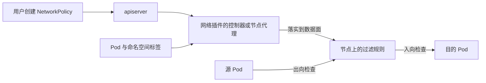
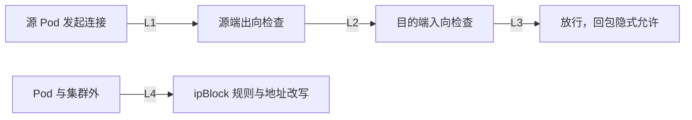

# NetworkPolicy排查参考

## 是什么
- **一句话定位**：NetworkPolicy 描述"哪些 Pod 可以和哪些对象通信"的三层四层规则。它只是 API 对象，真正执行靠网络插件。
- **解决什么问题**：回答"为什么这条连接被拒绝或意外放行"：先看有没有策略选中了这个 Pod，再看哪个方向被隔离，最后看放行规则怎么匹配。
- **谁在用、从哪进来**：运维用它做 Pod 间隔离；每个连接的两端（源 Pod 的出向、目的 Pod 的入向）都会被检查。
- **边界（不负责什么）**：各网络插件怎么在数据面落实，见各插件条目；Service 转发见 Service排查参考；解析问题见集群DNS排查参考。
- **形态与版本**：规则语义由官方定义，但是否生效、地址改写与策略的先后顺序因插件而异。
- **术语**：
  - 隔离 —— Pod 被某个策略选中后，在对应方向上只允许规则明确放行的流量
  - 叠加 —— 多条策略取并集，没有"拒绝"规则，只有"放行"规则
  - ipBlock —— 按集群外 IP 段放行

## 组件与架构

| 组件 | 角色 | 职责 | 部署位置 / 形态 | 如何找到 |
|---|---|---|---|---|
| NetworkPolicy 对象 | 声明 | 写明选中谁、放行谁、什么端口 | apiserver | 对应命名空间里的 NetworkPolicy |
| 网络插件 | 执行 | 监听策略与标签，在数据面落实 | 每个节点上的组件 | 集群里的网络插件，是否声明支持策略 |
| Pod 与命名空间标签 | 选择依据 | 决定选择器命中谁 | apiserver | Pod 与命名空间的 labels |

## 正常链路（请求怎么走 / 正常行为）

### 资源匹配关系
| 编号 | 资源 A.字段 | → | 资源 B.字段 | 匹配规则 | 对不上时的表现 |
|---|---|---|---|---|---|
| R1 | NetworkPolicy 对象 | → | 网络插件的执行 | 策略由网络插件实现，没有实现它的控制器时创建策略没有任何效果；已知 flannel 本身不执行策略〔待复核〕 | 策略写了毫无变化：多半是网络插件不支持或没启用 |
| R2 | spec.podSelector | → | 被隔离的 Pod | 选中策略所在命名空间的 Pod；空选择器选中该命名空间的全部 Pod | 选择器写偏：策略作用到了错误的 Pod 或没作用到任何 Pod |
| R3 | spec.policyTypes | → | 被隔离的方向 | 含 Ingress 则入向隔离，含 Egress 则出向隔离，两方向独立；未写时总设 Ingress，有出向规则才加 Egress | 以为写了出向规则就隔离了出向：未写 policyTypes 时要靠规则推断 |
| R4 | ingress.from 与 egress.to 的条目 | → | 被放行的对象 | podSelector 选同命名空间的 Pod；namespaceSelector 选所选命名空间的全部 Pod；同一条目里两者同时写，表示指定命名空间里的指定 Pod；分成两个条目则是并列；ipBlock 只用于集群外地址 | 选择器的写法不同，放行范围大不相同，典型错误是该写在同一条目里的写成了两个条目 |
| R5 | rules 里的 ports | → | 放行的协议与端口 | 一条规则要同时匹配 from 或 to 与 ports 两部分 | 端口写漏或写错：对象对了仍被拒 |
| R6 | 多条策略与连接两端 | → | 最终是否放行 | 多条策略效果取并集，与顺序无关；连接要成功，源端出向与目的端入向都必须允许，已允许连接的回包隐式允许 | 一端不允许就不通；叠加策略只会放宽不会收紧 |
| R7 | 经地址改写的连接 | → | ipBlock 与选择器的匹配 | 地址改写在策略处理之前还是之后没有定义，随插件、云厂商、Service 实现而异 | 经 Service 或出口改写的流量，策略匹配结果可能与预期不同 |

### 控制面下发路径
| 环节 | 做什么 | 依据 |
|---|---|---|
| P1 | 用户创建或修改 NetworkPolicy，apiserver 保存 | R1 R2 R3 |
| P2 | 网络插件监听策略、Pod 标签与命名空间标签，在各节点数据面落实，具体机制因插件而异 | R1 R4 |

### 流量走向（或生命周期）

| 环节 | 起点 → 终点 | 做什么 | 依据 | 同步/异步与默认行为 |
|---|---|---|---|---|
| L1 | 源 Pod → 出向检查 | 若源 Pod 被某策略按 Egress 隔离，则出向只放行规则允许的目的 | R3 R4 R5 | 未被隔离时默认放行 |
| L2 | 出向 → 入向检查 | 若目的 Pod 被某策略按 Ingress 隔离，则入向只放行规则允许的来源 | R3 R4 R5 | 未被隔离时默认放行 |
| L3 | 两端都允许 → 通 | 连接建立，已允许连接的回包隐式放行 | R6 | 同步 |
| L4 | Pod ↔ 集群外 | 用 ipBlock 控制；地址改写发生的时机影响匹配 | R4 R7 | 行为因插件而异 |

### 正常表现（健康基线）
- 所用网络插件确认支持并启用了 NetworkPolicy。
- 被策略选中的 Pod，只能收发规则放行的流量；没被选中的 Pod 不受影响。
- 没有任何策略的命名空间里，所有入向和出向流量都放行。

## 逐环节排查（沿链路对照）
- **P1 声明**
  - 正常：策略的 podSelector、policyTypes、规则都符合意图。
  - 异常：选择器选偏；policyTypes 与规则不一致；同一条目与分开条目写混。
  - 区分点：拿不准策略被如何解释时，用 kubectl describe 查看解释结果。
  - 证据落点：策略的 spec；kubectl describe 的输出。
- **P2 插件落实**
  - 正常：网络插件把策略落到数据面。
  - 异常：插件不支持或没启用策略；落实有延迟。
  - 区分点：没有任何效果，先确认插件是否支持 NetworkPolicy（R1），再看标签变化后是否重新计算〔待复核〕。
  - 证据落点：网络插件的能力说明与日志。
- **L1 出向检查**
  - 正常：源 Pod 若被 Egress 隔离，只能访问规则放行的目的。
  - 异常：出向被隔离后，访问集群 DNS 失败〔推论〕；访问外部被拒。
  - 区分点：出向被隔离后，没有显式放行的目的一律不通，解析所需的目的也不例外（见集群DNS排查参考）。
  - 证据落点：源 Pod 被哪些策略选中、policyTypes 是否含 Egress。
- **L2 入向检查**
  - 正常：目的 Pod 若被 Ingress 隔离，只收到放行来源的流量。
  - 异常：来源明明在放行范围却被拒。
  - 区分点：核对 R4 的写法，namespaceSelector 与 podSelector 是同一条目还是两个条目。
  - 证据落点：目的 Pod 的入向规则；来源 Pod 与命名空间的标签。
- **L3 两端判定与回包**
  - 正常：两端都允许则通，回包不需要再放行。
  - 异常：以为叠加策略能"拒绝"某个来源。
  - 区分点：策略只有放行没有拒绝，叠加只会放宽（R6）。
  - 证据落点：同一 Pod 上全部适用的策略。
- **L4 与集群外**
  - 正常：ipBlock 按预期放行外部地址。
  - 异常：经 Service 或出口改写后的流量没按 ipBlock 预期匹配。
  - 区分点：文档明确地址改写与策略处理的先后顺序没有定义，要查具体插件的行为（R7）。
  - 证据落点：插件文档；改写前后的地址。

## 异常归因速查
| 现象 / 错误码 | 环节 | 归因类别（回指 R#） | 证据位 | 详细条目 |
|---|---|---|---|---|
| 创建策略后毫无变化 | P2 | 网络插件不支持或没启用策略（R1） | 插件能力说明 | oss/k8s-network.md |
| 默认拒绝出向后解析失败 | L1 | 出向被隔离，解析所需目的未放行〔推论〕（R3、R4） | 被隔离的方向与规则 | oss/k8s-dns.md |
| 来源在放行范围却被拒 | L2 | 选择器写法不对（同条目与分条目）（R4） | from 的写法 | |
| 端口对、对象对仍被拒 | L1 L2 | ports 漏写或写错（R5） | 规则里的 ports | |
| 以为叠加策略能拒绝来源 | L3 | 策略只有放行，叠加取并集（R6） | 同一 Pod 上的全部策略 | |
| 只有一个方向被放行仍不通 | L1 L2 | 源端出向与目的端入向都要允许（R6） | 两端的隔离状态 | |
| 经 Service 访问与直连结果不同 | L4 | 地址改写与策略处理顺序因插件而异（R7） | 插件行为 | oss/k8s-service.md |
| 没写 policyTypes 的策略方向不对 | P1 | 默认只设 Ingress，有出向规则才加 Egress（R3） | policyTypes 的实际取值 | |

## 状态、事件与日志语义
| 来源 | 取值 | 含义 | 常见出现环节 |
|---|---|---|---|
| 隔离状态 | 非隔离（默认） | 没有策略选中该 Pod 的该方向，所有连接放行 | L1 L2 |
| 隔离状态 | 已隔离 | 有策略选中并含该方向的 policyTypes，只放行规则允许的流量 | L1 L2 |
| policyTypes | Ingress、Egress | 声明策略作用的方向 | P1 |

## 配置语义
| 配置项 | 默认 / 取值含义 | 改动后的行为后果 |
|---|---|---|
| podSelector | 空选择器选中该命名空间全部 Pod | 写在默认拒绝策略里即对整个命名空间生效 |
| policyTypes | 未写时总设 Ingress，有出向规则才加 Egress | 想只隔离出向时，要显式写 Egress |
| ingress 或 egress 为空列表 | 选中且隔离，但不放行任何流量 | 即"默认拒绝" |
| ingress 或 egress 含一个空规则 | 放行该方向的全部流量 | 即"默认放行" |
| from 与 to 的写法 | 同一条目写两种选择器为"且"，分开写为"或" | 写法不同范围差别很大 |
| ipBlock | 用于集群外地址 | 不适合用来指定 Pod IP |

## 边界与置信度说明
- **来源**：Kubernetes 官方 NetworkPolicy 概念页的多个版本，没有做过运行时取证。flannel 本身不执行策略一条来自厂商文档，不是官方原文。
- **〔待复核〕与〔推论〕项**：flannel 的说明待对照其上游文档；标签变化后策略重新计算的时延；"出向被隔离后解析失败"由官方的隔离语义推出，没有对应的官方原话。
- **版本差异**：官方文档各版本的语义一致；各插件对 SCTP、策略日志、扩展策略资源的支持各不相同。
- **未覆盖**：节点本地流量与探针流量如何处理；hostNetwork Pod 的情形；各网络插件的扩展策略（如集群级策略、七层策略）；策略的可观测与日志；网络策略的审计。
- **related**：见 frontmatter。
