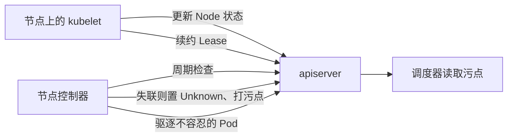

# 节点排查参考

## 是什么
- **一句话定位**：节点如何向控制面证明自己还活着、控制面如何据此判定节点健康、以及判定异常之后会发生什么：状态变 Unknown、被打污点、不再被调度、上面的 Pod 被驱逐。
- **解决什么问题**：看到节点 NotReady 或 Unknown 时，知道这是心跳问题还是节点自报的异常，也知道 Pod 多久会被迁走、为什么有时迟迟不迁走。
- **谁在用、从哪进来**：节点上的 kubelet 负责注册与上报；控制面的节点控制器负责判定与处置；调度器读取污点决定要不要往该节点放 Pod。
- **边界（不负责什么）**：kubelet 内部的资源压力驱逐阈值、容器运行时、节点上的组件故障、证书问题另见相应条目；节点上 Pod 自身的状态见 Pod排查参考。
- **形态与版本**：节点控制器运行在 kube-controller-manager 内；各项超时和速率有默认值，但随版本变化，使用时以集群实际参数为准。
- **术语**：
  - 心跳 —— 节点向控制面表明存活的信号，分 Node 状态更新与 Lease 两种
  - Lease —— kube-node-lease 命名空间里每节点一个的轻量对象
  - NoExecute 污点 —— 既阻止新 Pod 调度，也会驱逐不容忍的已有 Pod
  - cordon —— 把节点标为不可调度

## 组件与架构

| 组件 | 角色 | 职责 | 部署位置 / 形态 | 如何找到 |
|---|---|---|---|---|
| kubelet | 节点代理 | 注册节点，周期上报状态并续约 Lease | 每个节点 | 节点上的 kubelet 及日志 |
| Node 对象与 Lease | 数据 | 记录节点状态与心跳 | apiserver，Lease 在 kube-node-lease | Node 的 status.conditions；对应 Lease 的续约时间 |
| 节点控制器 | 控制面 | 检查节点健康，置 Unknown，打污点，限速驱逐 | kube-controller-manager 内 | controller-manager 的日志与参数 |
| 调度器 | 控制面 | 把污点纳入调度决策 | 控制面 | 调度事件 |

## 正常链路（请求怎么走 / 正常行为）

### 资源匹配关系
| 编号 | 资源 A.字段 | → | 资源 B.字段 | 匹配规则 | 对不上时的表现 |
|---|---|---|---|---|---|
| R1 | kubelet 的节点名 | → | Node 对象的 metadata.name | 以名字匹配，两个节点不能同名；健康的节点才有资格运行 Pod | 名字冲突或不匹配：节点被当作无效，除非恢复否则被忽略，对象保留并继续检查 |
| R2 | kubelet 的心跳 | → | 节点控制器对节点健康的判断 | 心跳有两种：Node 的 .status 更新与 Lease 续约；控制器按 node-monitor-period 周期检查 | 心跳中断：Ready 被置为 Unknown |
| R3 | Node 的状况（Ready、各类压力、NetworkUnavailable） | → | 自动创建的污点 | 控制面会创建与状况对应的污点；调度器据此排除节点；Ready 为 Unknown 时加 node.kubernetes.io/unreachable，为 False 时加 node.kubernetes.io/not-ready | 状况异常：新 Pod 不再调度到该节点，已有 Pod 视污点效果而定 |
| R4 | NoExecute 污点 | → | 不容忍它的 Pod | 节点控制器驱逐有 NoExecute 污点且不容忍的 Pod；从标记 Unknown 到首次驱逐默认等 5 分钟 | 节点异常后 Pod 过几分钟才被迁走，是预期行为 |
| R5 | cordon 标记 | → | 调度排除 | 节点被标为不可调度；DaemonSet 的 Pod 仍容忍不可调度 | 节点不再接新 Pod，已有 Pod 不受影响 |
| R6 | 区域内不健康节点比例 | → | 驱逐速率 | 默认限速 0.1 每秒；区域不健康比例达 0.55 时降速；小集群停止驱逐，大集群降到 0.01 每秒；整个集群全部不健康时不驱逐 | 大面积故障时 Pod 几乎不迁移，是限速或保护逻辑在生效 |
| R7 | 云厂商的机器列表 | → | 节点控制器的节点列表 | 节点不健康时，控制器会询问云厂商该机器是否还在，不在则从列表删除节点 | 云上机器被删除后节点对象被自动清理 |

### 控制面下发路径
| 环节 | 做什么 | 依据 |
|---|---|---|
| P1 | kubelet 注册节点，之后按 node-status-update-frequency 更新状态并续约 Lease | R1 R2 |
| P2 | 节点控制器每隔 node-monitor-period（默认 5 秒）检查各节点 | R2 |
| P3 | 判定失联后把 Ready 置为 Unknown，并创建对应污点 | R2 R3 |
| P4 | 等待容忍时间后提交驱逐，驱逐受速率与区域规则限制 | R4 R6 |

### 流量走向（或生命周期）

| 环节 | 起点 → 终点 | 做什么 | 依据 | 同步/异步与默认行为 |
|---|---|---|---|---|
| L1 | kubelet → apiserver | 注册节点并开始上报 | R1 | 节点名必须与 Node 的 metadata.name 匹配 |
| L2 | kubelet → apiserver | 持续更新状态并续约 Lease | R2 | 周期性；Lease 默认每 10 秒续约，是主要的存活信号，Node 的 .status 无变化时默认每 5 分钟才更新一次 |
| L3 | 节点控制器 | 发现心跳丢失，把 Ready 置为 Unknown，创建污点 | R2 R3 | 按检查周期触发，失联超过容忍时长后生效（较新版本默认 50 秒，早期版本 40 秒） |
| L4 | 调度器 | 读取污点，不再往该节点放无容忍的新 Pod | R3 R5 | 立即体现在调度决策里 |
| L5 | 节点控制器 → Pod | 对不容忍 NoExecute 污点的 Pod 提交驱逐，默认等待 5 分钟 | R4 R6 | 受速率与区域保护限制 |
| L6 | 节点 → 控制面 | 心跳恢复后 Ready 回到 True，污点由控制面清除〔待复核〕 | R2 R3 | 异步 |

### 正常表现（健康基线）
- 每个节点的 Ready 为 True，对应 Lease 的续约时间持续更新。
- 没有非预期的污点；不可调度的节点只在有意 cordon 时出现。
- 没有 Pod 被节点控制器驱逐。

## 逐环节排查（沿链路对照）
- **P1 注册与上报**
  - 正常：节点以预期的名字注册，状态与 Lease 持续更新。
  - 异常：节点名与预期不符或冲突；kubelet 无法连到 apiserver。
  - 区分点：节点根本没出现，先查名字匹配（R1）与 kubelet 到 apiserver 的连通。
  - 证据落点：kubelet 日志；Node 对象是否存在。
- **P2 周期检查**
  - 正常：控制器持续检查，没有节点被错判。
  - 异常：控制器自身异常，导致失联节点长期没被标记。
  - 区分点：节点明显失联却一直是 Ready，查 kube-controller-manager 是否正常。
  - 证据落点：controller-manager 的状态与日志。
- **P3 置 Unknown 与打污点**
  - 正常：失联才置 Unknown，同时出现对应污点。
  - 异常：节点自己报告了异常状况（如压力、网络不可用），Ready 为假。
  - 区分点：Unknown 说明控制面没收到心跳，问题在节点或网络；Ready 为 False 说明节点自己报告了问题（R2、R3）。
  - 证据落点：Node 的 conditions 与污点。
- **P4 驱逐与限速**
  - 正常：等待后按速率驱逐，Pod 被重新调度。
  - 异常：节点已异常很久，Pod 仍没被迁走；大面积故障下完全没有驱逐。
  - 区分点：迟迟不迁先看容忍时间与速率限制（R4、R6），不要直接判定为故障。
  - 证据落点：Pod 的容忍设置；节点控制器的速率参数；区域内不健康节点比例。
- **L1 注册**
  - 正常：新节点注册后进入 Ready。
  - 异常：节点长期不出现或被忽略。
  - 区分点：名字不匹配与同名冲突优先排除。
  - 证据落点：Node 列表；kubelet 日志。
- **L2 心跳**
  - 正常：Lease 续约时间不断刷新。
  - 异常：Lease 停止续约。
  - 区分点：Lease 停了而 kubelet 进程还在，多半是 kubelet 到 apiserver 的连接问题。
  - 证据落点：kube-node-lease 里该节点 Lease 的续约时间。
- **L3 状态变化**
  - 正常：状态与真实情况一致。
  - 异常：Ready 为 Unknown 或 False，并带有污点。
  - 区分点：见 P3。
  - 证据落点：conditions 与污点。
- **L4 调度排除**
  - 正常：不再有新 Pod 落到该节点。
  - 异常：仍有 Pod 被调度上去，说明它们容忍了污点。
  - 区分点：对比 Pod 的容忍与节点污点（R3）。
  - 证据落点：Pod 的 tolerations；节点 taints。
- **L5 驱逐**
  - 正常：等待期后，不容忍的 Pod 被驱逐并重建。
  - 异常：Pod 长时间留在失联节点上。
  - 区分点：Pod 带了较长的容忍时间，或速率保护在限制驱逐（R4、R6）。
  - 证据落点：Pod 的容忍时间；速率相关参数。
- **L6 恢复**
  - 正常：心跳恢复后状态回到 Ready，污点被清除〔待复核〕。
  - 异常：节点已恢复，污点或状态仍未更新。
  - 区分点：先确认 Lease 已恢复续约，再看控制器是否在工作。
  - 证据落点：Lease 的续约时间；Node 的状态。

## 异常归因速查
| 现象 / 错误码 | 环节 | 归因类别（回指 R#） | 证据位 | 详细条目 |
|---|---|---|---|---|
| 节点 Unknown | P3 L3 | 心跳中断，控制面没收到信号（R2） | Lease 续约时间；kubelet 与网络 | |
| 节点 NotReady（Ready 为 False） | P3 L3 | 节点自己报告了异常状况（R2、R3） | conditions 的各项状况 | |
| 节点异常后 Pod 过了几分钟才迁走 | P4 L5 | 默认容忍时间与驱逐等待（R4） | Pod 的容忍设置 | |
| 大面积节点故障时 Pod 不迁移 | P4 | 驱逐限速或整体不健康保护（R6） | 区域内不健康比例；速率参数 | |
| 节点不接新 Pod | L4 | 被 cordon 或带有污点（R3、R5） | 节点的不可调度标记与污点 | |
| 节点没出现在列表里 | L1 | 节点名不匹配或同名冲突（R1） | Node 列表；kubelet 日志 | |
| 云上机器已删但节点还在 / 自动消失 | P2 | 节点控制器与云厂商列表同步（R7） | 云上机器状态 | |
| 带 NetworkUnavailable | P3 | 节点网络未正确配置（R3） | conditions 的 NetworkUnavailable | |

## 状态、事件与日志语义
| 来源 | 取值 | 含义 | 常见出现环节 |
|---|---|---|---|
| Node 状况 | Ready 为 True | 节点健康，可运行 Pod | L2 |
| Node 状况 | Ready 为 Unknown | 控制器没有收到心跳 | L3 |
| Node 状况 | Ready 为 False | 节点自己报告不健康 | L3 |
| Node 状况 | MemoryPressure、DiskPressure、PIDPressure | 对应资源紧张〔待复核〕 | L3 |
| Node 状况 | NetworkUnavailable 为 True | 节点网络未正确配置 | L3 |
| 污点 | node.kubernetes.io/unreachable | Ready 为 Unknown 超过容忍时长后自动添加 | L3 L4 |
| 污点 | node.kubernetes.io/not-ready | Ready 为 False 超过容忍时长后自动添加 | L3 L4 |
| Lease | kube-node-lease 里的对象 | 节点续约时间代表心跳 | L2 |

## 配置语义
| 配置项 | 默认 / 取值含义 | 改动后的行为后果 |
|---|---|---|
| node-monitor-period | 默认 5 秒 | 控制器检查节点的周期 |
| node-status-update-frequency | kubelet 上报状态的频率；Lease 默认每 10 秒续约，无变化时 .status 默认每 5 分钟更新 | 调小可更快传播状况变化，但增加 apiserver 负载 |
| 失联容忍时长（node-monitor-grace-period） | 较新文档默认 50 秒，早期文档与旧版参数参考为 40 秒，以所用版本的实际参数为准 | 决定多久未收到心跳就判为 Unknown |
| 驱逐等待 | 从 Unknown 到首次驱逐默认 5 分钟 | 调短会更快迁移，也更易误驱逐 |
| node-eviction-rate | 默认 0.1 每秒 | 约每 10 秒最多驱逐一个节点的 Pod |
| unhealthy-zone-threshold | 默认 0.55 | 区域不健康比例达到后降速 |
| large-cluster-size-threshold | 默认 50 | 不超过它的小集群在区域不健康时停止驱逐 |
| secondary-node-eviction-rate | 默认 0.01 每秒 | 大集群区域不健康时的驱逐速率 |
| register-node | kubelet 参数 | 设为 false 时需要自己创建 Node 对象 |

## 边界与置信度说明
- **来源**：Kubernetes 官方「Nodes」文档，没有做过运行时取证。
- **版本差异**：失联容忍时长默认值在较新的官方文档中为 50 秒，早期文档写 40 秒，旧版 kube-controller-manager 参数参考也是 40 秒，以集群实际参数为准；驱逐机制在新旧版本里也从基于超时参数演变为基于污点与容忍。
- **〔待复核〕项**：各类压力状况（MemoryPressure、DiskPressure、PIDPressure）的触发条件；恢复后污点被控制面清除的细节。
- **未覆盖**：kubelet 的资源压力驱逐阈值；节点优雅关机；节点上组件（运行时、网络插件）的故障；节点证书与引导；节点资源容量与可分配量。
- **related**：见 frontmatter。
