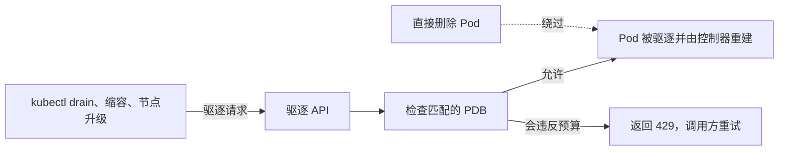
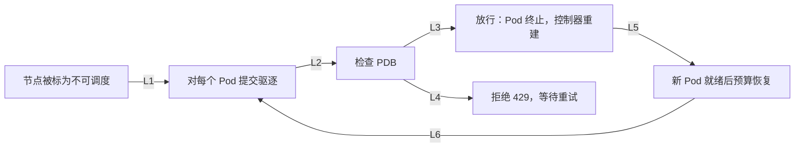

# PDB排查参考

## 是什么
- **一句话定位**：PodDisruptionBudget 限制"同一时间最多有多少个 Pod 能被主动驱逐"，保护的是节点排空、集群缩容、节点升级这类自愿干扰。它只管走驱逐 API 的操作，直接删除 Pod 它不管。
- **解决什么问题**：kubectl drain 卡住、节点升级卡住、缩容被阻止、驱逐返回 429 时，判断是预算太严、Pod 不健康占了名额，还是操作根本没走驱逐 API。
- **谁在用、从哪进来**：给关键应用设置可用性底线的应用所有者；做节点维护与升级的运维。
- **边界（不负责什么）**：节点失联后的驱逐由节点控制器负责，不经 PDB，见 节点排查参考；压力驱逐由 kubelet 负责，见 资源与QoS排查参考；滚动更新的节奏由 Deployment 自己的参数决定，见 工作负载控制器排查参考。
- **形态与版本**：policy/v1 自 v1.21 起稳定；unhealthyPodEvictionPolicy 是较新的字段，较早版本没有。
- **术语**：
  - 自愿干扰 —— 人或系统有意的驱逐，如排空、缩容、升级
  - 非自愿干扰 —— 硬件故障、内核崩溃、OOM 等，PDB 阻止不了，但会计入预算
  - 允许的干扰数 —— disruptionsAllowed，当前还能再驱逐几个
  - 驱逐 API —— 受 PDB 约束的删除入口

## 组件与架构

| 组件 | 角色 | 职责 | 部署位置 / 形态 | 如何找到 |
|---|---|---|---|---|
| PDB 对象 | 声明 | 选中 Pod，声明可用下限或不可用上限 | 命名空间内 | PDB 的 spec 与 status |
| 驱逐 API | 入口 | 对每次驱逐检查 PDB，必要时拒绝 | apiserver | 驱逐请求的响应 |
| 干扰预算控制器 | 控制面 | 计算 PDB 的状态字段 | kube-controller-manager 内〔待复核〕 | PDB 的 status |
| 调用方 | 操作者 | kubectl drain、Cluster Autoscaler、VPA、节点升级工具 | 各自运行 | 其日志与输出 |

## 正常链路（请求怎么走 / 正常行为）

### 资源匹配关系
| 编号 | 资源 A.字段 | → | 资源 B.字段 | 匹配规则 | 对不上时的表现 |
|---|---|---|---|---|---|
| R1 | PDB.spec.selector | → | 被保护的 Pod | 标签选择器选中同命名空间的 Pod | 选不到 Pod：PDB 形同虚设，驱逐不受限 |
| R2 | minAvailable 与 maxUnavailable | → | 允许的干扰数 | 二者互斥，可写整数或百分比；预算允许时，一次自愿干扰允许一个而不是两个 Pod | 两个字段都写会被拒绝；预算过严会让驱逐一直被拒 |
| R3 | Pod 的健康状况 | → | PDB 状态字段 | 状态含 currentHealthy、desiredHealthy、disruptionsAllowed、expectedPods；允许的干扰数随健康 Pod 数变化〔待复核〕 | 不健康的 Pod 多：允许的干扰数下降甚至为 0 |
| R4 | 驱逐请求 | → | 放行或拒绝 | 驱逐会使 PDB 被违反时，驱逐 API 返回 429，不会自动重试 | 调用方看到 429 并停下或重试，不是 apiserver 故障 |
| R5 | unhealthyPodEvictionPolicy | → | 不健康 Pod 的驱逐 | IfHealthyBudget（默认）下，预算耗尽时不健康的 Pod 也驱逐不了；AlwaysAllow 允许驱逐；处于 Pending、Succeeded、Failed 的 Pod 总可驱逐〔待复核〕 | 反复崩溃的 Pod 占着名额：排空永远完不成 |
| R6 | 操作的路径 | → | 是否受 PDB 约束 | 只有走驱逐 API 的才受约束，如排空、缩容、VPA 驱逐、云厂商节点升级；直接删除 Pod 或删除 Deployment 会绕过；非自愿干扰阻止不了但计入预算 | 以为 PDB 能防误删：它防不了直接删除 |
| R7 | 预算与副本数的关系 | → | 是否可能阻塞 | 绝对值不随副本数变化，百分比随之变化；预算要求可用数等于副本数时，任何驱逐都被拒绝〔待复核〕 | 副本数一变，允许的干扰数跟着变，或一直为 0 |
| R8 | PriorityClass 抢占 | → | 被动的干扰 | 使用 PriorityClass 也可能造成自愿与非自愿的干扰 | 高优先级 Pod 挤掉低优先级 Pod，不一定被 PDB 拦住〔待复核〕 |

### 控制面下发路径
| 环节 | 做什么 | 依据 |
|---|---|---|
| P1 | 应用所有者创建 PDB，选中 Pod，写预算 | R1 R2 |
| P2 | 控制器根据选中 Pod 的健康状况计算 status | R3 R7 |
| P3 | 运维发起自愿干扰操作：kubectl drain、缩容、节点升级 | R6 |
| P4 | 操作经驱逐 API 提交，API 检查所有匹配的 PDB | R4 |
| P5 | 被拒绝（429）时调用方等待并重试，直到成功或超时 | R4 |

### 流量走向（或生命周期）

| 环节 | 起点 → 终点 | 做什么 | 依据 | 同步/异步与默认行为 |
|---|---|---|---|---|
| L1 | 节点 → 不可调度 | kubectl drain 先 cordon 节点 | R6 | 同步 |
| L2 | Pod → 驱逐请求 | 对节点上每个 Pod 提交驱逐 | R6 | 逐个 |
| L3 | 请求 → PDB 检查 | 检查所有匹配的 PDB，预算够就放行 | R2 R4 | 同步 |
| L4 | 超出预算 → 拒绝 | 返回 429，调用方重试至成功或超时 | R4 | 不自动重试，由调用方重试 |
| L5 | 放行 → 终止与重建 | Pod 优雅终止，控制器创建替代 Pod | R3 | 异步 |
| L6 | 新 Pod 就绪 → 预算恢复 | 新 Pod 就绪后，允许的干扰数回升，下一个驱逐才能放行 | R3 R7 | 取决于新 Pod 多快就绪 |

### 正常表现（健康基线）
- 关键应用的 PDB 允许的干扰数大于 0，排空能逐个推进。
- 没有长期停留在 0 的允许干扰数；没有长期不健康的 Pod 占着预算。
- 运维习惯用排空而不是直接删除来下线节点。

## 逐环节排查（沿链路对照）
- **P1 声明**
  - 正常：选择器选中预期的 Pod，预算合理。
  - 异常：选不到 Pod；预算要求可用数等于副本数；两个字段都写。
  - 区分点：drain 被卡住，先看预算与副本数的关系（R2、R7）。
  - 证据落点：PDB 的 spec 与选中的 Pod 数。
- **P2 状态计算**
  - 正常：状态字段随 Pod 健康变化。
  - 异常：允许的干扰数一直为 0。
  - 区分点：先看是预算过严，还是有不健康的 Pod 占了名额（R3）。
  - 证据落点：PDB 的 currentHealthy、desiredHealthy、disruptionsAllowed。
- **P3 发起操作**
  - 正常：走驱逐 API。
  - 异常：绕过驱逐 API 直接删除。
  - 区分点：操作没被拦住，先确认它是否走了驱逐 API（R6）。
  - 证据落点：操作所用的命令与工具。
- **P4 驱逐检查**
  - 正常：预算足够就放行。
  - 异常：返回 429。
  - 区分点：429 是预算在起作用，不是故障；错误信息指出被哪个 PDB 拦住。
  - 证据落点：驱逐请求的响应；相关 PDB。
- **P5 重试**
  - 正常：预算恢复后继续。
  - 异常：一直重试到超时。
  - 区分点：预算恢复需要新 Pod 就绪，若新 Pod 起不来，排空会一直等。
  - 证据落点：新 Pod 的状态；drain 的输出。
- **L1 cordon**
  - 正常：节点不再接新 Pod。
  - 异常：节点被 cordon 了但没有排空。
  - 区分点：cordon 只是不可调度，不会驱逐已有 Pod。
  - 证据落点：节点的不可调度标记。
- **L2 提交驱逐**
  - 正常：逐个提交。
  - 异常：某个 Pod 总被拒。
  - 区分点：drain 输出会显示阻塞的 Pod，从它入手。
  - 证据落点：drain 的输出。
- **L3 PDB 检查**
  - 正常：允许。
  - 异常：被拒绝。
  - 区分点：核对该 Pod 匹配的所有 PDB，可能有多个。
  - 证据落点：匹配的 PDB 列表与状态。
- **L4 拒绝与等待**
  - 正常：很快恢复。
  - 异常：长时间阻塞。
  - 区分点：反复崩溃的 Pod 占名额时，可用 AlwaysAllow 让不健康的 Pod 被驱逐（R5）。
  - 证据落点：不健康的 Pod；unhealthyPodEvictionPolicy。
- **L5 终止与重建**
  - 正常：替代 Pod 很快就绪。
  - 异常：替代 Pod 起不来，预算无法恢复。
  - 区分点：转到 Pod排查参考与 调度排查参考。
  - 证据落点：替代 Pod 的状态。
- **L6 恢复**
  - 正常：预算恢复，排空继续。
  - 异常：预算久久不恢复。
  - 区分点：看就绪速度与副本数；百分比预算会随副本数变化。
  - 证据落点：允许的干扰数的变化。

## 异常归因速查
| 现象 / 错误码 | 环节 | 归因类别（回指 R#） | 证据位 | 详细条目 |
|---|---|---|---|---|
| kubectl drain 一直卡住 | L2 L4 | 某个 Pod 的驱逐被 PDB 拒绝（R4） | drain 输出里阻塞的 Pod | oss/k8s-node.md |
| 驱逐返回 429 | P4 | 驱逐会违反预算（R4） | 匹配的 PDB 状态 | |
| 允许的干扰数一直为 0 | P2 | 预算过严，或不健康 Pod 占名额（R3、R7） | PDB 状态字段 | oss/k8s-workload.md |
| 反复崩溃的 Pod 让排空完不成 | L4 | 不健康 Pod 也占预算（R5） | unhealthyPodEvictionPolicy | oss/k8s-pod.md |
| 直接删除 Pod 没被拦住 | P3 | 绕过了驱逐 API（R6） | 操作方式 | |
| PDB 完全不起作用 | P1 | 选择器选不到 Pod（R1） | 选中的 Pod 数 | |
| 同时写两个字段被拒绝 | P1 | minAvailable 与 maxUnavailable 互斥（R2） | PDB 的 spec | |
| 节点升级卡住 | L4 | 升级工具经驱逐 API，被预算拦住（R6） | 升级工具的输出；PDB | |
| 集群缩容节点被阻止 | L3 | 缩容经驱逐 API，被预算拦住（R6） | 缩容组件日志；PDB | oss/k8s-scheduling.md |
| 副本数一变预算行为就变 | L6 | 百分比随副本数变，绝对值不变（R7）〔待复核〕 | 预算写法与副本数 | |

## 状态、事件与日志语义
| 来源 | 取值 | 含义 | 常见出现环节 |
|---|---|---|---|
| 响应码 | 429 | 驱逐会违反 PDB，被拒绝 | P4 |
| PDB 状态 | currentHealthy | 当前健康的 Pod 数〔待复核〕 | P2 |
| PDB 状态 | desiredHealthy | 预算要求的最少健康数〔待复核〕 | P2 |
| PDB 状态 | disruptionsAllowed | 当前还能再驱逐的数量 | P2 L3 |
| PDB 状态 | expectedPods | 预期被选中的 Pod 数〔待复核〕 | P2 |
| 指标 | kube_poddisruptionbudget_status_pod_disruptions_allowed | 为 0 时可告警，名字来自二手资料〔待复核〕 | L6 |

## 配置语义
| 配置项 | 默认 / 取值含义 | 改动后的行为后果 |
|---|---|---|
| minAvailable | 至少保留的可用 Pod 数，整数或百分比 | 等于副本数时任何驱逐都被拒绝 |
| maxUnavailable | 最多允许不可用的 Pod 数，整数或百分比 | 与 minAvailable 互斥 |
| unhealthyPodEvictionPolicy | 默认 IfHealthyBudget，另有 AlwaysAllow〔待复核〕 | AlwaysAllow 避免不健康 Pod 卡住排空 |
| selector | 标签选择器 | 写错则 PDB 选不到 Pod |

## 边界与置信度说明
- **来源**：Kubernetes 官方 Disruptions 概念页（v1.32）给出 PDB 的稳定版本、自愿与非自愿干扰的区别、绕过 PDB 的操作、预算一次放行一个；驱逐 API 返回 429、重试行为、状态字段、不健康 Pod 策略及其取值来自二手资料，官方 PDB 任务页本次没取到。没有做过运行时取证。
- **〔待复核〕项**：干扰预算控制器所在位置；状态字段的精确含义；不健康 Pod 策略的引入与稳定版本及 Pending、Succeeded、Failed 总可驱逐的说法；预算与副本数的交互；PriorityClass 抢占与 PDB 的关系；指标名。
- **版本差异**：unhealthyPodEvictionPolicy 较早版本没有；二手资料对其引入与稳定版本的说法不一，以所用版本文档为准。
- **未覆盖**：Cluster Autoscaler 与 PDB 的详细交互；各云厂商节点升级对 PDB 的处理；PDB 与 StatefulSet 的法定人数应用；PDB 的容量规划；驱逐的优雅终止期与 preStop 的影响。
- **related**：见 frontmatter。
