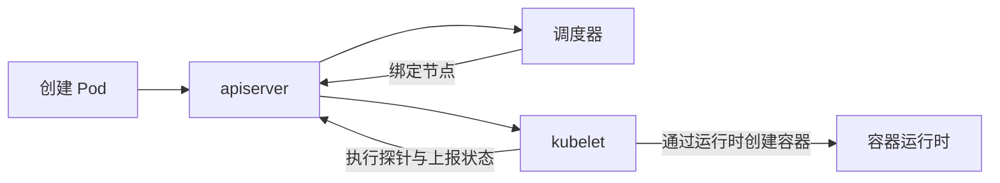
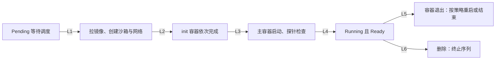

# Pod排查参考

## 是什么
- **一句话定位**：Pod 从被接受、调度、创建容器、探针检查、运行，到被终止的完整生命周期，以及这个过程中 phase、状况（conditions）、容器状态三层状态各自表示什么。
- **解决什么问题**：看到 Pod 的某个状态，要知道它处在生命周期的哪一环、下一步由谁负责，避免把 kubectl 的展示状态当成 API 里的真实状态。
- **谁在用、从哪进来**：用户或控制器创建 Pod；调度器绑定节点；kubelet 通过容器运行时创建并管理容器。
- **边界（不负责什么）**：调度器如何选节点、资源限制与 OOM 的细节、节点自身的状态与驱逐，另见相应条目；Pod 网络如何接入见 k8s网络排查参考。
- **形态与版本**：phase 的取值是严格定义的，文档提醒不要假定除列出值之外的 phase；状况与较新状况类型随版本变化。
- **术语**：
  - phase —— Pod 总体阶段：Pending、Running、Succeeded、Failed
  - 状况（conditions）—— 更细的多个布尔状态，可同时为真
  - 容器状态 —— 每个容器的 Waiting、Running、Terminated
  - 展示状态 —— kubectl 的 STATUS 列，如 CrashLoopBackOff、Terminating，不等于 phase

## 组件与架构

| 组件 | 角色 | 职责 | 部署位置 / 形态 | 如何找到 |
|---|---|---|---|---|
| apiserver | 控制面 | 保存 Pod 及其 status | 控制面 | Pod 对象的 spec 与 status |
| 调度器 | 控制面 | 为未绑定的 Pod 选节点并绑定 | 控制面 | PodScheduled 状况与事件 |
| kubelet | 节点代理 | 创建并管理容器，执行探针，上报状态 | 每个节点 | 节点上的 kubelet 日志 |
| 容器运行时 | 节点 | 真正创建与停止容器 | 每个节点 | 运行时侧的容器状态 |

## 正常链路（请求怎么走 / 正常行为）

### 资源匹配关系
| 编号 | 资源 A.字段 | → | 资源 B.字段 | 匹配规则 | 对不上时的表现 |
|---|---|---|---|---|---|
| R1 | Pod 的调度结果 | → | PodScheduled 状况 | 调度器把 Pod 绑定到节点后该状况为真；未绑定时 Pod 处于 Pending | PodScheduled 为假：Pod 停在 Pending，原因看调度事件 |
| R2 | 容器的镜像引用 | → | 节点上拉取到的镜像 | 镜像拉取发生在容器 Waiting 期间，这段时间计入 Pending 阶段；失败后会重试并退避〔待复核〕 | 镜像名、仓库鉴权或网络有问题：容器长期 Waiting，展示为 ErrImagePull 或 ImagePullBackOff〔待复核〕 |
| R3 | 展示状态（kubectl STATUS 列） | → | API 中的 phase | 两者不是同一个东西：CrashLoopBackOff、Terminating 是展示状态，不是 phase | 把展示状态当 phase 判断，会误解 Pod 所处阶段 |
| R4 | 各容器的状态 | → | Pod 的 phase 与状况 | Running 要求所有容器已创建且至少一个在运行或在启动、重启；Pending 包含等待调度与下载镜像；Ready 为真的前提是 ContainersReady 为真 | 容器未就绪：Pod 虽是 Running 阶段，但 Ready 为假，不会被 Service 当作可用后端 |
| R5 | Pod 的 restartPolicy | → | 容器退出后的处理 | Always（默认）、OnFailure、Never；首次崩溃立即重启，反复崩溃按指数退避延迟；成功运行一段时间后退避重置 | 容器反复崩溃：展示为 CrashLoopBackOff，表示退避在生效 |
| R6 | 探针结果 | → | 容器重启或就绪状态 | 存活与启动探针失败：kubelet 杀掉容器并按重启策略处理；就绪探针失败：Pod 的 IP 被 EndpointSlice 控制器从匹配 Service 的 EndpointSlice 中摘除，容器不重启；有启动探针时，它成功之前另两种探针不执行 | 探针配得不合理：容器被误杀，或迟迟不就绪 |
| R7 | 删除请求 | → | 终止序列 | 给予终止宽限期，默认 30 秒，也可强制终止；preStop 钩子在容器进入 Terminated 前执行，超时后被强杀（信号细节〔待复核〕）；容器进入 Terminated 并留下 reason 与退出码 | 应用处理不及时：被强杀；终止被卡住时展示为 Terminating |

### 控制面下发路径
| 环节 | 做什么 | 依据 |
|---|---|---|
| P1 | apiserver 接受 Pod，此时处于 Pending，容器尚未创建 | R1 R3 |
| P2 | 调度器选定节点并绑定，PodScheduled 变为真 | R1 |
| P3 | 节点上的 kubelet 看到绑定到本机的 Pod，通过运行时创建容器，并持续上报状态 | R2 R4 |

### 流量走向（或生命周期）

| 环节 | 起点 → 终点 | 做什么 | 依据 | 同步/异步与默认行为 |
|---|---|---|---|---|
| L1 | 提交 → 已调度 | Pod 等待调度器绑定节点，期间 phase 为 Pending | R1 | 由调度器异步完成 |
| L2 | 已调度 → 容器就绪创建 | kubelet 拉镜像、创建沙箱与网络，容器处于 Waiting | R2 R4 | 异步；失败会重试 |
| L3 | init 容器 → 主容器 | 所有 init 容器依次成功完成，Initialized 为真，再启动主容器 | R4 | 顺序执行 |
| L4 | 启动 → Ready | 主容器启动，探针运行；所有容器就绪后 ContainersReady 与 Ready 为真 | R4 R6 | 异步；就绪才会被 Service 选中 |
| L5 | 运行 → 退出 | 容器退出后按 restartPolicy 处理；全部成功结束为 Succeeded，有失败为 Failed | R5 | 默认 Always，会一直重启 |
| L6 | 删除 → 消失 | 执行 preStop，发 SIGTERM，宽限期后 SIGKILL，容器进入 Terminated | R7 | 宽限期默认 30 秒 |

### 正常表现（健康基线）
- 绑定后很快从 Pending 进入 Running，PodScheduled、Initialized、ContainersReady、Ready 依次为真。
- 没有容器处于持续 Waiting 或反复进入退避。
- 终止时在宽限期内正常退出，没有被 SIGKILL。

## 逐环节排查（沿链路对照）
- **P1 受理与展示状态**
  - 正常：Pod 被接受，初始为 Pending。
  - 异常：把 STATUS 列的展示状态误当成 phase。
  - 区分点：看到 CrashLoopBackOff 或 Terminating，先回到 phase 与状况去判断阶段（R3）。
  - 证据落点：Pod 的 status.phase、conditions 与容器状态。
- **P2 调度**
  - 正常：PodScheduled 为真，Pod 有了 nodeName。
  - 异常：PodScheduled 为假，长时间 Pending。
  - 区分点：Pending 且尚未绑定节点，问题在调度侧，不在 kubelet 或镜像。
  - 证据落点：PodScheduled 状况与调度事件。
- **P3 kubelet 创建容器**
  - 正常：kubelet 创建容器并持续上报状态。
  - 异常：已绑定节点但容器迟迟不出现；节点失联后状态长时间不更新。
  - 区分点：已绑定而无状态更新，看节点与 kubelet；节点失联时文档说明会按策略把其上 Pod 的 phase 置为 Failed，详见 节点排查参考。
  - 证据落点：节点状态；kubelet 日志。
- **L1 等待调度**
  - 正常：很快完成调度。
  - 异常：长期 Pending 且未绑定。
  - 区分点：Pending 也包含下载镜像的时间，要看 PodScheduled 区分是等调度还是等镜像（R1、R4）。
  - 证据落点：PodScheduled 状况；调度事件。
- **L2 拉镜像与创建**
  - 正常：容器短暂 Waiting 后启动。
  - 异常：容器长期 Waiting，展示为 ErrImagePull 或 ImagePullBackOff〔待复核〕。
  - 区分点：Waiting 是"尚未 Running 或 Terminated"的统称，要看 reason 才知道在等什么。
  - 证据落点：容器状态的 reason 与 message。
- **L3 init 容器**
  - 正常：init 容器依次成功，Initialized 为真。
  - 异常：某个 init 容器反复失败，主容器永远不启动。
  - 区分点：Pod 一直 Init 状态，先看是哪一个 init 容器失败及其退出码。
  - 证据落点：init 容器的状态与日志。
- **L4 启动与探针**
  - 正常：探针通过后 Ready 为真。
  - 异常：就绪探针不过，Pod 是 Running 却 Ready 为假；存活探针不过导致容器被重启。
  - 区分点：Running 但没流量，看 Ready 与 ContainersReady（R4），而不是看 phase。
  - 证据落点：Ready 状况；探针配置与事件。
- **L5 退出与重启**
  - 正常：按 restartPolicy 处理；Job 类按策略结束。
  - 异常：反复崩溃，展示 CrashLoopBackOff；重启间隔越来越长。
  - 区分点：CrashLoopBackOff 说明退避在生效，真正原因在容器上一次退出的 reason 与退出码，而不在 Pod 层。
  - 证据落点：容器最近一次 Terminated 的 reason 与退出码；容器日志。
- **L6 终止**
  - 正常：宽限期内退出，进入 Terminated。
  - 异常：卡在 Terminating；应用被 SIGKILL，请求被中断。
  - 区分点：被强杀说明没在宽限期内处理完 SIGTERM；卡住则看 preStop 是否耗时过长。
  - 证据落点：容器 Terminated 的 reason 与退出码；terminationGracePeriodSeconds 与 preStop 配置。

## 异常归因速查
| 现象 / 错误码 | 环节 | 归因类别（回指 R#） | 证据位 | 详细条目 |
|---|---|---|---|---|
| Pending 且未绑定节点 | P2 L1 | 尚未被调度（R1） | PodScheduled 状况；调度事件 | |
| Pending 且已绑定节点 | L2 | 正在拉镜像或创建容器（R2、R4） | 容器 Waiting 的 reason | |
| ErrImagePull 或 ImagePullBackOff | L2 | 镜像拉取失败并退避（R2）〔待复核〕 | 容器状态 reason | |
| CrashLoopBackOff | L5 | 容器反复崩溃，退避在生效（R5） | 最近一次 Terminated 的 reason 与退出码 | |
| Running 但不接流量 | L4 | Ready 为假（R4、R6） | Ready 与 ContainersReady 状况 | |
| Terminating 不消失 | L6 | 终止序列被卡住（R7） | preStop、宽限期与容器状态 | |
| 应用被强杀、请求中断 | L6 | 超过宽限期被 SIGKILL（R7） | 宽限期设置与退出码 | |
| 节点失联后 Pod 变 Failed | P3 | 节点失联策略置位（R4） | 节点状态 | |
| STATUS 与 phase 对不上 | P1 | 展示状态不等于 phase（R3） | status.phase 与 STATUS 列 | |

## 状态、事件与日志语义
| 来源 | 取值 | 含义 | 常见出现环节 |
|---|---|---|---|
| phase | Pending | 已被接受但有容器尚未创建或运行，含等待调度与下载镜像 | L1 L2 |
| phase | Running | 已绑定节点、所有容器已创建，至少一个在运行或在启动、重启 | L4 |
| phase | Succeeded / Failed | 容器全部成功结束 / 有容器失败结束 | L5 |
| phase | Unknown | 无法获取 Pod 状态，通常是与节点通信出错 | P3 |
| 状况 | PodScheduled | 已被调度到节点 | L1 |
| 状况 | Initialized | 所有 init 容器已完成 | L3 |
| 状况 | ContainersReady | 所有容器就绪 | L4 |
| 状况 | Ready | 可接流量；为真的前提是 ContainersReady 为真 | L4 |
| 容器状态 | Waiting | 不是 Running 或 Terminated 就是 Waiting，reason 说明在等什么 | L2 |
| 容器状态 | Terminated | 已结束，可查 reason、退出码与起止时间 | L5 L6 |
| 展示状态 | CrashLoopBackOff | 反复崩溃后退避在生效，不是 phase | L5 |
| 展示状态 | Terminating | Pod 正在被删除，不是 phase | L6 |

## 配置语义
| 配置项 | 默认 / 取值含义 | 改动后的行为后果 |
|---|---|---|
| restartPolicy | Always（默认）、OnFailure、Never | Always 会一直重启；OnFailure 仅非零退出才重启；Never 不重启 |
| terminationGracePeriodSeconds | 默认 30 秒 | 调大给应用更多收尾时间，调小可能导致被强杀 |
| preStop 钩子 | 可选 | 在容器进入 Terminated 前执行，耗时过长会拖慢终止 |
| 探针（存活、就绪、启动） | 可选；默认间隔 10 秒、超时 1 秒、失败阈值 3、成功阈值 1、初始延迟 0 | 存活失败会重启容器，就绪失败只摘除端点；有启动探针时，它成功之前另两种探针不执行；配错会造成误杀或迟迟不就绪 |

## 边界与置信度说明
- **来源**：Kubernetes 官方「Pod Lifecycle」文档的多个版本，没有做过运行时取证。
- **〔待复核〕项**：镜像拉取失败的具体展示名与重试方式；终止时发送信号的具体顺序与信号名。这两处官方页本次没有取到原文。
- **版本差异**：较新版本默认启用 PodReadyToStartContainers 状况，v1.29 文档里相应的是 alpha 的 PodHasNetwork，具体取决于集群版本。
- **未覆盖**：初始化容器与 sidecar 容器的细节；启动探针、存活探针、就绪探针的参数；Pod 的干扰预算与驱逐；调度器的选点逻辑；资源限制与 OOM；临时容器。
- **related**：见 frontmatter。
