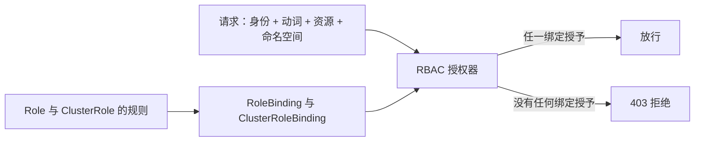
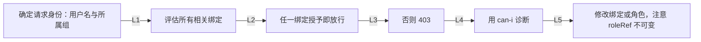

# RBAC排查参考

## 是什么
- **一句话定位**：RBAC 决定"某个身份能不能对某类资源做某个动作"。规则只有放行、没有拒绝，多个绑定的权限取并集；没有任何绑定授予的，一律拒绝。
- **解决什么问题**：看到 403、创建角色被拒、服务账号没权限、绑定了却不生效时，判断问题在身份识别、角色规则、绑定的范围，还是防提权规则。
- **谁在用、从哪进来**：所有经过 apiserver 的请求都会在认证之后、准入之前经过授权；RBAC 是最常见的授权器。
- **边界（不负责什么）**：请求如何被认证、准入 webhook 的行为见 apiserver排查参考；证书如何签发见 集群证书排查参考；Node 授权与准入策略类组件本条未展开。
- **形态与版本**：RBAC API 在 rbac.authorization.k8s.io/v1 下稳定；授权器的启用方式取决于 apiserver 的启动参数或授权配置文件。
- **术语**：
  - Role 与 ClusterRole —— 一组权限；前者限定在某个命名空间，后者可用于全集群、集群级资源与非资源 URL
  - 绑定 —— 把角色授予 subjects（用户、组、服务账号）
  - 防提权 —— 不能创建授予超出自己所拥有权限的角色或绑定
  - 聚合角色 —— 通过标签自动合并其他角色规则的 ClusterRole

## 组件与架构

| 组件 | 角色 | 职责 | 部署位置 / 形态 | 如何找到 |
|---|---|---|---|---|
| Role 与 ClusterRole | 声明 | 定义权限规则 | apiserver 里的对象 | 对应对象的 rules |
| RoleBinding 与 ClusterRoleBinding | 声明 | 把角色授予 subjects | 同上 | 对应对象的 subjects 与 roleRef |
| RBAC 授权器 | 决策 | 评估请求是否被某个绑定授予 | apiserver 内 | apiserver 的授权配置 |
| 服务账号 | 身份 | 工作负载访问 API 的身份 | 命名空间内 | ServiceAccount 对象 |

## 正常链路（请求怎么走 / 正常行为）

### 资源匹配关系
| 编号 | 资源 A.字段 | → | 资源 B.字段 | 匹配规则 | 对不上时的表现 |
|---|---|---|---|---|---|
| R1 | Role 或 ClusterRole 的 rules | → | 授予的权限 | 规则由 apiGroups、resources、verbs 组成，空字符串的 apiGroups 表示核心组；权限纯叠加，没有拒绝规则 | 某个动作没被任何规则覆盖：403；想用"拒绝"收权限做不到，只能删绑定 |
| R2 | 绑定的 roleRef | → | 被授予的角色 | RoleBinding 可引用 ClusterRole，只在绑定所在命名空间生效；创建后 roleRef 不能修改，要换角色必须删除重建 | 想改绑定的角色却被拒：roleRef 不可变 |
| R3 | 绑定的 subjects | → | 请求的身份 | subjects 可为用户、组、服务账号，名字区分大小写；服务账号的用户名形如 system:serviceaccount 加命名空间与名字，其所属组为 system:serviceaccounts 加命名空间〔待复核〕 | 名字大小写不对或命名空间写错：绑定了却不生效 |
| R4 | 绑定的类型 | → | 权限生效的范围 | RoleBinding 只在其命名空间内生效；ClusterRoleBinding 在整个集群生效；集群级资源与非资源 URL 需要 ClusterRole 加 ClusterRoleBinding | 用 RoleBinding 授予集群级资源的权限：不生效 |
| R5 | 聚合 ClusterRole 的标签 | → | 合并的规则 | 带 aggregate-to-* 标签的 ClusterRole 的规则会自动并入对应的父角色 | 标签写错：规则没有并入，父角色权限不全 |
| R6 | 创建或更新角色与绑定的请求 | → | 防提权检查 | 只有已拥有该角色包含的全部权限等条件下才能修改角色；创建绑定也要拥有被授予的权限，或持有 escalate 与 bind 动词〔待复核〕 | 想授予自己没有的权限：创建被拒绝，错误指向提权 |
| R7 | system:masters 组 | → | 是否绕过 RBAC | 该组由 apiserver 里硬编码的绑定获得 cluster-admin，不能通过 API 删除，绕过授权〔待复核〕 | 某凭据属于这个组：任何 RBAC 规则对它都不起作用，也无法收回 |
| R8 | apiserver 的授权配置 | → | RBAC 是否启用 | 授权器可通过启动参数或授权配置文件的 authorizers 列表配置，类型 RBAC；顺序有意义，见 apiserver排查参考 | 没启用 RBAC：创建的角色与绑定不会被用来决策 |

### 控制面下发路径
| 环节 | 做什么 | 依据 |
|---|---|---|
| P1 | 在 apiserver 上启用 RBAC 授权器 | R8 |
| P2 | 管理员创建 Role 与 ClusterRole，声明权限 | R1 R5 |
| P3 | 创建绑定，把角色授予 subjects，创建时要通过防提权检查 | R2 R3 R6 |
| P4 | 请求到达时，授权器按请求的身份、动词、资源、命名空间查找能放行的绑定〔待复核〕 | R3 R4 |
| P5 | 策略通过 Kubernetes API 动态配置，改动后无需重启 apiserver | R1 R2 |

### 流量走向（或生命周期）

| 环节 | 起点 → 终点 | 做什么 | 依据 | 同步/异步与默认行为 |
|---|---|---|---|---|
| L1 | 请求 → 身份 | 由认证确定用户名与所属组，RBAC 只看这个结果 | R3 | 认证先于授权 |
| L2 | 身份 → 绑定 | 找出所有授予该用户或其所属组的绑定，把各角色规则取并集 | R1 R2 R4 | 纯叠加 |
| L3 | 并集 → 决定 | 规则覆盖该动词、资源、命名空间即放行，否则拒绝 | R1 R4 | 默认拒绝 |
| L4 | 诊断 | 用 kubectl auth can-i 检查某身份的某权限，--list 列出全部〔待复核〕 | R3 | 手动 |
| L5 | 变更 | 增删绑定或角色；换角色需删除重建绑定 | R2 | 动态生效 |

### 正常表现（健康基线）
- 每个身份只有完成工作所需的最小权限；工作负载用各自的服务账号。
- 没有日常凭据带 system:masters；权限变更通过绑定的增删完成。
- 聚合角色的标签正确，父角色包含预期规则。

## 逐环节排查（沿链路对照）
- **P1 启用**
  - 正常：RBAC 授权器已启用。
  - 异常：授权配置里没有 RBAC。
  - 区分点：创建的角色与绑定完全不起作用，先确认授权器配置（R8）。
  - 证据落点：apiserver 的授权配置。
- **P2 角色规则**
  - 正常：规则覆盖所需的动词与资源。
  - 异常：缺动词、缺资源、apiGroups 写错。
  - 区分点：核心资源的 apiGroups 写成空字符串，写成别的就匹配不上（R1）。
  - 证据落点：角色的 rules。
- **P3 创建绑定**
  - 正常：绑定创建成功。
  - 异常：被防提权拒绝；想改 roleRef 被拒。
  - 区分点：被拒是因为创建者自己没有被授予的权限，或 roleRef 不可变，需要删除重建（R2、R6）。
  - 证据落点：创建时的错误信息；创建者自身的权限。
- **P4 请求评估**
  - 正常：能找到放行的绑定。
  - 异常：找不到，403。
  - 区分点：先确认身份是谁、属于哪些组，再看哪些绑定针对它们（R3）。
  - 证据落点：403 错误信息里的身份、动词、资源。
- **P5 动态生效**
  - 正常：改动立即生效。
  - 异常：改了没效果。
  - 区分点：看是否改对了对象、是否在正确的命名空间。
  - 证据落点：绑定对象的最新内容。
- **L1 身份**
  - 正常：身份与预期一致。
  - 异常：服务账号的命名空间或名字写错；组映射不对。
  - 区分点：服务账号要写完整身份，名字区分大小写（R3）。
  - 证据落点：subjects 的 kind、name、namespace。
- **L2 评估绑定**
  - 正常：相关绑定被找到。
  - 异常：绑定的范围不对。
  - 区分点：RoleBinding 只在自己的命名空间内有效，跨命名空间或集群级资源需 ClusterRoleBinding（R4）。
  - 证据落点：绑定的类型与命名空间。
- **L3 决定**
  - 正常：放行。
  - 异常：403。
  - 区分点：403 说明没有任何绑定授予；RBAC 没有拒绝规则，所以不会是"被某条规则拒绝"。
  - 证据落点：错误信息；can-i 的结果。
- **L4 诊断**
  - 正常：can-i 给出明确结论。
  - 异常：不知道身份到底有什么权限。
  - 区分点：用 --list 列出某身份在命名空间内可做的全部操作〔待复核〕。
  - 证据落点：can-i 的输出。
- **L5 变更**
  - 正常：按需调整。
  - 异常：想收回权限。
  - 区分点：只能删除授予它的绑定，不能写拒绝规则（R1）。
  - 证据落点：所有授予该身份的绑定。

## 异常归因速查
| 现象 / 错误码 | 环节 | 归因类别（回指 R#） | 证据位 | 详细条目 |
|---|---|---|---|---|
| 403 Forbidden | L3 | 没有任何绑定授予该身份此权限（R1、R4） | 错误信息里的身份、动词、资源 | oss/k8s-apiserver.md |
| 绑定了角色仍然 403 | L1 L2 | subjects 写错，或绑定范围不对（R3、R4） | 绑定的 subjects 与类型 | |
| 命名空间内能访问，跨命名空间不行 | L2 | 用了 RoleBinding，只在本命名空间生效（R4） | 绑定的类型 | |
| 集群级资源没有权限 | L2 | 需要 ClusterRole 加 ClusterRoleBinding（R4） | 绑定的类型 | |
| 修改 roleRef 失败 | P3 | roleRef 创建后不可变，需删除重建（R2） | 绑定对象 | |
| 创建角色或绑定被拒绝 | P3 | 防提权：创建者没有被授予的权限（R6） | 创建者的权限；错误信息 | |
| 聚合角色缺少预期规则 | P2 | aggregate 标签写错（R5） | 角色的标签 | |
| 创建了角色绑定毫无效果 | P1 | RBAC 授权器没启用（R8） | 授权配置 | oss/k8s-apiserver.md |
| 某凭据不受任何 RBAC 规则限制 | L2 | 凭据属于 system:masters（R7）〔待复核〕 | 凭据所属组 | oss/k8s-certs.md |
| 服务账号权限不对 | L1 | 身份写法或命名空间不对（R3） | 服务账号的完整身份 | |
| 想收回权限 | L5 | 只能删除绑定，没有拒绝规则（R1） | 授予该身份的所有绑定 | |
| 监控的服务发现缺权限 | P4 | Prometheus 的服务账号没有 get、list、watch（R1） | 角色规则 | oss/monitoring-pipeline.md |

## 状态、事件与日志语义
| 来源 | 取值 | 含义 | 常见出现环节 |
|---|---|---|---|
| 响应码 | 403 Forbidden | 授权拒绝，错误信息写明身份、动词、资源与命名空间〔待复核〕 | L3 |
| 命令 | kubectl auth can-i 与 --as、--list | 检查某身份的某权限，或列出其全部权限〔待复核〕 | L4 |
| 动词 | escalate、bind | 放行提权限制的特殊动词〔待复核〕 | P3 |
| 标签 | rbac.authorization.k8s.io/aggregate-to-admin、aggregate-to-edit | 把规则聚合进对应父角色 | P2 |
| 默认 ClusterRole | cluster-admin、admin、edit、view | 常用的内置角色〔待复核〕 | P2 |

## 配置语义
| 配置项 | 默认 / 取值含义 | 改动后的行为后果 |
|---|---|---|
| 规则的 apiGroups | 空字符串表示核心组 | 写错组则匹配不上 |
| roleRef | 创建后不可变 | 换角色要删除重建 |
| 绑定类型 | RoleBinding 限命名空间，ClusterRoleBinding 全集群 | 决定权限生效范围 |
| 聚合标签 | aggregate-to-* | 决定规则是否并入父角色 |
| 授权配置 | 授权器列表，类型含 RBAC，顺序有意义 | 决定哪个授权器先判断 |

## 边界与置信度说明
- **来源**：Kubernetes 官方 RBAC 文档给出四类对象、纯叠加、RoleBinding 引用 ClusterRole、roleRef 不可变及其原因、聚合角色、防提权、授权配置；system:masters 的硬编码绑定、can-i 的用法、服务账号命名、默认角色来自二手资料。没有做过运行时取证。
- **〔待复核〕项**：服务账号的用户名与所属组的命名；escalate 与 bind 动词的精确语义；system:masters 的绕过范围；403 错误信息的精确格式；默认 ClusterRole 的清单。
- **版本差异**：授权配置文件（AuthorizationConfiguration）在较新版本才支持，旧版本只用启动参数。
- **未覆盖**：资源名与子资源的细粒度规则；Node 授权与 NodeRestriction；impersonation；webhook 授权器；审计日志里的 RBAC 事件；多租户的 RBAC 设计；默认 ClusterRole 的完整规则；引导与自举时的权限。
- **related**：见 frontmatter。
