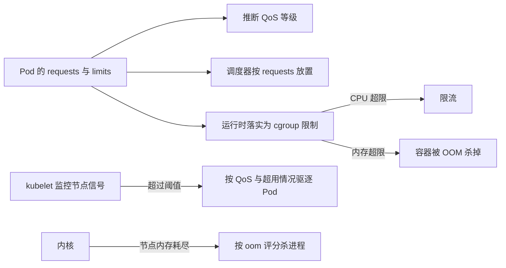
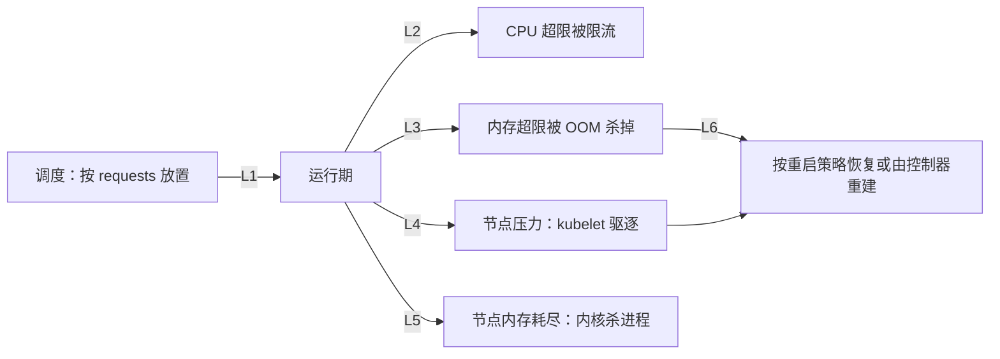

# 资源与QoS排查参考

## 是什么
- **一句话定位**：容器的 requests 与 limits 如何变成调度依据、运行期限制和被杀的顺序。"容器被杀"其实有三种完全不同的来源：容器超出自己的内存限制被 OOM 杀掉；kubelet 因节点压力驱逐 Pod；节点内存耗尽时内核 OOM killer 选进程杀。
- **解决什么问题**：看到 OOMKilled、Evicted、响应变慢、重启时，先分清是哪一种，再找对应的证据，避免把驱逐当 OOM、把 CPU 限流当应用慢。
- **谁在用、从哪进来**：所有设置了或没设置资源的容器；调度器用 requests，kubelet 与运行时落实 limits，kubelet 做节点压力下的驱逐。
- **边界（不负责什么）**：调度器如何用 requests 选节点见 调度排查参考；节点状况与污点见 节点排查参考；容器退出后的重启行为见 Pod排查参考；ephemeral-storage 的限制、LimitRange 与 ResourceQuota 本条未展开。
- **形态与版本**：QoS 等级由 Kubernetes 根据请求与限制推断，不能直接设置；驱逐的默认阈值在 Windows 节点上不同。
- **术语**：
  - requests —— 容器至少需要的资源，用于调度，也影响驱逐
  - limits —— 容器最多可用的资源
  - QoS 等级 —— Guaranteed、Burstable、BestEffort
  - 驱逐 —— kubelet 因节点资源压力主动终止 Pod
  - 限流 —— CPU 超限时被压低可用时间，而不是被杀

## 组件与架构

| 组件 | 角色 | 职责 | 部署位置 / 形态 | 如何找到 |
|---|---|---|---|---|
| 调度器 | 控制面 | 用 requests 与节点可分配量比较，决定能否放置 | 控制面 | 见 调度排查参考 |
| 容器运行时与 cgroup | 节点 | 把 limits 落成内核限制 | 每个节点 | 容器的 cgroup 配置 |
| kubelet 驱逐管理器 | 节点 | 监控节点信号，超过阈值时驱逐 Pod | 每个节点 | kubelet 配置与日志 |
| 内核 OOM killer | 节点 | 节点或 cgroup 内存耗尽时选进程杀 | 内核 | 内核日志 |

## 正常链路（请求怎么走 / 正常行为）

### 资源匹配关系
| 编号 | 资源 A.字段 | → | 资源 B.字段 | 匹配规则 | 对不上时的表现 |
|---|---|---|---|---|---|
| R1 | 各容器的 requests 与 limits | → | Pod 的 QoS 等级 | Guaranteed：每个容器都同时设置 CPU 与内存的请求和限制且相等；BestEffort：没有任何内存或 CPU 的请求与限制（其他资源不算）；其余为 Burstable；等级由系统推断，不能直接设置 | 以为设了 limits 就是 Guaranteed：请求与限制不相等或有缺项就是 Burstable |
| R2 | requests | → | 调度时节点的占用 | 请求为调度预留容量，是调度器比较的依据，也影响驱逐决策 | 请求写得过大：调度不上；写得过小：被放得太密，压力下先被驱逐 |
| R3 | CPU limit | → | 运行期 CPU 行为 | 超过限制时容器被限流，不会被终止〔待复核〕 | 延迟升高但容器没有重启：多是被限流，不是应用本身慢 |
| R4 | 内存 limit | → | 运行期内存行为 | 超过限制时容器可能被 OOM 杀掉，限制是被动执行的；容器以 OOMKilled 与退出码 137 结束〔待复核〕 | 容器反复重启且最近一次终止原因为 OOMKilled |
| R5 | QoS 等级与是否超出请求 | → | 节点压力下的驱逐顺序 | 先驱逐 BestEffort，再 Burstable，最后 Guaranteed；因资源压力驱逐时，只有超出请求的 Pod 才是候选 | 没超用请求的 Pod 不会因压力被驱逐；Burstable 在所有 BestEffort 之后才被驱逐 |
| R6 | 节点信号与阈值 | → | 是否触发驱逐 | 硬阈值立即驱逐、不给宽限期；软阈值需持续超过宽限期；默认硬阈值：内存可用小于 100Mi（Linux）、nodefs 可用小于 10%、imagefs 可用小于 15%、两类 inode 剩余小于 5% | 节点内存还剩不少但已有驱逐：阈值被调高，或信号口径与直观不同 |
| R7 | 容器的 OOM 评分 | → | 内核杀谁 | Guaranteed 评分最低、BestEffort 最高，Burstable 与其内存请求占比相关；超过自己请求的进程更容易被杀；系统关键进程评分被设得很低〔待复核〕 | 节点内存耗尽时，BestEffort 或超用的 Burstable 先被杀 |

### 控制面下发路径
| 环节 | 做什么 | 依据 |
|---|---|---|
| P1 | 用户声明 requests 与 limits，系统据此推断 QoS 等级 | R1 |
| P2 | 调度器用 requests 与节点可分配量比较，决定放置 | R2 |
| P3 | kubelet 与运行时把 limits 落实成 cgroup 的限制，并设置容器的 OOM 评分〔待复核〕 | R3 R4 R7 |
| P4 | kubelet 持续监控节点信号，超过硬阈值立即驱逐，超过软阈值并持续满宽限期后驱逐 | R5 R6 |

### 流量走向（或生命周期）

| 环节 | 起点 → 终点 | 做什么 | 依据 | 同步/异步与默认行为 |
|---|---|---|---|---|
| L1 | 调度 | 按请求把 Pod 放到有足够可分配量的节点 | R2 | 一次性 |
| L2 | 运行期 CPU | 超过 CPU 限制则被限流 | R3 | 持续，不终止容器 |
| L3 | 运行期内存 | 容器超过内存限制被 OOM 杀掉，终止原因为 OOMKilled | R4 | 被动执行，发生在容器级 |
| L4 | 节点压力 | 节点信号越过阈值，kubelet 按 QoS 与超用情况驱逐 Pod | R5 R6 | 硬阈值立即，软阈值有宽限期 |
| L5 | 节点内存耗尽 | 内核按 OOM 评分杀进程，是节点级的兜底 | R7 | 内核行为 |
| L6 | 恢复 | 容器被杀后按重启策略重启；被驱逐的 Pod 由其控制器按需重建 | R4 R5 | 见 Pod排查参考 |

### 正常表现（健康基线）
- 关键工作负载设置了合适的 requests 与 limits，QoS 等级符合预期。
- 没有容器因 OOMKilled 反复重启；没有持续的 CPU 限流。
- 节点的 MemoryPressure、DiskPressure 为假，没有意外驱逐。

## 逐环节排查（沿链路对照）
- **P1 声明与 QoS**
  - 正常：QoS 等级与预期一致。
  - 异常：只设置了 limits 或请求不等于限制，等级不是预期的 Guaranteed。
  - 区分点：有二手资料称"只写 limits 不写 requests 会被归为 BestEffort"，这与 Kubernetes 的默认做法（缺省的请求取 limit）不一致，以官方资源管理页为准〔待复核〕。
  - 证据落点：Pod 的 QoS 等级；各容器的资源设置。
- **P2 调度**
  - 正常：按请求放置成功。
  - 异常：请求过大无法调度。
  - 区分点：见 调度排查参考的 Insufficient cpu 与 Insufficient memory。
  - 证据落点：调度事件。
- **P3 落实限制**
  - 正常：限制被落成 cgroup 设置。
  - 异常：容器的实际限制与声明不符。
  - 区分点：个别节点行为不同，查运行时与 cgroup 版本。
  - 证据落点：容器的 cgroup 配置。
- **P4 驱逐监控**
  - 正常：信号在阈值之内。
  - 异常：阈值设置不当，过早或过晚驱逐。
  - 区分点：对照默认硬阈值与实际配置，注意 Windows 节点的内存阈值是 500Mi。
  - 证据落点：kubelet 的驱逐配置；节点状况。
- **L1 放置**
  - 正常：节点有余量。
  - 异常：请求之和逼近节点可分配量，没有缓冲。
  - 区分点：请求之和只反映账面，不反映实时使用。
  - 证据落点：节点已分配请求与可分配量。
- **L2 CPU 限流**
  - 正常：CPU 使用在限制之内。
  - 异常：延迟升高、吞吐下降而容器没有重启。
  - 区分点：容器没有被终止、也没有重启记录，只是慢，先怀疑被限流而非应用错误〔待复核〕。
  - 证据落点：容器的限流计数；CPU limit 与实际使用。
- **L3 内存超限**
  - 正常：内存使用在限制之内。
  - 异常：容器被杀，最近一次终止原因为 OOMKilled，退出码 137〔待复核〕。
  - 区分点：OOMKilled 是容器级的，发生在容器自己的限制处，与节点是否紧张无关；重启行为见 Pod排查参考的 R5。
  - 证据落点：容器上一次终止的 reason 与退出码；内存 limit 与实际使用。
- **L4 kubelet 驱逐**
  - 正常：节点信号在阈值内。
  - 异常：Pod 被驱逐，节点出现 MemoryPressure 或 DiskPressure。
  - 区分点：被驱逐的是整个 Pod，不是某个容器；顺序看 QoS，且只有超出请求的 Pod 才是候选（R5）；硬阈值立即杀，软阈值先给宽限期。
  - 证据落点：Pod 的终止原因与信息；节点状况；kubelet 的驱逐日志与阈值。
- **L5 内核 OOM**
  - 正常：节点内存充足。
  - 异常：节点内存耗尽，内核杀进程，可能是容器内的进程，也可能波及节点级进程。
  - 区分点：这是内核层的兜底，不经过 kubelet 的驱逐流程；评分低的更安全（R7）。
  - 证据落点：内核日志里的 OOM 记录与被杀进程。
- **L6 恢复**
  - 正常：被杀的容器按策略重启。
  - 异常：反复重启进入退避。
  - 区分点：详见 Pod排查参考的 L5。
  - 证据落点：容器重启次数与终止原因。

## 异常归因速查
| 现象 / 错误码 | 环节 | 归因类别（回指 R#） | 证据位 | 详细条目 |
|---|---|---|---|---|
| OOMKilled 与退出码 137 | L3 | 容器超出自己的内存限制（R4） | 最近一次终止原因；内存 limit | oss/k8s-pod.md |
| 延迟升高但容器没有重启 | L2 | CPU 限流（R3） | CPU limit 与限流计数 | |
| Pod 被驱逐（Evicted） | L4 | kubelet 因节点压力驱逐（R5、R6） | Pod 的终止原因；节点状况 | oss/k8s-node.md |
| 节点 MemoryPressure 或 DiskPressure | L4 P4 | 信号越过驱逐阈值（R6） | 节点状况；kubelet 阈值 | oss/k8s-node.md |
| 压力下 Burstable 先于 Guaranteed 被驱逐 | L4 | QoS 顺序与超用请求（R1、R5） | QoS 等级；实际用量对请求 | |
| 没超用请求的 Pod 没被驱逐 | L4 | 只有超出请求的 Pod 才是驱逐候选（R5） | 用量与请求 | |
| 节点内存还有余量却被驱逐 | L4 | 阈值被调高或信号口径不同（R6） | kubelet 的驱逐配置 | |
| 节点内存耗尽后进程被杀 | L5 | 内核 OOM 按评分杀进程（R7） | 内核日志 | |
| 等级不是预期的 Guaranteed | P1 | 请求与限制不相等或有缺项（R1） | 各容器资源设置 | |
| 请求设得太大调度不上 | P2 L1 | 请求超过各节点可分配余量（R2） | 调度事件 | oss/k8s-scheduling.md |

## 状态、事件与日志语义
| 来源 | 取值 | 含义 | 常见出现环节 |
|---|---|---|---|
| QoS 等级 | Guaranteed、Burstable、BestEffort | 由请求与限制推断，决定驱逐顺序 | P1 L4 |
| 容器终止原因 | OOMKilled | 因超出内存限制被杀〔待复核〕 | L3 |
| 容器退出码 | 137 | 被 SIGKILL 终止，常见于 OOM〔待复核〕 | L3 |
| Pod 状态 | Evicted | 被 kubelet 因节点压力驱逐〔待复核〕 | L4 |
| 节点状况 | MemoryPressure、DiskPressure、PIDPressure | 对应资源越过驱逐信号〔待复核〕 | L4 |
| 驱逐信号 | memory.available、nodefs.available、imagefs.available、nodefs.inodesFree、imagefs.inodesFree | kubelet 监控的资源信号 | P4 |

## 配置语义
| 配置项 | 默认 / 取值含义 | 改动后的行为后果 |
|---|---|---|
| requests | 调度用，且影响驱逐 | 调大则占用更多可调度容量，调小则更容易被放得过密 |
| limits | CPU 限流、内存 OOM | CPU 限制过低会限流，内存限制过低会 OOM |
| 默认硬驱逐阈值 | memory.available 小于 100Mi（Windows 为 500Mi）、nodefs.available 小于 10%、imagefs.available 小于 15%、两类 inode 小于 5% | 硬阈值立即驱逐，不给宽限期 |
| eviction-soft 与宽限期 | 软阈值需持续满宽限期才驱逐 | 未指定最大宽限期时被驱逐的 Pod 立即被杀 |
| Memory QoS（cgroup v2） | 自 v1.22 起为 alpha，默认关闭 | 开启后用请求与限制设置 memory.min 等接口 |

## 边界与置信度说明
- **来源**：Kubernetes 官方 Pod QoS 页与 Node-pressure Eviction 页（含默认阈值）；内核 OOM 评分来自较早的官方设计文档存档；CPU 限流、内存 OOM 的运行期行为、OOMKilled 与退出码 137 来自二手资料，官方资源管理页本次没取到。
- **〔待复核〕项**：CPU 限流与内存 OOM 的运行期语义；OOMKilled 与 137 的对应；Evicted 与节点状况的名称；当前版本的 OOM 评分取值；缺省请求取 limit 的默认做法。
- **版本差异**：官方页提到 Windows 节点的默认内存硬阈值不同；Memory QoS 与 Pod 级资源设置等特性随版本演进。
- **未覆盖**：ephemeral-storage 与临时存储的限制；LimitRange 与 ResourceQuota；Pod 级资源（Pod-level resources）；原地调整资源；PID 压力的细节；kubelet 预留（kubeReserved、systemReserved）与可分配量的计算。
- **related**：见 frontmatter。
