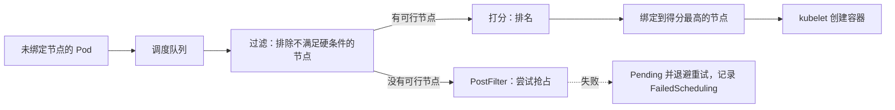
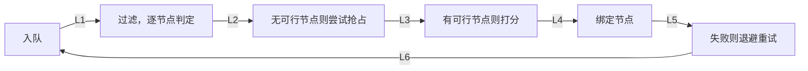

# 调度排查参考

## 是什么
- **一句话定位**：kube-scheduler 如何为一个尚未绑定节点的 Pod 选节点：先过滤出可行节点，再打分挑最高者，没有可行节点时才考虑抢占，选不出就让 Pod 继续 Pending 并记录 FailedScheduling。
- **解决什么问题**：Pod 一直 Pending 时，调度事件里已经写了原因。这一条把事件文本里的每一类原因对应到过滤的哪一关，指出下一步该查什么。
- **谁在用、从哪进来**：所有新建 Pod 都经过它；Pod 通过 schedulerName 选择调度 profile，不指定则走默认调度器。
- **边界（不负责什么）**：Pod 一旦绑定节点之后的生命周期见 Pod排查参考；节点自身的状态、污点如何自动产生见 节点排查参考；requests 与 limits 的运行时语义见 资源与QoS排查参考，PVC 绑定本身见 存储排查参考，滚动更新见 工作负载控制器排查参考。
- **形态与版本**：运行在控制面，调度行为由 profile 里各扩展点的插件决定；事件文本的措辞随版本略有不同。
- **术语**：
  - 可行节点 —— 通过全部过滤的节点
  - 过滤与打分 —— 前者排除不满足硬条件的节点，后者给剩下的节点排名
  - 抢占 —— 终止较低优先级的 Pod，给较高优先级的 Pod 腾位置
  - 退避 —— 无法调度的 Pod 重试之间的等待

## 组件与架构

| 组件 | 角色 | 职责 | 部署位置 / 形态 | 如何找到 |
|---|---|---|---|---|
| kube-scheduler | 控制面 | 监视未绑定的 Pod，过滤、打分、绑定 | 控制面 | 调度器日志与 Pod 的调度事件 |
| 调度 profile | 配置 | 决定各扩展点启用哪些插件，Pod 经 schedulerName 选用 | 调度器配置 | KubeSchedulerConfiguration |
| 调度队列 | 内部 | 排序待调度的 Pod，管理无法调度的 Pod 与退避 | 调度器内 | 间接体现为 Pod 重试节奏 |
| 其他调度器 | 可选 | 为指定了不同 schedulerName 的 Pod 调度 | 独立部署 | Pod 的 schedulerName |

## 正常链路（请求怎么走 / 正常行为）

### 资源匹配关系
| 编号 | 资源 A.字段 | → | 资源 B.字段 | 匹配规则 | 对不上时的表现 |
|---|---|---|---|---|---|
| R1 | Pod.spec.schedulerName | → | 调度 profile 与调度器 | 不指定则由默认调度器处理；指定的名字要有对应的调度器在运行 | 指定了不存在的调度器：Pod 一直 Pending，没有任何 FailedScheduling 事件 |
| R2 | Pod 的资源请求 | → | 节点的可分配资源 | 过滤时检查候选节点可用资源是否满足 Pod 的请求，依据的是账面上的请求与可分配量 | 请求超过各节点剩余：事件为 Insufficient cpu 或 Insufficient memory |
| R3 | nodeSelector 与亲和性的 required 规则 | → | 节点标签 | 必须全部满足；preferred 类规则只影响打分，不会排除节点 | 没有节点带所需标签：事件为 didn't match Pod's node affinity/selector |
| R4 | 节点污点 | → | Pod 的容忍 | 节点带有 Pod 不容忍的污点就不可行〔待复核〕 | 事件为 node(s) had untolerated taint，并附污点键值 |
| R5 | 拓扑分布约束与反亲和 | → | 各域内已有的 Pod | 约束要求跨域均匀或互斥；已满足不了时没有可行节点〔待复核〕 | 事件为 didn't match pod topology spread constraints 或 didn't satisfy existing pods anti-affinity rules |
| R6 | Pod 引用的 PVC | → | 已绑定的存储 | PVC 未绑定时 Pod 不能调度；卷的位置限制也会限制节点〔待复核〕 | 事件为 pod has unbound immediate PersistentVolumeClaims |
| R7 | 可行节点集合 | → | 最终选中的节点 | 对通过过滤的节点打分，选最高分，同分随机；找到足够多可行节点后可提前停止继续查找，比例由 percentageOfNodesToScore 控制 | 大集群里并非每个节点都被评估，这属于设计行为 |
| R8 | 没有可行节点的情形 | → | 抢占 | 只有过滤后没有可行节点才调用 PostFilter 尝试抢占；通过终止较低优先级的 Pod 腾位置；优先级不够、preemptionPolicy 为 Never、或会违反 PDB 时抢占不成功〔待复核〕 | 事件后缀为 No preemption victims found for incoming pod |

### 控制面下发路径
| 环节 | 做什么 | 依据 |
|---|---|---|
| P1 | Pod 被创建且没有 nodeName，进入调度队列；调度器监视这类 Pod | R1 |
| P2 | 一个调度周期依次经过 PreFilter、Filter、（无可行节点时）PostFilter、PreScore、Score、Reserve、Permit | R2 R3 R4 R5 R6 R7 R8 |
| P3 | Bind 把 Pod 绑定到选中的节点，kubelet 随后接手 | R7 |
| P4 | 失败的 Pod 回到队列并退避重试，最大退避默认 10 秒，同时记录 FailedScheduling 事件 | R8 |

### 流量走向（或生命周期）

| 环节 | 起点 → 终点 | 做什么 | 依据 | 同步/异步与默认行为 |
|---|---|---|---|---|
| L1 | Pod → 队列 | 未绑定的 Pod 进入调度队列，按调度器的排序规则等待 | R1 | 异步 |
| L2 | 队列 → 过滤 | 逐个节点判定：资源、选择器与亲和、污点、拓扑、卷等，不通过就记下原因 | R2 R3 R4 R5 R6 | 同步；原因按节点数汇总进事件 |
| L3 | 过滤 → 抢占 | 没有可行节点时尝试抢占 | R8 | 仅在无可行节点时 |
| L4 | 过滤 → 打分 | 对可行节点排名并选最高分 | R7 | 同分随机；大集群可提前停止查找 |
| L5 | 打分 → 绑定 | 绑定到选中节点，Pod 进入下一阶段 | R7 | 成功后由 kubelet 接手 |
| L6 | 失败 → 重试 | 无法调度的 Pod 退避后重试；条件变化（如节点增加）时可再次尝试 | R8 | 最大退避默认 10 秒 |

### 正常表现（健康基线）
- Pod 创建后很快被绑定到节点，没有持续的 FailedScheduling。
- 事件里 N/M 中 N 不为 0；各节点的剩余资源与 Pod 请求匹配。
- 污点、选择器、亲和性与集群实际的节点标签、污点一致。

## 逐环节排查（沿链路对照）
- **P1 入队**
  - 正常：未绑定的 Pod 被调度器看到。
  - 异常：指定的 schedulerName 没有对应调度器，Pod 无人处理且没有事件。
  - 区分点：Pending 且完全没有 FailedScheduling 事件，先看 schedulerName（R1）。
  - 证据落点：Pod 的 schedulerName；调度器是否运行。
- **P2 一个调度周期**
  - 正常：各扩展点按顺序完成。
  - 异常：某一关使所有节点都不通过。
  - 区分点：FailedScheduling 的汇总计数就是答案，计数最大的原因优先处理。
  - 证据落点：describe 输出里的事件文本。
- **P3 绑定**
  - 正常：Pod 得到 nodeName。
  - 异常：绑定失败后回到队列。
  - 区分点：绑定之后 kubelet 的问题，见 Pod排查参考。
  - 证据落点：Pod 的 nodeName；调度器日志。
- **P4 退避重试**
  - 正常：条件满足后很快重试成功。
  - 异常：长期不重试或重试间隔很长。
  - 区分点：无法调度的 Pod 有最大退避，默认 10 秒，不是无限延长。
  - 证据落点：事件的重复次数与间隔。
- **L1 入队**
  - 正常：Pod 进入队列。
  - 异常：见 P1。
  - 区分点：同 P1。
  - 证据落点：同 P1。
- **L2 过滤**
  - 正常：至少有一个节点通过。
  - 异常：Insufficient cpu 或 Insufficient memory：节点账面资源已满；untolerated taint：缺容忍；didn't match node affinity/selector：缺标签；unbound PVC：存储没绑定；topology spread 或 anti-affinity：约束无法满足〔待复核〕。
  - 区分点：资源不足看的是请求与可分配量的账面差，不是节点实时负载；各原因对应的下一步见速查表。
  - 证据落点：事件的原因汇总；节点的可分配量与已分配请求；节点标签与污点。
- **L3 抢占**
  - 正常：优先级足够时能腾出位置。
  - 异常：No preemption victims found。
  - 区分点：优先级不高、PreemptionPolicy 为 Never，或抢占会违反 PDB〔待复核〕。
  - 证据落点：Pod 的优先级与 PreemptionPolicy；相关 PDB。
- **L4 打分**
  - 正常：选出得分最高的节点。
  - 异常：期望落到某节点却没落。
  - 区分点：preferred 规则只影响打分，不是硬条件；大集群可能没评估到所有节点（R7）。
  - 证据落点：preferred 规则的权重；percentageOfNodesToScore 的设置。
- **L5 绑定**
  - 正常：绑定成功。
  - 异常：绑定后仍无法启动。
  - 区分点：转到 Pod排查参考。
  - 证据落点：Pod 的 nodeName 与状态。
- **L6 重试**
  - 正常：条件变化后重试成功。
  - 异常：条件已变化仍 Pending。
  - 区分点：新增节点上的标签或污点与 Pod 要求不匹配时，扩容也不会解决（见速查表）〔待复核〕。
  - 证据落点：新节点的标签与污点。

## 异常归因速查
| 现象 / 错误码 | 环节 | 归因类别（回指 R#） | 证据位 | 详细条目 |
|---|---|---|---|---|
| Pending 且没有任何调度事件 | P1 | 指定的 schedulerName 没有调度器处理（R1） | Pod 的 schedulerName | oss/k8s-pod.md |
| Insufficient cpu 或 Insufficient memory | L2 | 请求超过各节点剩余可分配量（R2） | 节点的可分配量与已分配请求 | oss/k8s-resources.md |
| node(s) had untolerated taint | L2 | 缺少对应容忍（R4） | 节点污点；Pod 容忍 | oss/k8s-node.md |
| didn't match Pod's node affinity/selector | L2 | 没有节点带所需标签（R3） | 节点标签；Pod 的选择器 | |
| unbound immediate PersistentVolumeClaims | L2 | PVC 没绑定（R6） | PVC 状态 | oss/k8s-storage.md |
| didn't match pod topology spread constraints | L2 | 拓扑分布约束无法满足（R5） | 约束与各域 Pod 数 | |
| didn't satisfy existing pods anti-affinity rules | L2 | 反亲和与已有 Pod 冲突（R5） | 反亲和规则；已有 Pod 分布 | |
| No preemption victims found | L3 | 优先级不够、PreemptionPolicy 为 Never 或违反 PDB（R8） | 优先级；PDB | |
| 新增节点后 Pod 仍 Pending | L6 | 新节点的标签或污点与 Pod 要求不匹配（R3、R4） | 新节点标签与污点 | |
| 大集群里某些节点从未被选中 | L4 | 提前停止查找，并非每个节点都被评估（R7） | percentageOfNodesToScore | |
| 节点失联后其上 Pod 不再被调度回来 | L2 | 节点带 unreachable 或 not-ready 污点（R4） | 节点污点 | oss/k8s-node.md |

## 状态、事件与日志语义
| 来源 | 取值 | 含义 | 常见出现环节 |
|---|---|---|---|
| 事件 | FailedScheduling | 调度失败，原因在消息里〔待复核〕 | L2 |
| 事件消息 | 0/N nodes are available | N 个节点里没有一个通过过滤，之后按原因汇总计数 | L2 |
| 事件消息 | Insufficient cpu、Insufficient memory | 节点账面资源不足 | L2 |
| 事件消息 | node(s) had untolerated taint | 有未被容忍的污点，较早版本措辞为 had taint 且 the pod didn't tolerate〔待复核〕 | L2 |
| 事件消息 | didn't match Pod's node affinity/selector | 选择器或亲和性无节点满足 | L2 |
| 事件消息 | unbound immediate PersistentVolumeClaims | PVC 未绑定 | L2 |
| 事件消息 | preemption 后接 No preemption victims found | 抢占也找不到可终止的 Pod | L3 |

## 配置语义
| 配置项 | 默认 / 取值含义 | 改动后的行为后果 |
|---|---|---|
| schedulerName | 不写则用默认调度器 | 写了不存在的名字，Pod 无人调度 |
| nodeSelector 与 required 亲和 | 硬条件 | 约束越多，可行节点越少 |
| preferred 亲和 | 只影响打分 | 不会让 Pod 因它而无法调度 |
| 优先级与 preemptionPolicy | 决定能否抢占，Never 表示不抢占 | 优先级为 0 的 Pod 不会抢占任何 Pod |
| percentageOfNodesToScore | 为 0 时按集群规模取 5% 到 50% | 调小加快调度，但评估的节点更少 |
| podMaxBackoffSeconds | 默认 10 秒 | 无法调度的 Pod 的最大退避 |

## 边界与置信度说明
- **来源**：Kubernetes 官方 kube-scheduler 与调度概念页（多个版本）以及调度器配置类型的源码注释；FailedScheduling 事件文本的具体措辞、各类原因的说明、抢占失败的原因来自二手资料，官方页没有逐条列出。
- **〔待复核〕项**：事件文本在各版本的精确措辞；污点与容忍的细节；拓扑分布与反亲和的具体报错；PVC 与卷拓扑对调度的限制；抢占与 PDB 的关系。
- **版本差异**：事件文本随版本变化，如较新版本的 untolerated taint 与较早版本的 had taint 且 the pod didn't tolerate；调度框架的扩展点与默认插件随版本增加。
- **未覆盖**：各过滤与打分插件的完整清单与权重；拓扑感知的工作负载调度（较新版本的 alpha 特性）；多调度器并存的配置；Pod Overhead；节点自动扩缩容与调度的配合；调度器指标与日志。
- **related**：见 frontmatter。
