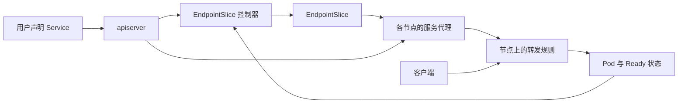
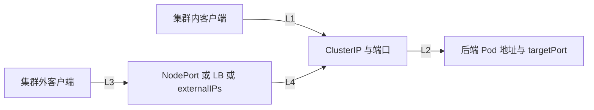

# Service排查参考

## 是什么
- **一句话定位**：Service 是给一组 Pod 提供稳定入口的抽象。Kubernetes 自己的逻辑到"Service → EndpointSlice → 后端 Pod 地址"为止，之后由各节点的代理把访问转到这些地址。
- **解决什么问题**：Pod 地址会变，Service 用 selector 圈定后端，由控制面维护后端列表，客户端只认一个稳定名字或虚拟 IP。
- **谁在用、从哪进来**：集群内客户端经 ClusterIP 或 DNS 名访问；集群外经 NodePort、LoadBalancer 或 externalIPs 访问；Ingress、Gateway 的后端也是 Service 或其端点。
- **边界（不负责什么）**：规则如何落到节点（iptables、IPVS、nftables）见 kube-proxy排查参考；Service 名如何解析见集群DNS排查参考；七层路由见 Ingress排查参考与 GatewayAPI排查参考。
- **形态与版本**：纯 API 对象加控制面逻辑，本条依据 v1.32 至 v1.34 文档。
- **术语**：
  - EndpointSlice —— 记录一个 Service 当前后端地址与状态的对象，一个 Service 可有多个
  - 端点条件 —— ready、serving、terminating，描述后端能否接流量
  - headless —— clusterIP 为 None，没有虚拟 IP
  - 无选择器 Service —— 没有 selector，后端由外部进程自行登记

## 组件与架构

| 组件 | 角色 | 职责 | 部署位置 / 形态 | 如何找到 |
|---|---|---|---|---|
| apiserver | 控制面 | 存放 Service 与 EndpointSlice，分配 ClusterIP〔待复核〕 | 控制面 | Service 对象的 clusterIP 字段 |
| EndpointSlice 控制器 | 控制面 | 按 selector 汇集 Pod 地址与状态，写入 EndpointSlice | kube-controller-manager 内〔待复核〕 | EndpointSlice 的 managed-by 标签为 endpointslice-controller.k8s.io |
| 服务代理（通常是 kube-proxy） | 数据面 | 监听 Service 与 EndpointSlice，在每个节点生成转发规则 | 每个节点 | 见 kube-proxy排查参考 |
| 自管端点的实体 | 外部依赖 | 为无选择器 Service 创建 EndpointSlice | 视情况 | EndpointSlice 的 managed-by 取值不同于上面的控制器 |

## 正常链路（请求怎么走 / 正常行为）

### 资源匹配关系
| 编号 | 资源 A.字段 | → | 资源 B.字段 | 匹配规则 | 对不上时的表现 |
|---|---|---|---|---|---|
| R1 | Service.spec.selector | → | Pod.metadata.labels | selector 的键值全部匹配的 Pod 成为后端；selector 为空时 Kubernetes 不管理端点 | selector 写错：EndpointSlice 里没有端点；selector 为空又无人登记：同样没有端点 |
| R2 | Service.spec.ports[].targetPort | → | Pod 容器的端口（数字，或具名端口） | 数字直接用；字符串则在目标 Pod 的容器端口里按名字查找；不写则取 port | 具名端口在 Pod 里不存在或与实际监听不符：后端地址有，但连不上 |
| R3 | Service | → | EndpointSlice | 通过 kubernetes.io/service-name 标签与属主引用关联；managed-by 标签标明谁在管理 | 找不到对应 EndpointSlice：该 Service 没有后端 |
| R4 | Pod 的 Ready 状态与删除时间戳 | → | EndpointSlice 端点的 serving、terminating、ready 条件 | serving 对应 Pod 的 Ready；terminating 在 Pod 收到删除时间戳时置位；ready 约等于 serving 且非 terminating | Pod 未 Ready：端点不会被当作可用后端；见下文 publishNotReadyAddresses 例外 |
| R5 | Service.spec.clusterIP | → | 虚拟 IP | 有 IP 则经代理转发；None 表示 headless，没有虚拟 IP，也不经代理 | headless 却期望固定入口 IP：拿不到；DNS 返回的是 Pod 地址列表 |
| R6 | Service 的流量策略字段 | → | 节点对流量的分发范围 | internalTrafficPolicy 为 Local：只用本机端点，没有则丢弃；externalTrafficPolicy 为 Local：保留客户端源 IP，不做第二跳，只在有本机端点的节点上服务 | 无本机端点：流量被丢；Cluster 策略下客户端源 IP 不保留〔待复核〕 |
| R7 | 无选择器 Service 对应的 Endpoints | → | EndpointSlice | 控制面镜像 Endpoints 为 EndpointSlice，例外：带 skip-mirror 标签、带 leader 注解、对应 Service 不存在、对应 Service 有选择器 | 例外情形下没有被镜像，Service 看起来"没有后端" |

### 控制面下发路径
| 环节 | 做什么 | 依据 |
|---|---|---|
| P1 | 用户创建或修改 Service，apiserver 保存；有虚拟 IP 的 Service 由 apiserver 分配 ClusterIP〔待复核〕 | R1 R2 R5 |
| P2 | EndpointSlice 控制器监听 Service 与 Pod，按 selector 汇集地址，写入 EndpointSlice，并随 Pod 状态更新端点条件 | R1 R3 R4 |
| P3 | 各节点的服务代理监听 Service 与 EndpointSlice 的变化，更新本机转发规则（具体机制见 kube-proxy排查参考） | R3 R4 R6 |

### 流量走向（或生命周期）

| 环节 | 起点 → 终点 | 做什么 | 依据 | 同步/异步与默认行为 |
|---|---|---|---|---|
| L1 | 客户端 → Service 虚拟 IP | 客户端访问 ClusterIP:port，或经 DNS 名解析到它 | R5 | headless 没有此环节，DNS 直接返回 Pod 地址 |
| L2 | 虚拟 IP → 后端 Pod | 节点上的规则选出一个可用端点，转到 Pod IP:targetPort | R1 R2 R4 R6 | 选哪个后端由代理模式与 sessionAffinity 决定；默认 sessionAffinity 为 None |
| L3 | 集群外 → 节点或 LB | 外部流量从 NodePort、外部负载均衡或 externalIPs 进入某个节点 | R6 | 分发范围受 externalTrafficPolicy 控制 |
| L4 | 节点 → Service 转发 | 进入节点后按与集群内相同的规则转到后端 | R4 R6 | Local 策略下只转给本机端点 |

### 正常表现（健康基线）
- Service 的 selector 命中预期数量的 Pod，EndpointSlice 里端点数与 Ready 的 Pod 数一致。
- 端点的 serving 为 true；terminating 为 false；正在滚动更新时，旧 Pod 终止期间短暂出现 terminating 为 true 属正常。
- targetPort 与 Pod 里进程实际监听的端口一致。

## 逐环节排查（沿链路对照）
- **P1 声明 Service**
  - 正常：Service 创建成功，需要虚拟 IP 的有 clusterIP。
  - 异常：clusterIP 未分配；字段写错，例如 selector 的键值与 Pod 标签不符；targetPort 具名端口拼错。
  - 区分点：对象在，但后端为空，先怀疑 selector（R1）；对象不在，是创建阶段的问题。
  - 证据落点：Service 对象的 spec 与 status。
- **P2 EndpointSlice 控制器汇集后端**
  - 正常：每个 Service 对应一到多个 EndpointSlice，地址与 Pod 一致，端点条件随 Pod 状态变化。
  - 异常：EndpointSlice 缺失或为空；端点都是 ready 为 false；带 skip-mirror 的 Endpoints 没被镜像。
  - 区分点：有 Pod、无端点，看 selector 与 Pod 标签是否匹配；有端点但 ready 为 false，问题在 Pod 就绪，而不在 Service。
  - 证据落点：带 kubernetes.io/service-name 标签的 EndpointSlice 的 endpoints 与 conditions。
- **P3 代理下发规则**
  - 正常：每个节点上都有这个 Service 对应的转发规则，端点变化后规则随之更新。
  - 异常：EndpointSlice 正确，但个别节点上规则缺失或陈旧。
  - 区分点：全部节点都不通指向前面环节；只有个别节点不通，看这些节点上的代理。
  - 证据落点：服务代理的日志与该节点规则，细节见 kube-proxy排查参考。
- **L1 访问虚拟 IP**
  - 正常：客户端到 ClusterIP:port 可达，名字能解析。
  - 异常：解析不到；解析到 Pod 地址而不是虚拟 IP（headless）；端口写成了 targetPort 而不是 port。
  - 区分点：名字解析失败看集群DNS排查参考；解析成功但连不上才进入后面的环节。
  - 证据落点：Service 的 clusterIP 与 ports；客户端解析结果。
- **L2 转到后端 Pod**
  - 正常：请求落到 Ready 的后端，targetPort 上有进程在监听。
  - 异常：连接被拒绝或超时；只有部分 Pod 收到流量；internalTrafficPolicy 为 Local 但本机没有端点而被丢弃。
  - 区分点：地址对、端口不通，核对 R2；只有本机端点可用的情形查 R6。
  - 证据落点：EndpointSlice 的端点与端口；Pod 实际监听的端口。
- **L3 外部流量入口**
  - 正常：外部地址能进入节点，LoadBalancer 有外部地址。
  - 异常：外部拿不到客户端源 IP；externalTrafficPolicy 为 Local 时，没有本机端点的节点不提供服务〔待复核〕。
  - 区分点：源 IP 丢失先看 externalTrafficPolicy 是否为 Cluster。
  - 证据落点：Service 的 externalTrafficPolicy 与 status 里的外部地址。
- **L4 节点到后端**
  - 正常：进入节点后按集群内同样的规则转发。
  - 异常：滚动更新期间流量中断；所有端点都在终止时的行为与预期不符。
  - 区分点：代理通常忽略 terminating 端点，但全部端点都在终止时可能继续转给同时 serving 的端点，这是设计行为，用来避免滚动更新丢流量。
  - 证据落点：EndpointSlice 端点的 serving 与 terminating。

## 异常归因速查
| 现象 / 错误码 | 环节 | 归因类别（回指 R#） | 证据位 | 详细条目 |
|---|---|---|---|---|
| Service 存在但后端列表为空 | P2 | selector 与 Pod 标签不匹配，或无选择器却无人登记（R1、R7） | EndpointSlice 的 endpoints | |
| 端点有，但 ready 为 false | P2 | Pod 未就绪（R4） | 端点 conditions；Pod 的 Ready | |
| 地址对、连接被拒绝 | L2 | targetPort 与进程实际监听不符，具名端口不存在（R2） | Service 的 targetPort；Pod 容器端口 | |
| 滚动更新期间部分请求失败 | L4 | 端点从 ready 到 terminating 的切换窗口（R4） | 端点 serving 与 terminating 的变化 | |
| 域名返回多个 Pod IP 而非一个虚拟 IP | L1 | headless 的预期行为（R5） | Service 的 clusterIP 为 None | |
| 外部访问拿不到客户端源 IP | L3 | 策略为 Cluster，源 IP 会被改写〔待复核〕（R6） | externalTrafficPolicy | |
| 部分节点访问不通 | L3 L4 | Local 策略下这些节点没有本机端点（R6） | 各节点的本机端点分布 | |
| 带 skip-mirror 的 Endpoints 对应服务无后端 | P2 | 未被镜像成 EndpointSlice（R7） | 对应 Endpoints 的标签 | |

## 状态、事件与日志语义
| 来源 | 取值 | 含义 | 常见出现环节 |
|---|---|---|---|
| EndpointSlice 端点条件 | serving | 端点正在提供服务，应作为 Service 流量目标；对 Pod 端点对应 Pod 的 Ready | P2 L4 |
| EndpointSlice 端点条件 | terminating | 端点在终止；Pod 收到删除时间戳时置位，通常早于容器真正退出 | P2 L4 |
| EndpointSlice 端点条件 | ready | 约等于 serving 且非 terminating；publishNotReadyAddresses 为 true 时恒为 true | P2 |
| EndpointSlice 标签 | endpointslice.kubernetes.io/managed-by | 标明管理者；官方控制器的取值是 endpointslice-controller.k8s.io | P2 |
| EndpointSlice 标签 | kubernetes.io/service-name | 标明所属 Service，便于按 Service 列出全部 slice | P2 |
| Endpoints 标签 | endpointslice.kubernetes.io/skip-mirror | 值为 true 时不镜像成 EndpointSlice | P2 |

## 配置语义
| 配置项 | 默认 / 取值含义 | 改动后的行为后果 |
|---|---|---|
| spec.selector | 为空表示端点由外部进程管理，Kubernetes 不修改 | 空 selector 且无人登记则没有端点 |
| ports[].targetPort | 数字，或具名端口；不写则等于 port | 具名端口按 Pod 容器端口名查找 |
| clusterIP | None 即 headless | headless 没有虚拟 IP，DNS 直接给 Pod 地址 |
| publishNotReadyAddresses | 默认 false；true 时端点的 ready 恒为 true | 未就绪的 Pod 也会被当作可用端点，常用于需要彼此发现的有状态应用 |
| sessionAffinity | None 或 ClientIP，默认 None | ClientIP 让同一客户端 IP 的请求落到同一后端 |
| internalTrafficPolicy | Local 时只用本机端点，没有则丢弃 | 没有本机端点的节点上，集群内访问该 Service 会失败 |
| externalTrafficPolicy | Local 时保留客户端源 IP，无第二跳，只有本机端点的节点提供服务 | 外部负载均衡需要避开没有本机端点的节点 |

## 边界与置信度说明
- **来源**：EndpointSlice 部分取自 kubernetes.io 官方概念页；Service 字段语义取自 Service API 的字段说明，但页面是经 OpenShift 与客户端库文档转载取得，没有直接读 kubernetes.io 的 API 参考，字段细节在升级版本时需要回到官方复核。
- **版本差异**：v1.32 文档强调 terminating 端点的 ready 恒为 false，较新文档把 ready 描述为"serving 且非 terminating"的简写，两者结论一致，只是表述不同。
- **〔待复核〕项**：ClusterIP 由 apiserver 分配；EndpointSlice 控制器运行在 kube-controller-manager 内；Cluster 策略下客户端源 IP 被改写；Local 策略下没有本机端点的节点不提供服务。以上是常见行为，本次没有逐页对照官方文档。
- **未覆盖**：每个 EndpointSlice 的端点数量上限与分片规则；拓扑感知路由（topology aware routing）与流量分发相关字段；ExternalName 类型；双栈与 ipFamilies；多集群 Service。
- **related**：见 frontmatter。
