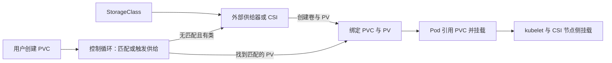
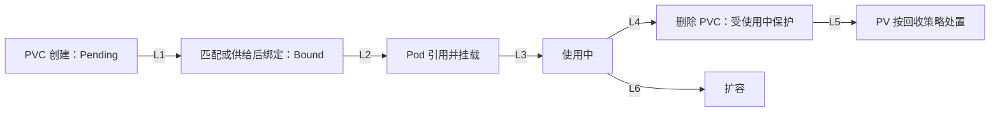

# 存储排查参考

## 是什么
- **一句话定位**：PVC、PV、StorageClass 三者如何配合，把一个存储请求变成可被 Pod 挂载的卷：声明、匹配或动态供给、绑定、使用、受保护的删除、回收。
- **解决什么问题**：PVC 一直 Pending、Pod 因存储无法调度或挂载、删除卡住、数据意外丢失时，判断问题在声明、类、供给、绑定时机，还是回收策略。
- **谁在用、从哪进来**：需要持久存储的工作负载；管理员创建 StorageClass 与静态 PV，用户创建 PVC，Pod 在 volumes 里引用 PVC。
- **边界（不负责什么）**：Pod 因存储而无法调度时调度侧的表现见 调度排查参考；挂载失败后 Pod 的状态见 Pod排查参考；各存储后端与 CSI 驱动的内部行为不在本条范围。
- **形态与版本**：PV 是集群资源，PVC 是命名空间内的请求；绑定是一对一且独占的。删除保护的终结器自 v1.33 起稳定。
- **术语**：
  - 静态与动态供给 —— 管理员预先建好 PV，或按 StorageClass 在需要时现建
  - ClaimRef —— PV 与 PVC 之间的双向绑定引用
  - 回收策略 —— PVC 被删除后 PV 与底层存储如何处理，有 Retain 与 Delete，Recycle 已弃用
  - 绑定模式 —— 立即绑定，或等到有 Pod 使用时再绑定

## 组件与架构

| 组件 | 角色 | 职责 | 部署位置 / 形态 | 如何找到 |
|---|---|---|---|---|
| StorageClass | 声明 | 说明如何供给卷：供给器、回收策略、绑定模式、是否允许扩容 | 集群级资源 | StorageClass 对象 |
| PVC 与 PV | 声明与资源 | 请求存储，对应实际的卷 | PVC 在命名空间内，PV 在集群级 | PVC 的状态与事件，PV 的阶段 |
| 控制循环 | 控制面 | 监视新 PVC，匹配或触发供给，完成绑定 | kube-controller-manager | 控制器日志 |
| 外部供给器与 CSI | 供给 | 按类创建底层卷并生成 PV | 集群内的工作负载 | 供给器日志与事件 |
| DefaultStorageClass 准入 | 准入 | 让未指定类的 PVC 使用默认类 | API 服务器 | API 服务器的准入配置 |
| kubelet 与 CSI 节点侧 | 节点 | 把绑定的卷挂载给 Pod | 每个节点 | 挂载相关事件 |

## 正常链路（请求怎么走 / 正常行为）

### 资源匹配关系
| 编号 | 资源 A.字段 | → | 资源 B.字段 | 匹配规则 | 对不上时的表现 |
|---|---|---|---|---|---|
| R1 | PVC 的 storageClassName | → | StorageClass | 动态供给要求 PVC 请求某个类且管理员已配置该类；类为 "" 即为自己关闭动态供给；未指定时使用默认类，前提是有默认类且启用了准入控制器〔待复核〕 | 类名写错或类不存在：PVC 一直 Pending；没有默认类又没写类：同样 Pending |
| R2 | PVC 的请求（容量、访问模式） | → | PV | 控制循环找到匹配的 PV 并绑定，一对一，经 ClaimRef 双向绑定，一旦绑定独占；得到的至少是所请求的，可能更大 | 没有匹配的 PV：声明无限期未绑定，直到出现匹配的卷 |
| R3 | StorageClass 的 volumeBindingMode | → | 供给与绑定的时机 | Immediate 在 PVC 出现时就供给并绑定；WaitForFirstConsumer 等到使用该 PVC 的 Pod 被调度后才绑定，用来避免区域不匹配〔待复核〕 | WaitForFirstConsumer 下没有 Pod 引用：PVC 保持 Pending 属预期，不是故障 |
| R4 | 供给器与 StorageClass 的参数 | → | 底层的卷与 PV | 动态供给时供给器创建底层卷并生成 PV，且总是绑定到触发它的 PVC〔待复核〕 | 供给器无权限、配额用尽或参数不被支持：PVC 一直 Pending，原因在 PVC 事件里 |
| R5 | Pod 的 volumes 引用 | → | 已绑定的卷 | Pod 把声明当作卷使用，集群找到绑定的卷并挂载；多访问模式的卷由 Pod 指定所需模式 | 引用的 PVC 不存在或未绑定：Pod 无法调度或无法启动 |
| R6 | 使用中的 PVC 与已绑定的 PV | → | 删除保护 | 被 Pod 使用的 PVC 删除会被推迟到不再被使用；已绑定的 PV 被删除也推迟；被保护对象状态为 Terminating 且带 pvc-protection 或 pv-protection 终结器 | PVC 一直 Terminating：仍有 Pod 在使用它 |
| R7 | PV 的回收策略 | → | PVC 删除后的处置 | Retain 保留 PV 与数据，PV 变为已释放，需手动回收；Delete 同时删除 PV 与底层存储；动态供给的卷继承 StorageClass 的回收策略；Recycle 已弃用 | 误以为删 PVC 不丢数据：回收策略为 Delete 时数据一并销毁 |
| R8 | StorageClass 的 allowVolumeExpansion | → | 能否扩容 PVC | 只有设为 true 才能扩容 | 扩容请求被拒或不生效：类不允许扩容 |

### 控制面下发路径
| 环节 | 做什么 | 依据 |
|---|---|---|
| P1 | 管理员创建 StorageClass，并可预先创建静态 PV | R1 R4 |
| P2 | 用户创建 PVC，控制循环监视到并尝试匹配 PV | R1 R2 |
| P3 | 没有匹配且有可用的类时，由外部供给器或 CSI 创建底层卷与 PV〔待复核〕 | R4 |
| P4 | 通过 ClaimRef 把 PV 与 PVC 双向绑定 | R2 |
| P5 | Pod 引用 PVC 被调度后，WaitForFirstConsumer 模式在此时才绑定，随后 kubelet 与 CSI 节点侧完成挂载〔待复核〕 | R3 R5 |

### 流量走向（或生命周期）

| 环节 | 起点 → 终点 | 做什么 | 依据 | 同步/异步与默认行为 |
|---|---|---|---|---|
| L1 | PVC 创建 → 绑定 | 控制循环匹配 PV，或触发动态供给；找不到匹配的卷时一直未绑定 | R1 R2 R3 R4 | 异步；WaitForFirstConsumer 下要等 Pod |
| L2 | 绑定 → Pod 使用 | Pod 引用声明，集群找到绑定的卷并挂载 | R5 | 同步 |
| L3 | 使用中 | 卷挂载在 Pod 上，访问模式限制了可同时挂载的节点范围〔待复核〕 | R5 | 持续 |
| L4 | 删除 PVC | 若仍被 Pod 使用则推迟到不再使用 | R6 | 受保护，状态 Terminating |
| L5 | PVC 删除后 → PV | Retain 变为已释放待手动处理，Delete 删除 PV 与底层存储 | R7 | 取决于回收策略 |
| L6 | 扩容 | 类允许时可扩容 PVC | R8 | 取决于后端与类的设置 |

### 正常表现（健康基线）
- PVC 在短时间内变为 Bound，或在 WaitForFirstConsumer 下于 Pod 被调度后绑定。
- Pod 能挂载卷并启动；删除 PVC 前先停掉使用它的 Pod。
- 回收策略与数据的重要性匹配：重要数据用 Retain，可重建的数据用 Delete。

## 逐环节排查（沿链路对照）
- **P1 StorageClass**
  - 正常：类存在且配置了供给器，有默认类（如需要）。
  - 异常：类不存在、供给器没运行；没有默认类。
  - 区分点：PVC 一直 Pending 先看 describe 的事件和类名（R1）。
  - 证据落点：StorageClass 列表与默认标记；供给器的状态。
- **P2 PVC 声明**
  - 正常：容量、访问模式、类名都合理。
  - 异常：请求的容量或访问模式没有任何 PV 或后端能满足。
  - 区分点：静态场景看现有 PV 的容量与访问模式；动态场景看供给器事件。
  - 证据落点：PVC 的 spec 与事件；PV 列表。
- **P3 供给**
  - 正常：供给器创建卷与 PV。
  - 异常：供给失败：无权限、配额用尽、参数不支持〔待复核〕。
  - 区分点：PVC 的事件会写供给失败的原因。
  - 证据落点：PVC 事件；供给器日志。
- **P4 绑定**
  - 正常：PV 与 PVC 经 ClaimRef 绑定。
  - 异常：PV 已释放后无法被新 PVC 绑定。
  - 区分点：已释放的 PV 仍带着旧的绑定引用，需要手动处理后才能复用〔待复核〕。
  - 证据落点：PV 的阶段与 ClaimRef。
- **P5 调度后绑定与挂载**
  - 正常：Pod 调度后卷被绑定并挂载。
  - 异常：Pod 因未绑定的 PVC 调度失败；挂载失败。
  - 区分点：调度失败见 调度排查参考；调度成功后的挂载失败看 Pod 事件与节点侧。
  - 证据落点：Pod 事件；节点与 CSI 的日志。
- **L1 等待绑定**
  - 正常：很快绑定，或在 WaitForFirstConsumer 下等待 Pod。
  - 异常：长期 Pending。
  - 区分点：先判断绑定模式：WaitForFirstConsumer 且还没有 Pod 引用属预期；Immediate 或已有 Pod 引用仍 Pending 才是问题。
  - 证据落点：StorageClass 的 volumeBindingMode；PVC 事件。
- **L2 引用与挂载**
  - 正常：Pod 启动并挂载成功。
  - 异常：引用的 PVC 不存在或没绑定。
  - 区分点：PVC 名写错或在别的命名空间，PVC 是命名空间内资源。
  - 证据落点：Pod 的 volumes；PVC 所在命名空间。
- **L3 使用中**
  - 正常：卷可读写。
  - 异常：访问模式不允许多节点同时挂载。
  - 区分点：只允许单节点读写的卷，多副本分布到不同节点时会冲突〔待复核〕。
  - 证据落点：访问模式；Pod 分布。
- **L4 删除受保护**
  - 正常：Pod 停止后 PVC 才被真正删除。
  - 异常：PVC 一直 Terminating。
  - 区分点：看是否还有 Pod 在使用它，终结器 pvc-protection 存在即说明仍受保护（R6）。
  - 证据落点：PVC 的终结器与使用它的 Pod。
- **L5 回收**
  - 正常：按回收策略处置。
  - 异常：数据被意外删除；PV 卡在已释放。
  - 区分点：数据丢失先看回收策略是否为 Delete；动态供给的卷继承类的策略（R7）。
  - 证据落点：PV 的回收策略与阶段；StorageClass 的 reclaimPolicy。
- **L6 扩容**
  - 正常：允许扩容的类可以扩。
  - 异常：不能扩容。
  - 区分点：看类的 allowVolumeExpansion（R8）。
  - 证据落点：StorageClass 的该字段。

## 异常归因速查
| 现象 / 错误码 | 环节 | 归因类别（回指 R#） | 证据位 | 详细条目 |
|---|---|---|---|---|
| PVC 一直 Pending | L1 P1 P2 | 类名错误或不存在、没有默认类、无匹配 PV（R1、R2） | PVC 事件；StorageClass | |
| WaitForFirstConsumer 下 PVC Pending | L1 | 还没有 Pod 引用，属预期（R3） | volumeBindingMode；是否有 Pod | |
| pod has unbound immediate PersistentVolumeClaims | P5 | 引用的 PVC 还没绑定，导致调度失败（R2、R5） | PVC 状态 | oss/k8s-scheduling.md |
| 供给失败，PVC 事件里有原因 | P3 | 无权限、配额用尽或参数不支持（R4） | PVC 事件；供给器日志 | |
| PV 已释放后新 PVC 无法绑定 | P4 L5 | 释放后仍保留旧的绑定引用，需手动处理（R7） | PV 的阶段与 ClaimRef | |
| PVC 一直 Terminating | L4 | 仍有 Pod 在使用，受使用中保护（R6） | pvc-protection 终结器；使用它的 Pod | oss/k8s-pod.md |
| 删除 PVC 后数据没了 | L5 | 回收策略为 Delete（R7） | reclaimPolicy | |
| Pod 起不来，挂载失败 | P5 L2 | 引用错误、访问模式冲突或节点侧问题（R5） | Pod 事件；访问模式 | oss/k8s-pod.md |
| 扩容请求被拒 | L6 | StorageClass 不允许扩容（R8） | allowVolumeExpansion | |
| 多可用区下卷无法挂载 | P5 | 绑定时机与区域不匹配，WaitForFirstConsumer 的设计目的之一（R3） | 卷所在区域与 Pod 所在区域 | |

## 状态、事件与日志语义
| 来源 | 取值 | 含义 | 常见出现环节 |
|---|---|---|---|
| PVC 状态 | Pending | 还没有绑定，原因看事件 | L1 |
| PVC 状态 | Bound | 已与某个 PV 绑定 | L2 |
| PVC 状态 | Terminating 并带 pvc-protection | 仍被 Pod 使用，删除被推迟 | L4 |
| PV 阶段 | Available、Bound、Released、Failed | 未绑定、已绑定、声明已删除待处理、回收失败〔待复核〕 | L1 L5 |
| PV 状态 | Terminating 并带 pv-protection | 仍绑定在 PVC 上，删除被推迟 | L4 |
| 回收策略 | Retain、Delete、Recycle | 保留、删除、已弃用的擦除 | L5 |
| 绑定模式 | Immediate、WaitForFirstConsumer | 立即绑定、等有 Pod 使用再绑定〔待复核〕 | L1 |

## 配置语义
| 配置项 | 默认 / 取值含义 | 改动后的行为后果 |
|---|---|---|
| storageClassName | 指向某个类；"" 表示不用动态供给；未写则用默认类〔待复核〕 | 写错类名会使 PVC 一直 Pending |
| volumeBindingMode | Immediate 或 WaitForFirstConsumer〔待复核〕 | 后者避免区域不匹配，但 PVC 会一直等到有 Pod 引用 |
| reclaimPolicy（类）与 persistentVolumeReclaimPolicy（PV） | 动态供给的卷继承类的策略，常见为 Delete〔待复核〕 | Delete 时 PVC 删除即丢数据；Retain 需手动清理 |
| allowVolumeExpansion | 必须为 true 才能扩容 | 默认不允许时无法扩容 |
| 访问模式 | ReadWriteOnce、ReadOnlyMany、ReadWriteMany〔待复核〕 | 决定可同时挂载的节点范围 |

## 边界与置信度说明
- **来源**：Kubernetes 官方 Persistent Volumes 页，覆盖多个版本；WaitForFirstConsumer 的语义、PV 与 PVC 的阶段名、已释放 PV 不可重新绑定、PVC Pending 的常见原因来自二手资料，官方 StorageClass 页本次没取到。
- **〔待复核〕项**：默认 StorageClass 的具体行为；绑定模式的详细语义；供给失败的各类原因；已释放 PV 的处理；访问模式的取值与限制；PV 阶段名的完整含义。
- **版本差异**：PV 删除保护的终结器自 v1.33 起稳定，CSI 与动态供给卷的终结器自 v1.31 引入；Recycle 已弃用。
- **未覆盖**：卷快照与克隆；VolumeAttributesClass；临时卷与 emptyDir；CSI 驱动的内部行为；StatefulSet 的 volumeClaimTemplates；本地卷与节点亲和；容量跟踪；挂载选项与权限（fsGroup）。
- **related**：见 frontmatter。
