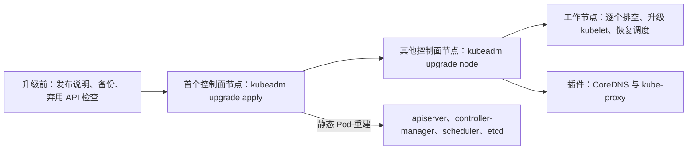
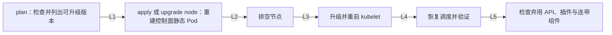

# 集群升级排查参考

## 是什么
- **一句话定位**：kubeadm 集群升级的顺序与约束，以及升级时最容易"连带出问题"的几个点：软件源看不到版本、跨小版本、kubelet 升级前没排空、etcd 升级时 API 请求停滞、插件与 CNI 的升级时机、弃用 API 导致旧清单失效。
- **解决什么问题**：升级前后出现"升级后某个组件不工作""升级卡住""找不到版本"时，判断是升级路径与顺序的问题，还是某个组件自己的版本差异。
- **谁在用、从哪进来**：用 kubeadm 自建集群并做版本升级的运维；托管集群的升级由云厂商控制，不适用。
- **边界（不负责什么）**：各组件在升级后的具体问题分别见各自条目：运行时配置见 containerd排查参考，准入 webhook 见 apiserver排查参考，证书见 集群证书排查参考，排空被拦见 PDB排查参考；失败后的恢复与回滚细节本条未展开。
- **形态与版本**：不同版本的文档在升级步骤上有差异，使用时以所用版本的官方文档为准。
- **术语**：
  - 小版本 —— 如 1.34 到 1.35 这一级，不可跳过
  - 版本偏差策略 —— 各组件之间允许的版本差距
  - 排空 —— 把节点标为不可调度并驱逐其上的 Pod
  - 静态 Pod —— 由节点上的清单文件直接管理的控制面组件

## 组件与架构

| 组件 | 角色 | 职责 | 部署位置 / 形态 | 如何找到 |
|---|---|---|---|---|
| kubeadm | 升级工具 | 检查、编排控制面升级 | 控制面与工作节点 | kubeadm 版本 |
| 控制面静态 Pod | 被升级对象 | apiserver、controller-manager、scheduler、etcd | 控制面节点 | 节点上的静态 Pod 清单 |
| kubelet 与 kubectl | 节点组件 | 单独升级，需要重启 kubelet | 每个节点 | 其版本 |
| 插件 | 集群插件 | CoreDNS 与 kube-proxy，随升级更新 | 集群内 | 对应工作负载的版本 |
| 软件包仓库 | 版本来源 | 决定能装到哪些版本 | 节点的软件源配置 | 软件源配置文件 |

## 正常链路（请求怎么走 / 正常行为）

### 资源匹配关系
| 编号 | 资源 A.字段 | → | 资源 B.字段 | 匹配规则 | 对不上时的表现 |
|---|---|---|---|---|---|
| R1 | 当前版本与目标版本 | → | 是否被支持 | 不支持跳过小版本，要逐个小版本升级 | 一次跳多个小版本：不被支持，风险大 |
| R2 | 控制面与工作节点的顺序 | → | 升级顺序 | 先升级一个主控制面节点，再升级其他控制面节点，最后升级工作节点；控制面一次一个节点；首个节点上要有 admin.conf | 乱序或并行升级控制面：不被支持，可能造成控制面不可用 |
| R3 | kubeadm 与 kubelet 的版本 | → | 是否在支持范围 | 建议一致，也可 kubelet 比 kubeadm 旧但要在支持范围内，详见版本偏差策略 | 差距超出支持范围：组件之间行为不可预期 |
| R4 | 节点的软件包仓库 | → | 能看到的版本 | 旧仓库已弃用并冻结，较新版本只在社区新仓库提供，每个小版本有自己的仓库 | 看不到预期的版本：先确认用的是不是对应小版本的新仓库 |
| R5 | 插件升级的时机 | → | CoreDNS 与 kube-proxy 的版本 | v1.28 之前在 upgrade apply 时立即升级插件，不管是否还有控制面没升级；较新版本的时机不同〔待复核〕 | 老版本下控制面版本不一致期间插件已被升级：混合态 |
| R6 | kubelet 的小版本升级 | → | 是否需要先排空 | 对任何 kubelet 做小版本升级前必须先排空该节点，排空带 --ignore-daemonsets；控制面节点上可能跑 CoreDNS 等关键工作负载 | 没排空就升级：运行中的 Pod 受影响；排空被 PDB 拦住则卡住，见 PDB排查参考 |
| R7 | etcd 升级与 apiserver | → | 在途请求 | 升级含 etcd 时，新 etcd 启动期间 apiserver 在途请求会停滞；规避办法是升级前几秒对 kube-apiserver 发 SIGTERM 并等待 | 升级期间 API 请求卡住或超时 |
| R8 | CNI 插件 | → | 是否需要手动升级 | 较早文档要求手动升级，若 CNI 以 DaemonSet 运行则其他控制面节点不需要；v1.35 文档称不再需要 | 按旧文档做多余步骤，或按新文档漏掉插件自身的升级说明 |
| R9 | 清单里的 API 版本 | → | 目标版本是否还支持 | 升级前应检查弃用或已移除的 API，可用工具扫描或看 apiserver 的弃用 API 请求指标；常见被取代的例子有 batch/v1beta1 到 batch/v1 等〔待复核〕 | 升级后旧清单或控制器用了已移除的 API：请求失败 |
| R10 | 升级前的备份 | → | 能否回滚 | 备份 etcd 是升级失败后恢复控制面状态的关键手段〔待复核〕 | 没有备份：失败后难以恢复 |

### 控制面下发路径
| 环节 | 做什么 | 依据 |
|---|---|---|
| P1 | 升级前：读发布说明，备份 etcd，检查弃用 API | R9 R10 |
| P2 | 首个控制面节点：升级 kubeadm，用 plan 检查，再用 apply 升级 | R1 R2 R4 |
| P3 | 其他控制面节点逐个用 upgrade node 升级 | R2 R5 R8 |
| P4 | 逐个排空节点，升级 kubelet 与 kubectl，重启 kubelet，恢复调度 | R3 R6 |
| P5 | 工作节点一次一个或几个，不损害所需的最小容量 | R6 |

### 流量走向（或生命周期）

| 环节 | 起点 → 终点 | 做什么 | 依据 | 同步/异步与默认行为 |
|---|---|---|---|---|
| L1 | plan → 检查 | 检查集群能否升级并列出可升级到的版本，给出组件配置版本状态 | R1 R4 | 较新版本文档称不再必须调用〔待复核〕 |
| L2 | apply 或 upgrade node → 控制面 | 升级控制面组件，静态 Pod 重建；含 etcd 升级时有 API 请求停滞的窗口 | R2 R7 | 控制面一次一个节点 |
| L3 | 节点 → 排空 | 对要升级 kubelet 的节点先排空 | R6 | 受 PDB 约束 |
| L4 | kubelet → 升级 | 升级 kubelet 与 kubectl，daemon-reload 并重启 kubelet | R3 | 需要重启 |
| L5 | 节点 → 恢复 | uncordon 后验证系统命名空间 Pod、CoreDNS 解析与冒烟测试 | R5 R8 R9 | 连带问题在这里暴露 |

### 正常表现（健康基线）
- 逐个小版本升级，控制面一次一个节点，工作节点按容量约束分批。
- kubelet 与 kubeadm 版本在支持范围内；系统命名空间 Pod 都正常。
- 升级前后没有因弃用 API 而失败的请求。

## 逐环节排查（沿链路对照）
- **P1 准备**
  - 正常：读过发布说明，有 etcd 备份。
  - 异常：没检查弃用 API；没备份。
  - 区分点：升级后旧清单失败，回头看是否用了已移除的 API（R9）。
  - 证据落点：弃用 API 的扫描结果；apiserver 的弃用 API 请求指标。
- **P2 首个控制面**
  - 正常：plan 通过，apply 成功。
  - 异常：看不到想升级的版本；跨小版本被拒。
  - 区分点：先看软件源是否对应目标小版本，再看是否跳了小版本（R1、R4）。
  - 证据落点：软件源配置；kubeadm 与目标版本。
- **P3 其他控制面**
  - 正常：逐个 upgrade node 成功。
  - 异常：并行升级导致控制面不可用。
  - 区分点：控制面必须一次一个节点（R2）。
  - 证据落点：各节点的升级顺序与时间。
- **P4 kubelet**
  - 正常：排空后升级、重启、恢复调度。
  - 异常：排空卡住；没排空就升级。
  - 区分点：排空卡住多半是 PDB，见 PDB排查参考（R6）。
  - 证据落点：drain 输出；节点状态。
- **P5 工作节点**
  - 正常：分批升级，容量够。
  - 异常：一次性升级太多，容量不足。
  - 区分点：不能损害所需的最小容量。
  - 证据落点：升级时的可用副本数。
- **L1 plan**
  - 正常：plan 给出可升级版本。
  - 异常：plan 看不到目标版本。
  - 区分点：软件源问题（R4）。
  - 证据落点：软件源配置。
- **L2 控制面重建**
  - 正常：静态 Pod 重建成功。
  - 异常：升级期间 API 请求卡住。
  - 区分点：含 etcd 升级时的已知现象，可用升级前对 apiserver 发 SIGTERM 的办法缓解（R7）。
  - 证据落点：升级期间的请求延迟；etcd 与 apiserver 的重启时间。
- **L3 排空**
  - 正常：Pod 被驱逐。
  - 异常：被 PDB 拦住。
  - 区分点：见 PDB排查参考。
  - 证据落点：drain 的输出。
- **L4 kubelet**
  - 正常：升级后重启正常。
  - 异常：kubelet 与 kubeadm 版本不一致。
  - 区分点：看是否在支持范围内（R3）。
  - 证据落点：两者的版本。
- **L5 连带检查**
  - 正常：系统 Pod 正常，CoreDNS 可解析。
  - 异常：升级后某个组件不工作。
  - 区分点：运行时选项失效看 containerd排查参考，准入失败看 apiserver排查参考，证书看 集群证书排查参考。
  - 证据落点：各组件的状态；速查表指向的条目。

## 异常归因速查
| 现象 / 错误码 | 环节 | 归因类别（回指 R#） | 证据位 | 详细条目 |
|---|---|---|---|---|
| 找不到想升级到的版本 | L1 P2 | 软件源不是对应小版本的新仓库（R4） | 软件源配置 | |
| 跨小版本升级被拒绝或出问题 | P2 | 不支持跳过小版本（R1） | 当前与目标版本 | |
| 升级后 containerd 选项不生效 | L5 | 运行时配置版本与路径名变化，见该条（R3） | 运行时配置 | oss/containerd.md |
| 升级后准入 webhook 突然失败 | L5 | 旧版 webhook 的默认超时与失败策略不同 | webhook 配置的 API 版本 | oss/k8s-apiserver.md |
| 升级后旧 API 的清单报错 | L5 P1 | 用了目标版本已移除的 API（R9）〔待复核〕 | 清单里的 API 版本 | |
| 升级期间 API 请求卡住 | L2 | etcd 升级期间在途请求停滞（R7） | 请求延迟；etcd 重启时间 | oss/k8s-etcd.md |
| 排空节点一直卡住 | L3 | PDB 拦住驱逐（R6） | drain 输出；PDB | oss/k8s-pdb.md |
| 升级后 CoreDNS 或 kube-proxy 版本不对 | P3 | 插件升级时机随版本不同（R5）〔待复核〕 | 插件工作负载的版本 | oss/kube-proxy.md |
| 超过一年没升级后证书过期 | P1 | 证书自动续期只在升级时发生 | 证书到期时间 | oss/k8s-certs.md |
| kubelet 与 kubeadm 版本差太多 | L4 | 超出支持范围（R3） | 两者版本 | |
| 升级失败后难以恢复 | P1 | 没有 etcd 备份（R10）〔待复核〕 | 备份是否存在 | |

## 状态、事件与日志语义
| 来源 | 取值 | 含义 | 常见出现环节 |
|---|---|---|---|
| 命令 | kubeadm upgrade plan | 检查并列出可升级版本，显示组件配置版本状态 | L1 |
| 命令 | kubeadm upgrade apply 与 upgrade node | 首个控制面节点用前者，其他控制面节点用后者 | L2 |
| 命令 | kubectl drain 带 --ignore-daemonsets | 排空节点 | L3 |
| 配置 | UpgradeConfiguration | 通过 --config 传入，配置升级过程 | P2 |
| 指标 | apiserver_requested_deprecated_apis | 对弃用 API 的请求，升级前可用来检查〔待复核〕 | P1 |

## 配置语义
| 配置项 | 默认 / 取值含义 | 改动后的行为后果 |
|---|---|---|
| 软件源 | 需用对应小版本的新仓库 | 旧仓库已冻结，看不到新版本 |
| --config 与 UpgradeConfiguration | 自定义升级过程 | 与命令行参数的配合以所用版本文档为准 |
| --ignore-daemonsets | 排空时忽略 DaemonSet 的 Pod | 否则排空会被 DaemonSet 的 Pod 阻止 |
| 升级节奏 | 控制面一次一个，工作节点一次一个或几个 | 过快会损害容量 |

## 边界与置信度说明
- **来源**：Kubernetes 官方 kubeadm 升级文档的多个版本给出顺序、不可跳小版本、kubelet 升级前排空、etcd 升级期间 API 请求停滞及规避办法、软件源变化、各版本差异；弃用 API 检查、etcd 备份建议来自二手资料。没有做过运行时取证。
- **〔待复核〕项**：版本偏差策略的具体数值（本条没有写）；插件在较新版本里的升级时机；plan 与 CNI 升级是否仍必须；弃用 API 检查工具与指标；备份与回滚细节。
- **版本差异**：旧文档要求手动升级 CNI，较新文档称不再需要；v1.28 之前插件在 apply 时立即升级；软件源在不同时期不同。
- **未覆盖**：版本偏差策略的完整数值；失败后的恢复与回滚；非 kubeadm 部署的升级；托管集群的升级；HA 控制面的特殊情形；etcd 的单独升级；升级后的功能迁移（如 API 的替代）。
- **related**：见 frontmatter。
