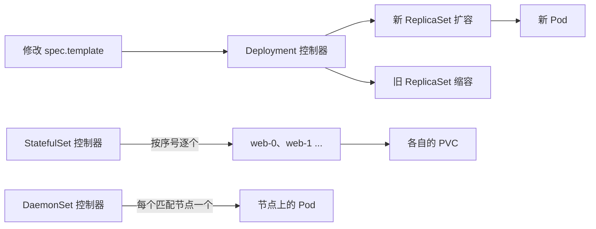
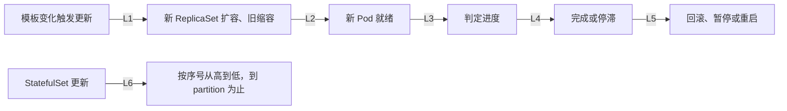

# 工作负载控制器排查参考

## 是什么
- **一句话定位**：Deployment、StatefulSet、DaemonSet 三类控制器如何把一份声明变成一组 Pod，并在模板变化时滚动更新：Deployment 靠新旧 ReplicaSet 之间按比例交接，StatefulSet 按序号一个个来，DaemonSet 每个匹配节点一个。
- **解决什么问题**：滚动更新卡住、副本数不对、更新没触发、StatefulSet 不往后走、DaemonSet 某些节点缺 Pod 时，判断是控制器的更新规则在起作用，还是 Pod 本身起不来。
- **谁在用、从哪进来**：所有以工作负载形式运行的应用；用户改模板或副本数，控制器负责对齐。
- **边界（不负责什么）**：新 Pod 起不来的原因见 Pod排查参考、调度排查参考、存储排查参考；Pod 的 Ready 如何影响 Service 见 Service排查参考；Job 与 CronJob 本条没有展开。
- **形态与版本**：控制器运行在 kube-controller-manager 内。StatefulSet 的 maxUnavailable 与起始序号是较新特性，使用前确认版本。
- **术语**：
  - 滚动更新 —— 逐步用新 Pod 替换旧 Pod
  - ReplicaSet —— Deployment 用它保存每个修订并管理该修订的 Pod
  - 序号 —— StatefulSet 里每个 Pod 的编号，决定创建与更新的顺序
  - partition —— StatefulSet 滚动更新的分区序号

## 组件与架构

| 组件 | 角色 | 职责 | 部署位置 / 形态 | 如何找到 |
|---|---|---|---|---|
| Deployment 控制器 | 控制面 | 为模板变化创建新 ReplicaSet，按参数在新旧之间交接副本 | kube-controller-manager 内 | Deployment 的状况与 Events |
| ReplicaSet | 中间对象 | 保存一个修订并维持该修订的 Pod 数 | 由 Deployment 创建 | 对应的 ReplicaSet 列表 |
| StatefulSet 控制器 | 控制面 | 按序号创建与更新 Pod，管理其 PVC | 同上 | StatefulSet 的状态与 Pod 序号 |
| DaemonSet 控制器 | 控制面 | 为每个匹配节点保证有一个 Pod | 同上 | DaemonSet 的状态与各节点的 Pod |
| 管理 StatefulSet 的 Service | 网络身份 | 给每个 Pod 稳定的 DNS 名 | 必须先于 StatefulSet 存在 | serviceName 指向的 Service |

## 正常链路（请求怎么走 / 正常行为）

### 资源匹配关系
| 编号 | 资源 A.字段 | → | 资源 B.字段 | 匹配规则 | 对不上时的表现 |
|---|---|---|---|---|---|
| R1 | Deployment.spec.template | → | ReplicaSet 与滚动更新 | 对 .spec.template 的任何修改都触发滚动更新，用新配置创建新 Pod 并逐步终止旧 Pod；新 ReplicaSet 的名字与 Pod 标签里带模板哈希；只改副本数不改模板不会触发更新〔待复核〕 | 改了别的字段（如副本数、标签选择器之外的元数据）以为会触发更新：没有触发 |
| R2 | maxUnavailable 与 maxSurge | → | 滚动更新的节奏 | 默认都是 25%，可写绝对值或百分比，以期望副本数为基数，maxUnavailable 向下取整、maxSurge 向上取整；两者不能同时为 0〔待复核〕 | 副本少时百分比取整后不符直觉；两者都为 0 或资源不足：更新无法推进 |
| R3 | 发布进度 | → | Progressing 状况 | 在 progressDeadlineSeconds（默认 600 秒）内没有进展，Progressing 被标为 False，原因为 ProgressDeadlineExceeded〔待复核〕；发布停滞通常说明新 Pod 启动失败 | 发布卡住：根因多在新 Pod，而不在 Deployment |
| R4 | 修订历史 | → | 回滚能力 | 历史保存在 ReplicaSet 里，默认保留 10 个旧 ReplicaSet；CHANGE-CAUSE 取自 kubernetes.io/change-cause 注解 | 旧 ReplicaSet 保留数不足：无法回到更早的修订 |
| R5 | 暂停与恢复 | → | 变更是否立即生效 | 暂停期间可做多处修改，恢复时一并应用 | 暂停状态下改了模板却没有任何变化：因为还处于暂停 |
| R6 | StatefulSet 的名字与序号 | → | Pod 的身份与网络身份 | Pod 名为 StatefulSet 名加序号；serviceName 指向的 Service 必须先于 StatefulSet 存在，负责网络身份；网络身份总对应同一个存储身份 | Service 不存在或名字不符：Pod 没有稳定的 DNS 名 |
| R7 | podManagementPolicy 与 updateStrategy | → | StatefulSet 的创建与更新方式 | OrderedReady（默认）严格按序号升序创建、降序删除，前一个就绪才继续；Parallel 不等待；RollingUpdate（默认）按序号从高到低更新到 partition，序号小于 partition 的不动；OnDelete 只在手动删除 Pod 时才重建 | OrderedReady 下一个 Pod 不就绪：后面的不会创建；partition 非 0：部分 Pod 保持旧版本是预期 |
| R8 | volumeClaimTemplates 与保留策略 | → | 每个 Pod 的 PVC | 为每个 Pod 生成对应的 PVC；whenDeleted 与 whenScaled 默认都是 Retain，Delete 会连 PVC 一起删除 | 删了 StatefulSet 存储还在：默认保留，是预期 |
| R9 | DaemonSet 的节点选择 | → | 每个匹配节点上的 Pod | 每个匹配的节点一个 Pod；Pod 由默认调度器调度，控制器注入节点亲和性并自动追加对内置污点的容忍；RollingUpdate 默认 maxUnavailable 为 1〔待复核〕 | 某些节点没有 Pod：节点选择器、污点容忍或资源限制导致 |

### 控制面下发路径
| 环节 | 做什么 | 依据 |
|---|---|---|
| P1 | 用户修改 Deployment 的 spec.template（或恢复暂停的发布） | R1 R5 |
| P2 | Deployment 控制器创建新 ReplicaSet，并按 maxSurge 与 maxUnavailable 扩新缩旧 | R1 R2 |
| P3 | ReplicaSet 控制器创建或删除 Pod，新 Pod 随后进入调度与启动流程〔待复核〕 | R1 |
| P4 | StatefulSet 控制器按序号逐个创建 Pod 并创建 PVC，更新时从高序号向 partition 推进 | R6 R7 R8 |
| P5 | DaemonSet 控制器为每个匹配节点创建 Pod | R9 |

### 流量走向（或生命周期）

| 环节 | 起点 → 终点 | 做什么 | 依据 | 同步/异步与默认行为 |
|---|---|---|---|---|
| L1 | 模板变化 → 新 ReplicaSet | 触发滚动更新，创建新 ReplicaSet | R1 R5 | 异步 |
| L2 | 新旧 ReplicaSet | 按 maxSurge 与 maxUnavailable 扩新缩旧 | R2 | 默认各 25% |
| L3 | 新 Pod → 就绪 | 新 Pod 必须就绪才能继续推进，依赖 Pod 自己的启动与探针 | R3 | 新 Pod 起不来则卡在这里 |
| L4 | 进度 → 判定 | 超过进度期限没有进展则 Progressing 为 False | R3 | 默认 600 秒 |
| L5 | 完成后 → 管理 | 保留旧 ReplicaSet 供回滚，可暂停、恢复或回滚 | R4 R5 | 默认保留 10 个旧 ReplicaSet |
| L6 | StatefulSet 更新 → 推进 | 从序号高的向 partition 推进，序号小于 partition 的不动；OrderedReady 要等每个就绪 | R6 R7 R8 | 一次推进一个 |

### 正常表现（健康基线）
- 模板变化后，新 ReplicaSet 逐步变满、旧的逐步变空，期间可用副本数不低于预期。
- Progressing 为真，Available 为真；没有长时间停滞。
- StatefulSet 的各 Pod 按序号就绪，PVC 与 Pod 一一对应；DaemonSet 每个预期节点一个 Pod。

## 逐环节排查（沿链路对照）
- **P1 触发更新**
  - 正常：修改模板后开始滚动更新。
  - 异常：改了没触发；发布处于暂停。
  - 区分点：只有对 .spec.template 的修改才触发；暂停时改动会等恢复后一并应用（R1、R5）。
  - 证据落点：Deployment 是否 paused；模板是否真的变化。
- **P2 新旧交接**
  - 正常：新 ReplicaSet 扩容、旧的缩容。
  - 异常：副本数比预期多或少。
  - 区分点：按 maxSurge 与 maxUnavailable 计算允许范围，百分比有取整（R2）；两者都为 0 无法推进。
  - 证据落点：新旧 ReplicaSet 的副本数；strategy 的取值。
- **P3 创建 Pod**
  - 正常：Pod 被创建并进入调度与启动。
  - 异常：Pod 迟迟创建不出来。
  - 区分点：控制器已创建 Pod 之后的问题转到 Pod排查参考。
  - 证据落点：ReplicaSet 的副本数与事件。
- **P4 StatefulSet 有序创建**
  - 正常：Pod 按序号就绪。
  - 异常：某个 Pod 不就绪，后面的都不创建。
  - 区分点：OrderedReady 下前一个就绪才继续（R7）；Parallel 则不受此限制。
  - 证据落点：各 Pod 的就绪状态；podManagementPolicy。
- **P5 DaemonSet 铺开**
  - 正常：每个匹配节点一个 Pod。
  - 异常：某些节点没有 Pod。
  - 区分点：看节点选择器、污点容忍与节点资源（R9）。
  - 证据落点：节点标签与污点；DaemonSet 的 Pod 分布。
- **L1 触发**
  - 正常：模板变化即触发。
  - 异常：见 P1。
  - 区分点：同 P1。
  - 证据落点：同 P1。
- **L2 交接**
  - 正常：按节奏推进。
  - 异常：更新期间可用副本明显减少。
  - 区分点：maxUnavailable 为 25% 在 4 个副本下一次会少 1 个，对要求高可用的服务应调小。
  - 证据落点：strategy 的参数。
- **L3 新 Pod 就绪**
  - 正常：新 Pod 就绪后继续。
  - 异常：新 Pod 一直不就绪，发布卡住。
  - 区分点：发布停滞通常是新 Pod 启动失败，要去看新 Pod，而不是继续看 Deployment（R3）。
  - 证据落点：新 Pod 的状态与事件，见 Pod排查参考。
- **L4 进度判定**
  - 正常：期限内有进展。
  - 异常：Progressing 为 False。
  - 区分点：这只说明在期限内没有进展，并不会自动回滚；根因仍在新 Pod。
  - 证据落点：Deployment 的状况与 Events。
- **L5 回滚与暂停**
  - 正常：可回到旧修订。
  - 异常：回滚后配置不对；找不到更早的修订。
  - 区分点：历史取决于保留的旧 ReplicaSet 数；回滚是回到某个修订的模板。
  - 证据落点：ReplicaSet 列表；修订与 change-cause。
- **L6 StatefulSet 更新**
  - 正常：按序号推进，到 partition 为止。
  - 异常：更新只更新了部分 Pod；OnDelete 下没有自动更新。
  - 区分点：partition 非 0 时序号小于它的保持旧版本，OnDelete 要手动删 Pod 才会重建（R7）。
  - 证据落点：updateStrategy 与 partition；各 Pod 的版本。

## 异常归因速查
| 现象 / 错误码 | 环节 | 归因类别（回指 R#） | 证据位 | 详细条目 |
|---|---|---|---|---|
| 滚动更新卡住 | L3 L4 | 新 Pod 启动失败（R3） | 新 Pod 的状态与事件 | oss/k8s-pod.md |
| Progressing 为 False，ProgressDeadlineExceeded | L4 | 进度期限内没有进展（R3）〔待复核〕 | Deployment 的状况 | oss/k8s-pod.md |
| 改了配置没触发更新 | P1 | 修改的不是 .spec.template，或发布处于暂停（R1、R5） | 是否 paused；改动位置 | |
| 更新期间可用副本变少 | L2 | maxUnavailable 允许少这么多（R2） | strategy 参数 | oss/k8s-service.md |
| 更新无法推进，新 Pod 也起不来 | P2 | 两个参数都为 0，或资源不足（R2） | strategy；调度事件 | oss/k8s-scheduling.md |
| 无法回滚到更早修订 | L5 | 保留的旧 ReplicaSet 数不够（R4） | revisionHistoryLimit；ReplicaSet 列表 | |
| StatefulSet 后面的 Pod 不创建 | P4 | OrderedReady 下前一个未就绪（R7） | 各 Pod 就绪状态 | oss/k8s-pod.md |
| StatefulSet 只更新了部分 Pod | L6 | partition 非 0（R7） | partition 取值 | |
| StatefulSet 改了模板不更新 | L6 | 更新策略为 OnDelete（R7） | updateStrategy | |
| 删除 StatefulSet 后存储还在 | P4 | PVC 保留策略默认 Retain（R8） | persistentVolumeClaimRetentionPolicy | oss/k8s-storage.md |
| Pod 没有稳定 DNS 名 | P4 | serviceName 指向的 Service 不存在或不符（R6） | serviceName 与该 Service | oss/k8s-dns.md |
| DaemonSet 某些节点没有 Pod | P5 | 节点选择器、污点容忍或资源限制（R9）〔待复核〕 | 节点标签与污点 | oss/k8s-scheduling.md |

## 状态、事件与日志语义
| 来源 | 取值 | 含义 | 常见出现环节 |
|---|---|---|---|
| Deployment 状况 | Progressing 为 False | 在进度期限内没有进展 | L4 |
| 状况的原因 | ProgressDeadlineExceeded | 超过进度期限〔待复核〕 | L4 |
| Deployment 状况 | Available 为 True，原因 MinimumReplicasAvailable | 可用副本数达到最低要求〔待复核〕 | L5 |
| 标签 | pod-template-hash | 让 Pod 对应到 ReplicaSet〔待复核〕 | L1 |
| 注解 | kubernetes.io/change-cause | 修订的变更原因，显示在 rollout history | L5 |
| 策略取值 | OrderedReady、Parallel | StatefulSet 的 Pod 管理方式 | P4 |
| 策略取值 | RollingUpdate、OnDelete | StatefulSet 的更新方式 | L6 |

## 配置语义
| 配置项 | 默认 / 取值含义 | 改动后的行为后果 |
|---|---|---|
| maxUnavailable | 默认 25%，向下取整 | 调为 0 可全程满容量，但需要额外资源且更新更慢 |
| maxSurge | 默认 25%，向上取整 | 允许临时超出期望副本数的数量 |
| progressDeadlineSeconds | 默认 600 秒 | 决定多久没进展就标为停滞，不会自动回滚 |
| revisionHistoryLimit | 默认保留 10 个旧 ReplicaSet | 调小后可回滚的修订变少 |
| minReadySeconds | 新 Pod 保持就绪多久才算可用〔待复核〕 | 调大使发布更稳但更慢 |
| podManagementPolicy | 默认 OrderedReady | Parallel 同时创建与删除，不等待 |
| updateStrategy 与 partition | 默认 RollingUpdate，partition 默认 0 | partition 用于金丝雀；OnDelete 需手动删 Pod |
| persistentVolumeClaimRetentionPolicy | whenDeleted 与 whenScaled 默认 Retain | 设为 Delete 会连 PVC 一起删除 |

## 边界与置信度说明
- **来源**：Kubernetes 官方 Deployment 滚动更新任务页与 StatefulSet API 参考；DaemonSet 的调度与自动容忍、ProgressDeadlineExceeded 等原因名、pod-template-hash 来自二手资料，官方 Deployment 与 DaemonSet 概念页本次没取到。
- **〔待复核〕项**：只改副本数不触发更新的具体判定；两个滚动参数不能同时为 0；状况的原因名；DaemonSet 的调度与滚动参数；minReadySeconds 的语义。
- **版本差异**：StatefulSet 的 maxUnavailable 与起始序号相关字段是较新的特性；DaemonSet 的 maxSurge 自 v1.22 起可用。
- **未覆盖**：Job 与 CronJob；ReplicaSet 与 ReplicationController 的细节；Deployment 的 Recreate 策略；水平 Pod 自动扩缩容；StatefulSet 的起始序号与 maxUnavailable 的完整行为；DaemonSet 的更新细节；Pod 干扰预算与滚动更新的关系。
- **related**：见 frontmatter。
