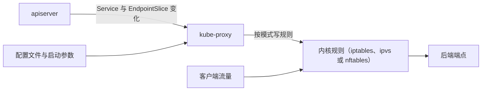
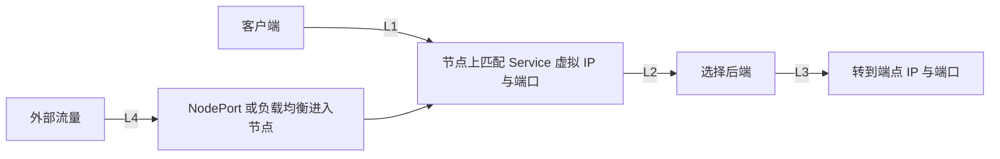

# kube-proxy排查参考

## 是什么
- **一句话定位**：kube-proxy 是每个节点上把 Service 的虚拟 IP 落成转发规则的组件。它监听 Service 和 EndpointSlice，在本机生成规则，把访问 ClusterIP 或 NodePort 的流量转到后端端点。
- **解决什么问题**：Service 与 EndpointSlice 只是 API 对象，真正让流量转起来的是各节点上的规则。"Service 看着正常但访问不通"，问题常常出在规则这一层。
- **谁在用、从哪进来**：集群内所有走 Service 虚拟 IP 的访问，以及经 NodePort 进入节点的外部流量；ExternalName 类型不经过它。
- **边界（不负责什么）**：后端地址与端点条件如何产生见 Service排查参考；名字解析见集群DNS排查参考；如果集群用别的组件替代了 kube-proxy（例如 eBPF 数据面的 CNI），规则由那个组件生成，本条不适用。
- **形态与版本**：以 DaemonSet 或节点进程形式运行，由配置决定模式。Linux 有 iptables、ipvs、nftables 三种；Windows 只有 kernelspace。ipvs 自 v1.35 起标记为 deprecated。
- **术语**：
  - 代理模式 —— kube-proxy 用哪种内核机制写规则
  - minSyncPeriod —— 两次规则同步之间的最短间隔
  - syncPeriod —— 周期性对账的间隔
  - 会话亲和 —— 同一客户端 IP 的请求固定落到同一后端

## 组件与架构

| 组件 | 角色 | 职责 | 部署位置 / 形态 | 如何找到 |
|---|---|---|---|---|
| kube-proxy | 数据面控制进程 | 监听 Service 与 EndpointSlice，持续把节点规则对齐到 API 状态 | 每个节点一个实例 | 节点上的 kube-proxy 进程及其日志 |
| 内核转发规则 | 数据面 | 真正做地址转换与后端选择 | 内核（iptables、ipvs、nftables 之一） | 对应机制下与 Service 相关的规则 |
| kube-proxy 配置 | 配置 | 决定模式、同步节奏 | 配置文件（`--config`）或启动参数 | 配置文件中的 mode 与 iptables 段 |

## 正常链路（请求怎么走 / 正常行为）

### 资源匹配关系
| 编号 | 资源 A.字段 | → | 资源 B.字段 | 匹配规则 | 对不上时的表现 |
|---|---|---|---|---|---|
| R1 | Service 的虚拟 IP 与端口 + EndpointSlice 的可用端点 | → | 节点上的转发规则 | 每个非 ExternalName 的 Service 一组规则，每个端点 IP 一条或一组规则；规则内容随端点增减而变 | 该节点规则缺失或陈旧：该节点上访问此 Service 失败或打到已不存在的端点 |
| R2 | kube-proxy 的代理模式配置 | → | 实际使用的内核机制 | iptables、ipvs、nftables 三选一（Linux）；Windows 为 kernelspace | 模式与内核能力不匹配：kube-proxy 起不来或回退；换模式后行为、性能、边缘语义会变 |
| R3 | 同步配置 minSyncPeriod、syncPeriod | → | 规则更新的批量程度与对账节奏 | minSyncPeriod 限制两次同步的最短间隔，期间的变化会合并；syncPeriod 决定多久做一次周期性对账与部分清理 | 间隔过大：变更生效延迟；过小：大集群上同步开销大 |
| R4 | 会话亲和与调度设置 | → | 后端选择方式 | iptables 默认随机选后端，设了会话亲和则按客户端 IP 固定；ipvs 提供多种调度算法（如轮询 rr） | 期望均匀却不均匀：多是亲和或随机性造成，不是规则缺失 |
| R5 | 流量来源（ClusterIP 或 NodePort、负载均衡） | → | 是否改写客户端源 IP | 经 ClusterIP 访问不改写客户端 IP；经 NodePort 或负载均衡进入时会改写 | 应用看到的源地址不是真实客户端 |
| R6 | 集群是否另有替代组件 | → | 规则由谁生成 | 部署了替代 kube-proxy 的组件时，节点上没有 kube-proxy，规则归该组件 | 按 kube-proxy 去排查却找不到进程或规则 |

### 控制面下发路径
| 环节 | 做什么 | 依据 |
|---|---|---|
| P1 | kube-proxy 启动，读取配置，确定代理模式 | R2 |
| P2 | 监听 apiserver 里 Service 与 EndpointSlice 的新增、修改、删除 | R1 |
| P3 | 变化触发规则同步；同步受 minSyncPeriod 限速，期间多次变化合并为一次；v1.28 起 iptables 模式只更新有变化的部分 | R1 R3 |
| P4 | 每隔 syncPeriod 做一次对账，并执行部分清理，也借此发现被外部组件改动的规则 | R3 |

### 流量走向（或生命周期）

| 环节 | 起点 → 终点 | 做什么 | 依据 | 同步/异步与默认行为 |
|---|---|---|---|---|
| L1 | 客户端 → 节点规则 | 访问 Service 虚拟 IP 与端口，命中本机 kube-proxy 生成的规则 | R1 | 同步；规则在本机，不经过别的节点 |
| L2 | 规则 → 后端选择 | 默认随机选一个端点，设了会话亲和则按客户端 IP 固定；ipvs 模式按所选调度算法 | R4 | 同步 |
| L3 | 选定后端 → 转发 | 把目的地址转成端点 IP 与端口，经 ClusterIP 访问时不改写客户端 IP | R1 R5 | 同步 |
| L4 | 外部 → 节点 | NodePort 或负载均衡的流量进入节点，之后走同样的规则；此时客户端 IP 会被改写 | R5 | 同步 |

### 正常表现（健康基线）
- 每个节点都有 kube-proxy 在运行（或有明确的替代组件）。
- 端点变化后，各节点规则在 minSyncPeriod 量级的时间内跟上。
- 大集群里规则同步耗时（指标 sync_proxy_rules_duration_seconds）保持在较低水平，没有持续攀升。

## 逐环节排查（沿链路对照）
- **P1 启动与模式**
  - 正常：kube-proxy 进程在运行，实际模式与预期一致。
  - 异常：模式与预期不符；内核缺少所选模式需要的能力。
  - 区分点：怀疑"换了模式后行为变了"，先确认当前生效的模式（R2）。
  - 证据落点：kube-proxy 启动日志与配置文件的 mode 取值。
- **P2 监听变化**
  - 正常：Service 与 EndpointSlice 的变化能及时被 kube-proxy 看到。
  - 异常：kube-proxy 与 apiserver 之间连接异常，变化没传到节点。
  - 区分点：EndpointSlice 本身正确，而某节点规则不更新，先看该节点的 kube-proxy 日志。
  - 证据落点：kube-proxy 日志；EndpointSlice 的实际内容。
- **P3 规则同步**
  - 正常：变化后规则在短时间内更新，同步耗时稳定。
  - 异常：大集群里规则更新很慢；minSyncPeriod 被设得过大导致延迟；同步耗时指标持续升高。
  - 区分点：端点早已变化，但流量仍打到旧端点，指向同步延迟，调整 minSyncPeriod 前要先看同步耗时指标。
  - 证据落点：指标 sync_proxy_rules_duration_seconds；该节点上的实际规则。
- **P4 周期对账与清理**
  - 正常：规则偶尔被外部改动后能在一个 syncPeriod 内被修回。
  - 异常：kube-proxy 停止或被移除后，内核里的规则仍残留；被外部组件改写的规则迟迟未恢复。
  - 区分点：规则残留是文档明确说明的行为，kube-proxy 自带的清理功能不是正式特性，不能指望它自动清干净。
  - 证据落点：节点上与 Service 相关的内核规则。
- **L1 命中规则**
  - 正常：访问 Service 虚拟 IP 与端口时命中规则。
  - 异常：该节点上完全没有对应规则，访问直接失败。
  - 区分点：只有部分节点失败，问题在那些节点的 kube-proxy 或规则（R1），而不在 Service 本身。
  - 证据落点：失败节点的规则与 kube-proxy 日志。
- **L2 选后端**
  - 正常：流量按预期分摊到各端点。
  - 异常：流量明显偏向少数端点；同一客户端总落同一后端。
  - 区分点：先看有没有设会话亲和（R4）；iptables 的随机选择在小流量下本就不均匀，不一定是故障。
  - 证据落点：Service 的会话亲和设置；各端点的实际请求量。
- **L3 转发**
  - 正常：请求到达端点的 IP 与 targetPort。
  - 异常：规则指向的端点已不存在。
  - 区分点：与 P3 配合判断是同步延迟还是规则确实错了。
  - 证据落点：规则里的端点列表与 EndpointSlice 对比。
- **L4 外部入口**
  - 正常：经 NodePort 或负载均衡进入后同样转发，源 IP 被改写属于预期。
  - 异常：应用要求真实源 IP 却拿到了节点或负载均衡的地址。
  - 区分点：需要保留源 IP 时看 Service 的流量策略，见 Service排查参考的 R6。
  - 证据落点：应用侧看到的源地址；Service 的 externalTrafficPolicy。

## 异常归因速查
| 现象 / 错误码 | 环节 | 归因类别（回指 R#） | 证据位 | 详细条目 |
|---|---|---|---|---|
| 只有部分节点访问某 Service 失败 | P2 P3 L1 | 这些节点规则缺失或陈旧（R1） | 失败节点的规则与 kube-proxy 日志 | |
| 端点早已更新但流量仍打旧后端 | P3 | 规则同步延迟或 minSyncPeriod 过大（R3） | 同步耗时指标；节点规则 | |
| 大集群变更后很久才生效 | P3 | 规则数量大、同步耗时长（R3） | sync_proxy_rules_duration_seconds | |
| 换了代理模式后行为不一致 | P1 | 不同模式的实现与边缘语义不同（R2） | 当前生效的模式 | |
| ipvs 下个别 Service 行为异常 | P1 L2 | ipvs 无法正确实现全部 Service 边缘情形，且已 deprecated（R2） | 模式与 Service 特性组合 | |
| kube-proxy 停掉后规则还在 | P4 | 内核规则不会随进程退出自动清理（R6） | 节点上残留的规则 | |
| 应用看到的源 IP 不是真实客户端 | L4 | 经 NodePort 或负载均衡会改写源 IP（R5） | 应用侧源地址 | |
| 按 kube-proxy 排查却找不到进程 | P1 | 集群用了替代组件（R6） | 节点上的组件清单 | |

## 状态、事件与日志语义
| 来源 | 取值 | 含义 | 常见出现环节 |
|---|---|---|---|
| 指标 | sync_proxy_rules_duration_seconds | 一次规则同步的耗时；大集群里持续偏高说明同步成为瓶颈 | P3 |
| 配置 | iptables.minSyncPeriod | 两次规则同步之间的最短间隔，期间的变化会合并 | P3 |
| 配置 | iptables.syncPeriod | 周期性对账与部分清理的间隔 | P4 |

## 配置语义
| 配置项 | 默认 / 取值含义 | 改动后的行为后果 |
|---|---|---|
| 代理模式 | Linux 上为 iptables、ipvs、nftables 之一；Windows 为 kernelspace | 换模式会改变性能与边缘语义；ipvs 已 deprecated，nftables 被推荐为其替代 |
| iptables.minSyncPeriod | 文档示例默认 1s | 调大可让更多变化合并成一次同步，但变更生效更慢 |
| iptables.syncPeriod | 文档示例默认 30s | 它控制发现被外部改动的规则有多快；曾有人把它调到很大，现已不推荐，容易损害功能 |
| 会话亲和 | None 或 ClientIP | 设为 ClientIP 后，同一客户端 IP 的请求落到同一后端 |
| ipvs 调度算法 | 提供多种，如轮询 rr | 只对 ipvs 模式生效 |
| 版本差异 | 旧版本文档提到 minSyncPeriod 被覆盖的情形 | 升级后若沿用旧的覆盖值，应考虑回到默认值或比升级前更小的值 |

## 边界与置信度说明
- **来源**：Kubernetes 官方「Virtual IPs and Service Proxies」文档的多个版本，没有做过运行时取证。
- **版本差异**：iptables 模式自 v1.28 起按变更增量更新；ipvs 自 v1.35 起标记为 deprecated；文档对 minSyncPeriod、syncPeriod 默认值的描述以所用版本的文档为准，升级前先核对。
- **未覆盖**：各模式下具体生成的链与规则结构；nftables 模式的内部细节；节点端口监听地址范围、localhost NodePort 的处理；conntrack 相关调优；Windows kernelspace 模式；无端点时各模式的具体丢弃或拒绝行为。
- **related**：见 frontmatter。
