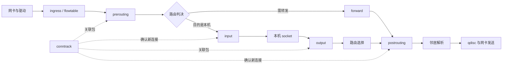
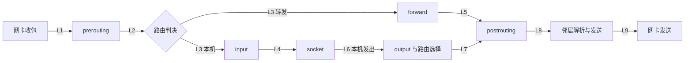

# Linux网络排查参考

## 是什么
- **一句话定位**：Linux 内核网络栈里，数据包从网卡进入、经过 netfilter 钩子、路由判决，再交给本机 socket 或转发出去的完整路径，以及路径上各子系统（路由、邻居、netfilter、conntrack）的状态与容量限制。
- **解决什么问题**：把"不通 / 丢包 / 间歇失败"落到具体一环：没有路由、下一跳解析失败、规则丢弃、conntrack 表满，还是本机没有监听。
- **谁在用、从哪进来**：所有跑在 Linux 上的网络程序；容器与 K8s 网络的转发、NAT 都建立在这套机制之上〔待复核〕。
- **边界（不负责什么）**：不含二层交换细节；不含 kube-proxy、Cilium、Calico 等软件如何生成规则（见各自条目）；不含应用层协议；文件句柄与端口范围等上限见 Linux资源上限排查参考；域名解析见 Linux域名解析排查参考。
- **形态与版本**：内核态机制。nftables 与 legacy iptables 共用同一套 hook 基础设施、连接跟踪和 NAT 引擎，所以本条对两者都成立。部分参数的默认值随内核版本变化，见文末说明。
- **术语**：
  - hook —— 内核在包路径上预留的挂接点，规则（链）按 hook 与优先级挂在上面
  - priority —— 同一 hook 内的执行顺序，数值小的先执行
  - conntrack —— 连接跟踪，记录每条连接的状态，是 NAT 与有状态过滤的基础
  - 原方向 / 应答方向 —— 一条连接在表中会以两个方向各登记一次
  - INVALID —— 不能与任何已知连接关联、或不符合协议状态的包
  - 邻居表 —— 下一跳 IP 到链路层地址的缓存（IPv4 为 ARP，IPv6 为 NDP）
  - netns —— 网络命名空间，路由、邻居、规则相互独立

## 组件与架构

| 组件 | 角色 | 职责 | 部署位置 / 形态 | 如何找到 |
|---|---|---|---|---|
| 网卡与驱动 | 数据面 | 收发包，计数丢包与错误 | 内核 | 接口名与接口统计 |
| netfilter 框架 | 数据面 | 提供五个 hook，外加 ingress（4.2+）与 egress，规则由 iptables 或 nftables 挂接 | 内核 | iptables 或 nftables 规则集 |
| conntrack | 数据面（状态） | 跟踪连接状态，支撑 NAT | 内核模块 nf_conntrack | /proc/sys/net/netfilter/nf_conntrack_* |
| 路由子系统 | 数据面 | 按目的地址选出口与下一跳 | 内核，每个 netns 一份 | 路由表与策略路由规则 |
| 邻居子系统 | 数据面 | 解析并缓存下一跳链路层地址 | 内核，每个 netns 一份 | 邻居表 |
| socket 层 | 数据面 | 把入向包交给本机监听进程 | 内核 | 监听 socket 列表 |
| flowtable | 数据面快路径（可选） | 已建立连接的转发绕过经典路径 | nftables 配置 | nftables 的 flowtable 对象 |
| 网络命名空间 | 隔离 | 路由、邻居、规则按 netns 隔离；conntrack 的 buckets 只能在初始 netns 修改 | 内核 | netns 列表 |

## 正常链路（请求怎么走 / 正常行为）

### 资源匹配关系
| 编号 | 资源 A.字段 | → | 资源 B.字段 | 匹配规则 | 对不上时的表现 |
|---|---|---|---|---|---|
| R1 | 包的目的 IP | → | 路由表条目（前缀 → 出接口 / 下一跳） | 最长前缀匹配；有策略路由规则时先按规则选表〔待复核〕；多路径路由按 hash 选一条，默认按三层信息（主要是源、目的 IP），不看端口〔待复核〕 | 无匹配路由：本机发包得到 Network is unreachable，转发则丢包并回 ICMP 不可达〔待复核〕 |
| R2 | 下一跳 IP | → | 邻居表条目（IP → 链路层地址） | 同一二层网段内通过 ARP / NDP 解析并缓存，长期未用的条目会被回收 | 解析不出：等待解析期间的包进入有限队列，超限被丢；邻居条目总数超过 gc_thresh3 时新条目建不起来 |
| R3 | 包所处的 hook | → | 该 hook 上的规则链（family + hook + priority） | 同一 hook 内按优先级数值升序执行；nat 类链优先级必须大于 -200，即排在 conntrack 之后 | 命中 drop 或 reject：包到此为止，后续环节看不到它 |
| R4 | 包的五元组与方向 | → | conntrack 表条目 | 首个包在 prerouting 或 output 被关联为"新连接"，在 input 或 postrouting 末尾才真正登记；之后同一连接的包按元组命中已有条目 | 表满：新连接登记失败，包被丢弃并在内核日志留下 table full 记录；校验和错误的包判 INVALID |
| R5 | 路由判决结果（本机 / 转发） | → | 是否进入 forward 路径（受 ip_forward 控制） | ip_forward 为 0（默认）时，目的不是本机的包不会被转发 | 非本机目的包被丢弃，表现为"转发不通" |

### 流量走向（或生命周期）

| 环节 | 起点 → 终点 | 做什么 | 依据 | 同步/异步与默认行为 |
|---|---|---|---|---|
| L1 | 网卡 → ingress | 收包；ingress hook（4.2+）可在 prerouting 之前做早期过滤，此时分片尚未重组；flowtable 也挂在这里，命中的已建立连接直接走快路径 | R4 | 同步；flowtable 默认不启用，需要显式配置 |
| L2 | ingress → prerouting | 先分片重组（优先级 -400），再按优先级执行规则，conntrack 在 -200 关联包，之后才是 DNAT 等 nat 链 | R3 R4 | 同步；conntrack 关联早于 nat |
| L3 | prerouting → 路由判决 | 按目的地址判断是本机还是转发 | R1 R5 | 同步；转发默认关闭 |
| L4 | 路由判决 → input → socket | 本机入向：执行 input hook，末尾确认新连接，再交付 socket | R3 R4 | 同步；无监听 socket 时的反应见速查表〔待复核〕 |
| L5 | 路由判决 → forward → postrouting | 转发：执行 forward hook，随后进 postrouting；已建立连接若命中 flowtable 则不经过这里 | R3 R5 | 同步 |
| L6 | socket → output | 本机发出：先选路由，再执行 output hook，conntrack 在 -200 关联包 | R1 R3 R4 | 同步 |
| L7 | output → postrouting | 出向包汇入 postrouting | R3 | 同步 |
| L8 | postrouting → 邻居解析 | 执行 SNAT 等规则，末尾确认新连接；随后按下一跳查邻居表 | R2 R3 R4 | 同步；邻居未解析时包排队等待 |
| L9 | 邻居解析 → 网卡 | 交给队列与驱动发送 | R2 | 异步，由发送队列驱动 |

### 正常表现（健康基线）
- conntrack 当前条目数（nf_conntrack_count，只读）明显低于上限 nf_conntrack_max。
- 内核日志里没有 table full、邻居表溢出之类记录。
- 目的为本机的包走 prerouting → input；目的非本机且 ip_forward 开启的包走 prerouting → forward → postrouting。
- 接口统计里的错误与丢弃计数基本不增长。

## 逐环节排查（沿链路对照）
- **L1 收包与 ingress**
  - 正常：包被网卡收下，接口收包计数增长，未见驱动层丢弃。
  - 异常：接口统计的错误或丢弃计数增长；ingress 上的规则在 prerouting 之前就丢包。
  - 区分点：ingress 与 flowtable 处在 prerouting 之前，若 prerouting 上的规则从未命中，而包确实到了网卡，要回头看这里。
  - 证据落点：接口统计；nftables 中 ingress 链与 flowtable 的计数。
- **L2 prerouting**
  - 正常：包被重组、关联到 conntrack 条目，DNAT 在此生效。
  - 异常：新连接失败并伴随 table full 日志；包被判 INVALID 后被规则丢弃；DNAT 未生效。
  - 区分点：已建立连接正常而新连接失败，指向 conntrack 容量（R4）；规则里写了 DNAT 却不生效，先看链的优先级是否大于 -200，以及是否只对新连接生效〔待复核〕。
  - 证据落点：nf_conntrack_count 与 nf_conntrack_max；内核日志；规则的命中计数。
- **L3 路由判决**
  - 正常：目的地址命中预期路由，判决为本机或转发符合预期。
  - 异常：无匹配路由；命中了意料之外的路由或策略路由表；多路径路由下，同一对源、目的 IP 之间的不同连接被选到同一条路径（默认 hash 不看端口）。
  - 区分点：本机发包即报不可达，是本机路由缺失；转发时丢包，还要同时确认 ip_forward（R5）。
  - 证据落点：路由表与策略路由规则；ip_forward 的取值。
- **L4 input 与 socket**
  - 正常：包通过 input 规则，被监听 socket 接收。
  - 异常：input 规则丢弃，表现为连接超时无响应；无监听时客户端立刻得到拒绝（Connection refused）〔待复核〕。
  - 区分点：被拒绝说明包到了本机协议栈且没有监听；超时无响应说明包可能在更早的规则处被丢弃。
  - 证据落点：input 链的命中计数；本机监听 socket 列表。
- **L5 forward 与 flowtable**
  - 正常：forward 规则放行；开启 flowtable 时，已建立连接绕过本环。
  - 异常：ip_forward 为 0；forward 链默认策略为 drop 且没有放行规则；flowtable 的初始流量未被放行，导致连接建不起来。
  - 区分点：能到本机、不能穿过本机，优先查 R5 与 forward 链。
  - 证据落点：ip_forward 的取值；forward 链的命中计数。
- **L6 本机发出（output）**
  - 正常：选路成功，output 规则放行。
  - 异常：选路失败直接报 Network is unreachable；output 规则丢弃。
  - 区分点：报错发生在发送瞬间，说明是路由层，而不是后面的邻居或网卡。
  - 证据落点：路由表；output 链的命中计数。
- **L7 postrouting 前的汇合**
  - 正常：出向与转发的包都在此汇合，等待 SNAT 与确认。
  - 异常：postrouting 规则丢包，或 SNAT 规则未命中导致源地址未被改写。
  - 区分点：源地址对不上而对端不回包，先看 SNAT 规则的命中。
  - 证据落点：postrouting 链与 nat 链的命中计数。
- **L8 SNAT、conntrack 确认与邻居解析**
  - 正常：新连接成功登记进 conntrack，下一跳的邻居条目可用。
  - 异常：表满导致登记失败而丢包（日志为 table full）；邻居表超过 gc_thresh3 导致新条目建不起来；邻居长时间未解析，排队包被丢。
  - 区分点：整机新连接都失败看 conntrack；只是某些下一跳不通、同网段间歇不通，看邻居表。
  - 证据落点：nf_conntrack_count 与 max；邻居表条目数与状态；内核日志。
- **L9 发送**
  - 正常：包进入发送队列并由网卡发出。
  - 异常：发送队列满或网卡丢弃，接口统计的 tx 错误或丢弃计数增长。
  - 区分点：前面各环节计数都正常、包却没出现在对端，再怀疑这里。
  - 证据落点：接口统计。

## 异常归因速查
| 现象 / 错误码 | 环节 | 归因类别（回指 R#） | 证据位 | 详细条目 |
|---|---|---|---|---|
| nf_conntrack: table full, dropping packet | L2 L8 | conntrack 表容量耗尽（R4） | 内核日志；count 接近 max | |
| 新连接间歇失败，已建立连接正常 | L2 L8 | conntrack 表满或接近满（R4） | count 与 max 的比值 | |
| Network is unreachable | L3 L6 | 无匹配路由（R1） | 路由表与策略路由 | |
| 能到本机、穿不过本机（转发不通） | L5 | ip_forward 为 0 或 forward 规则丢弃（R5、R3） | ip_forward 取值；forward 链计数 | |
| Connection refused | L4 | 包到达本机但无监听（socket 层，见边界说明）〔待复核〕 | 本机监听列表 | |
| 连接超时、无任何响应 | L2 L4 L5 | 规则在包路径上某处丢弃（R3） | 各 hook 链的命中计数 | |
| DNAT 或 SNAT 不生效 | L2 L8 | nat 链位置或优先级不对、只影响新连接〔待复核〕（R3、R4） | nat 链命中计数；conntrack 条目 | |
| 包被判 INVALID 后被丢 | L2 | 校验和错误或不符合连接状态（R4） | conntrack 的 invalid 计数；规则命中 | |
| 同网段个别下一跳间歇不通 | L8 | 邻居表满或解析失败（R2） | 邻居表条目数与状态；内核日志 | |
| 同一对 IP 的流量总走同一条路径 | L3 | 多路径 hash 默认只按三层（R1） | 多路径 hash 策略取值 | |
| 大包或分片包丢失 | L2 | 分片重组超过内存上限或缺片（R4） | 分片相关阈值与丢弃计数〔待复核〕 | |

## 状态、事件与日志语义
| 来源 | 取值 | 含义 | 常见出现环节 |
|---|---|---|---|
| 内核日志 | nf_conntrack: table full, dropping packet | conntrack 表已满，新连接登记失败，包被丢 | L2 L8 |
| /proc/sys/net/netfilter/nf_conntrack_count | 整数（只读） | 当前已分配的连接跟踪条目数 | L2 L8 |
| /proc/sys/net/netfilter/nf_conntrack_max | 整数 | 表容量上限 | L2 L8 |
| conntrack 包状态 | INVALID | 不能关联到已知连接或不符合协议状态；开启校验和检查时，校验和错误的包也判此状态 | L2 |
| 邻居表条目 | 非永久条目数 | 超过 gc_thresh3 后新条目建不起来 | L8 |
| ip_forward | 0 或非 0 | 0 表示不在接口之间转发（默认） | L3 L5 |
| 套接字错误 | Network is unreachable | 本机路由层找不到去路〔待复核〕 | L6 |
| 套接字错误 | Connection refused | 对端协议栈明确拒绝，通常是没有监听〔待复核〕 | L4 |

## 配置语义
| 配置项 | 默认 / 取值含义 | 改动后的行为后果 |
|---|---|---|
| ip_forward | 默认 0；非 0 表示允许在接口之间转发 | 它的变更会把接口配置参数重置为默认状态，改它之前要知道会连带重置别的参数 |
| nf_conntrack_max | 表容量。旧版文档写默认为 buckets 的 4 倍，较新文档写默认等于 buckets，并说明每条连接按两个方向各登记一次 | 调大可容纳更多连接，条目占用内核内存；两个文档版本的差异见文末说明 |
| nf_conntrack_buckets | 哈希表大小；只能在初始 netns 修改 | 影响哈希链长度；容器内无法改 |
| nf_conntrack_tcp_timeout_established | 默认 432000 秒（5 天） | 已建立连接的条目在空闲这么久之后才回收 |
| nf_conntrack_tcp_timeout_time_wait / close_wait | 默认 120 秒 / 60 秒 | 决定对应状态的条目占表时间 |
| nf_conntrack_udp_timeout / udp_timeout_stream | 默认 30 秒 / 120 秒 | 后者用于识别为 UDP 流的情形 |
| nf_conntrack_tcp_loose | 默认开启；设为 0 则不接管已经建立的连接 | 关闭后，conntrack 启用之前就存在的连接会被当成无法关联的包 |
| nf_conntrack_tcp_be_liberal | 非 0 时只把窗口外的 RST 判 INVALID | 影响哪些包被标 INVALID |
| neigh gc_thresh1 / 2 / 3 | 默认 128 / 512 / 1024；thresh3 是非永久条目的硬上限 | 邻居很多时，超过 thresh3 会无法新增条目 |
| fib_multipath_hash_policy | 默认 0，只按三层；1 为按四层 | 决定多路径路由下的流量如何分摊 |

## 边界与置信度说明
- **来源**：内核官方文档与 nftables wiki，条目整体为 `doc-sourced`，没有做过运行时取证。
- **版本差异**：nf_conntrack_max 的默认值，旧版内核文档写作"buckets 的 4 倍"，较新文档写作"等于 buckets"，并强调每条连接占两个表项。判断一台机器的实际容量要以它自己的 nf_conntrack_max 取值为准，不要按公式推。
- **〔待复核〕项**：以下内容是常见的内核行为，但本次没有逐页对照官方文档，复核后再去掉标记：策略路由选表的先后；无路由、无监听时各自的具体报错与 ICMP 行为；nat 只对新连接生效；分片相关丢弃计数的名称；容器与 K8s 网络依赖本机制的具体说法。
- **未覆盖**：rp_filter 等反向路径检查、TCP 半连接队列与 accept 队列、TIME_WAIT 堆积、网卡多队列与 offload，本条未展开，后续按需补充或另立条目。
- **related**：目前尚无同批其他条目，待 k8s-resources、k8s-service、k8s-dns 等落地后补 `related`。
