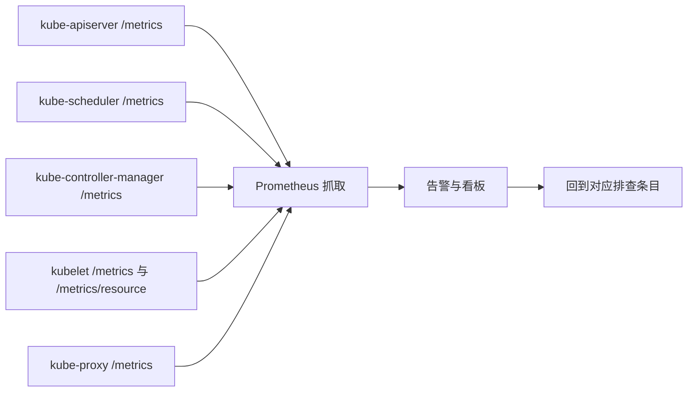
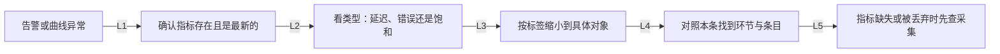

# 控制面与节点组件指标排查参考

## 是什么
- **一句话定位**：把控制面和节点组件暴露的指标，对应到它在排查链路里度量的是哪个环节。看到某个告警或曲线异常时，先知道"这个指标量的是什么"，再回到对应条目去定位。
- **解决什么问题**：指标名很容易凭印象写错。这里只写核实过的名字，并说明它是计数、直方图还是瞬时值，异常时指向哪个环节、该看哪个条目。
- **谁在用、从哪进来**：用 Prometheus 之类抓取各组件 /metrics 的运维与告警规则编写者。
- **边界（不负责什么）**：应用自己的指标、云厂商指标不在范围；etcd 自身的指标见 etcd排查参考；工作负载与容器资源指标见 工作负载与资源指标排查参考；采集链路本身（抓不到、被丢弃）的排查见 监控采集链路排查参考。
- **形态与版本**：STABLE 指标承诺稳定，BETA 指标约束较宽松，具体取决于集群版本。kubelet、kube-proxy 与 workqueue 的指标名来自二手清单。
- **术语**：
  - 计数器（Counter）—— 只增不减，用速率看
  - 直方图（Histogram）—— 带分桶的分布，用分位数看
  - 瞬时值（Gauge）—— 当前取值，可升可降
  - SLI 端点 —— 各组件的 /metrics/slis，提供健康检查结果

## 组件与架构

| 组件 | 角色 | 端点 | 主要指标族 | 对应排查条目 |
|---|---|---|---|---|
| kube-apiserver | 控制面 | /metrics 与 /metrics/slis | 请求延迟与计数、流控 | apiserver排查参考 |
| kube-scheduler | 控制面 | /metrics 与 /metrics/slis | 待调度队列、调度尝试、抢占 | 调度排查参考 |
| kube-controller-manager | 控制面 | /metrics 与 /metrics/slis | 节点驱逐、Job 控制器、工作队列 | 节点排查参考、Job与CronJob排查参考 |
| kubelet | 节点 | /metrics、/metrics/resource、/metrics/slis | 运行时操作、Pod 启动、PLEG | containerd排查参考、Pod排查参考 |
| kube-proxy | 节点 | /metrics 与 /metrics/slis | 规则同步耗时 | kube-proxy排查参考 |

## 正常链路（请求怎么走 / 正常行为）

### 资源匹配关系
这一节的"资源 A"是指标（含关键标签），"资源 B"是它度量的环节。

| 编号 | 资源 A.字段 | → | 资源 B.字段 | 匹配规则 | 对不上时的表现 |
|---|---|---|---|---|---|
| R1 | apiserver_request_duration_seconds（标签含动词、资源、子资源、范围、版本） | → | apiserver 的请求处理延迟 | 稳定的直方图，按分位数看；按动词与资源拆分才能定位是哪类请求慢；长连接的 WATCH 不应与普通请求混看〔待复核〕 | 整体延迟升高：先分清是哪类动词与资源，再看是 etcd、准入 webhook 还是流控，见 apiserver排查参考与 etcd排查参考 |
| R2 | apiserver_flowcontrol_current_inqueue_requests、request_wait_duration_seconds、rejected_requests_total（标签 flow_schema、priority_level、reason） | → | API 优先级与公平性的排队与拒绝 | BETA；前者为当前排队数，等待时长为直方图，被拒绝数为计数，reason 说明拒绝原因 | 排队与等待上升或出现拒绝：客户端会收到 429，要看是哪个 FlowSchema 与优先级，见 apiserver排查参考的 L3 |
| R3 | scheduler_pending_pods（标签 queue） | → | 调度器的待调度队列 | 稳定的瞬时值；active 为活动队列，backoff 为退避队列，unschedulable 为尝试后失败的，gated 为被门控而没尝试的 | unschedulable 持续偏高：有 Pod 一直调度不上，转到 调度排查参考；gated 偏高是被门控而非失败 |
| R4 | scheduler_scheduling_attempt_duration_seconds（标签 profile、result） | → | 一次调度尝试的耗时 | 稳定的直方图，含调度算法与绑定；result 区分成功、无法调度与内部错误 | 耗时升高：调度算法或绑定变慢；result 为 error 说明调度器内部问题 |
| R5 | scheduler_preemption_attempts_total、scheduler_preemption_victims | → | 抢占的发生与代价 | 稳定；前者为抢占尝试次数，后者为被选中牺牲的 Pod 数分布 | 抢占频繁：高优先级 Pod 在挤占低优先级 Pod，见 调度排查参考的 L3 |
| R6 | node_collector_evictions_total | → | 节点控制器驱逐 | 稳定的计数，节点控制器启动以来的节点驱逐次数 | 增长：有节点被判为异常并触发驱逐，见 节点排查参考 |
| R7 | kubelet_pod_start_duration_seconds、kubelet_pod_worker_duration_seconds、kubelet_runtime_operations_duration_seconds 与错误计数 | → | kubelet 创建 Pod 与调用运行时的耗时与错误 | 直方图与计数，名字来自二手清单〔待复核〕 | 升高或错误增多：Pod 启动慢或运行时调用失败，转到 containerd排查参考 |
| R8 | workqueue_depth、workqueue_adds_total、workqueue_queue_duration_seconds | → | 控制器工作队列 | 深度为瞬时值，新增为计数，排队时长为直方图；按队列名区分哪个控制器〔待复核〕 | 深度与排队时长持续上升：该控制器处理不过来，变更延迟生效 |
| R9 | kubeproxy_sync_proxy_rules_duration_seconds、kubeproxy_network_programming_duration_seconds | → | kube-proxy 规则同步与网络编程延迟 | 直方图；前者是一次同步耗时，后者是从变更到规则生效的时延〔待复核〕 | 升高：大集群规则同步慢，Service 变更生效延迟，见 kube-proxy排查参考 |
| R10 | kubernetes_healthchecks_total（来自 /metrics/slis） | → | 组件健康检查结果 | 计数，按健康检查与结果拆分 | 失败增多：组件自检不过 |

### 控制面下发路径
| 环节 | 做什么 | 依据 |
|---|---|---|
| P1 | 各组件通过 /metrics、/metrics/resource、/metrics/slis 暴露指标 | R1 R2 R3 R10 |
| P2 | Prometheus 或托管采集按目标抓取，目标需要启用才会被采集〔待复核〕 | R7 R8 R9 |
| P3 | 采集端通过重新标记规则只保留约定清单，其余指标被丢弃〔待复核〕 | R7 R8 R9 |
| P4 | 告警与看板基于保留的指标；告警触发后回到本条找对应环节 | R1 R3 |

### 流量走向（或生命周期）

| 环节 | 起点 → 终点 | 做什么 | 依据 | 同步/异步与默认行为 |
|---|---|---|---|---|
| L1 | 异常 → 指标确认 | 确认指标有数据、时间戳最新，排除抓取问题 | R7 | 先排除采集问题 |
| L2 | 指标 → 类型判断 | 区分延迟（直方图）、错误（计数）、饱和（队列深度） | R1 R3 | 计数用速率，直方图用分位数 |
| L3 | 类型 → 具体对象 | 用标签（动词、资源、队列、流控优先级）缩小范围 | R1 R2 R3 | 标签才是定位的关键 |
| L4 | 对象 → 排查条目 | 按"对不上时的表现"一列指向对应条目与环节 | R1 至 R10 | |
| L5 | 缺失 → 采集排查 | 指标没有或停更，先查采集链路 | R7 R8 R9 | 见 监控采集链路排查参考 |

### 正常表现（健康基线）
- apiserver 的请求延迟稳定，流控没有拒绝；调度队列里 unschedulable 为低位。
- 工作队列深度很快回落；节点驱逐计数平稳。
- kubelet 的 Pod 启动耗时与 kube-proxy 的规则同步耗时稳定。

## 逐环节排查（沿链路对照）
- **P1 暴露**
  - 正常：端点可访问，指标稳定。
  - 异常：端点需要认证而抓取没带凭据。
  - 区分点：指标缺失而组件正常，先确认抓取权限（见采集条目）。
  - 证据落点：直接访问端点的响应。
- **P2 抓取**
  - 正常：目标都被抓到。
  - 异常：目标未启用或抓取失败。
  - 区分点：托管服务里部分目标默认禁用，需显式启用〔待复核〕。
  - 证据落点：目标的抓取状态。
- **P3 保留清单**
  - 正常：需要的指标都在保留清单里。
  - 异常：需要的指标被重新标记规则丢弃。
  - 区分点：官方有该指标而看不到，多半是被采集端丢弃，不是组件没暴露〔待复核〕。
  - 证据落点：采集配置里的保留与丢弃规则。
- **P4 告警**
  - 正常：告警指向可行动的指标。
  - 异常：告警用了不存在或已改名的指标。
  - 区分点：BETA 指标可能随版本变化，升级后要重新核对名字。
  - 证据落点：告警表达式；官方指标参考。
- **L1 确认指标**
  - 正常：数据新鲜。
  - 异常：数据停更。
  - 区分点：先排除采集，再下结论。
  - 证据落点：指标的最后更新时间。
- **L2 判断类型**
  - 正常：按类型选对看法。
  - 异常：对计数直接看原值，对直方图看平均值。
  - 区分点：计数看速率，直方图看分位数，不要看平均。
  - 证据落点：指标类型。
- **L3 缩小范围**
  - 正常：标签能定位到对象。
  - 异常：标签基数太高、聚合后失去定位能力。
  - 区分点：先按动词、资源、队列聚合，再下钻。
  - 证据落点：标签集合。
- **L4 对应环节**
  - 正常：对照表能指到条目。
  - 异常：指标异常但表里没有。
  - 区分点：回到症状，用症状检索条目。
  - 证据落点：本条的对应表。
- **L5 采集缺口**
  - 正常：采集完整。
  - 异常：指标缺失。
  - 区分点：转到采集链路条目。
  - 证据落点：采集目标状态。

## 异常归因速查
| 现象 / 错误码 | 环节 | 归因类别（回指 R#） | 证据位 | 详细条目 |
|---|---|---|---|---|
| apiserver_request_duration_seconds 升高 | L3 | 某类请求变慢，先按动词与资源拆分（R1） | 按动词与资源的分位数 | oss/k8s-apiserver.md、oss/k8s-etcd.md |
| apiserver_flowcontrol_rejected_requests_total 增长 | L3 | 请求被流控拒绝，客户端见 429（R2） | flow_schema、priority_level、reason | oss/k8s-apiserver.md |
| scheduler_pending_pods 的 unschedulable 持续高 | L3 | 有 Pod 调度不上（R3） | queue 标签；调度事件 | oss/k8s-scheduling.md |
| scheduler_scheduling_attempt_duration_seconds 升高 | L2 | 调度算法或绑定变慢（R4） | profile 与 result | oss/k8s-scheduling.md |
| scheduler_preemption_attempts_total 增长 | L3 | 频繁抢占（R5） | 抢占牺牲数 | oss/k8s-scheduling.md |
| node_collector_evictions_total 增长 | L3 | 节点控制器在驱逐（R6） | 节点状况 | oss/k8s-node.md |
| kubelet_pod_start_duration_seconds 升高 | L3 | Pod 启动慢，多为运行时或镜像（R7） | 运行时操作耗时与错误 | oss/containerd.md |
| workqueue_depth 持续上升 | L2 | 某个控制器处理不过来（R8） | 队列名；排队时长 | |
| kubeproxy_sync_proxy_rules_duration_seconds 升高 | L3 | 规则同步慢（R9） | 同步耗时 | oss/kube-proxy.md |
| 官方有的指标在平台里看不到 | L5 | 目标未启用或指标被采集端丢弃（R7） | 采集配置 | |
| 升级后告警不再触发 | P4 | BETA 指标改名或语义变化 | 告警表达式与新版本参考 | |

## 状态、事件与日志语义
| 来源 | 取值 | 含义 | 常见出现环节 |
|---|---|---|---|
| 稳定性标记 | STABLE | 指标 API 稳定，不会无预告变更 | P4 |
| 稳定性标记 | BETA | 约束较宽松，尽量兼容看板与告警 | P4 |
| 指标类型 | Counter、Gauge、Histogram | 计数、瞬时值、分布 | L2 |
| 端点 | /metrics、/metrics/resource、/metrics/slis | 常规指标、容器资源指标、健康检查指标 | P1 |
| 标签 | queue 的取值 | active、backoff、unschedulable、gated | R3 |
| 标签 | result 的取值 | 调度尝试结果，含无法调度与内部错误 | R4 |

## 配置语义
| 配置项 | 默认 / 取值含义 | 改动后的行为后果 |
|---|---|---|
| 采集目标 | 托管服务里部分目标默认禁用〔待复核〕 | 不启用就没有这部分指标 |
| 保留清单与重新标记 | 只保留约定指标，其余丢弃〔待复核〕 | 需要更多指标就要放宽保留规则，但会增加存储与基数 |
| 抓取权限 | 部分端点需要认证 | 缺凭据则抓取失败 |

## 边界与置信度说明
- **来源**：Kubernetes 官方指标参考（v1.33、v1.34、v1.36 及最新版）给出 apiserver、流控、scheduler、节点控制器、Job 控制器的指标与稳定性；kubelet、kube-proxy、workqueue 的指标名取自微软 Azure Monitor 的默认采集清单，不是 Kubernetes 官方文档。没有做过运行时取证。
- **〔待复核〕项**：WATCH 请求与普通请求的区别；kubelet 与 kube-proxy 各指标的精确含义；workqueue 指标的标签；托管采集的默认行为；各指标的告警阈值（本条不给阈值，因为取值依赖集群规模）。
- **版本差异**：BETA 指标可能随版本改名或调整；kubelet 与 kube-proxy 指标名以所用版本的实际 /metrics 输出为准。
- **未覆盖**：etcd 指标（见 etcd排查参考）；工作负载与容器指标；网络与入口组件指标；指标的基数与成本控制；告警规则的具体写法；各组件的抓取端口与认证方式。
- **related**：见 frontmatter。
