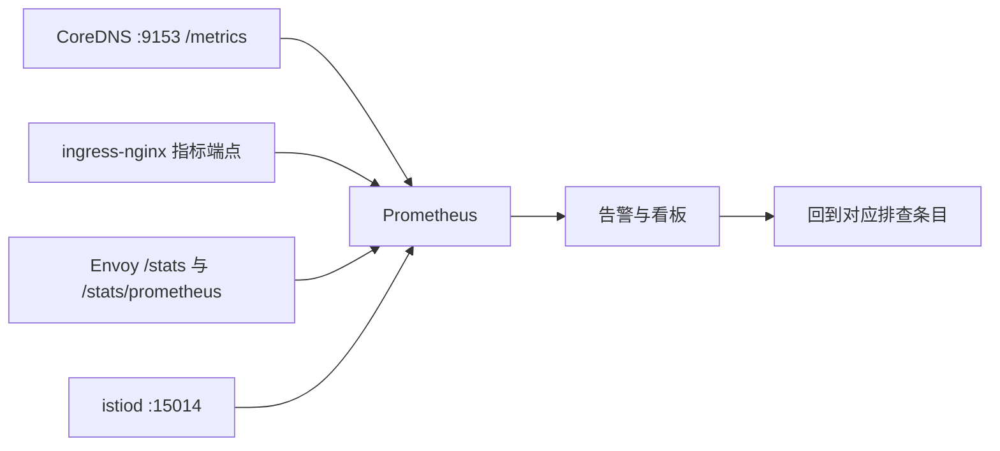
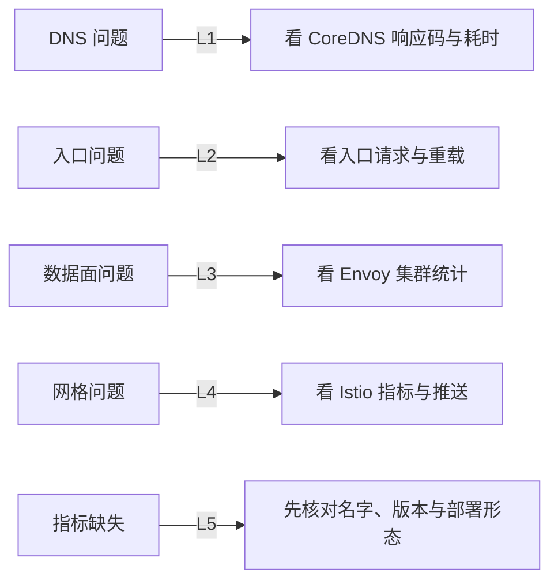

# 网络与入口指标排查参考

## 是什么
- **一句话定位**：把 DNS、入口、数据面代理、服务网格这几层暴露的指标，对应到它们度量的环节，以及异常时该回到哪个条目。重点是核实过的名字和一个常见陷阱：指标名随版本改过，或在某种部署形态下根本不存在。
- **解决什么问题**：DNS 变慢、入口 5xx 增多、配置重载失败、熔断触发、网格指标消失时，知道该看哪个指标、读对它的意思，并且知道"看不到"是正常还是故障。
- **谁在用、从哪进来**：给 CoreDNS、ingress-nginx、Envoy、Istio 写告警与看板的人。
- **边界（不负责什么）**：控制面与节点组件指标见 控制面与节点组件指标排查参考；容器与工作负载指标见 工作负载与资源指标排查参考；Cilium、Calico、flannel 的指标本条未覆盖；采集链路排查见 监控采集链路排查参考。
- **形态与版本**：CoreDNS 的转发指标在较新版本改名；Istio 的请求指标在 Ambient 没有 waypoint 时不存在。
- **术语**：
  - rcode —— DNS 响应码，如 NOERROR、NXDOMAIN、SERVFAIL
  - 响应标志 —— Envoy 访问日志里说明请求为何失败的缩写，其对应的统计项见下文
  - 重载成功标志 —— ingress-nginx 的 config_last_reload_successful，1 成功、0 失败
  - 推送收敛 —— 控制面把配置推到所有代理的耗时

## 组件与架构

| 组件 | 角色 | 端点 | 主要指标族 | 对应排查条目 |
|---|---|---|---|---|
| CoreDNS | 集群 DNS | 默认 localhost:9153 的 /metrics | 请求、响应码、耗时、缓存、转发 | 集群DNS排查参考、CoreDNS排查参考 |
| ingress-nginx | 入口控制器 | 控制器的指标端点 | 请求量与延迟、重载、孤儿 Ingress | ingress-nginx排查参考 |
| Envoy | 数据面 | 管理接口的 /stats | 集群级的连接与请求统计 | envoy排查参考 |
| Istio 数据面 | 网格 | sidecar 的 /stats/prometheus〔待复核〕 | 标准请求指标 | istio排查参考 |
| istiod | 网格控制面 | 15014 的 /metrics〔待复核〕 | 推送、收敛、证书签发 | istio排查参考 |

## 正常链路（请求怎么走 / 正常行为）

### 资源匹配关系
这一节的"资源 A"是指标（含关键标签），"资源 B"是它度量的环节。

| 编号 | 资源 A.字段 | → | 资源 B.字段 | 匹配规则 | 对不上时的表现 |
|---|---|---|---|---|---|
| R1 | coredns_dns_responses_total（标签 rcode、zone） | → | DNS 响应结果 | 计数器，按响应码拆分；NOERROR 为成功，NXDOMAIN 为名字不存在，SERVFAIL 为服务器失败 | SERVFAIL 增多：上游转发或插件链出错；NXDOMAIN 增多：多为名字拼写或命名空间问题，见 集群DNS排查参考 |
| R2 | coredns_dns_requests_total、coredns_dns_request_duration_seconds（标签 zone、type） | → | 解析流量与处理耗时 | 前者是计数器，后者是直方图，按分位数看；zone 标签区分集群域与其他域 | 耗时升高：看是集群域还是外部域，外部域慢多指向上游，见 CoreDNS排查参考的 L4 |
| R3 | coredns_cache_hits_total、coredns_cache_requests_total、coredns_cache_entries | → | 缓存命中 | 命中数除以请求数即命中率〔待复核〕 | 命中率低：缓存起不到作用，上游压力大 |
| R4 | coredns_proxy_*（较新版本）或 coredns_forward_*（较老清单） | → | 向上游转发的耗时与健康检查 | 转发插件的指标在较新版本改名为 proxy，带 proxy_name 标签〔待复核〕 | 沿用旧名字的告警查不到数据；上游健康检查失败增多：外部解析会出问题 |
| R5 | coredns_panics_total 与指标端点本身 | → | 进程健康与指标可达 | panic 计数应为零；重载失败时 DNS 仍可服务但指标端点保持关闭，直到成功重载或重启 | 指标突然消失而 DNS 仍正常：可能是重载失败后指标处理器没起来，见 CoreDNS排查参考 |
| R6 | nginx_ingress_controller_requests（标签含域名、路径、状态码）与 request_duration_seconds | → | 入口请求量、错误率与总延迟 | 前者是计数器，可按域名、路径拆分；后者是客户端到收完整响应的总处理时间〔待复核〕 | 某域名或路径的 5xx 比例上升：定位到具体 Ingress，再看上游，见 ingress-nginx排查参考 |
| R7 | nginx_ingress_controller_config_last_reload_successful 及其时间戳、config_hash | → | 配置重载是否成功 | 1 表示最近一次重载成功，0 表示失败；时间戳与哈希用来判断配置是否在更新〔待复核〕 | 值为 0 且时间戳不再更新：配置无效导致所有 Ingress 变更被搁置，是最关键的告警之一，见 ingress-nginx排查参考的 P3 |
| R8 | nginx_ingress_controller_orphan_ingress（标签 type）与 ssl_certificate_info | → | 孤儿 Ingress 与证书 | type 为 no-service 或 no-endpoint 表示 Ingress 指向的 Service 或端点不存在；证书信息指标保留证书相关标签〔待复核〕 | 出现孤儿：规则写了但后端缺失；证书信息可用来发现快到期的证书 |
| R9 | Envoy 的集群统计 upstream_cx_connect_fail、upstream_rq_timeout、upstream_rq_pending_overflow、upstream_cx_overflow、upstream_cx_none_healthy、membership_healthy、upstream_rq_xx、upstream_rq_retry_overflow | → | 数据面的连接、超时、熔断与健康 | 响应标志对应的统计项：UF 对应连接失败，UT 对应请求超时，UO 对应熔断溢出，UH 对应没有健康主机，URX 与重试统计相关〔待复核〕 | 统计在增长：对应的响应标志在访问日志里会出现，见 envoy排查参考 |
| R10 | istio_requests_total、istio_request_duration_milliseconds（标签 reporter、destination_canonical_service、response_flags） | → | 网格层请求量、延迟与代理判定的失败原因 | 计数器与直方图；response_flags 区分代理自身拒绝与应用错误；Ambient 没有 waypoint 时这些指标不存在 | 迁到 Ambient 后消失：不是故障，是形态变化，见 istio排查参考 |
| R11 | pilot_xds_pushes、pilot_proxy_convergence_time、pilot_xds_push_time、pilot_xds | → | 控制面的推送与收敛 | 前者是推送计数，收敛与推送时间是直方图，pilot_xds 为已连接代理数〔待复核〕 | 推送与收敛时间升高：控制面过载，代理配置陈旧，对应 istio排查参考里的 STALE |

### 控制面下发路径
| 环节 | 做什么 | 依据 |
|---|---|---|
| P1 | CoreDNS 的 prometheus 插件默认在 9153 端口暴露 /metrics；其他组件暴露各自端点 | R1 R2 R5 |
| P2 | Prometheus 抓取各端点；Istio 的代理端点与 istiod 端点端口不同〔待复核〕 | R10 R11 |
| P3 | Istio 里 Envoy 的统计默认很精简，需要时通过配置放开更多 | R9 R10 |
| P4 | 高负载下全量采集 ingress-nginx 指标有内存增长风险，有厂商默认屏蔽部分指标 | R6 R7 |

### 流量走向（或生命周期）

| 环节 | 起点 → 终点 | 做什么 | 依据 | 同步/异步与默认行为 |
|---|---|---|---|---|
| L1 | DNS 症状 → 指标 | 用响应码拆分与耗时分位数判断解析问题 | R1 R2 R3 R4 R5 | 先分集群域与外部域 |
| L2 | 入口症状 → 指标 | 先看重载是否成功，再看按域名与路径拆分的错误率与延迟 | R6 R7 R8 | 重载失败要优先排除 |
| L3 | 代理症状 → 统计 | 用连接失败、超时、溢出、健康成员数对应响应标志 | R9 | 统计与访问日志互相印证 |
| L4 | 网格症状 → 指标 | 看请求指标与控制面推送收敛 | R10 R11 | 先确认当前是 Sidecar 还是 Ambient |
| L5 | 缺失 → 核对 | 指标没有时先核对名字、版本、部署形态 | R4 R10 | 不要先判断为故障 |

### 正常表现（健康基线）
- CoreDNS 的 SERVFAIL 很少，解析耗时稳定；没有 panic。
- ingress-nginx 的重载成功标志为 1，时间戳随配置变更更新；没有孤儿 Ingress。
- Envoy 没有持续的连接失败、超时与溢出；网格控制面的推送与收敛时间稳定。

## 逐环节排查（沿链路对照）
- **P1 暴露**
  - 正常：端点可访问。
  - 异常：CoreDNS 重载失败后指标端点保持关闭。
  - 区分点：DNS 正常而指标没了，先看是否发生过失败的重载（R5）。
  - 证据落点：CoreDNS 日志与端点可达性。
- **P2 抓取**
  - 正常：各端点都被抓到。
  - 异常：Istio 代理与控制面的端口不同被漏抓〔待复核〕。
  - 区分点：数据面指标有而控制面没有，查是否抓了 istiod 的端点。
  - 证据落点：抓取目标列表。
- **P3 统计精简**
  - 正常：需要的统计已放开。
  - 异常：Envoy 统计在 Istio 下默认精简，想看的没有。
  - 区分点：官方有的统计在这里看不到，先查是否被默认精简〔待复核〕。
  - 证据落点：代理的统计配置。
- **P4 基数与内存**
  - 正常：采集的指标量受控。
  - 异常：高负载下指标采集占用内存增长。
  - 区分点：有厂商为此默认屏蔽部分指标，所以"查不到某指标"可能是被主动屏蔽〔待复核〕。
  - 证据落点：采集端的屏蔽配置。
- **L1 DNS**
  - 正常：响应以 NOERROR 为主，耗时稳定。
  - 异常：SERVFAIL 或 NXDOMAIN 上升，耗时升高。
  - 区分点：先按 zone 分集群域与外部域，再看转发指标；注意转发指标可能叫 proxy 或 forward。
  - 证据落点：按 rcode 与 zone 的曲线；转发健康检查。
- **L2 入口**
  - 正常：重载成功，错误率低。
  - 异常：重载失败；某域名错误率高；出现孤儿 Ingress。
  - 区分点：重载标志为 0 时，所有 Ingress 的变更都不会生效，优先处理（R7）。
  - 证据落点：重载标志与时间戳；按域名与路径的错误率。
- **L3 数据面**
  - 正常：连接与请求统计平稳。
  - 异常：连接失败、超时、溢出、健康成员数下降。
  - 区分点：对照响应标志，UF 看连接失败、UT 看超时、UO 看溢出、UH 看健康成员（R9）。
  - 证据落点：集群统计；访问日志的响应标志。
- **L4 网格**
  - 正常：请求指标与推送收敛稳定。
  - 异常：请求指标缺失；推送收敛时间升高。
  - 区分点：请求指标缺失先确认是否在 Ambient 且没有 waypoint；推送变慢指向控制面过载。
  - 证据落点：命名空间的数据面形态；控制面推送指标。
- **L5 名字核对**
  - 正常：名字是当前的。
  - 异常：告警沿用旧名字。
  - 区分点：转发指标改名、网格形态变化，都会让旧告警静默失效。
  - 证据落点：所用版本的实际指标输出。

## 异常归因速查
| 现象 / 错误码 | 环节 | 归因类别（回指 R#） | 证据位 | 详细条目 |
|---|---|---|---|---|
| coredns_dns_responses_total 的 SERVFAIL 增多 | L1 | 上游转发或插件出错（R1） | 按 rcode 与 zone | oss/coredns.md |
| NXDOMAIN 增多 | L1 | 名字或命名空间有误（R1） | 查询的名字 | oss/k8s-dns.md |
| coredns_dns_request_duration_seconds 升高 | L1 | 外部域解析慢，指向上游（R2、R4） | 按 zone 的分位数 | oss/coredns.md |
| 转发相关告警查不到数据 | L5 | 转发指标改名（R4） | 实际指标名 | |
| DNS 正常但指标没了 | P1 | 重载失败后指标处理器未启动（R5） | CoreDNS 日志 | oss/coredns.md |
| config_last_reload_successful 为 0 | L2 | 配置无效，所有 Ingress 变更被搁置（R7） | 重载标志与时间戳 | oss/ingress-nginx.md |
| 某域名 5xx 比例上升 | L2 | 该 Ingress 的上游有问题（R6） | 按域名与路径的错误率 | oss/ingress-nginx.md |
| orphan_ingress 出现 | L2 | Ingress 指向的 Service 或端点不存在（R8） | type 标签 | oss/k8s-ingress.md |
| upstream_rq_pending_overflow 增长 | L3 | 连接池熔断，请求被拒（R9） | 熔断设置 | oss/envoy-proxy.md |
| upstream_cx_connect_fail 增长 | L3 | 连不上上游（R9） | 上游端点可达性 | oss/envoy-proxy.md |
| istio_requests_total 突然消失 | L4 | 迁到 Ambient 且没有 waypoint（R10） | 命名空间的数据面形态 | oss/istio.md |
| pilot_proxy_convergence_time 升高 | L4 | 控制面过载，推送变慢（R11） | 推送与收敛指标 | oss/istio.md |

## 状态、事件与日志语义
| 来源 | 取值 | 含义 | 常见出现环节 |
|---|---|---|---|
| rcode | NOERROR、NXDOMAIN、SERVFAIL | DNS 响应码，用来拆分成功与失败 | L1 |
| 标签 | zone | 请求所用的区域名；不进入插件链的查询归入 dropped | L1 |
| 重载标志 | 1 与 0 | 最近一次重载成功与失败 | L2 |
| 标签 | type 为 no-service 或 no-endpoint | 孤儿 Ingress 的状态 | L2 |
| 标签 | response_flags | Istio 请求指标里代理判定失败的原因 | L4 |
| 标签 | reporter | 指标由请求的源端还是目的端上报 | L4 |

## 配置语义
| 配置项 | 默认 / 取值含义 | 改动后的行为后果 |
|---|---|---|
| CoreDNS 的 prometheus 插件地址 | 默认 localhost:9153，路径固定 /metrics | 改成其他地址需同步抓取配置 |
| Envoy 在 Istio 下的统计 | 默认精简 | 放开更多统计会增加基数与内存 |
| ingress-nginx 的指标采集范围 | 全量采集在高负载下有内存增长风险〔待复核〕 | 屏蔽部分指标可缓解，但这些指标就看不到了 |
| Ambient 的 waypoint | 没有则缺少七层请求指标 | 需要这些指标就要部署 waypoint |

## 边界与置信度说明
- **来源**：CoreDNS 官方 prometheus 插件文档与 Envoy 官方集群统计文档；CoreDNS 的缓存与转发指标、ingress-nginx 与 Istio 的指标名与含义来自二手资料。没有做过运行时取证。
- **〔待复核〕项**：CoreDNS 转发指标改名的具体版本；缓存命中率算法；ingress-nginx 各指标的精确含义与标签；Envoy 响应标志与统计项的对应关系（依据定义推出，官方未逐条写明）；Istio 的端口与指标细节；ingress-nginx 高负载下的内存问题。
- **版本差异**：CoreDNS 的 view 与 plugin 标签只在较新版本出现；转发指标 forward 与 proxy 命名不同；Envoy 官方来源是较早版本，较新版本的统计名可能有增补。
- **未覆盖**：Cilium、Calico、flannel 的指标；Hubble 的流指标；Envoy 的监听器与 HTTP 连接管理器统计；ingress-nginx 之外的入口控制器；告警阈值；指标的基数控制。
- **related**：见 frontmatter。
