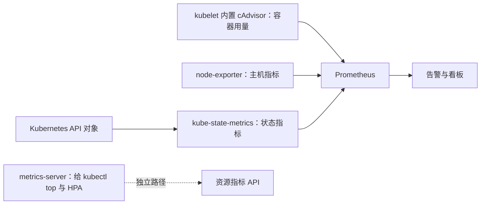

# 工作负载与资源指标排查参考

## 是什么
- **一句话定位**：把"Pod、容器、节点、Deployment、存储"层面的 Prometheus 指标，对应到它们度量的状态或用量，以及异常时该回到哪个排查条目。
- **解决什么问题**：看到容器反复重启、疑似 OOM、CPU 慢、副本不可用时，选对指标、读对意思，而且不被已经改名或弃用的旧指标误导。
- **谁在用、从哪进来**：写告警规则、搭看板、做容量与稳定性分析的人。
- **边界（不负责什么）**：控制面与节点组件指标见 控制面与节点组件指标排查参考；网络与入口指标见 网络与入口指标排查参考；采集链路排查见 监控采集链路排查参考。
- **形态与版本**：指标来自三类来源：kube-state-metrics 给对象状态，cAdvisor 给容器用量，node-exporter 给主机用量。kube-state-metrics 在 2.0.0 起改过一批指标名。
- **术语**：
  - 状态指标与用量指标 —— 前者是对象的当前状态（来自 kube-state-metrics），后者是资源消耗（来自 cAdvisor 或 metrics-server）
  - 工作集内存 —— 容器当前实际占用且难回收的内存，常用来对比内存限制
  - 限流比例 —— 被限流的周期数占总周期数的比例
  - 累计计数 —— 只增不减，必须取速率

## 组件与架构

| 组件 | 角色 | 提供什么 | 部署位置 / 形态 | 如何找到 |
|---|---|---|---|---|
| kube-state-metrics | 状态指标 | 对象状态，如 Pod 阶段、重启次数、副本数、节点状况 | 集群内的一个工作负载 | 其 Pod 与 /metrics |
| cAdvisor | 容器用量 | 容器的 CPU、内存、网络、文件系统用量 | 内置于 kubelet〔待复核〕 | kubelet 的容器指标端点 |
| node-exporter | 主机指标 | 节点的内存、磁盘、网络等 | 每个节点的 DaemonSet | 其 Pod 与 /metrics |
| metrics-server | 资源指标 | 给 kubectl top 与自动扩缩容用的 CPU 与内存用量 | 集群内的一个工作负载 | 其 Pod 与资源指标 API |
| Prometheus | 采集存储 | 抓取并保存以上指标 | 集群内或外 | 其目标页面 |

## 正常链路（请求怎么走 / 正常行为）

### 资源匹配关系
这一节的"资源 A"是指标（含关键标签），"资源 B"是它度量的状态或用量。

| 编号 | 资源 A.字段 | → | 资源 B.字段 | 匹配规则 | 对不上时的表现 |
|---|---|---|---|---|---|
| R1 | kube_pod_status_phase（标签 phase） | → | Pod 阶段 | 瞬时值，每个阶段一条序列，值表示当前是否处于该阶段 | 非 Running 的数量持续偏高：看 Pending 还是 Failed，转到 Pod排查参考与调度排查参考 |
| R2 | kube_pod_container_status_waiting_reason、terminated_reason、last_terminated_reason（标签 reason） | → | 容器为什么在等或为什么结束 | 瞬时值；waiting 看当前等待原因，terminated 看当前终止原因，last_terminated 看上一次终止的原因；稳定性在文档表里逐项标注 | 反复重启时看 last_terminated 的 reason 才能知道上一次为什么结束，如是否 OOMKilled，见 资源与QoS排查参考 |
| R3 | kube_pod_container_status_restarts_total | → | 容器重启次数 | 计数器，取速率看增长 | 速率持续大于零：容器在反复重启，对应 CrashLoopBackOff，见 Pod排查参考 |
| R4 | kube_pod_container_resource_requests 与 kube_pod_container_resource_limits（标签 resource） | → | 声明的请求与限制 | 瞬时值；2.0.0 起旧的 cpu_cores 与 memory_bytes 后缀指标被弃用，用带 resource 标签的新指标 | 沿用旧指标名：查不到数据或告警失效 |
| R5 | container_memory_working_set_bytes 对 container_spec_memory_limit_bytes | → | 内存逼近限制的程度 | 前者是当前工作集，后者是限制；二者之比越接近 1 越有被 OOM 杀掉的风险〔待复核〕 | 比值长期接近 1：容器有 OOM 风险，见 资源与QoS排查参考的 L3 |
| R6 | container_cpu_cfs_throttled_periods_total 与 container_cpu_cfs_periods_total | → | CPU 限流比例 | 都是计数器，前者的速率除以后者的速率即为限流比例；container_cpu_usage_seconds_total 的速率是实际 CPU 使用〔待复核〕 | 限流比例高而使用并不高：限制设得太低，延迟升高但容器不重启，见 资源与QoS排查参考的 L2 |
| R7 | kube_node_status_condition（标签 condition、status） | → | 节点状况 | 瞬时值；kube_node_status_capacity 与 allocatable 给出节点容量 | 压力类状况为真：节点在承压或失联，见 节点排查参考 |
| R8 | kube_deployment_spec_replicas 对 kube_deployment_status_replicas_available | → | 期望与可用副本 | 瞬时值；两者之差即缺少的可用副本 | 差值长期不为零：滚动更新卡住或 Pod 不就绪，见 工作负载控制器排查参考 |
| R9 | kube_persistentvolume_status_phase 与 kube_persistentvolume_capacity_bytes | → | 持久卷阶段与容量 | 瞬时值；PVC 对应的指标另有，名字待核〔待复核〕 | 卷停在未绑定或已释放：见 存储排查参考 |
| R10 | node_memory_MemAvailable_bytes 等 node-exporter 的主机指标 | → | 节点级内存、网络 | 来自每个节点的 node-exporter，与容器级指标互补 | 主机可用内存很低而各容器看起来正常：节点级压力或非容器进程占用，见 资源与QoS排查参考的 L5 |

### 控制面下发路径
| 环节 | 做什么 | 依据 |
|---|---|---|
| P1 | kube-state-metrics 监听 API 对象并把状态转成指标 | R1 R2 |
| P2 | kubelet 内置的 cAdvisor 暴露容器的用量指标〔待复核〕 | R5 R6 |
| P3 | node-exporter 在每个节点暴露主机指标 | R10 |
| P4 | Prometheus 抓取并保存，告警与看板基于它 | R1 R3 |
| P5 | metrics-server 独立地为 kubectl top 与自动扩缩容提供资源用量，不经 Prometheus〔待复核〕 | R5 |

### 流量走向（或生命周期）

| 环节 | 起点 → 终点 | 做什么 | 依据 | 同步/异步与默认行为 |
|---|---|---|---|---|
| L1 | 症状 → 指标族 | 状态类问题看 kube-state-metrics，用量类看 cAdvisor，主机类看 node-exporter | R1 R5 R10 | 先选对来源 |
| L2 | 状态与用量 → 对照 | 把声明的请求与限制和实际使用放在一起看 | R4 R5 R6 | 单看一个不够 |
| L3 | 对照 → 趋势 | 计数器取速率，瞬时值看趋势，比例类用除法 | R3 R6 R8 | 避免看累计值 |
| L4 | 趋势 → 条目 | 按"对不上时的表现"一列回到对应条目 | R1 至 R10 | |
| L5 | 名字核对 | 指标无数据时先查是否改名或弃用 | R4 | 升级后尤其要查 |

### 正常表现（健康基线）
- 非 Running 的 Pod 数很少且很快回落；重启速率接近零。
- 关键容器的工作集内存与限制之间有余量，CPU 限流比例很低。
- 期望副本与可用副本一致；节点压力类状况为假。

## 逐环节排查（沿链路对照）
- **P1 状态指标**
  - 正常：对象状态都有指标。
  - 异常：某些指标需要显式开启而没开；指标名已变。
  - 区分点：文档表里标有稳定性与是否需要显式开启，查不到时先看这两列。
  - 证据落点：kube-state-metrics 的指标清单。
- **P2 容器用量**
  - 正常：每个容器都有用量指标。
  - 异常：指标缺失或标签变化。
  - 区分点：容器级指标名与标签随版本和运行时可能不同，以实际输出为准〔待复核〕。
  - 证据落点：容器指标端点的实际输出。
- **P3 主机指标**
  - 正常：每个节点都有。
  - 异常：某节点缺失。
  - 区分点：先看该节点的 node-exporter 是否在运行。
  - 证据落点：该节点的 node-exporter Pod。
- **P4 采集**
  - 正常：目标都被抓到。
  - 异常：抓取失败，指标停更。
  - 区分点：参见采集链路条目；up 为 0 就是抓不到。
  - 证据落点：目标的 up 状态。
- **P5 metrics-server**
  - 正常：kubectl top 有数据。
  - 异常：kubectl top 与 Prometheus 数据不一致或没数据。
  - 区分点：两者来源与采样窗口不同，数值不必完全相等；没数据先看 metrics-server〔待复核〕。
  - 证据落点：metrics-server 的状态与资源指标 API 的可用性。
- **L1 选指标族**
  - 正常：选对来源。
  - 异常：用 kube-state-metrics 找用量，或用 cAdvisor 找对象状态。
  - 区分点：状态问用 KSM，用量问用 cAdvisor。
  - 证据落点：指标所属组件。
- **L2 对照**
  - 正常：请求、限制、实际三者放在一起。
  - 异常：只看实际使用，忽略限制。
  - 区分点：限流与 OOM 都与限制有关，必须对照限制。
  - 证据落点：三类指标。
- **L3 趋势**
  - 正常：看速率与比例。
  - 异常：看累计值。
  - 区分点：重启次数与 CPU 时间都是累计值，取速率。
  - 证据落点：速率曲线。
- **L4 对应条目**
  - 正常：能指到条目。
  - 异常：指标异常但不知看哪个条目。
  - 区分点：回到症状检索。
  - 证据落点：本条对应表。
- **L5 改名与弃用**
  - 正常：指标名是当前的。
  - 异常：告警沿用旧名字，查不到数据。
  - 区分点：kube-state-metrics 2.0.0 起弃用带 cpu_cores 与 memory_bytes 后缀的旧资源指标。
  - 证据落点：所用版本的指标文档。

## 异常归因速查
| 现象 / 错误码 | 环节 | 归因类别（回指 R#） | 证据位 | 详细条目 |
|---|---|---|---|---|
| 容器反复重启 | L3 | 重启速率持续大于零（R3） | kube_pod_container_status_restarts_total 的速率 | oss/k8s-pod.md |
| 不知道上次为什么重启 | L2 | 看 last_terminated 的 reason（R2） | kube_pod_container_status_last_terminated_reason | oss/k8s-resources.md |
| 疑似 OOM | L3 | 工作集逼近限制，且终止原因为 OOMKilled（R2、R5） | 工作集与限制之比；终止原因 | oss/k8s-resources.md |
| 延迟高但容器没重启 | L3 | CPU 被限流（R6） | 限流比例；CPU 使用 | oss/k8s-resources.md |
| 一直有 Pod 非 Running | L3 | 阶段为 Pending 或 Failed（R1） | kube_pod_status_phase | oss/k8s-scheduling.md |
| 期望与可用副本不一致 | L3 | 滚动更新卡住或 Pod 不就绪（R8） | 副本指标之差 | oss/k8s-workload.md |
| 节点压力类状况为真 | L3 | 节点承压或失联（R7） | kube_node_status_condition | oss/k8s-node.md |
| 持久卷停在未绑定 | L3 | 存储绑定问题（R9） | 卷与声明的阶段 | oss/k8s-storage.md |
| 告警查不到数据 | L5 | 沿用了已弃用的旧指标名（R4） | 指标名与版本 | |
| kubectl top 与 Prometheus 不一致 | P5 | 来源与采样窗口不同（R5） | 两侧的数据来源 | |
| 主机可用内存低而容器正常 | L3 | 节点级压力（R10） | node-exporter 的主机内存 | oss/k8s-resources.md |

## 状态、事件与日志语义
| 来源 | 取值 | 含义 | 常见出现环节 |
|---|---|---|---|
| 指标类型 | Gauge | kube-state-metrics 的状态类指标多为瞬时值 | L1 |
| 指标类型 | Counter | 重启次数、CPU 时间、限流周期都是累计值 | L3 |
| 稳定性 | STABLE、EXPERIMENTAL | kube-state-metrics 文档里逐项标注 | P1 |
| 标签 | reason | 容器等待、终止、上次终止的原因 | R2 |
| 标签 | resource | 请求与限制指标里的资源种类（取代旧的后缀指标） | R4 |
| 指标 | up | 目标是否可抓取 | P4 |

## 配置语义
| 配置项 | 默认 / 取值含义 | 改动后的行为后果 |
|---|---|---|
| kube-state-metrics 的开启项 | 部分指标需显式开启 | 没开则查不到对应指标 |
| 指标名与版本 | 2.0.0 起弃用旧资源指标名 | 升级后沿用旧名字的告警失效 |
| 采集间隔 | 由 Prometheus 决定 | 间隔越长，短暂的限流与重启越容易漏看 |

## 边界与置信度说明
- **来源**：kube-state-metrics 项目文档的 Pod 指标页给出容器状态原因类指标及其稳定性；其余指标名与含义来自 IBM Kubecost、华为云 CCE、Last9 等二手清单，不是各项目官方文档。没有做过运行时取证。
- **〔待复核〕项**：cAdvisor 内置于 kubelet 的方式与端点；工作集与限制之比作为 OOM 风险的解读；限流比例的算法；PVC 指标的名字；metrics-server 与 Prometheus 数据的差异；容器指标名随版本与运行时的变化。
- **版本差异**：kube-state-metrics 2.0.0 起弃用带 cpu_cores 与 memory_bytes 后缀的旧资源指标；部分指标稳定性随版本变化；各指标的实际存在取决于是否开启。
- **未覆盖**：告警阈值的具体取值（依赖集群规模）；kube-state-metrics 对自定义资源的指标；GPU、网络策略等扩展指标；指标基数与成本控制；Windows 节点的指标。
- **related**：见 frontmatter。
