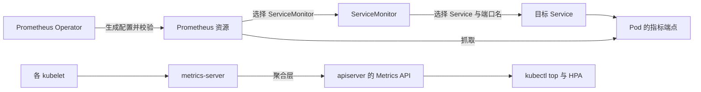
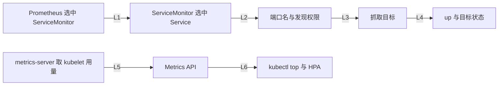

# 监控采集链路排查参考

## 是什么
- **一句话定位**：指标从暴露到被看到要经过两条独立的管道。一条是 Prometheus 采集：Prometheus 选中 ServiceMonitor，ServiceMonitor 选中 Service，再按端口抓取。另一条是 metrics-server：从各 kubelet 采集 CPU 与内存用量，经 Metrics API 给 kubectl top 与自动扩缩容用。
- **解决什么问题**：ServiceMonitor 创建了却没有目标、目标 down、kubectl top 报错、HPA 取不到指标时，沿管道逐层判断卡在选择、端口、权限、证书还是网络。
- **谁在用、从哪进来**：搭监控、写告警、用 kubectl top 与 HPA 的人。
- **边界（不负责什么）**：各组件暴露哪些指标见 控制面与节点组件指标排查参考、工作负载与资源指标排查参考、网络与入口指标排查参考；Prometheus 自身的存储与查询性能、Alertmanager 的告警路由不在范围；HPA 的扩缩容逻辑本条未展开。
- **形态与版本**：假设用 Prometheus Operator 管理 Prometheus；不用 Operator 的静态抓取配置规则不同。metrics-server 各版本默认值不同。
- **术语**：
  - ServiceMonitor 与 PodMonitor —— 声明"抓取哪些 Service 或 Pod 的哪个端口"
  - 选择器 —— Prometheus 选中 ServiceMonitor，ServiceMonitor 选中 Service，是两个不同的选择
  - Metrics API —— metrics-server 经聚合层提供的资源用量接口
  - 聚合层 —— apiserver 把某些 API 转发给扩展服务的机制

## 组件与架构

| 组件 | 角色 | 职责 | 部署位置 / 形态 | 如何找到 |
|---|---|---|---|---|
| Prometheus 资源 | 采集端配置 | 用选择器决定采哪些 ServiceMonitor | 自定义资源 | 该资源的 spec |
| ServiceMonitor 与 PodMonitor | 采集声明 | 选目标并指明端口与路径 | 自定义资源 | 对象与事件 |
| Prometheus Operator | 控制器 | 校验资源并生成 Prometheus 配置，拒绝无效资源 | 集群内的工作负载 | 其日志与事件 |
| metrics-server | 用量聚合 | 从 kubelet 采集用量并提供 Metrics API | kube-system 里的工作负载 | 其 Pod 与 APIService |
| kubelet | 数据来源 | 提供资源指标端点 | 每个节点 | 节点地址与 kubelet 端口 |

## 正常链路（请求怎么走 / 正常行为）

### 资源匹配关系
| 编号 | 资源 A.字段 | → | 资源 B.字段 | 匹配规则 | 对不上时的表现 |
|---|---|---|---|---|---|
| R1 | Prometheus 的 serviceMonitorSelector 与 serviceMonitorNamespaceSelector | → | 被选中的 ServiceMonitor | 前者匹配 ServiceMonitor 自己的标签，后者选择含有 ServiceMonitor 的命名空间 | ServiceMonitor 存在但标签或命名空间不在范围内：Prometheus 完全看不到它 |
| R2 | ServiceMonitor 的 namespaceSelector 与 selector | → | 目标 Service | namespaceSelector 选目标 Service 所在命名空间，selector 匹配的是 Service 的标签，不是 Deployment 或 Pod 的标签 | 标签写在 Deployment 或 Pod 上：选不到目标 |
| R3 | endpoints 的 port | → | Service 的端口名 | 对应 Service 端口的名字，不是 Pod 或容器的端口名；也可用 targetPort 按名字或编号选 Pod 容器端口，二者都设时 port 优先〔待复核〕 | Service 端口没起名或名字不同：选择匹配了但端点解析不出来 |
| R4 | Prometheus 的服务账号权限与 serviceDiscoveryRole | → | 服务发现能力 | 需要对相关资源有 get、list、watch；serviceDiscoveryRole 未设时继承 Prometheus，都未设用 Endpoints；kubelet 的 Endpoints 在 v1.33 起弃用，需改用 EndpointSlice 并授予 endpointslices 读取权限 | 缺权限：发现不到目标；v1.33 以上仍用 Endpoints：kubelet 目标可能发现不到 |
| R5 | 无效的 ServiceMonitor 等资源 | → | 是否被调和进配置 | Operator 拒绝无效资源并发出事件；生成的配置存放在一个 Secret 里，ServiceMonitor 名字被编码进去，可直接搜索 | 对象存在却不在生成的配置里：被 Operator 拒绝或没被选中，先看事件 |
| R6 | 空与 null 的选择器 | → | 匹配范围 | 空的 serviceMonitorSelector 匹配全部，null 则不匹配任何；空的 serviceMonitorNamespaceSelector 匹配全部命名空间〔待复核〕 | 误以为没写就是全选：null 时什么都不选 |
| R7 | 生成的抓取任务 | → | 实际目标与状态 | 有任务但没有目标，指向命名空间、Service、端口、重新标记或发现权限；有活动目标但 down，说明发现成功而抓取失败〔待复核〕 | 分清"没发现"与"发现了抓不到"，排查方向完全不同 |
| R8 | metrics-server | → | 每个 kubelet 的地址与端口 | 地址取自 Node 的 status.addresses，端口取自 kubelet 端点端口，默认 10250，按 kubelet-preferred-address-types 的顺序选第一个地址 | 选到的地址对 metrics-server 不可达：该节点没有数据 |
| R9 | kubelet 的服务证书 | → | metrics-server 的校验 | 要求 kubelet 证书由集群 CA 签发，否则要传 --kubelet-insecure-tls，仅用于测试 | 证书校验失败：metrics-server 采不到数据，见 集群证书排查参考的 R4 |
| R10 | 聚合层与 APIService | → | Metrics API 是否可用 | apiserver 必须启用聚合层，且控制面要能访问 metrics-server 的 Pod IP 与端口；metrics.k8s.io 经 APIService 注册，其 Available 应为 True〔待复核〕 | APIService 不可用：kubectl top 报 Metrics API not available |
| R11 | metrics-server 的定位 | → | 适用场景 | 供 HPA、VPA 与 kubectl top 使用；不应作为监控方案的指标来源，监控应直接从 kubelet 的 /metrics/resource 采集；不适合要求准确用量的场景 | 拿它当监控数据源：数据口径与 Prometheus 不同，两者不必一致 |

### 控制面下发路径
| 环节 | 做什么 | 依据 |
|---|---|---|
| P1 | 部署 Prometheus（Operator）并配置 serviceMonitorSelector 与命名空间选择器 | R1 R6 |
| P2 | 创建 ServiceMonitor 或 PodMonitor，写明选择与端口〔待复核〕 | R2 R3 |
| P3 | Operator 校验资源，生成配置，对无效资源发事件 | R5 |
| P4 | Prometheus 做服务发现并抓取目标 | R4 R7 |
| P5 | 部署 metrics-server 并满足前提：聚合层、节点 Webhook 认证授权、kubelet 证书、运行时的容器指标、网络连通 | R8 R9 R10 |

### 流量走向（或生命周期）

| 环节 | 起点 → 终点 | 做什么 | 依据 | 同步/异步与默认行为 |
|---|---|---|---|---|
| L1 | Prometheus → ServiceMonitor | 按命名空间与标签选中 | R1 R6 | 周期性调和 |
| L2 | ServiceMonitor → Service | 按命名空间与 Service 标签选中目标 | R2 | |
| L3 | Service → 端点 | 按端口名解析，需有发现权限 | R3 R4 | |
| L4 | 目标 → 抓取 | 按间隔抓取，状态可在 Prometheus 的 Status 页看 | R7 | 抓取失败则目标 down |
| L5 | kubelet → metrics-server | 按地址与端口采集用量 | R8 R9 | 新版本约每 15 秒一次，旧教程写 60 秒〔待复核〕 |
| L6 | metrics-server → Metrics API | 经聚合层提供给 kubectl top 与 HPA | R10 R11 | 刚安装后可能要等一会儿才有数据 |

### 正常表现（健康基线）
- 需要的 ServiceMonitor 都出现在生成的配置里，目标都为 up。
- Prometheus 的服务账号有足够的发现权限；没有被 Operator 拒绝的资源。
- APIService 为可用，kubectl top 能给出各节点与 Pod 的用量。

## 逐环节排查（沿链路对照）
- **P1 选择器配置**
  - 正常：选择器覆盖了需要的 ServiceMonitor。
  - 异常：选择器与 ServiceMonitor 的标签或命名空间不匹配；误用 null。
  - 区分点：用 Helm 部署时，发布名本身不是选择器配置，要看 Prometheus 资源的实际 spec（R1、R6）。
  - 证据落点：Prometheus 资源的选择器字段。
- **P2 采集声明**
  - 正常：选择、端口名都写对。
  - 异常：标签写在 Deployment 上；端口写成数字或容器端口名。
  - 区分点：port 要对应 Service 的端口名（R2、R3）。
  - 证据落点：ServiceMonitor 的 selector 与 endpoints；Service 的标签与端口名。
- **P3 Operator 校验**
  - 正常：资源被调和进配置。
  - 异常：资源被拒绝。
  - 区分点：对象存在却不在生成的配置里，先看该对象的事件，再搜生成配置里有没有它的名字（R5）。
  - 证据落点：事件；存放生成配置的 Secret。
- **P4 发现与抓取**
  - 正常：目标被发现并抓取。
  - 异常：有任务没有目标；有目标但 down。
  - 区分点：没有目标是发现层问题，有目标但 down 是抓取层问题（R7）。
  - 证据落点：Prometheus 的 Service discovery 与 Target health 页。
- **P5 metrics-server 前提**
  - 正常：前提都满足。
  - 异常：聚合层未启用；节点未启用 Webhook 认证授权；运行时不提供容器指标。
  - 区分点：这些是集群与发行版层面的前提，不是 metrics-server 配置能解决的。
  - 证据落点：apiserver 与 kubelet 的配置；运行时能力。
- **L1 选中 ServiceMonitor**
  - 正常：被选中。
  - 异常：不在范围内。
  - 区分点：看命名空间标签与 ServiceMonitor 标签是否被选择器覆盖。
  - 证据落点：生成配置里是否有该名字。
- **L2 选中 Service**
  - 正常：选中。
  - 异常：选不到。
  - 区分点：用 ServiceMonitor 的 selector 去列 Service，列不出就说明标签对不上。
  - 证据落点：按 selector 查到的 Service 列表。
- **L3 端口与权限**
  - 正常：端口解析成功，有权限。
  - 异常：端口名对不上；缺发现权限；kubelet 目标因 Endpoints 弃用而发现不到。
  - 区分点：选择都匹配而端点解析不出，先查端口名；发现不到再查 RBAC 与 serviceDiscoveryRole（R3、R4）。
  - 证据落点：Service 端口名；Prometheus 服务账号的权限。
- **L4 抓取状态**
  - 正常：up。
  - 异常：down，或有目标但没有指标。
  - 区分点：down 看目标的网络、认证与路径；没有指标可能是被重新标记丢弃，见指标条目。
  - 证据落点：目标页的错误信息。
- **L5 metrics-server 采集**
  - 正常：从各 kubelet 取到用量。
  - 异常：证书校验失败；到 kubelet 的网络不通；选了不可达的地址。
  - 区分点：看 metrics-server 日志里的是证书错误还是连接错误；证书问题回到 集群证书排查参考，不要在生产里长期用 --kubelet-insecure-tls（R8、R9）。
  - 证据落点：metrics-server 日志；节点地址类型与 kubelet 端口。
- **L6 Metrics API**
  - 正常：kubectl top 有数据。
  - 异常：Metrics API not available；metrics not available yet。
  - 区分点：前者看 APIService 与控制面到 metrics-server 的连通；后者多为刚安装或刚启动，等一会儿（R10）。
  - 证据落点：APIService 的 Available 状态；metrics-server 的就绪状态。

## 异常归因速查
| 现象 / 错误码 | 环节 | 归因类别（回指 R#） | 证据位 | 详细条目 |
|---|---|---|---|---|
| ServiceMonitor 存在但 Prometheus 里没有目标 | L1 L2 | 没被 Prometheus 选中，或没选中 Service（R1、R2） | 选择器；生成配置 | |
| ServiceMonitor 不在生成的配置里 | P3 | 被 Operator 拒绝或不在选择范围（R5） | 事件；配置 Secret | |
| 选择匹配但端点解析不出 | L3 | 端口名对不上（R3） | Service 的端口名 | |
| 目标发现不到 | L3 | 缺发现权限，或 kubelet 仍用 Endpoints（R4） | RBAC；serviceDiscoveryRole | |
| 有任务没有目标 | P4 | 命名空间、Service、端口或权限问题（R7） | Service discovery 页 | |
| 目标 down | L4 | 发现成功而抓取失败（R7） | Target health 页的错误 | |
| 以为没写选择器就是全选 | P1 | null 选择器不匹配任何（R6） | 选择器取值 | |
| Metrics API not available | L6 | APIService 不可用或聚合层与连通有问题（R10） | APIService；metrics-server | oss/k8s-apiserver.md |
| metrics not available yet | L6 | 刚启动还没采集到数据 | metrics-server 就绪时间 | |
| metrics-server 证书错误 | L5 | kubelet 证书不由集群 CA 签发（R9） | kubelet 证书；日志 | oss/k8s-certs.md |
| 部分节点没有用量 | L5 | 选了不可达的节点地址（R8） | 地址类型顺序；连通性 | oss/k8s-node.md |
| kubectl top 与 Prometheus 数据不一致 | L6 | 来源与口径不同，metrics-server 不是监控源（R11） | 两侧数据来源 | oss/metrics-workload.md |
| HPA 取不到指标 | L6 | Metrics API 不可用（R10） | APIService | |

## 状态、事件与日志语义
| 来源 | 取值 | 含义 | 常见出现环节 |
|---|---|---|---|
| Operator 事件 | 针对 ServiceMonitor 等资源的拒绝事件 | 说明资源为什么被拒绝 | P3 |
| 目标状态 | up 与 down | 抓取成功与失败 | L4 |
| Prometheus 页面 | Service discovery 与 Target health | 分别看发现结果与抓取结果 | P4 |
| 错误 | Metrics API not available | metrics.k8s.io 不可用 | L6 |
| 错误 | metrics not available yet | 还没有采集到数据 | L6 |
| APIService | v1beta1.metrics.k8s.io 的 Available | 聚合 API 是否可用〔待复核〕 | L6 |

## 配置语义
| 配置项 | 默认 / 取值含义 | 改动后的行为后果 |
|---|---|---|
| serviceMonitorSelector | 空匹配全部，null 不匹配任何〔待复核〕 | 决定哪些 ServiceMonitor 被采纳 |
| serviceMonitorNamespaceSelector | 空匹配全部命名空间〔待复核〕 | 决定在哪些命名空间找 ServiceMonitor |
| serviceDiscoveryRole | 未设时继承，都未设用 Endpoints；v1.33 起 kubelet 的应改用 EndpointSlice | 需要同步授予 endpointslices 的权限 |
| --kubelet-insecure-tls | 不校验 kubelet 证书，仅用于测试 | 生产应让 kubelet 使用被信任的证书 |
| --kubelet-preferred-address-types | 清单里默认 InternalIP、ExternalIP、Hostname | 决定连接 kubelet 用哪种地址 |
| --metric-resolution | 新版本文档写每 15 秒，旧教程写 60 秒〔待复核〕 | 决定用量的新鲜度 |

## 边界与置信度说明
- **来源**：Prometheus Operator 官方排障文档给出选择规则、端口名含义、事件与 EndpointSlice 迁移；metrics-server 官方 README（经转载页取得）给出前提、网络要求、证书要求与定位。空与 null 选择器语义、目标状态的解读、APIService 细节来自二手资料。没有做过运行时取证。
- **〔待复核〕项**：空与 null 选择器的语义；目标"有任务无目标"与"有目标但 down"的解读；targetPort 与 port 的优先级；APIService 的状态字段；metrics-server 默认采集间隔的版本差异。
- **版本差异**：kubelet 的 Endpoints 自 Kubernetes v1.33 起弃用；metrics-server 的采集间隔在新版文档写 15 秒，旧教程写 60 秒。
- **未覆盖**：不使用 Operator 的静态抓取配置；Probe、ScrapeConfig 等其他自定义资源；Prometheus 的远程写与长期存储；告警路由；Metrics API 之外的自定义与外部指标接口；HPA 的扩缩容算法与稳定窗口；metrics-server 的 HA 与规模参数的调优。
- **related**：见 frontmatter。
