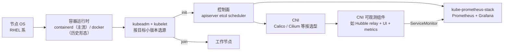

# 自建 kubeadm 集群安装与可观测性接入链路排查参考

## 是什么
- **一句话定位**：kubeadm 自建 Kubernetes 集群的通用安装链路（系统准备 → 容器运行时 → kubeadm → 镜像 → init/join → CNI → 监控栈）与可观测性接入（Prometheus/Grafana + CNI 流量指标），**版本无关**——安装更新版本时流程不变，只换各环节的取值。
- **解决什么问题**：安装期故障（kubelet 起不来、pause 镜像拉不动、join 失败）与安装后可观测性接入失败（指标查不到、dashboard 导不进）按链路定位，而不是按组件散查。
- **谁在用、从哪进来**：排查人员拿到一台待装/新装节点或半成品集群时，沿本条目链路对照；消费方为 troubleshooting 排查流程。
- **边界（不负责什么）**：kubeadm/containerd/Cilium/Calico/Prometheus Operator 的通用机制细节另见 oss 对应条目（cilium/containerd/calico/monitoring-pipeline）；集群日常运行期故障（调度、网络策略、证书轮换）不属于本条目；存量集群的小版本滚动升级（kubeadm upgrade）流程另见 oss/k8s-upgrade.md。
- **形态与版本**：链路对 1.x 全系适用。**版本耦合的内容只出现在两处**：「本环境已验证组合」节记录本环境实测过的取值组合与固定特例；各环节标注的内核/组件版本下限（如 eBPF 全量功能需内核 ≥5.10）。
- **术语**：
  - kube-proxy-free —— `kubeadm init --skip-phases=addon/kube-proxy` 跳过 kube-proxy 安装，由 CNI（如 Cilium `kubeProxyReplacement=true`）接管 Service 转发；可选形态，非默认
  - sandbox_image —— containerd config.toml 里的 pause 底座镜像，须与目标 kubeadm 版本期望值对齐
  - exclude + disableexcludes —— kubernetes.repo 用 `exclude=` 锁住 kube 组件防 yum 误升级，安装时用 `--disableexcludes=kubernetes` 临时放行

## 组件与架构

| 组件 | 角色 | 职责 | 部署位置 / 形态 | 如何找到 |
|---|---|---|---|---|
| kubeadm/kubelet | 控制面 + 节点代理 | 集群引导与节点生命周期 | systemd 服务，yum 安装 | `systemctl status kubelet` |
| containerd | 数据面 | 容器运行时，SystemdCgroup=true | systemd 服务，docker-ce 源安装 | `ctr info` / config.toml |
| docker（历史形态） | 数据面 | 容器运行时，cgroupdriver=systemd | systemd 服务 | `docker info` |
| CNI | 数据面 | Pod 网络与网络策略；选型决定 Service 转发是否接管 | manifest 或 helm chart | 对应命名空间 Pod |
| CNI 可观测组件 | 可观测 | eBPF/流量指标暴露（如 Hubble） | 随 CNI chart 开启 | 对应 Pod 与 ServiceMonitor |
| kube-prometheus-stack | 可观测 | Prometheus 指标采集 + Grafana | helm chart，自定命名空间 | 安装时命名空间内 Pod |

## 正常链路（安装怎么走 / 正常行为）

### 资源匹配关系
| 编号 | 资源 A.字段 | → | 资源 B.字段 | 匹配规则 | 对不上时的表现 |
|---|---|---|---|---|---|
| R1 | containerd config.toml `sandbox_image` | → | 目标 kubeadm 版本期望的 pause 版本 | 必须一致；通用做法是从 `kubeadm config images list` 动态取 pause 值回填 config.toml 后重启 containerd（不写死版本号，升级自然跟随） | pause 拉取失败、Pod 卡 sandbox 创建 |
| R2 | 运行时 cgroup driver | → | kubelet cgroupDriver | 必须同为 systemd（containerd 走 SystemdCgroup=true；docker 历史形态走 daemon.json 的 native.cgroupdriver=systemd） | kubelet 起不来或容器反复重启 |
| R3 | CNI `kubeProxyReplacement=true`（kube-proxy-free 时） | → | `k8sServiceHost/Port` = `kubectl get ep kubernetes` 的 apiserver 端点，且 init 时 `--skip-phases=addon/kube-proxy` | 三者同时成立才是完整 kube-proxy-free 形态；不用此形态则三项都不设 | 流量转发缺一块：要么 kube-proxy 残留双写，要么 Service 不通 |
| R4 | CNI 指标 ServiceMonitor 的标签（如 labels.release） | → | Prometheus Operator 的 serviceMonitorSelector | 标签必须被 selector 选中（kube-prometheus-stack 默认按 release 标签） | CNI 指标在 Prometheus 里查不到 |
| R5 | NetworkPolicy（CNP）`endpointSelector` | → | 目标 Pod labels | L7 可见性与放行只对匹配 Pod 生效，且须显式写 toPorts + rules（dns/http） | 七层指标（dns/http）不产生 |
| R6 | 节点主网卡名 | → | init 的 `--apiserver-advertise-address` | 必须取到真实网卡 IP；通用做法是脚本化提取或显式传值，不依赖固定网卡名 | advertise address 为空或取错，init/join 异常 |
| R7 | join token（`kubeadm token list/create`） | → | 节点 join 命令 | token 有有效期（默认 24h）；推荐带 `--discovery-token-ca-cert-hash` 做 CA 校验 | join 报 token 无效或证书校验失败 |

### 流量走向（安装生命周期）

| 环节 | 起点 → 终点 | 做什么 | 依据 | 同步/异步与默认行为 |
|---|---|---|---|---|
| L1 | OS → 内核参数 | 停 firewalld、关 swap（fstab 注释 + swapoff）、SELinux=permissive、modprobe br_netfilter、写 /etc/sysctl.d/kubernetes.conf（bridge-nf-call-iptables/ip6tables=1、ip_forward=1） | — | 同步；全版本不变 |
| L2 | OS → 运行时 | 装 containerd.io，`containerd config default` 生成配置后改 SystemdCgroup=true | R2 | 同步；docker 为历史形态，仅存量集群 |
| L3 | OS → kubeadm | 写 kubernetes.repo，**baseurl 按目标小版本选**（官方 pkgs.k8s.io core:/stable:/v1.X/，内网映射到镜像源同版本路径），加 exclude=kubelet kubeadm kubectl cri-tools kubernetes-cni，安装时 `--disableexcludes=kubernetes` | — | 同步；换版本只改 repo 路径，流程不变 |
| L4 | 运行时 → 镜像就绪 | `kubeadm config images list` 列出目标镜像 → 动态对齐 sandbox_image（R1）→ `kubeadm config images pull`（受限网络用 `--image-repository` 指向代理仓库） | R1 | 同步 |
| L5 | kubeadm → 控制面 | `kubeadm init --apiserver-advertise-address=<主网卡IP> --service-cidr=<规划值> --pod-network-cidr=<规划值>`；kube-proxy-free 追加 `--skip-phases=addon/kube-proxy` | R3 R6 | 同步；kubelet 此前已 enable --now，init 前处于重启循环属正常 |
| L6 | 控制面 → 工作节点 | 生成 join 命令（token + CA hash），节点执行；token 过期用 `kubeadm token create` 重发 | R7 | 同步 |
| L7 | 控制面 → CNI | 按选型安装（manifest 或 helm）；kube-proxy-free 形态须把 apiserver 端点传给 CNI | R3 | 异步；Pod 就绪前节点 NotReady 属预期 |
| L8 | CNI → 可观测 | 先装 kube-prometheus-stack；NodePort 暴露走 `get svc \| sed \| replace`；再 helm upgrade --reuse-values 开 CNI 指标 serviceMonitor（标签须被 selector 选中，R4）；dashboard 经 Grafana API 导入（删 uid/id 后包装 overwrite=true） | R4 R5 | 异步 |

### 本环境已验证组合（版本特例数据，升级版本时只更新本节）
| 项目 | v1.23（历史） | v1.25（历史） | v1.33（现用） |
|---|---|---|---|
| OS | CentOS 7.6 | CentOS 7.6 | CentOS Stream 9 |
| 运行时 | docker + daemon.json cgroupdriver | containerd + SystemdCgroup | containerd + SystemdCgroup |
| kubeadm 源 | 华为云 el7 镜像源 | 阿里云 el7 镜像源 | pkgs.k8s.io 官方源 |
| 镜像获取 | SWR 代理仓库 `--image-repository` | 官方直拉 | 官方直拉 |
| CNI | Calico manifest | Calico manifest | Cilium helm，kube-proxy-free + Hubble |
| 本环境固定取值 | service-cidr=10.247.0.0/16、pod-network-cidr=10.0.0.0/16（三代不变）；节点主网卡名 eth0；join 固定带 `--discovery-token-unsafe-skip-ca-verification`（跳过 CA 校验，信任特例） |||

### 正常表现（健康基线）
- init 完成后：`kubectl get nodes` master Ready（装 CNI 前 NotReady 属预期）；`kubectl get ep kubernetes` 有 apiserver 地址端口。
- kube-proxy-free 形态：`kube-proxy` Pod **不存在**是预期（skip-phases），不是故障。
- kubelet 在 init 前因缺 /etc/kubernetes 配置反复重启，属正常等待态。
- Grafana API 导入成功返回 HTTP 200；NodePort 端口从 `spec.ports..nodePort` 读取。

## 逐环节排查（沿链路对照）
- **L1 系统准备**
  - 正常：`sysctl -p /etc/sysctl.d/kubernetes.conf` 三参数全为 1；swap 关闭；SELinux permissive。
  - 异常：swap 未关时 kubelet 拒绝启动；bridge-nf-call-iptables=0 时 iptables 规则对桥接流量不生效。
  - 区分点：故障出现在 kubelet 启动或 Pod 网络阶段，但系统参数没落——回到本环节。
  - 证据落点：`sysctl net.bridge.bridge-nf-call-iptables`、`swapon --show`、`getenforce`。
- **L2 运行时安装**
  - 正常：`ctr info` 的 cgroup driver 为 systemd。
  - 异常：cgroup driver 与 kubelet 不一致（R2）；containerd 配置是 default 未改 SystemdCgroup。
  - 区分点：kubelet journal 报 cgroup 相关错误即指向本环节。
  - 证据落点：kubelet journal、`containerd config dump | grep SystemdCgroup`。
- **L3 kubeadm 安装**
  - 正常：yum 安装成功，repo baseurl 与目标小版本匹配。
  - 异常：源路径与目标版本不对应装出旧版/装不到；exclude 未配合 --disableexcludes 导致空装。
  - 证据落点：`yum list installed | grep kubelet`、repo 文件 baseurl。
- **L4 镜像准备**
  - 正常：`kubeadm config images list` 与本地镜像一致；sandbox_image 已动态对齐（R1）。
  - 异常：pause 版本不匹配、代理仓库登录失效。
  - 区分点：拉取阶段报镜像不存在/超时，而系统与运行时正常。
  - 证据落点：`crictl images`、containerd 日志。
- **L5 init**
  - 正常：输出 join 命令、admin.conf 就位、`kubectl cluster-info` 通。
  - 异常：advertise address 空/错（R6）；CIDR 与后续 CNI 规划冲突。
  - 证据落点：init 输出、`kubectl get ep kubernetes`。
- **L6 join**
  - 正常：节点出现在 `kubectl get nodes`。
  - 异常：token 过期；跳过 CA 校验（unsafe-skip-ca）带来中间人风险面——本环境历史特例，新集群建议改带 CA hash。
  - 证据落点：`kubeadm token list`、节点侧 join 输出。
- **L7 CNI**
  - 正常：CNI Pod 全 Ready；节点转 Ready；kube-proxy-free 形态无 kube-proxy（R3）。
  - 异常：Pod 起不来（内核版本不满足，eBPF 全量功能需 ≥5.10）、apiserver 端点传错。
  - 区分点：节点长期 NotReady 且无 CNI Pod 即指向本环节。
  - 证据落点：`kubectl get pods -n kube-system`、CNI Pod 日志。
- **L8 监控栈与指标接入**
  - 正常：Prometheus targets 里出现 CNI 指标目标；Grafana 有对应 dashboard；NodePort 可访问。
  - 异常：指标查不到（R4）、dashboard 导入失败（uid/id 未删或脚本判断 bug）。
  - 证据落点：Prometheus targets 页、Grafana API 返回码、`kubectl get servicemonitor -A`。

## 异常归因速查
| 现象 / 错误码 | 环节 | 归因类别（回指 R#） | 证据位 | 详细条目 |
|---|---|---|---|---|
| pause 镜像拉取失败 | L4 | sandbox_image 与目标版本不匹配（R1） | containerd config / crictl images | |
| kubelet 起不来或容器反复重启 | L2 | cgroup driver 与运行时不一致（R2） | kubelet journal / containerd config | |
| 桥接流量异常、iptables 规则不生效 | L1 | bridge-nf-call-iptables 未开 | sysctl 输出 | oss/linux-network.md |
| advertise address 为空或错 | L5 | 主网卡 IP 提取落空（R6） | 脚本 echo 变量 / ip addr | |
| join 报 token 无效 | L6 | token 过期（R7） | kubeadm token list | oss/k8s-certs.md |
| 节点长期 NotReady、Pod 无 IP | L7 | CNI 未装/未就绪（R3） | kube-system Pod 列表 | oss/calico.md oss/cilium.md |
| kube-proxy-free 集群里找不到 kube-proxy | L7 | skip-phases 固定形态，属预期（R3） | init 命令回看 | oss/cilium.md |
| Service 转发不通（kube-proxy-free） | L7 | 三要素缺一（R3） | CNI config / ep kubernetes | oss/cilium.md oss/kube-proxy.md |
| CNI 指标在 Prometheus 查不到 | L8 | serviceMonitor 标签不被 selector 选中（R4） | Prometheus targets | oss/monitoring-pipeline.md |
| 七层（dns/http）指标不产生 | L8 | 未建 NetworkPolicy 或 selector/rules 不匹配（R5） | CNP 清单 / CNI 日志 | oss/cilium.md |
| Grafana dashboard 导入失败 | L8 | JSON 未删 uid/id 冲突，或脚本 http_code/http_status 变量错位恒报失败 | API 返回码 / 脚本实读 | |

## 状态、事件与日志语义
| 来源 | 取值 | 含义 | 常见出现环节 |
|---|---|---|---|
| kubelet journal | Running with swap on is not supported | swap 未关，kubelet 拒绝工作 | L1 |
| kubelet journal | cgroup driver 相关不匹配报错 | 运行时与 kubelet cgroupDriver 不一致（R2） | L2 |
| 节点状态 | NotReady（CNI 装前） | 预期等待态，装完 CNI 自愈 | L5-L7 |
| `kubectl get pods -n kube-system` | 无 kube-proxy | kube-proxy-free 固定形态，非故障（R3） | L7 |
| containerd 日志 | sandbox 镜像拉取失败 | sandbox_image 未对齐（R1） | L4 |
| Grafana API | 200 / 非 200 | 导入成功 / uid 冲突或认证失败；本环境脚本判断恒显示失败，以实际返回码为准 | L8 |

## 配置语义
- `/etc/sysctl.d/kubernetes.conf`：bridge-nf-call-iptables/ip6tables=1 让 iptables 规则作用于桥接流量；ip_forward=1 允许转发。缺任一 → kube-proxy/CNI 行为异常。
- `/etc/containerd/config.toml`：SystemdCgroup=true（与 kubelet 对齐）；sandbox_image（与目标版本 pause 对齐）。两处都须改在 `containerd config default` 生成之后。
- kubernetes.repo：baseurl 按目标小版本选；exclude 列表防 yum 误升级，安装时 --disableexcludes 放行。
- kubeadm init 规划参数：service-cidr 与 pod-network-cidr 须与 CNI 及 networkpolicy 规划一致；本环境取值见「本环境已验证组合」。
- docker daemon.json（历史形态）：exec-opts 设 native.cgroupdriver=systemd；脚本用 `>>` 追加写——文件已存在时会产生重复键，属已知粗糙点。

## 边界与置信度说明
- confidence 为 observed-once：通用链路与约束来自三代安装脚本实测与内部部署文档；**已实测范围限定于「本环境已验证组合」节所列组合**，安装更新版本时流程不变，但该版本本身未实测，取值处按上游文档核对。
- **凭据安全**：历史脚本内嵌镜像仓库长期明文凭据（本条目以 `<REGISTRY_CREDENTIAL>` 占位，不落原文）；该凭据已存在于明文脚本中，建议轮换并改用 credential helper 或短期 token。
- 〔待复核〕join token 脚本取 `kubeadm token list | awk 'NR==2{print $1}'`，多 token 场景取行是否稳定未验证；新集群建议 `kubeadm token create --print-join-command` 替代手工拼接。
- 〔待复核〕Grafana URL 取 `nodes[0].status.addresses[0].address`，多网卡/多地址节点上首个地址是否为可访问地址未验证。
- 〔待复核〕dashboard 导入脚本 `http_code`/`http_status` 变量错位导致失败提示恒触发；成功与否应以实际 HTTP 返回码为准。
- 〔待复核〕v1.23 历史 prepare 缺 sysctl 块（v1.25 起才有），该存量集群桥接参数是否在其他途径落地未验证。
